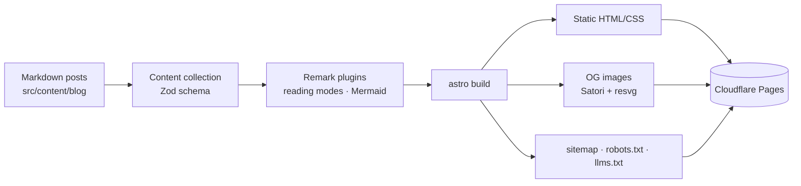

# buikhuongduy.com

Personal site and bilingual blog of **Bui Khuong Duy**: a fast, content-first website built with Astro, rendered fully at build time and served from Cloudflare's edge.

[](https://github.com/001123/buikhuongduy-com/actions/workflows/deploy.yml)


**Live:** [buikhuongduy.com](https://buikhuongduy.com) · **CV:** [cv.buikhuongduy.com](https://cv.buikhuongduy.com)

## Highlights

- **Zero JavaScript by default.** Pages ship as static HTML; small scripts are added only where interaction needs them.
- **Bilingual by design.** Vietnamese at the root, English under `/en/`, with shared English slugs (`/about/` ↔ `/en/about/`), a language switcher, and `hreflang` pairs in the sitemap.
- **Reading modes.** Posts can offer *TL;DR*, *Normal*, and *Advanced* views, authored with `:::tldr` / `:::advanced` directives through a custom remark plugin. The chosen mode persists and is shareable via `?mode=`.
- **Build-time Mermaid.** Diagrams render to inline SVG during the build with the site's theme and font, so readers download no diagram runtime.
- **Generated Open Graph images.** Each post gets its own 1200×630 card, rendered with Satori and resvg.
- **SEO and discoverability.** schema.org JSON-LD (`ProfilePage`, `BlogPosting`, …), canonical URLs, sitemap, `robots.txt`, and an [`llms.txt`](https://buikhuongduy.com/llms.txt) summary for language models.
- **Performance work.** Self-hosted fonts through the Astro Fonts API with metric-matched fallbacks (no layout shift), inlined CSS, and an inlined blurred placeholder for the hero background.
- **Accessible motion.** View transitions and click effects respect `prefers-reduced-motion`.
- **Small touches.** A recruiter quiz, per-post feedback via `mailto:` (no backend needed), and a scroll-to-top control.

## Tech stack

| Area | Choice |
| :-- | :-- |
| Framework | [Astro 7](https://astro.build) (static output, content collections, i18n routing) |
| Styling | [Tailwind CSS 4](https://tailwindcss.com) + `@tailwindcss/typography` |
| Language | TypeScript, checked with `astro check` |
| Content | Markdown + Zod-validated frontmatter |
| Markdown pipeline | `remark-directive`, custom remark plugins, `mermaid-isomorphic` |
| Images | Satori + `@resvg/resvg-js` for OG cards |
| Hosting | Cloudflare Pages, deployed by GitHub Actions + Wrangler |

## Architecture



## Project structure

```text
src/
├── components/        UI components; sections/ holds page-level sections
├── content/blog/      Posts: vi/<slug>.md and en/<slug>.md
├── data/profile.ts    Contact details and social links
├── i18n/ui.ts         Translations and localized section paths
├── layouts/           Base layout and section page layout
├── lib/               Blog helpers, SEO/JSON-LD, OG rendering, remark plugins
├── pages/             Routes, including og/[...id].png.ts, llms.txt.ts, robots.txt.ts
└── styles/global.css  Theme tokens and global styles
```

## Getting started

Requirements: Node.js 22+ and pnpm. The build renders Mermaid with the system Google Chrome, so Chrome must be installed locally.

```sh
pnpm install
pnpm dev        # http://localhost:4321
```

| Command | Action |
| :-- | :-- |
| `pnpm dev` | Start the dev server |
| `pnpm build` | Build the production site to `dist/` |
| `pnpm preview` | Preview the production build locally |
| `pnpm check` | Type-check `.astro` and `.ts` files |

## Writing a post

Create the same file name in each language folder, e.g. `src/content/blog/vi/my-post.md` and `src/content/blog/en/my-post.md`. Shared slugs link the translations automatically.

```md
---
title: My post
description: One-sentence summary used for SEO and the OG image.
pubDate: 2026-11-08
tags: [astro, frontend]
draft: false        # drafts appear in `astro dev` only
---

:::tldr
- The short version for skimmers.
:::

Main content for everyone.

:::advanced
Deeper details for readers who want them.
:::
```

Fenced ` ```mermaid ` blocks are rendered to SVG at build time.

## Deployment

[`.github/workflows/deploy.yml`](.github/workflows/deploy.yml) builds the site with pnpm and deploys `dist/` to Cloudflare Pages:

- push to `main` → production at buikhuongduy.com
- pull request → preview deployment

Required repository secrets: `CLOUDFLARE_API_TOKEN`, `CLOUDFLARE_ACCOUNT_ID`.

## Contact

- Email: [contact@buikhuongduy.com](mailto:contact@buikhuongduy.com)
- GitHub: [@001123](https://github.com/001123)
- LinkedIn: [buikhuongduy](https://www.linkedin.com/in/buikhuongduy)
- X: [@khuongduy1897](https://x.com/khuongduy1897)

---

© Bui Khuong Duy. All rights reserved for site content and personal assets.
