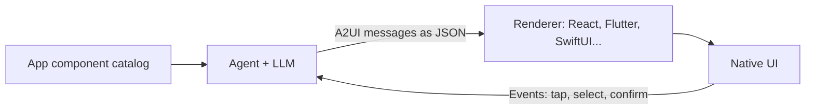

:::tldr
- **A2UI 1.0** launched on **November 11, 2026**: the first stable version of an open protocol (Apache 2.0) that lets AI agents answer with **interactive UI** such as forms, cards, and charts instead of just text.
- The agent only **describes what to show**; each app draws it with **its own components**. The agent never sends executable code, only declarative JSON, and can only use components you have registered.
- Renderers ship for **React, Angular, Lit, Flutter, and SwiftUI** (Jetpack Compose is moving to 1.0 soon), plus Agent SDKs for **Python, TypeScript, and Dart**. It also runs inside **MCP Apps** in Claude and Gemini.
- **Atlassian (Jira), Alation, ByteDance (Lynx), Bloomberg**, and several Google products are already using it.
:::

Most agents today still answer like computers in the terminal era: capable of a lot, but everything comes back as text. Want to compare three products, or edit and approve a detailed plan? You get a wall of text and several rounds of “which ones?”.

A2UI wants to change that. Below are the points I found worth noting, taken from [Google's announcement](https://developers.googleblog.com/a2ui-10-build-delightful-fast-reliable-agentic-experiences/) and the [docs at a2ui.org](https://a2ui.org/).

## How A2UI Works

The core idea: **separate “saying what to show” from “drawing it”**.

1. The app (client) declares a **catalog**: the list of components the agent may use, for example `Card`, `Text`, `Button`, or your own `FlightCard`.
2. The agent reads that catalog and returns **A2UI messages**: a component tree plus data, as declarative JSON.
3. A **renderer** in the app reads the messages and draws them with the app's native components: React on the web, SwiftUI on iOS, Flutter on mobile, and so on.
4. When the user taps a button or picks something, the app sends an **event** back to the agent.



This gives you three clear wins:

- **On brand.** The agent can only place components you have registered, so the UI always follows your design system.
- **Secure.** What travels over the wire is declarative data, **not executable code**. Sensitive values are bound to the UI on the server, so they never have to pass through the model.
- **Build once, run anywhere.** The same agent output renders natively on a phone or a laptop, in your own app or in a third-party AI assistant.

## Example: A Sick Morning

Google gives an easy-to-picture example. You wake up sick, and getting through the morning takes six apps: book a video visit, move your meetings, tell your team, turn on an out-of-office reply, ask your partner to do school pickup, and order soup.

Ask a text-only agent and you get a long numbered list, then round after round of “which ones?”. With A2UI, developers can build an agent that answers with **one screen covering all six tasks**. Changing the plan takes a couple of taps, and **nothing is sent until you confirm**.

Another example: “move dinner with Priya to Friday”. The agent can return one screen that lines up your calendar, open tables from a restaurant app, and prices from a rideshare app, so the time that works for everyone is obvious at a glance.

## What Is New in 1.0

- **A stable protocol.** It adds **bidirectional function calls**: a flight or reservation picker can check availability while the user is choosing. There is also support for **accessibility** and **extensions** for arbitrary metadata.
- **Renderers for major platforms.** [React](https://www.npmjs.com/package/@a2ui/react), [Angular](https://www.npmjs.com/package/@a2ui/angular), and [Lit](https://www.npmjs.com/package/@a2ui/lit) on the web; [Flutter](https://pub.dev/packages/a2ui_flutter) for mobile, web, and desktop; [SwiftUI](https://github.com/a2ui-project/a2ui/tree/main/swift/swiftui) on iOS; [Jetpack Compose](https://developer.android.com/jetpack/androidx/releases/a2ui-compose) on Android (still at 0.9.1, 1.0 coming soon). The web and Flutter renderers work inside [MCP Apps](https://modelcontextprotocol.io/extensions/apps/overview), so A2UI screens can show up in Claude and Gemini.
- **Agent SDKs for TypeScript, Python, and Dart.** The SDKs generate prompts from your catalog, translate messages, **correct errors** when the model writes something invalid, and let you **swap inference formats** to cut latency. Python also gets [Macros](https://a2ui.org/guides/macros/) for programmatic component expansion and data binding.

## A2UI Express: About 3x Fewer Tokens

This is the part I find smartest. JSON is great on the wire, but asking an LLM to write it token by token is costly: repeated keys (`"id"`, `"component"`…), nested braces, hand-made IDs, and more errors on smaller models.

So A2UI splits the two: the model writes in a compact language called **Express**, and the **server compiles** it into standard JSON before sending it to the client. The client always receives the same kind of JSON, no matter how the model produced it.

According to [A2UI's benchmark](https://a2ui.org/concepts/inference-formats/) on 54 samples with `gemini-3.8-flash`, compared with having the model write JSON directly:

| | Direct JSON | Express |
| --- | --- | --- |
| Input tokens (median) | 10,980 | 6,000 (**-45%**) |
| Generated code tokens (no thinking) | 807 | 297 (**-63%**, ~2.7x fewer) |
| Pass@1 accuracy | 98.1% | 98.1% |

In other words: cheaper and faster with no loss in accuracy. A2UI can even skip the LLM for choosing the UI: a **decision model** (Google calls these “system one” models, such as Jev) picks components and values instead of writing text, or server code can build messages from a state machine for workflows that must be deterministic.

:::advanced
### What Express Looks Like

Here is a flight card, written by the model inside an `<a2ui>` tag:

```text
<a2ui>
$/flight/number = "NH 105"
$/flight/gate = "B12"
root = Card(
  Column([
    Text($/flight/number),
    Text($/flight/gate, "caption"),
    Button(Text("Board now"), action=Event("check_in", {flight: $/flight/number}))
  ])
)
</a2ui>
```

- `$/path = value` writes into the **data model**; components read data through `$/path` (data binding).
- Components nest inline, with no hand-written IDs.
- `Event(...)` is an action sent back to the agent when the user taps.

The compiler flattens the tree, assigns IDs (`root`, `root_child`, `root_child_children_0`…), and emits 1.0 wire JSON, shortened here:

```json
{
  "version": "1.0",
  "createSurface": {
    "surfaceId": "main",
    "catalogId": "https://a2ui.org/specification/v1_0/catalogs/basic/catalog.json",
    "components": [
      { "id": "root", "component": "Card", "child": "root_child" },
      { "id": "root_child_children_1", "component": "Text", "text": { "@path": "/flight/gate" }, "variant": "caption" }
    ],
    "dataModel": { "flight": { "number": "NH 105", "gate": "B12" } }
  }
}
```

In 1.0, initial data folds into `createSurface.dataModel`; later changes use `updateComponents` and `updateDataModel`.

### Swapping the Inference Format in the Agent SDK

The SDK uses Express by default; to switch, pass a different factory, with no changes to your catalog or renderers:

```ts
import { A2uiGenerator, CatalogConfig, DirectJsonFormatFactory, ExpressFormatFactory } from "@a2ui/agent";

const generator = new A2uiGenerator([new CatalogConfig(catalog)], undefined, new ExpressFormatFactory());

// Each request can override the format; prompt generation and parsing stay the same.
const processor = generator.createProcessor(rendererCapabilities, new DirectJsonFormatFactory());
const systemPrompt = processor.promptSnippet;
const parts = processor.parseResponse(llmOutput);
```

While streaming, the SDK separates conversational text from UI blocks, “heals” half-written strings so the UI can appear progressively, and validates every message; invalid messages go back to the model for self-correction.
:::

## Who Is Using It

- **Atlassian (Jira).** When a work item is assigned to an AI agent and the agent needs a missing detail or a decision, it asks with an **interactive card right in the work item**, and the team answers in Jira.
- **Alation.** Its AIOS builds feeds with A2UI: metric cards and charts, each able to show the SQL and data behind it. The same feed looks nearly identical in Claude and in Alation's own app.
- **ByteDance (Lynx).** It released an A2UI renderer for Lynx in June 2026, with a [GenUI Playground](https://lynx-stack.dev/genui/#/a2ui) that renders A2UI messages natively, for example as a two-day Kyoto trip planner. Lynx supports 0.9 today and is moving to 1.0.
- **Gemini Notebook.** Ask for a slide deck and it replies with a card asking for the deck style and topics, then a review card with format, focus, and visual style you can edit before it generates.
- **Gemini Enterprise.** Organizations can [register their own agents](https://docs.cloud.google.com/gemini/enterprise/docs/a2ui-agents/register-and-manage-an-a2ui-agent) that respond with A2UI; it supports 0.9.1 today and is upgrading to 1.0.

## A2UI and MCP Apps

The two complement each other rather than compete. MCP Apps is how an AI assistant (Claude, Gemini) embeds third-party UI; A2UI is how you describe that UI so it renders natively and safely. Alation already uses both to bring its feeds into Claude. See the [A2UI in MCP Apps guide](https://a2ui.org/guides/a2ui-in-mcp-apps/) for details.

## Where to Start

- Try it in the [A2UI Playground by CopilotKit](https://go.copilotkit.ai/a2ui-playground), nothing to install.
- Follow the [quickstart](https://a2ui.org/quickstart/) (about 5 minutes), or add the skill to your coding agent: `npx skills add a2ui-project/a2ui`.
- On 0.9? Read the [evolution guide](https://github.com/a2ui-project/a2ui/blob/main/specification/v1_0/docs/evolution_guide.md) for every change.
- Browse industry demos: [real estate](https://homeward-genui.web.app/), [investing](https://finance-a2ui-v1.web.app/), [medical records](https://genui-clinic.solid.software/), [smart home](https://a2ui-vgv-smart-home.web.app/), and more.
- Source and issues: [github.com/a2ui-project/a2ui](https://github.com/a2ui-project/a2ui).

## Wrapping Up

As a front-end developer, I find A2UI worth watching because it hands back the part of the job we are good at: **building solid components and a tight design system**. The agent decides what to show; how it looks is still your components, running natively and on brand.

What I like most is the pragmatic design: the model writes a compact language, the server compiles and validates it, and the client only receives declarative data. No foreign code running in your app, no sensitive data exposed to the model, and no rebuilding the UI for every platform.

If you are reading up on bringing agents into products, see also [What Is AI-Native](/en/blog/what-is-ai-native/) and [the AI agent infrastructure stack](/en/blog/agent-infrastructure-stack/). A2UI is the piece at the very top: where the agent meets the user.
