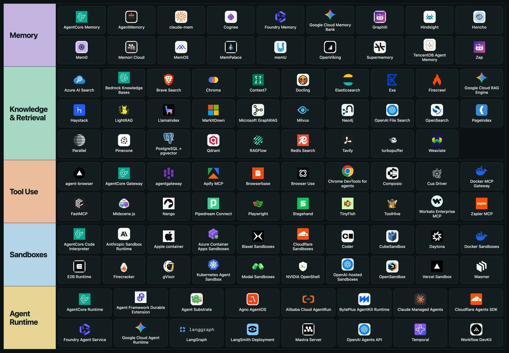
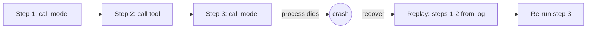

:::tldr
- A real AI agent needs more than a model: it needs **memory**, **knowledge**, **tools**, a **safe place to run code**, and a **runtime** to keep it running.
- The ecosystem splits cleanly into 5 layers: **Memory**, **Knowledge & Retrieval**, **Tool Use**, **Sandboxes**, **Agent Runtime**.
- The big cloud providers (AWS, Google, Microsoft, OpenAI, Cloudflare…) now show up in almost every layer.
:::

The image below is a snapshot of today's AI agent infrastructure tools, grouped by layer.

## 1. Memory: what the agent remembers

Models don't remember anything between sessions. This layer stores facts, user preferences, and past context so the agent can use them next time.

Notable: **Mem0**, **Zep**, **Graphiti**, **Supermemory**, **Cognee**, **memU**, plus the cloud versions: **AgentCore Memory** (AWS), **Google Cloud Memory Bank**, **Foundry Memory** (Microsoft).

## 2. Knowledge & Retrieval: what the agent knows

The RAG layer: find the right documents and put them into context. Three groups:

- **Vector databases / search engines**: Pinecone, Qdrant, Milvus, Weaviate, Chroma, turbopuffer, PostgreSQL + pgvector, Elasticsearch, OpenSearch, Redis Search.
- **Frameworks and graph RAG**: LlamaIndex, Haystack, LightRAG, Microsoft GraphRAG, RAGFlow, Neo4j.
- **Web search and document parsing**: Exa, Tavily, Brave Search, Firecrawl, Parallel, Context7, Docling, MarkItDown.

:::advanced
### How is Memory different from Retrieval?

Both "put past information into context", so they're easy to lump together. The difference is **who writes the data** and **how it changes**:

| | Memory | Knowledge & Retrieval |
| --- | --- | --- |
| Data source | Written by the agent itself while it works | Existing documents, ingested ahead of time |
| Scope | Usually per user or per session | Shared across all users |
| Read / write | Constant reads and writes | Mostly read-only |
| Hard problem | Merging, updating, forgetting stale facts | Chunking, ranking, index freshness |

The hardest problem in memory is **facts that conflict over time**: yesterday the user said "I use Postgres", today "we moved to MySQL". Store both in a vector store and search by similarity, and the agent may pull the old one. That's why tools like Graphiti (the engine behind Zep) store memory as a time-aware knowledge graph that marks a fact as no longer valid when a newer one replaces it, instead of just piling them up.

In practice, many systems start with a single vector database for both, separated by namespace or metadata, and only split out a dedicated memory service once the update logic gets complicated.
:::

## 3. Tool Use: what the agent can do

Agents need to call APIs, drive browsers, and connect to other apps. **MCP** has become the de facto standard in this layer.

- **Browsers**: Playwright, Browser Use, Browserbase, Stagehand, Chrome DevTools for agents, agent-browser, Midscene.js.
- **MCP and integrations**: FastMCP, Composio, Zapier MCP, Pipedream Connect, Nango, Apify MCP.
- **Tool gateways**: AgentCore Gateway, Docker MCP Gateway, agentgateway, ToolHive.

## 4. Sandboxes: where the agent runs code

Agent-generated code shouldn't run directly on a real machine. Sandboxes isolate it in a container or micro-VM.

- **Sandbox services**: E2B, Daytona, Modal, Vercel Sandbox, Cloudflare Sandboxes, Blaxel, OpenAI-hosted Sandboxes, Anthropic Sandbox Runtime.
- **Underlying isolation tech**: Firecracker, gVisor, Kubernetes Agent Sandbox, Apple container, Wasmer.

:::advanced
### Container, gVisor, or micro-VM?

Sandbox services differ mostly in their **isolation boundary**: what layer separates the agent's code from the host.

| Isolation | Boundary | Trade-off |
| --- | --- | --- |
| Plain container (Docker) | Namespaces and cgroups, **shares the host kernel** | Fast and light; one kernel bug is enough to escape |
| gVisor | A user-space "kernel" that intercepts and handles system calls | Safer than a container; slower for I/O-heavy work, some syscalls unsupported |
| Micro-VM (Firecracker) | Each sandbox gets **its own kernel**, isolated by hardware virtualization (KVM) | Strongest boundary; more overhead, needs a host with virtualization |
| WebAssembly (Wasmer) | A Wasm VM that can only touch what it's granted | Very light; can't run arbitrary Linux programs |

Treat model-generated code like **untrusted code from a stranger**. That's why many agent sandbox services pick micro-VMs (E2B uses Firecracker) over plain containers.

Beyond the isolation layer, a few things the sandbox won't handle for you:

- **Outbound network**: deny by default, allow only the domains you need, so code can't ship data elsewhere.
- **Secrets**: don't put real API keys inside the sandbox; have an outside proxy attach credentials to requests.
- **Resource and time limits**: CPU, RAM, max run time, so an infinite loop doesn't burn money.
:::

## 5. Agent Runtime: where the agent lives

The layer that runs agents over time: keeps state, survives failures, resumes after interruptions, and scales with load.

- **Cloud runtimes**: AgentCore Runtime, Google Cloud Agent Runtime, Foundry Agent Service, Claude Managed Agents, OpenAI Agents API, Cloudflare Agents SDK.
- **Frameworks and durable execution**: LangGraph, Mastra, Agno AgentOS, Temporal, Workflow DevKit.

:::advanced
### What does durable execution actually solve?

An agent task can run for tens of minutes with hundreds of model and tool calls. If the process dies at step 80 (a new deploy, a reclaimed machine, a transient API error), restarting from scratch wastes tokens and may repeat actions that already happened.

Durable execution handles this by **recording the result of every step** in durable storage. On recovery, the runtime replays the history: finished steps return their saved results immediately, without calling the model or tool again, then execution continues from the unfinished step.

This model puts two requirements on your code:

- **Orchestration logic must be deterministic.** Anything non-deterministic (model calls, the current time, random numbers) has to live inside a logged step, or the replay will take a different branch.
- **Side-effecting tools should be idempotent.** If the process dies right after a tool runs but before its result is recorded, that step runs again. Sending email, charging money, or creating orders should carry an idempotency key so the second run doesn't double the effect.

This is also the layer for **human approval** points (human-in-the-loop): the workflow pauses without holding resources and resumes when someone approves, even days later.
:::

## Wrap-up

If you're just starting, you don't need all 5 layers. A simple agent usually needs only **Tool Use** (via MCP) and a bit of **Retrieval**. Once your agent starts running code, running for a long time, or serving many users, that's when you add **Sandboxes**, **Memory**, and a **Runtime**.
