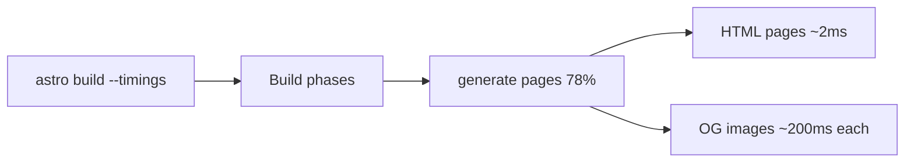

:::tldr
- The big news this month is **Astro 7.4**: the `astro build --timings` flag shows where your build spends its time.
- Image services can now be split into **build** and **runtime**, a good fit for sites that mix prerendered and on-demand pages.
- Two experimental features: **parallel prerendering** across threads and a **custom redirect page** for static builds.
- I ran `--timings` on this site: almost all render time goes into generating OG images.
:::

Every month, the Astro team publishes a [What's new in Astro](https://astro.build/blog/whats-new-october-2026/) roundup of releases, notable sites, articles and community integrations.
The October edition is long, so I picked out the parts that matter for day-to-day site work, plus a few experiments on this very site (why it runs on Astro is in [this post](/en/blog/why-i-chose-astro/)).

## Astro 7.4: where does the build time go?

My favorite change is the `--timings` flag:

```bash
astro build --timings
```

When the build finishes, Astro prints a summary: build phases, Vite plugins, slowest files to bundle, Markdown, syntax highlighting, images, integrations and the slowest pages.
Before, finding out why a build was slow meant guessing or adding your own `console.time` calls.

I ran it on this site (43 pages, static output). Trimmed result:

```text
total 5.22s · 43 pages · output "static"

Build phases
  resolve config                       451ms   8.6%
  setup                                241ms   4.6%
  prerender bundle                     336ms   6.4%
  generate pages                       4.10s  78.5%

Slowest pages (median 2ms · p95 227ms)
  /og/en/what-is-ai-native.png         1.64s   /og/[...id].png
  /og/en/why-i-built-kd-code.png       260ms   /og/[...id].png
  /og/vi/hello.png                     227ms   /og/[...id].png
```

HTML pages take a median of **2 ms**. The heavy part is the `/og/[...id].png` endpoint, where I use satori + resvg to draw a share image for each post.
The first image takes 1.64 s because it loads the fonts and base image once for the whole build; the rest take about 200 ms each.
No profiler needed: one flag shows exactly what to optimize if the number of posts grows.



:::advanced
### Reading the report top-down

The [Astro 7.4 post](https://astro.build/blog/astro-740/) has a good example: a `<Comment>` component fetches each commenter's profile itself, so every page waits on two network round trips in a row.
The report shows `generate pages` taking 81%, nearly all of it in `component render` rather than Astro's own pipeline, and only pages using the post layout are slow.
Batching the requests with `Promise.all()` in the parent component cut page generation from 2.10 s to 1.13 s.

The general approach: find the phase that dominates, check whether that time is in your code or the framework's, then look at the slowest pages to see which route to fix.
The Astro team recommends running `--timings` before turning on parallel prerendering or incremental builds, so you know which part of the build to target.
:::

## Separate build and runtime image services

Prerendered and on-demand pages need different things from images.
At build time you have plenty of time and full Node.js, so Sharp works well. On-demand pages often run at the edge, where Sharp can't run, so an image CDN fits better.

Since 7.4, `image.service` accepts two services:

```js
// astro.config.mjs
export default defineConfig({
  image: {
    service: {
      build: { entrypoint: "astro/assets/services/sharp" },
      runtime: { entrypoint: "my-image-cdn-service" },
    },
  },
});
```

`build` handles images on prerendered pages (and in dev); `runtime` handles on-demand pages and the image endpoint in production.
This site is fully static, so I don't need it yet, but if I ever add SSR routes on Cloudflare, this is the setup I'd use.
Note: upgrade `@astrojs/cloudflare` and `@astrojs/markdoc` together with `astro`, since their new versions require `astro@^7.4.0`.

## Small changes worth knowing

- **`notFound()` for custom entrypoints**: if you compose `pages()` from `astro/hono` or `astro/fetch` without `astro()`, unmatched requests used to return an empty 404. Add `notFound()` before `pages()` to get your `404.astro` page.
- **Font configuration warnings**: font providers can report which weights, styles and subsets a family actually has, and Astro warns when your config asks for something the provider can't serve. This site uses Be Vietnam Pro and Fraunces from Fontsource with the `vietnamese` subset, and the build shows no warnings.
- **Minimum Node.js is now 22.22.0**: check the Node version on your CI before upgrading.

## Two experimental features

### Parallel prerendering

Astro already renders static pages concurrently, but on a single thread. The `experimental.parallelPrerender` flag spreads rendering across worker threads:

```js
export default defineConfig({
  experimental: {
    parallelPrerender: { workers: 4 },
  },
});
```

By default, Astro uses all CPU cores but one. Each worker adds memory, so if your build runs out of memory or doesn't get faster, lower `workers`.
The flag has no effect when the adapter does its own prerendering, which today means only `@astrojs/cloudflare`.

For this site, the `--timings` report says the heavy work is OG images, which is CPU-bound, so parallel prerendering could help here. But the whole build takes about 5 seconds, which isn't worth an experimental flag yet.

### Custom redirect page

A static site has no server to send a `Location` header, so for every redirect Astro generates a small HTML page with `<meta http-equiv="refresh">`. Its content used to be fixed and couldn't be translated.
Turn on `experimental.redirectPage` and create `src/pages/3xx.astro` to design that page yourself, with `from`, `to`, `status` and `delay` as props.

:::advanced
### Why this site doesn't need `3xx.astro` yet

This site runs on Cloudflare Pages and declares redirects in `public/_redirects`, for example when old Vietnamese slugs were renamed to English:

```text
/gioi-thieu/ /about/ 301
```

Cloudflare sends a real 301 at the hosting layer, so browsers and Google never see a meta refresh page.
`3xx.astro` is useful when your host has no server-side redirects, or when you use `redirects` in the config, `Astro.redirect()` in prerendered pages or i18n redirects and want those pages to match your site's design and language.
Keep in mind that in a static build, the meta refresh tag is the redirect, so your page must render one that points to `to`.
:::

## From the community

A few Reading List picks I found worth your time:

- **Owner** [rebuilt their web infrastructure with Astro](https://building.owner.com/project-speed) for restaurants: menu pages got 83% faster and per-restaurant revenue rose more than 4%. A rare case with clear numbers on what speed is worth.
- **Miguel Fernandez** [migrated an ~800-page multi-language site from Webflow to Astro in a single day](https://www.useomnia.com/blog/webflow-to-astro-migration), with help from agents.
- [Make missing translations fail your Astro build](https://dev.to/mabb0512/make-missing-translations-fail-your-astro-build-4m49): the same idea as this site letting its Zod schema fail the build on bad frontmatter.
- [Chasing 100 Lighthouse scores on my Astro blog](https://tomekdev.com/posts/chasing-100-lighthouse-scores-on-my-astro-blog), a nice companion to [my post on Lighthouse scores](/en/blog/perfect-lighthouse-score/).

There's also a long list of new integrations for SEO, `llms.txt`, Git-based CMSes and i18n. One that stands out is [`@cloudflare/polystella-astro`](https://github.com/cloudflare/polystella), which translates Markdown content with AI at build time and caches it in R2.

## Conclusion

For me, `--timings` is the most useful change this month: a single run showed that this site's build time goes into OG images, not HTML or CSS.
If you use Astro, run that command on your project before optimizing anything.
