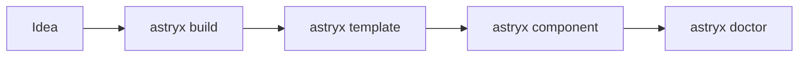

:::tldr
- **Astryx** ([astryx.atmeta.com](https://astryx.atmeta.com/)) is Meta's open source design system, MIT licensed, built on **React 19+** and **StyleX**. It grew inside Meta for 8 years and powers more than **13,000 internal apps**.
- One package set: **170+ accessible components** (version 0.7.16 reports 174), **7 ready-made themes**, dark mode, about **60 page templates** and a **CLI**.
- Easy to adopt: import pre-built CSS and typed components, **no build plugin required**. Override with `className` using Tailwind, CSS Modules or plain CSS.
- The big difference: **the CLI is documentation for agents**. `astryx init` writes rules into `AGENTS.md`/`CLAUDE.md`, `astryx build "<idea>"` picks a matching template, and `astryx component <Name>` prints props and best practices.
- Still in **beta** (0.7.x). In my test the bundle was heavy: a page with a single `Button` came to ~162 KB of gzipped JS plus ~48 KB of CSS.
:::

If you have written React for a while, you have rebuilt the date picker, the table and the form in one project after another. Meta hit the same problem across thousands of internal tools, so it built a shared design system. Eight years later, it rebuilt that system on an open source stack and released it as **Astryx**.

Astryx caught my eye because it is not just "another component library". From the start, the team designed the API, docs and CLI so that **people and AI agents build the same way, from the same reference**. Below is what I gathered from the [homepage](https://astryx.atmeta.com/), the [docs](https://astryx.atmeta.com/docs/getting-started), the [GitHub repo](https://github.com/meta/astryx) and the post [How Astryx works](https://astryx.atmeta.com/blog/how-astryx-works), plus one hands-on install.

## Why Meta Rebuilt Its Design System

According to [How Astryx works](https://astryx.atmeta.com/blog/how-astryx-works), Meta's culture encourages building your own tool when one does not exist, so teams kept rebuilding the same components. The internal design system was created to solve those problems once, and it became the largest design system in the company, with roughly half of all changes contributed by its own users.

Then AI changed the math. Coding assistants work far better with "in-distribution" tech: TypeScript, popular open source libraries and standard browser APIs. The internal system was none of those. So Meta rebuilt it on an open stack, kept the breadth and conventions it had accumulated, and made it AI-fluent by design. The team is also candid that AI is what made a full rebuild and open-sourcing feasible for a team its size.

## What Is in Astryx

| Package | What it does |
| --- | --- |
| `@astryxdesign/core` | Components, theme system, hooks and utilities |
| `@astryxdesign/cli` | Component docs, templates, scaffolding, themes, upgrade codemods |
| `@astryxdesign/theme-*` | 7 themes: neutral, butter, chocolate, matcha, stone, gothic, y2k |
| `@astryxdesign/richtext` | A rich text field built on Lexical that reads and writes Markdown |
| `@astryxdesign/build` | Build plugins if you want to build from the StyleX source |

Components range from basics (Button, Badge, Avatar, VStack) to the ones that are hard to get right, like a Table with row and column virtualization, PowerSearch, Lightbox, BottomSheet and DateInput with multiple calendars. Since [0.5.0](https://astryx.atmeta.com/blog/astryx-v0-5-0), Astryx supports around 30 locales and RTL.

Four principles the team stresses:

- **Open internals**: the building blocks of each component are exported directly. When you need to go deeper, `swizzle` ejects a component's full source into your project for you to own.
- **No styling lock-in**: Astryx authors its styles in StyleX, but consumers don't have to care. Override with `className` using Tailwind, CSS Modules or plain CSS.
- **Customize without wrapping**: a theme is a set of CSS custom properties and per-component overrides generated from a config. Designers own the theme; developers never fork or wrap component source.
- **One system for people and AI**: the API, conventions and CLI are designed together, and measured by watching how LLMs actually use the library.

## Installation and a First Component

Astryx requires React 19 or later:

```bash
npm install @astryxdesign/core @stylexjs/stylex @astryxdesign/theme-neutral @astryxdesign/cli
npx @astryxdesign/cli init
npx @astryxdesign/cli theme add neutral
```

`theme add` generates an `astryx-themes.js` module (it imports the theme and its fonts). Then add the base CSS and wrap your app in `Theme`:

```css
/* globals.css */
@import "@astryxdesign/core/reset.css";
@import "@astryxdesign/core/astryx.css";
```

```tsx
import { Theme } from "@astryxdesign/core/theme";
import { themes, defaultThemeSlug } from "./astryx-themes";

<Theme theme={themes[defaultThemeSlug]}>
  <App />
</Theme>;
```

Each component is imported from its own entry point, so the bundle only picks up what you use:

```tsx
import { Button } from "@astryxdesign/core/Button";
import { VStack } from "@astryxdesign/core/VStack";

export default function Page() {
  return (
    <VStack gap={2}>
      <Button label="Hello Astryx" onClick={() => alert("Hi!")} />
    </VStack>
  );
}
```

Note that `Button` takes a `label` prop instead of children. The label doubles as the accessible name, so it is hard to ship an unlabeled button.

:::advanced
### StyleX overrides and cascade layer order

If your project already uses StyleX, pass styles through the `xstyle` prop:

```tsx
import * as stylex from "@stylexjs/stylex";

const overrides = stylex.create({
  save: { alignSelf: "flex-end", marginTop: 16 },
});

<Button label="Save" xstyle={overrides.save} />;
```

Astryx's CSS lives in cascade layers: the reset in `@layer reset`, components in `@layer astryx-base`. Unlayered styles, and styles in later layers, always beat `astryx-base` **regardless of specificity**. If your project already has global CSS, a legacy reset or Tailwind, declare the layer order explicitly and assign each stylesheet to a layer on purpose, or you will wonder why component styles suddenly get overridden. Details: `npx @astryxdesign/cli docs migration/migration-setup`.

There is also a build-from-source path with TypeScript + StyleX: your bundler keeps only the styles for components you use, which Meta says is about a third of the full stylesheet in its reference app.
:::

## The CLI: Docs for Agents, in the Terminal

This is the part I think is most worth learning from. Instead of letting an agent guess props from its training data, Astryx serves docs **for the exact version installed** in the terminal:

```bash
npx @astryxdesign/cli search button        # search components, hooks, docs, templates
npx @astryxdesign/cli component Button     # props, anatomy, best practices, accessibility
npx @astryxdesign/cli build "settings page with a table of team members"
npx @astryxdesign/cli template table-page --type page src/TablePage.tsx
npx @astryxdesign/cli doctor --built .     # check the project before handing it off
```

`astryx init` asks no questions (safe for agents and CI) and writes a block of rules into `AGENTS.md`, into `CLAUDE.md` when the project has one, and a one-line import into `GEMINI.md`. That block teaches the agent a three-step workflow:



1. `build "<idea>"` picks the closest page template, suggests two alternatives and lists the blocks the page still lacks.
2. `template <name> <path>` scaffolds the template into the project; keep its frame and spacing, replace the content.
3. `component <Name>` reads the props before using a component.

It comes with fairly strict rules: no raw `<div>`, no `style={{}}`, no hand-written hex or px values (use tokens), and dense data goes in Table/List rather than Cards. The team explains why in [AI is a copycat so we gave it good examples to copy](https://astryx.atmeta.com/blog/astryx-cli-build-command): agents imitate, so give them designer-made templates to imitate.

The homepage also mentions MCP, so agents can reach the same features without going through a terminal.

## What I Found Trying It

I installed Astryx into an empty Vite + React 19 project (tested on November 15, 2026, `@astryxdesign/core` and `@astryxdesign/cli` 0.7.16, neutral theme) and followed the same workflow the CLI teaches agents.

**What works well:**

- `init` runs without prompts and writes an `AGENTS.md` of about 2.7 KB: short, to the point, with the version and component count (174) on the first line. Much leaner than dumping the whole doc set into an `llms.txt`.
- `build "settings page with a table of team members"` returned the `settings` template, with `table-page` and `settings-sidebar` as alternatives, and even flagged a missing dependency (`@heroicons/react`). Exactly what I needed.
- `component Button` prints the anatomy, Do/Don't best practices and concrete contrast requirements for each state. That is the kind of information agents skip most often.
- The `table-page` template (almost 1,000 lines: a table with search, per-column filters, sorting and live totals) built with Vite right after scaffolding, no plugin or extra config. `doctor` reported 0 failures and 2 warnings about the Figtree font loading from an external service.

**What to weigh:**

| Page built with Vite | JS (gzip) | CSS (gzip) |
| --- | --- | --- |
| A single `Button` in a `VStack` | ~162 KB | ~48 KB |
| `table-page` template | ~464 KB across all chunks (main chunk ~332 KB) | ~48 KB |

That includes React 19 (around 60 KB gzipped). For one button, that is a lot: `Theme` and the shared internals pull in a good amount of code. The pre-built CSS is always ~292 KB (~45 KB gzipped), whether you use few components or many. The StyleX source build is supposed to trim the CSS, but I have not tried it.

A few smaller things:

- Recent npm versions block the `postinstall` script of `@astryxdesign/core` until you approve it. The script only prints a reminder to run `astryx init`, so skipping it is fine.
- Don't run `npx astryx` before the CLI is installed: the unscoped name resolves to an unrelated npm package. Always use `npx @astryxdesign/cli`.
- The component count differs by source: the README says 150+, the homepage 180+, the CLI 174.

My take: for **internal tools, dashboards and admin apps**, the kind of software Meta has used it for over 8 years, Astryx is well worth trying, especially if agents write most of your UI. The templates and CLI give agents far more structured results than starting from a blank file. For public pages that need to load fast on slow networks, the current bundle size is a real drawback. I will wait for 1.0 and try the source build before considering it for that kind of project.

## Wrapping Up

What makes Astryx interesting is not the component count (plenty of libraries have that) but that it treats **AI agents as first-class users** of a design system. Version-matched docs live in the CLI, rules live in `AGENTS.md`, designers build templates for agents to imitate, and `doctor` checks the result before hand-off. That is a good pattern for any team maintaining its own design system.

Two caveats: the library is in **beta**, so APIs can still change across 0.x releases, and the best way to judge it is to build a real page in the [Playground](https://astryx.atmeta.com/playground) or with one of the [example apps](https://github.com/meta/astryx) (Next.js, Next.js + StyleX, Next.js + Tailwind, Vite + Tailwind).

For the styling layer underneath Astryx, see the [StyleX](/en/blog/stylex/) post. If you care about helping agents build better UI, see also [Vercel's UI SDK](/en/blog/vercel-ui-sdk/) (giving agents behaviors instead of components) and [A2UI 1.0](/en/blog/a2ui-1-0/) (agents answering with UI).
