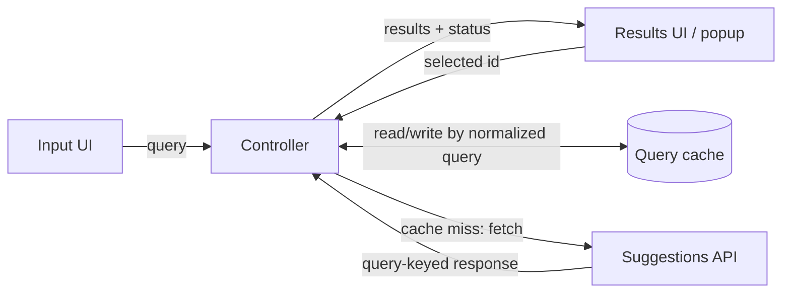
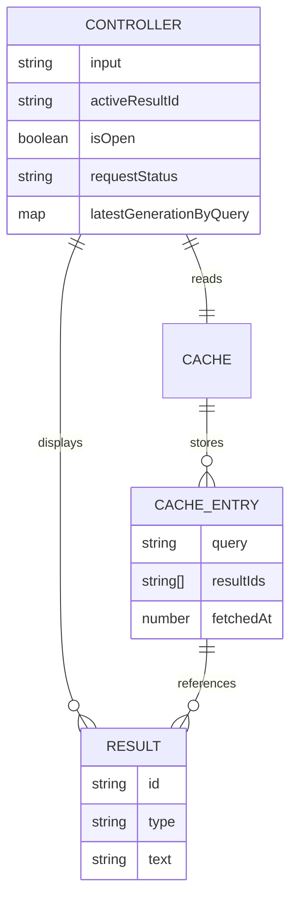
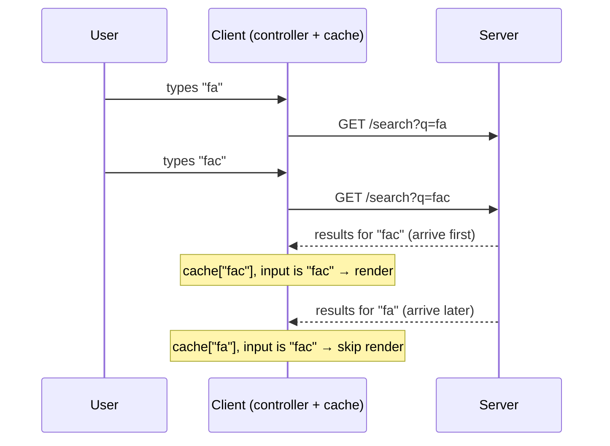
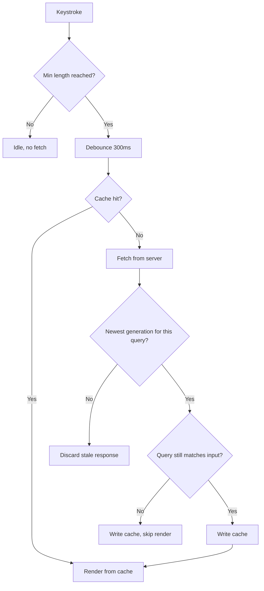
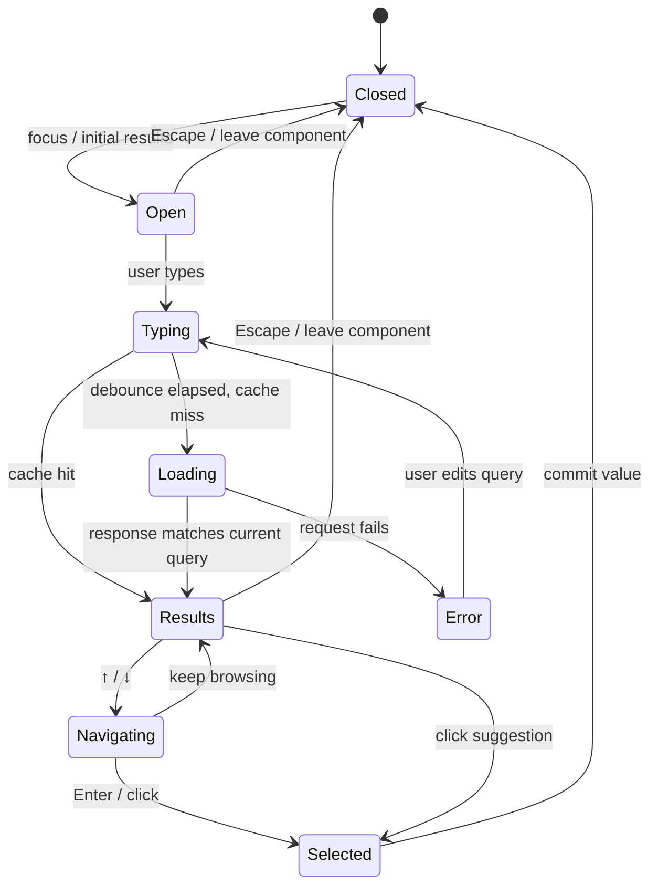

:::tldr
- Autocomplete is a small system design question that touches everything: input handling, async fetching, caching, race conditions, keyboard and accessibility.
- Put a **controller** in the middle: the input, the results popup, the cache and the server only talk to the controller. Race conditions and stale state get handled in one place.
- **Never trust response order.** Tie results to the query that produced them, and only render when that query still matches the current input.
- Pick the cache shape by **page lifetime**: a `query → results` map for short-lived pages, a normalized `query → ids` + `id → entity` cache for long-lived SPAs.
- Debounce the API call (not the text the user sees) by ~300ms, and use the WAI-ARIA **combobox** pattern instead of inventing your own roles.
:::

This follows my [9-step front-end system design checklist](/en/blog/frontend-system-design-cheatsheet/), this time applied to a concrete and very common question: designing an autocomplete component. These notes are based on [GreatFrontEnd's Autocomplete article](https://www.greatfrontend.com/questions/system-design/autocomplete), rewritten the way I understand it, with code examples added.

## The question

Design an autocomplete component: the user types into an input, a popup shows a list of suggestions, and the user picks one. Familiar examples are Google's search box (mostly text suggestions) and Facebook's (richer results: people, pages, groups, with images).

A backend API that returns results for a query already exists. Requirements:

- The component is **generic** enough for different websites to use.
- The input and the results list are **customizable**.

## 1. Clarify requirements

Questions worth asking before drawing anything:

| Question | Reasonable answer for v1 |
| --- | --- |
| What kinds of results? | Text, image, or image with text. You can't predict them all, so consumers must be able to render their own. |
| Which devices? | All of them: laptops, tablets, phones. |
| Fuzzy search? | Not in v1, revisit if time allows. |

The first answer matters most: since you don't know what results look like, the component **must not** assume a fixed row layout.

## 2. Architecture

Four pieces, one "brain" in the middle:



- **Input UI**: renders the current text and reports edits and focus changes to the controller.
- **Results UI (popup)**: renders the result set the controller hands it and reports the **id** of the selected result. The popup doesn't update the input itself; it tells the controller, and the controller decides.
- **Cache**: keeps results of earlier queries, keyed by query. It stores; it doesn't decide which query the popup shows.
- **Controller**: like the Controller in MVC. Takes input, checks the cache, fetches on a miss, writes responses back to the cache and pushes results to the popup.

The payoff of routing everything through the controller: when you hit a bug like "old results overwrote new ones", you know exactly where to fix it.

## 3. Data model

Split state by lifetime:



- **The controller** owns transient UI state: the current text, the highlighted result (`activeResultId`), whether the popup is open, the request status and the latest request "generation" per query. Plus the props/options passed in.
- **The cache** owns longer-lived query history: initial results (before any typing) and fetched results, keyed by normalized query.

`requestStatus` should distinguish `idle`, `loading`, `success`, `error` and `offline`. Note that **"no results" isn't a separate status**: it's `success` with an empty list.

Two things that **don't** belong in state as the source of truth: server-highlighted HTML as the canonical label (fine for display, but the canonical label should be plain text), and the list of mounted DOM nodes as the result order (order comes from data, not from the DOM).

## 4. API

### Component API

**Basic options**, which define functionality:

- **Number of results** to show.
- **Request adapter**: a function that takes the query, a result limit, an optional cursor and an `AbortSignal`, and returns results with stable ids. URL building, auth and response parsing all live outside the component, so it knows nothing about any specific backend.
- **Event hooks**: `input`, `focus`, `blur`, `change`, `select`, handy for logging user behavior.
- **Custom rendering**, from easiest to most flexible:
  1. **Theme object** (`{ textSize: '12px', textColor: 'red' }`): easiest, least flexible.
  2. **Class names**: consumers write their own CSS for each part.
  3. **Render function** (inversion of control, like React render props): the component hands over data, the consumer decides how to render. Most flexible, most work.

**Advanced options**, which affect UX and performance:

- **Minimum query length**: very short queries ("a") give meaningless results; maybe only search after 2–3 characters.
- **Debounce duration**: e.g. 300ms, only call the API after the user stops typing for 300ms.
- **API timeout**: how long to wait before treating the request as failed.
- **Cache**: initial results, data source (network only, network and cache, cache only), and cache lifetime.

### Server contract

The request adapter should return a small, consistent shape:

```ts
type Suggestion = {
  id: string;     // stable; used as key and for aria-activedescendant
  text: string;   // visible label
  value?: string; // value committed on selection; defaults to text
  type?: string;  // lets the renderer pick a layout (person, page, text...)
};

type SuggestionPage<T extends Suggestion = Suggestion> = {
  items: T[];
  nextCursor?: string;
};

type FetchSuggestions<T extends Suggestion = Suggestion> = (args: {
  query: string;
  limit: number;
  cursor?: string;
  signal: AbortSignal;
}) => Promise<SuggestionPage<T>>;
```

Decisions worth calling out in an interview:

- **Stable ids, not array indexes.** Indexes shift whenever the list changes, breaking render keys and `aria-activedescendant`.
- **The server returns data, not pre-rendered HTML.** Otherwise "customizable UI" means nothing.
- **Cursors over page numbers**, because a ranked list can change between calls.
- Consumers extend `Suggestion` with their own fields (image, subtitle…) through the generic.

## 5. Deep dive: network

Autocomplete fires a request on almost every keystroke, so the network layer has to cope with out-of-order responses, transient failures and going offline.

### Race conditions

The user types `fa`, then `fac`. Two requests are in flight, and nothing guarantees the first one sent returns first:



If you just render the latest response *received*, the user sees suggestions for `fa` while the input says `fac`.

The fix has two layers:

1. **Key by query**: store responses in a map keyed by the query that was sent, and only display results for the query that **matches the input**. The `fa` response still goes into the cache (useful if the user backspaces), it just isn't rendered.
2. **A generation per query**: the query key can't tell apart two requests for **the same query** (a retry, or typing `fa` → `fac` → `fa`). Give each request an increasing number, and only let the newest generation for a query overwrite its cache entry.

Cancelling stale requests with `AbortController` is an **optimization** (saves bandwidth and CPU), not the correctness mechanism: the abort can arrive too late and the response still lands. Keep both checks whether or not you abort.

```ts
class SuggestionController {
  private generation = 0;
  private latestGen = new Map<string, number>();
  private cache = new Map<string, { items: Suggestion[]; fetchedAt: number }>();
  private inflight?: AbortController;

  constructor(
    private fetchSuggestions: FetchSuggestions,
    private render: (items: Suggestion[]) => void,
    private getInput: () => string,
  ) {}

  async load(rawQuery: string) {
    const key = normalize(rawQuery);
    const cached = this.cache.get(key);
    if (cached) return this.render(cached.items);

    const gen = ++this.generation;
    this.latestGen.set(key, gen);

    this.inflight?.abort(); // an optimization, not the correctness check
    this.inflight = new AbortController();

    const { items } = await this.fetchSuggestions({
      query: rawQuery,
      limit: 10,
      signal: this.inflight.signal,
    });

    // Layer 1: only the newest response for this query may write the cache.
    if (this.latestGen.get(key) !== gen) return;
    this.cache.set(key, { items, fetchedAt: Date.now() });

    // Layer 2: only render if the query still matches the current input.
    if (normalize(this.getInput()) === key) this.render(items);
  }
}

const normalize = (q: string) => q.trim().toLowerCase();
```

(`AbortError` handling and loading state are left out for brevity.)

Caching keystroke history helps with typos: `foot` → `footr` → delete `r` → `foot`, and `foot` results show instantly. But with debounce, the `foot` request may never have been sent, so this mostly helps users who type slower than the debounce window.

### Failures and retries

Requests fail on flaky connections. Retrying automatically is reasonable, but use **exponential backoff** (with jitter) so you don't pile more load onto a struggling server. A suggestions GET is idempotent, so retrying is safe.

### Offline

When the device is fully offline there's not much to do, but you can:

- Read from the cache only (useless if it's empty).
- Fire no requests, saving CPU and battery.
- Show clearly in the component that there's no connection.

## 6. Deep dive: cache

A cache trades memory for speed: queries you've seen before show up instantly with no round trip.

### Should you use a trie?

A trie indexes strings by prefix: find `fac` by walking `f` → `a` → `c`, then collect words below that node. It helps when **the browser already has the whole dataset**, small and stable (say, a list of countries). For a few hundred items, `array.filter` is usually enough.

But **don't filter the results for `fa` to answer `fac`**. The server only returned the top N for `fa`; correct matches for `fac` may not be in that set. A trie built from cached responses has the same gap. For server-backed data, cache by the full query.

### Three cache shapes

**1. A `query → results` map.** Simplest, O(1) lookup:

```ts
const cache = {
  fa: [{ id: "fb", text: "Facebook" }, { id: "face", text: "face" }],
  fac: [{ id: "fb", text: "Facebook" }, { id: "face", text: "face" }, { id: "fbm", text: "facebook messenger" }],
};
```

Downside: lots of duplication. `Facebook` sits under `fa`, `fac`, `face`… Without debounce it gets worse.

**2. A flat list, filtered on the client.** No duplication, but filtering runs on the main thread (slow for big data and weak devices) and loses the server's ranking. Usually not worth it.

**3. A normalized cache** (same idea as [normalizr](https://github.com/paularmstrong/normalizr)): store each entity once by id, and each query keeps only a list of ids:

```ts
const entities = {
  fb: { id: "fb", type: "organization", text: "Facebook" },
  face: { id: "face", type: "text", text: "face" },
  fbm: { id: "fbm", type: "text", text: "facebook messenger" },
};

const queries = {
  fa: ["fb", "face"],
  fac: ["fb", "face", "fbm"],
};

const resultsFor = (q: string) => (queries[q] ?? []).map((id) => entities[id]);
```

Lookups stay fast with no duplicated data; the id → entity mapping is negligible since only a handful of results show at a time.

### Which one?

| Context | Use | Why |
| --- | --- | --- |
| Short-lived page (Google search) | `query → results` map | Simple; users rarely search enough for memory to matter; the page resets when they click a result |
| Long-lived SPA (Facebook, an all-day dashboard) | Normalized cache | The same entities repeat across queries; saves memory as the session grows |

Start with the map and only move to normalization when you **measure** meaningful duplication.

### Initial results

When the user focuses the input before typing, you can show something up front: trending queries and search history (Google), search history (Facebook), trending tickers (exchanges). The simplest approach is to store them in the cache under the empty string key `""`.

Facebook once preloaded a user's friends, pages and groups into the browser so it could filter on the client with no request ([The Life of a Typeahead Query](https://engineering.fb.com/2010/05/17/web/the-life-of-a-typeahead-query/)).

### When to evict

Entries kept too long waste memory and serve stale results:

- **General search**: results change slowly, a long TTL is fine.
- **Personalized search**: short TTL, and the cache must be scoped to the signed-in user.
- **Exchanges showing prices in suggestions**: maybe don't cache at all, prices change every minute.

In practice: normalize queries before using them as keys (`trim`, lowercase…), give each entry a TTL, and cap the number of entries with LRU eviction.

## 7. Deep dive: performance

- **Perceived speed**: you can't make the server faster, but the cache makes repeat queries near-instant.
- **Debounce**: fewer requests, less CPU. Note: **debounce the API call, not the input update**. Text must appear as you type; only the search waits. Throttle suits continuous signals like scroll and resize better than typing.
- **Memory**: long-lived pages need to purge the cache, when the browser is idle (`requestIdleCallback`) or past an entry threshold.
- **Virtualized lists**: with hundreds or thousands of results, render only the visible rows and recycle DOM nodes, using spacer elements to keep the scrollbar height right.

The full path from a keystroke to a render:



## 8. Deep dive: user experience

- **Autofocus** when the page exists mainly to search (like Google). Don't overuse it elsewhere.
- **Cover every state**: loading (spinner), error (with a retry button), offline, and no results. For no results: keep the query, show a clear message, and let the user keep typing. Don't clear the query or keep showing old results with a spinner.
- **Long strings**: truncate with an ellipsis or wrap cleanly; never overflow the popup.
- **Mobile**: rows big enough to tap; make `autocapitalize`, `autocomplete`, `autocorrect` and `spellcheck` configurable. `autocomplete="off"` is only a browser hint; disable autocorrect or spellcheck only when they fight the kind of input you expect.
- **A global shortcut** to focus the search box, most commonly `/` (Facebook, X and YouTube all use it). Ignore it while the user is typing in another field.
- **Typos**: fuzzy search. When filtering on the client, compute the edit distance (e.g. Levenshtein) between query and results. When searching on the server, send the query as-is and let the server handle it.
- **Popup position**: below the input by default, but flip above when the input sits near the bottom of the viewport. Update on scroll and resize. In production, use a maintained positioning library (like Floating UI) rather than rolling your own.

## 9. Deep dive: accessibility

A plain `<input>` carries no semantics about "there's a list of suggestions". Follow the [WAI-ARIA Combobox pattern](https://www.w3.org/WAI/ARIA/apg/patterns/combobox/); screen readers already know how to announce it, while home-made ARIA tends to be announced inconsistently or not at all.

### Markup

- Give the input a visible label; if there isn't one, use `aria-label`.
- Input: `role="combobox"`, `aria-autocomplete="list"`, `aria-expanded`, `aria-controls` pointing to the popup.
- Popup: `role="listbox"`; each suggestion: `role="option"` with a stable id. A `<ul>/<li>` structure doesn't replace these roles.
- **DOM focus stays on the input.** The highlighted result is exposed via `aria-activedescendant` on the input and `aria-selected` on the option. Don't move focus into the list when results arrive, and don't put every option in the Tab order.
- Announce loading, result counts, empty results and errors through a separate `aria-live` element, **not** by making the listbox a live region.

```html
<label for="search">Search</label>
<input
  id="search"
  role="combobox"
  aria-autocomplete="list"
  aria-expanded="true"
  aria-controls="search-listbox"
  aria-activedescendant="opt-fb"
/>
<ul id="search-listbox" role="listbox">
  <li id="opt-fb" role="option" aria-selected="true">Facebook</li>
  <li id="opt-face" role="option" aria-selected="false">face</li>
</ul>
<div role="status" aria-live="polite" class="sr-only">2 results</div>
```

### Keyboard

- **↑ / ↓**: move through suggestions. Whether it wraps at the ends is a product decision.
- **Enter**: selects the highlighted suggestion if there is one; otherwise submits the surrounding form.
- **Escape**: closes the popup.
- While an **IME** composition is active (Japanese, Chinese, Vietnamese with some input methods…), leave Enter and arrow keys to the input method and only process the value after `compositionend`. This is a very common bug: the user presses Enter to confirm a character and the component treats it as picking a suggestion.

### Popup lifecycle



A detail people often get wrong: **don't close the popup as soon as the input blurs**. When the user clicks a suggestion, the input blurs before the click completes; closing then unmounts the suggestion and the click is lost. Only close when focus and pointer interaction have left the **whole** component (or use `mousedown` + `preventDefault` on options so the input never blurs).

## How do Google, Facebook and X do it?

A snapshot of the HTML attributes on each product's search box (these may have changed; for reference only):

| Attribute | Google | Facebook | X |
| --- | --- | --- | --- |
| Element | `<textarea>` | `<input>` | `<input>` |
| Inside a `<form>` | Yes | No | Yes |
| `type` | — | `"search"` | `"text"` |
| `autocomplete` | `"off"` | `"off"` | `"off"` |
| `autofocus` | Yes | No | Yes |
| `role` | `"combobox"` | Absent | `"combobox"` |
| `spellcheck` | `"false"` | `"false"` | `"false"` |
| `aria-activedescendant` | Yes | No | Yes |
| `aria-autocomplete` | `"both"` | `"list"` | `"list"` |
| `aria-expanded` | Yes | Yes | Yes |
| `enterkeyhint` | No | No | `"search"` |

Even big products disagree (Facebook has no `role="combobox"`). Don't copy one product; follow the WAI-ARIA spec.

## Wrapping up

The three decisions to articulate clearly:

1. **A controller at the center.** Everything flows through one place: check the cache, fetch on a miss, write the response back. Race conditions are handled there and only there.
2. **A cache shaped by page lifetime.** A plain map for short-lived pages, a normalized cache for long-lived SPAs when duplication is significant. Use generations so an older response never overwrites a newer one for the same query.
3. **Debounce, reuse the cache, follow the combobox pattern.** A ~300ms debounce collapses keystrokes into one request; backspacing or retyping an old query is served from the cache; accessibility follows `role="combobox"`, `aria-expanded` and `aria-activedescendant`.

If there's time and the interviewer wants more depth: privacy-aware cache keys (user A shouldn't see user B's personalized suggestions on a shared machine), careful query logging, bounded retries, the tension between virtualization and `aria-activedescendant` (the referenced option must exist in the DOM), and guarding against autofocus or global shortcuts stealing focus unexpectedly.

### References

- [Autocomplete, GreatFrontEnd](https://www.greatfrontend.com/questions/system-design/autocomplete)
- [The Life of a Typeahead Query, Facebook Engineering](https://engineering.fb.com/2010/05/17/web/the-life-of-a-typeahead-query/)
- [Combobox Pattern, W3C ARIA Authoring Practices Guide](https://www.w3.org/WAI/ARIA/apg/patterns/combobox/)
- [Building an accessible autocomplete control, Adam Silver](https://adamsilver.io/blog/building-an-accessible-autocomplete-control/)
- [AbortController, MDN](https://developer.mozilla.org/en-US/docs/Web/API/AbortController)
- [Trie, Wikipedia](https://en.wikipedia.org/wiki/Trie)
