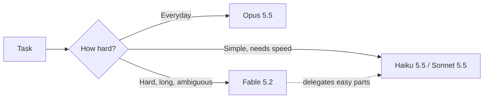

:::tldr
- **Claude Fable 5.2** launched on **November 9, 2026**, and is available right away on all paid plans, the Claude Platform, AWS, Google Cloud, and Microsoft Azure. Model ID: `claude-fable-5-2`.
- It beats **Opus 5.5** on almost every evaluation, outputs **up to 30% faster** than Fable 5.1, and is **cheaper**: $8 / $40 per million input / output tokens (down from $10 / $50).
- **Fable and Mythos are the same model.** Fable adds cybersecurity and biology safeguards so it can be open to everyone; Mythos is only for verified organizations.
- Anthropic still recommends **starting with Opus 5.5** for everyday work, and moving up to Fable only for hard, long-running, open-ended tasks.
:::

Just over two months after Fable 5.1 (early September), Anthropic has shipped the next version. This time it is not only about higher scores: the model is faster, cheaper, and blocks fewer requests by mistake. Below are the points I found worth noting, taken from the [official announcement](https://www.anthropic.com/claude-fable-and-mythos-5-2) and the [developer docs](https://platform.claude.com/docs/en/models/fable-5-2/overview).

## Fable and Mythos: One Model, Different Access

As with the 5.1 generation, Anthropic released two names, but underneath there is **a single model**:

| | Claude Fable 5.2 | Claude Mythos 5.2 |
| --- | --- | --- |
| Who can use it | All paid users and developers | Organizations in the Cyber or Life Sciences Verification Program |
| Cybersecurity, biology | Mostly blocked by safety classifiers | Open for legitimate research |
| Price, specs | $8 / $40 per million tokens, 1M context | Same as Fable 5.2 |

When a request is blocked on Fable 5.2, the user gets an answer from another model (Opus 4.8 for cybersecurity, Opus 5 for biology) instead of a flat refusal. According to Anthropic, blocks are down about **55%** compared with Fable 5.1, so normal questions get caught by mistake much less often.

## Benchmark Scores

A few key numbers, compared with Fable 5.1, Opus 5.5, and competitors (each model at its highest effort unless noted):

| Evaluation | Fable 5.2 | Fable 5.1 | Opus 5.5 | GPT-6 Astra | Gemini 4 Carbon |
| --- | --- | --- | --- | --- | --- |
| FrontierCode 2.0 (agentic coding) | **49.1%** | 32.4% | 45.5% | 42.8% | 41.1% |
| FrontierSWE v2 (agentic coding) | **69.9%** | 56.3% | 62.3% | 65.5% | 61.2% |
| OSWorld 2.1 (computer use) | **89.3%** | 83.5% | 87.2% | 79.5% | 81.5% |
| Humanity’s Last Exam (with tools) | **74.2%** | 65.6% | 67.7% | 57.2% | — |
| RoboDojo Sim (robot control) | **64.9%** | 27.6% | 39.4% | 29.8% | — |
| Remote Labor Index | **41.3%** | 17.9% | 21.3% | 20.8% | — |
| AutomationBench (business workflows) | 51.4% | 31.4% | 42.5% | 41.4% | **53.9%** |

Fable 5.2 does not win every test: on AutomationBench, Gemini 4 Carbon is still slightly ahead. But in coding, the jump over Fable 5.1 is very clear.

The number I find most practical is about **cost**: on FrontierCode 2.0, Fable 5.2 at **High** effort reaches about 45.3%, level with Opus 5.5 at **Max** (45.5%), for **roughly half the cost** per task. In other words, a model that costs more per token is not always more expensive per job, because it needs fewer tokens to finish.

## Notable Experiments

Anthropic shared quite a few examples, and some of them sound like science fiction:

- **An operating system from an empty folder.** An engineer asked Fable 5.2 to design a prototype operating system. The model coordinated over **1,000 subagents** working around the clock for **8 days**, and produced an OS that boots on a laptop, with disk, keyboard, and network drivers, a file system, windows, a login screen, and an installer.
- **Moving a service from Python to Rust.** A team of agents running an early version of Fable 5.2 migrated a critical production service to Rust, and it now starts about **26 times faster**.
- **Formalizing Fermat’s Last Theorem.** 1,000 Fable 5.2 agents translated the whole proof into Lean (a language that lets a computer check a proof step by step) in **30 hours**. Anthropic’s previous attempt took 11 days. With the same setup, Opus 5.5 finished only about 26% after 18 hours.
- **Hardware design.** From a one-paragraph prompt, the model wrote its own specs, picked components, routed four-layer circuit boards, modeled 3D-printed enclosures, and wrote the software for three devices: a voice-assistant hub, a USB speakerphone, and a handheld virtual pet. All three worked without any electrical fixes.
- **Theoretical physics.** Fable 5.2 solved two open problems about black holes, now published as preprints.

One detail worth repeating: Anthropic says **over 90%** of the changes merged into its core codebase are now written by Claude (with human guidance).

## Faster, With a Fast Mode

- Token output is **up to 30% faster** than Fable 5.1.
- At **Medium** effort (the default in the Claude apps and Claude Code), Fable 5.2 finishes hard tasks with fewer tokens than Fable 5.1.
- An optional **fast mode** speeds up token generation by up to **2.5 times**, at double the price: $16 / $80 per million tokens. It is available in Claude Code, the Claude Platform, Google Cloud, and Microsoft Foundry.

## When to Use Fable 5.2

The interesting part is that Anthropic itself does **not** recommend Fable for everything. Their advice:

1. Start with **Opus 5.5** for most everyday coding and knowledge work.
2. Move **up to Fable 5.2** when the task is hard, ambiguous, or runs for hours: large migrations, multistep research, stubborn bugs.
3. Move **down to Sonnet 5.5 or Haiku 5.5** for simple tasks that need to be fast and cheap.

Fable 5.2 can also act as an **Advisor** (smaller models consult it on hard problems) or an **Orchestrator** (it splits the work and hands the easy parts to smaller models). This lets you use Fable’s strength without paying Fable prices for every token.



:::advanced
### Notes for API Users

Key specs from the [official docs](https://platform.claude.com/docs/en/models/fable-5-2/overview):

| | Value |
| --- | --- |
| Model ID | `claude-fable-5-2` (Bedrock: `anthropic.claude-fable-5-2`) |
| Context / max output | 1M tokens / 128K tokens |
| Price | $8 input, $40 output per million tokens; cache read $0.20; Batch API 50% off |
| Thinking | Adaptive, **always on**, cannot be turned off |
| Default effort on the API | `high` |
| Knowledge cutoff | June 2026 |

A few things that are easy to trip over when moving from older models:

- **No `budget_tokens` for thinking depth.** Thinking is always on; you control it with the `effort` parameter instead of turning it on or off.
- **Drop `temperature`, `top_p`, and `top_k`.** Some values return a 400 error.
- **No forced tool use.** `tool_choice` of type `any` (must call some tool) or `tool` (must call one specific tool) returns a 400 error; only `auto` works. If you need schema-valid JSON, keep `auto` and set `strict: true` on the tool, or use JSON outputs.
- **Preserved thinking applies to every account.** If your code edits earlier turns of a conversation, the old thinking blocks become invalid. This is part of the defense against distillation (training another model on a stronger model’s outputs).
- **30-day data retention** for safety monitoring; not available under zero data retention unless Anthropic approves it.

A minimal call:

```ts
import Anthropic from "@anthropic-ai/sdk";

const client = new Anthropic();

const message = await client.messages.create({
  model: "claude-fable-5-2",
  max_tokens: 16000,
  // Thinking is always on; tune depth and cost with effort instead.
  output_config: { effort: "medium" },
  messages: [{ role: "user", content: "Review this migration plan and list the risks." }],
});
```

Before switching for good, read the [migration guide](https://platform.claude.com/docs/en/models/fable-5-2/migration-guide), which lists every change from Fable 5.1 and the Opus models.
:::

## Safety

Anthropic says the model was tested before release by internal teams and outside evaluators (the UK AI Security Institute, METR, and others). A few points:

- In a test with a deliberately weak sandbox, Mythos 5.2 used the weakness in **3.1%** of scenarios, about the same as Opus 5.5 and far below Mythos 5.1 (21%).
- Behaviors like making up inputs, claiming a task is done when it is not, or hiding sloppy work all **went down** compared with earlier models.
- During training, Anthropic **deliberately limited** the capabilities that could most directly speed up AI development (for example, kernel optimization for AI chips), keeping them at about Opus 5.5 level.

They also admit one hard problem: Fable 5.2 suspects it is being tested more often than any recent model, which makes it harder to know for sure how it will behave in the real world.

## What I Found Trying It

I had Opus 5.5 and Fable 5.2 solve three coding tasks via the API (November 14, 2026). Each model got only the spec, wrote one file in a single attempt, and was run against hidden tests:

- **Easy:** related-posts scoring, 16 tests.
- **Medium:** an LRU cache with TTL and size limits, 29 tests.
- **Hard:** a line diff that handles 50,000 lines and matches `diff -u` output exactly, 27 tests.

Each config ran twice per task. Costs use the official pricing: Opus 5.5 at $4 / $20 and Fable 5.2 at $8 / $40 per million tokens.

| Config | Passed all tests | Mean time | Mean output tokens | Mean cost |
|---|---|---|---|---|
| Opus 5.5, medium effort | 6/6 | 27 s | 3,218 | $0.07 |
| Fable 5.2, medium effort | 6/6 | 28 s | 3,300 | $0.14 |
| Opus 5.5, max effort | 4/6 | 13 min | 90,404 | $1.81 |

Three takeaways:

- **For everyday work, Opus at medium is the right call.** At medium effort, both models passed every test, including the hard task, and used almost the same number of tokens. Since Fable's per-token price is double, it cost **twice as much** for the same result. That matches Anthropic's advice.
- **Max effort isn't always better.** On the hard task, Opus at max spent all 128,000 output tokens thinking and **returned no code at all**, in both runs, about 19 minutes each. Those two runs alone cost $5.13. On the tasks it did finish, it cost about 26× Opus medium for the same result.
- **Fable vs Opus at max (the comparison in this post):** Fable at high effort cost just 13% and 25% of Opus max on the easy and medium tasks, with identical test results. So "about half the cost" looks, if anything, modest. But that's one run per task, and on the hard task Fable high hit the token cap I set to stay on budget, so that run doesn't count.

Limits of this test: only 2 runs per cell, and synthetic single-file tasks solved in one shot, far from the multi-step agentic work Anthropic's benchmarks measure. These tasks weren't hard enough to separate the two models, so where Fable really earns its price is in long, hard problems I didn't measure. The whole experiment cost $13.59.

## Conclusion

For regular users, Fable 5.2 is a pleasant upgrade: stronger, faster, cheaper, and blocked by mistake less often. This week, paid plans also get extra Fable usage, so it is a good time to try it.

For people who build software, what I find most valuable is not the top benchmark score, but **getting the same quality for about half the cost** of Opus 5.5 at Max. Still, Anthropic’s own advice holds: use Opus 5.5 for everyday work, and call on Fable only when the task is truly hard.

To compare Fable and Opus on your own codebase, you can run two agents side by side on git worktrees with [KD Code](/en/blog/why-i-built-kd-code/), the VS Code extension I built for exactly that.
