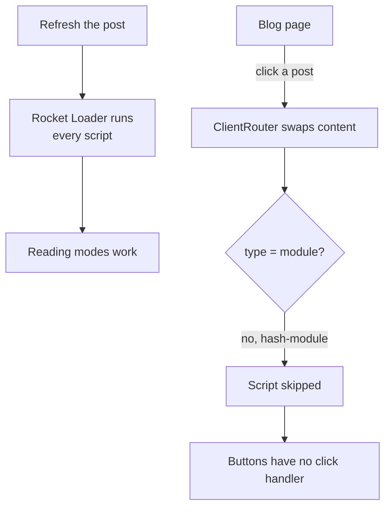
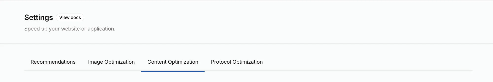
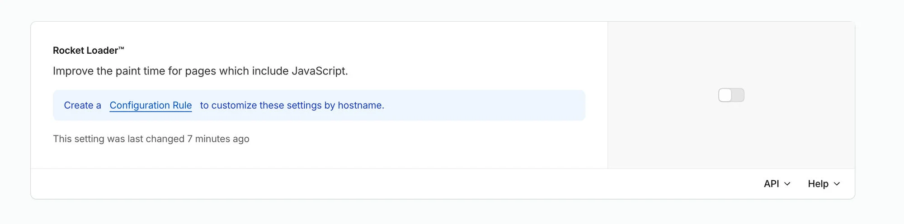

:::tldr
- The bug: going from the Blog page to a post, the **reading-mode buttons and zoomable diagrams did nothing**. Refreshing the post made everything work.
- The dev server and the build served with `astro preview` were **fine**. Only production on Cloudflare was broken.
- The cause was **Rocket Loader**, a Cloudflare speed feature. It rewrites `type="module"` into something like `type="3d45…-module"` so it can run the scripts itself.
- On navigation, Astro's `ClientRouter` only runs scripts whose type is `module` or `text/javascript`. Scripts with an unknown type are **skipped**, and Rocket Loader does not run them either.
- The fix: **turn Rocket Loader off**. Astro's scripts are already modules, which never block rendering, so Rocket Loader adds nothing.
- The lesson: what the CDN serves is not what is in `dist/`. Check the HTML your readers actually receive.
:::

This site uses Astro's `<ClientRouter />` for smooth page changes without full reloads. After publishing two Front-end System Design posts, I opened one from the Blog page and found that the **TL;DR / Standard / Advanced** buttons did nothing, and clicking a diagram did not zoom it. Pressing F5 brought everything back.

When something "only breaks after navigation" on a site with view transitions, the usual suspect is a script that runs once on the first load and never again after a page swap. This time the usual suspect was innocent.

## Step 1: reproduce locally

The reading-mode script was already written the right way for `ClientRouter`: it hooks into the `astro:page-load` event instead of running at the top level:

```ts
document.addEventListener("astro:page-load", () => {
  const options = document.querySelectorAll("[data-mode-option]");
  if (options.length === 0) return;
  // attach a click handler to each button…
});
```

`astro:page-load` fires on the first load and after every navigation, so in theory this bug could not happen. I still replayed the same steps in an automated browser:

- **`astro dev`**: Blog → post → click a button: works.
- **`astro build` + `astro preview`**: works. Post → Blog → another post, then Back and Forward: still works.
- **Checking for an overlay** with `document.elementFromPoint` at the button's position: it hits the button, nothing covers it.

The code is correct and the build is correct. So the difference lies between `dist/` and the reader's browser, which means **Cloudflare**.

## Step 2: look at the real HTML in production

Repeating the steps on `buikhuongduy.com` showed the bug right away. The console had one interesting line, coming from a file I never added to the site:

```text
A preload for '…/ClientRouter.astro_astro_type_script_index_0_lang.CnDxeVtR.js' is found,
but is not used because the request credentials mode does not match.
  rocket-loader.min.js
```

Fetching the HTML with `curl` to look at the script tags:

```bash
curl -s https://buikhuongduy.com/blog/frontend-system-design-cheatsheet/ \
  | grep -o '<script[^>]*>'
```

```html
<script type="3d45018fbc5e20ffe1c88196-module" src="/_astro/ClientRouter…js">
<script type="3d45018fbc5e20ffe1c88196-text/javascript">
<script type="3d45018fbc5e20ffe1c88196-module">
<script type="3d45018fbc5e20ffe1c88196-module" src="/_astro/MediaViewer…js">
```

In `dist/`, these tags are `type="module"`. In production, each type has a hex string in front of it. That is the signature of **Rocket Loader**.

## What Rocket Loader does

Rocket Loader is a feature in Cloudflare's Speed settings. Its goal is to keep JavaScript from blocking rendering:

1. At the edge, it **rewrites the type** of every script tag to a value the browser does not understand, such as `<hash>-module`. The browser ignores scripts with an unknown type, the same trick [Partytown uses with `type="text/partytown"`](/en/blog/why-gtag-did-not-lower-lighthouse-score/).
2. It injects `rocket-loader.min.js`. Once the page has loaded, this file finds the rewritten scripts and **runs them itself**, in order.

On older sites with many synchronous `<script>` tags in `<head>`, this makes pages appear sooner. But it relies on one assumption: every script is present **on the first page load**.

## Why it only broke after navigation

On navigation, `ClientRouter` fetches the new page's HTML, swaps it into the current document, and runs the new scripts. This is the loop that runs them, from Astro's source (`astro/dist/transitions/router.js`):

```js
for (const script of document.getElementsByTagName("script")) {
  if (script.dataset.astroExec === "") continue;
  const type = script.getAttribute("type");
  if (type && type !== "module" && type !== "text/javascript") continue;
  // create a fresh script element so the browser runs it…
}
```

The second `continue` is where it breaks. A script with type `3d45…-module` is not `module`, so Astro treats it as data (like `application/ld+json`) and skips it. Rocket Loader finished its work when the first page loaded, so it does not run the script either.



This also explains why the bug was easy to miss. Scripts that are **on every page**, such as search or the cursor effects, already ran on the first load and kept working after navigation, so the site looked fine. Only scripts that **exist only on post pages** broke, because the first time they appear is through `ClientRouter`:

- `ReadingModes`: the TL;DR / Standard / Advanced buttons.
- `MediaViewer`: click an image or diagram to zoom.
- `PostActions`, `PostFeedback`: the like, share and rating buttons.

When you refresh a post directly, every script is there from the start, Rocket Loader runs them all, and nothing is wrong.

:::advanced
### Why Lighthouse CI did not catch it

This site's Lighthouse CI runs against `dist/` on a local server, without Cloudflare in front. I hit a similar trap with CSP in the [gtag post](/en/blog/why-gtag-did-not-lower-lighthouse-score/). Features that rewrite HTML at the edge, such as Rocket Loader, the Email Obfuscation script or Zaraz, are invisible to CI too.

On top of that, Lighthouse measures **one page load with nobody clicking**. This bug only shows up after a navigation and a click, so even Lighthouse against production would still report 100.

A cheap check is a post-deploy step that fetches production with `curl` and fails if any script tag has a rewritten type:

```bash
curl -s https://buikhuongduy.com/ \
  | grep -Eq '<script[^>]*type="[0-9a-f]+-' \
  && { echo "HTML scripts were rewritten at the edge"; exit 1; }
```
:::

## The fix

I went with **turning Rocket Loader off** in the Cloudflare Dashboard: pick the zone, go to **Speed → Settings**, and open the **Content Optimization** tab.



Scroll down to the **Rocket Loader™** card and switch the toggle off:



Then purge the cache so the old HTML with rewritten types is no longer served.

Turning it off does not make the site slower, because Rocket Loader has nothing left to optimize here:

- Every script Astro emits is `type="module"`. Browsers **load module scripts without blocking HTML parsing** by default and run them after parsing, like `defer`.
- The analytics script (GA4) already runs in a web worker through Partytown.
- Rocket Loader actually **adds** a JavaScript file to download, and it breaks the preloads of the very scripts it manages (the "credentials mode does not match" warning above).

:::advanced
### Other options, and why I did not use them

- **`data-cfasync="false"`**: Rocket Loader skips script tags with this attribute. But in Astro, adding any attribute other than `src` to a `<script>` makes it `is:inline`: it is no longer bundled and cannot use TypeScript or `import`. Doing that to every component with a script is too much of a trade-off.
- **Configuration Rules**: Cloudflare can turn Rocket Loader off for specific paths only. Useful when part of the zone is an older site that benefits from it. Here the whole site is Astro, so turning it off for the zone is simplest.
- **A client-side workaround**: listen for `astro:after-swap`, find scripts with a rewritten type and run them manually. It works, but it patches around a feature I do not need, and it breaks again if Cloudflare changes how it rewrites types.
:::

## Takeaways

The bug was not in the code and not in the build. It was a switch on the CDN, turned on long ago and forgotten, until it met a way of running scripts it did not expect.

Three things I took away:

1. **For "a refresh fixes it" bugs** on a site with view transitions, first check whether scripts run again after navigation. If the code already uses `astro:page-load` correctly and still fails, look at the real HTML in production.
2. **Compare `dist/` with the HTML readers receive.** One `curl` is enough to see whether the CDN changed anything.
3. **Revisit automatic optimizations when your architecture changes.** Rocket Loader suits sites with many synchronous scripts. For a static site built on module scripts like this one, it adds risk without adding speed. If you want to know what does make this site fast, I wrote about it in the [perfect Lighthouse score post](/en/blog/perfect-lighthouse-score/).
