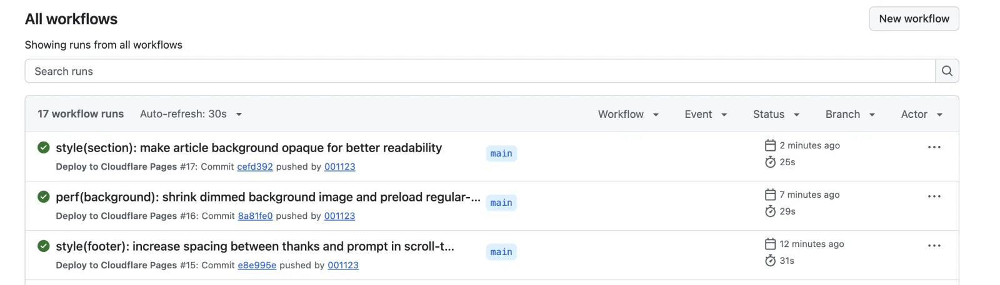
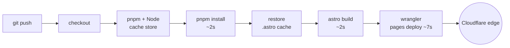
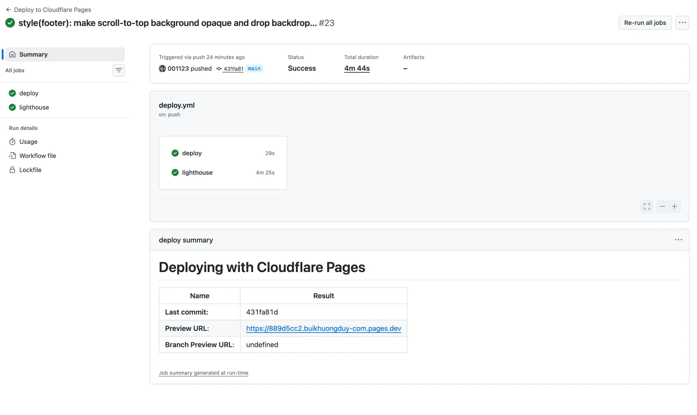

:::tldr
- **About 25 seconds from push until the new site is live**. The job itself runs for only about 19 seconds.
- **Astro's build cache** (`node_modules/.astro`) is the biggest change: the build step drops from **16–36 seconds to 2–5 seconds**.
- **Deploy fits in one job**: no splitting, no matrix, no passing artifacts back and forth.
- **Lighthouse runs in parallel in its own job**: it keeps the score at 100 without adding a single second to the deploy.
- **pnpm + store cache**: installing dependencies takes only about 2 seconds.
- **Nothing extra downloaded**: Mermaid uses the Chrome already on the runner, and Wrangler is pinned in `devDependencies`.
- **`cancel-in-progress`**: when pushes come fast, only the latest commit gets deployed.
:::

Every push to `main` rebuilds this site and deploys it to Cloudflare Pages. The last three runs took **25, 29 and 31 seconds**, including the time spent waiting for a runner.



There is no special trick. Each step does its own job, and no step has to redo work from the last run.

## Where every second goes

Here is the time for each step in the 25-second run (commit `cefd392`), taken from the GitHub Actions API:

| Step | Time |
| --- | --- |
| Job setup + checkout | ~1 s |
| Install pnpm + Node 24 (restore store cache) | ~5 s |
| `pnpm install --frozen-lockfile` | ~2 s |
| Restore Astro cache | ~1 s |
| `pnpm build` | ~2 s |
| Deploy with Wrangler | ~7 s |
| Clean up, save cache | ~1 s |

The job takes about 19 seconds in total. The rest, up to 25 seconds, is the time GitHub takes to queue the job and assign a runner. I cannot control that.

The slowest step now is the deploy, which means uploading files to Cloudflare. The build, which usually takes most of the CI time, now takes only a few seconds.



## 1. Astro build cache: from 30 seconds down to 2

This change made the biggest difference. Astro keeps a cache folder at `node_modules/.astro`, which contains:

- fonts already downloaded through the Astro Fonts API;
- optimized images (AVIF/WebP in several sizes);
- the data store for content collections.

On my machine, this folder already exists, so builds are very fast. On CI, each runner is a brand-new machine: there is no cache. Astro has to download the fonts again, compress all the images again and rebuild the content store every time.

Before the cache, the build step in the last 10 runs took **16 to 36 seconds**. After I added `actions/cache` for `node_modules/.astro`, the next three runs took only **3, 5 and 2 seconds**.

```yaml
- uses: actions/cache@v6
  with:
    path: node_modules/.astro
    key: astro-${{ runner.os }}-${{ hashFiles('pnpm-lock.yaml') }}-${{ github.sha }}
    restore-keys: |
      astro-${{ runner.os }}-${{ hashFiles('pnpm-lock.yaml') }}-
      astro-${{ runner.os }}-
```

:::advanced
### Why the key includes `github.sha`

GitHub Actions caches are immutable: once a key is saved, it is never overwritten. If the key depended only on `pnpm-lock.yaml`, the cache would freeze at the first build. Every new image added later would have to be compressed again on every run.

Adding `github.sha` makes the key always new, so at the end of each job the cache is saved with the latest content. When restoring, the main key never matches, and `restore-keys` picks the most recent cache with the same lockfile. If the lockfile changes (for example, when upgrading Astro), it falls back to the most recent cache for the same operating system.

The first run after adding the cache still takes 30 seconds for the build step, because there is nothing to restore yet. The cache only helps from the second run onward.
:::

## 2. Deploy fits in one job

The whole deploy path is one job: checkout, install, build and deploy. There is no separate lint job, no separate test job and no matrix of Node versions. The only exception is the Lighthouse job in section 6, and it is not on the deploy path.

For a personal static site, splitting jobs gains nothing. Each new job is a new runner that must start up, check out the code again and install dependencies again. Artifacts in `dist/` would also have to be uploaded and downloaded between jobs. A single job avoids all of that cost.

`astro build` itself acts as a check: a wrong frontmatter schema or a broken image link makes the build fail. When the build fails, nothing gets deployed.

## 3. pnpm and the store cache

`actions/setup-node` with `cache: pnpm` restores the pnpm store from the previous run. Then `pnpm install --frozen-lockfile` mostly just creates hard links from the store into `node_modules`. This takes about **2 seconds**.

`--frozen-lockfile` makes sure CI installs exactly what is in the lockfile. If the lockfile does not match `package.json`, CI stops right away instead of quietly installing a different version.

## 4. Don't download what you don't need

Some dependencies tend to download something heavy during install or at runtime. I block two of them:

- **Chrome for Mermaid**: diagrams are rendered to SVG at build time with `mermaid-isomorphic`, which uses Playwright. Instead of letting Playwright download its own browser (over 100 MB), I set `channel: "chrome"` to use the Chrome already on the GitHub runner.
- **Wrangler pinned in `devDependencies`**: `cloudflare/wrangler-action` uses Wrangler if it is already installed in the project. It does not need to fetch Wrangler with `npx` on every deploy. The version is also fixed, so nothing changes unexpectedly when Wrangler releases a new version.

## 5. Push often, deploy only the latest

```yaml
concurrency:
  group: deploy-${{ github.ref }}
  cancel-in-progress: true
```

When I push two commits close together, the older run is cancelled right away to make way for the newer commit. No runner is wasted on a version that will be overwritten, and an older version cannot finish deploying after the newer one.

## 6. Lighthouse runs in parallel and does not block the deploy

Besides the deploy job, the workflow has a `lighthouse` job that keeps the site's Lighthouse score at 100. It builds the site again, then runs Lighthouse CI (`lhci autorun`) on the `dist/` folder for the main pages, 3 times per page. If any page scores below 100 in any category (Performance, Accessibility, Best Practices, SEO), the job fails and attaches the reports for review. I wrote about how the site reaches 100 in [this post](/en/blog/perfect-lighthouse-score/).



This job is slow, about **4 minutes 25 seconds**, because it has to launch Chrome and measure each page several times. But it runs **in parallel** and has no `needs` link to the deploy, so the deploy does not wait for it. In the run above, the whole workflow took 4 minutes 44 seconds, while the deploy job still took only **29 seconds**. The new site was live long before Lighthouse finished scoring.

This is the only place where I accept a separate job, because Lighthouse is a quality check, not a condition for deploying. If it were in the same job, every push would wait more than 4 extra minutes before the new site went live. As a separate job, it costs only one more install and build, which take a few seconds thanks to the cache, and the deploy feedback loop stays the same.

For pull requests, making `lighthouse` a required check means a PR that lowers the score cannot be merged. For a direct push to `main`, the deploy still goes out, and a red Lighthouse job tells me to fix it in the next commit.

## 7. A static site is the foundation

All of the above works only because the site is **static HTML**. There is no server to restart, no database migration and no health check waiting for a new instance to be ready.

Deploying just uploads the `dist/` folder to Cloudflare Pages. Wrangler sends only the files that changed, so a commit that edits CSS uploads only a few files. When the deploy command finishes, the new version is already served from the edge. Being static files is also what keeps [hosting free](/en/blog/zero-cost-hosting-millions-of-requests/) as traffic grows.

Pull requests go through the same workflow and get their own preview. That lets me check changes on a real environment before merging.

## Conclusion

Fast CI does not come from a stronger runner or a paid service. It comes from **measuring where each second goes**, then removing repeated work: cache what has already been computed, do not download what is already there, do not split what does not need splitting, and keep slow checks off the deploy path.

When CI takes only 25 seconds, I deploy more often, each change is smaller and bugs are found sooner. A short feedback loop is the best thing to invest in.

If you need someone who brings this mindset into your team's pipeline: **I am open to new opportunities**. [Get in touch](/en/contact/), I would be glad to talk.
