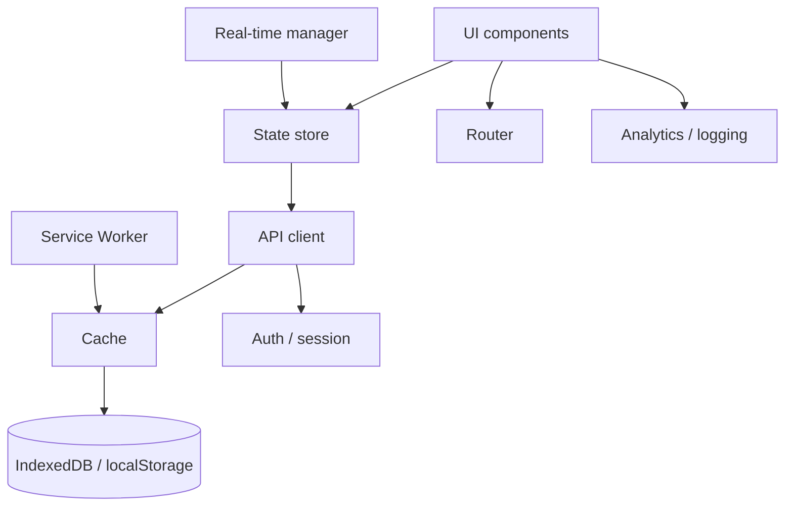

:::tldr
- Front-end system design isn't about drawing servers and databases. It's about designing **what runs in the browser**: rendering, state, networking, performance, reliability and security.
- Always start by **clarifying requirements**: who the users are, read-heavy or write-heavy, whether you need real-time, SEO or offline. Those answers drive almost every architectural choice that follows.
- Front-end design is mostly **state design**: what lives on the server, on the client, in the URL, and what must survive a refresh.
- What usually separates a senior answer from a junior one is **reliability**: dropped connections, a failing panel, stale cache conflicts, and whether users lose their work.
:::

These are my notes based on [GreatFrontEnd's Frontend System Design Cheatsheet](https://www.greatfrontend.com/front-end-system-design-playbook), with extra explanation and examples where I've seen interviewers dig deeper. Use it as an answer framework in interviews, or as a checklist before starting a large feature.


## 1. Requirements and problem framing

Don't rush into architecture. Spend the first few minutes understanding the problem, using these questions as a guide:

- Who are the users?
- What are the core user journeys?
- Web, mobile web, desktop or embedded?
- Read-heavy or write-heavy?
- Real-time or not?
- Is SEO required?
- Is offline support needed?
- Accessibility requirements?
- Browser and device constraints?
- Security and privacy constraints?
- Latency expectations?

Each answer prunes a branch. "Needs SEO" nearly rules out pure CSR. "Read-heavy, rarely changing content" points to SSG plus CDN caching. "Real-time, many people editing together" brings in WebSockets and conflict resolution.

## 2. Architectural choices

The big decisions that are hard to change later:

- **Rendering architecture**: CSR, SSR, SSG, ISR or streaming.
- **Page architecture**: SPA or MPA.
- **Product architecture**: monolith front end or micro-frontends.
- **APIs**: BFF (Backend for Frontend) or direct API calls; REST or GraphQL.
- **Real-time data**: polling, SSE or WebSocket.
- **Drawing**: DOM, Canvas or WebGL.
- **Data processing**: client-side or server-side search and filtering.

:::advanced
### Choosing a rendering mode

| Mode | When HTML is produced | Good for | Trade-offs |
| --- | --- | --- | --- |
| CSR | In the browser, after JS loads | Logged-in dashboards, highly interactive apps | Longer blank screen, weak SEO |
| SSR | On the server, per request | Pages that need SEO plus personalized or always-fresh data | Server cost; TTFB depends on data fetching time |
| SSG | At build time | Blogs, docs, landing pages | Data is only as fresh as the last build |
| ISR | At build time, then regenerated periodically or on demand | Product pages, many pages that change rarely | Users may see a stale version for a while |
| Streaming SSR | On the server, sent in chunks | Pages with slow data sections | Harder error handling and header management |

Real apps rarely pick one mode for everything. An e-commerce site often uses SSG/ISR for product pages, SSR for search and CSR for the cart.

### Polling, SSE or WebSocket?

| | Polling | SSE | WebSocket |
| --- | --- | --- | --- |
| Direction | Client asks periodically | Server pushes, one way | Bidirectional |
| Protocol | Plain HTTP | HTTP, auto-reconnect | Own protocol after upgrade |
| Good for | Slow-changing data, simplicity | Feeds, notifications, progress, streaming AI tokens | Chat, collaboration, games |
| Watch out for | Wasted requests when nothing changed | Text only | You own reconnects, heartbeats; harder to scale server-side |

Start with the simplest option that meets the requirements. Many "real-time" features only need SSE.
:::

## 3. Core building blocks

A modern front-end app is usually made of these blocks. Drawing them as a diagram when presenting a design helps your audience follow along:

- App shell
- Router
- UI component layer
- Store / state management layer
- Data fetching / API client
- Cache
- Real-time connection manager
- Background workers (Web Workers, Service Workers)
- Local persistence
- Analytics / logging
- Auth / session layer



## 4. Data and state management

Front-end design often becomes state design, so this is where to invest the most:

- Server state vs client state vs ephemeral UI state
- Source of truth
- Caching strategy
- Optimistic updates
- Invalidation / revalidation
- Pagination / cursors
- Normalized vs denormalized state
- Derived state
- URL state
- Form state
- Persistence to localStorage / IndexedDB

For each piece of data, ask:

- What lives in memory only?
- What belongs in the URL?
- What should survive a refresh?
- What should be cached?
- What can go stale?
- What needs conflict resolution?

:::advanced
### Classifying state with a table

Take an email inbox as an example:

| Data | Kind | Where it lives |
| --- | --- | --- |
| Email list, message bodies | Server state | Data fetching library cache (TanStack Query, SWR…), optionally persisted to IndexedDB for fast startup |
| Current folder, search query, page | URL state | Query string, so links can be shared and Back works |
| Draft being written | Durable form state | Memory, autosaved to IndexedDB |
| Which emails are selected | Client state | Store or component state |
| Open menu, visible tooltip | Ephemeral UI state | Local component state |
| Unread count | Derived state | Computed from the list, never stored separately |

Two common mistakes: **copying server state into a global store** (now you must sync and invalidate it yourself), and **storing derived state** (which then drifts from its source). Every piece of data should have exactly one source of truth.

When the same entity appears in many places (a user in a list, in comments, in the header), **normalizing** into `{ usersById, postIds }` means one update changes it everywhere.
:::

## 5. UI and rendering concerns

The UI is the main thing that sets front-end system design apart:

- Rendering strategy
- Code splitting
- Progressive hydration / islands if relevant
- List virtualization
- Lazy loading
- Image and video loading
- Skeletons / placeholders
- Route transitions
- Responsive layout
- Theming / design system
- Accessibility states (focus, `aria-*`, screen reader announcements)

And the **mandatory** UI states checklist for every screen:

- Loading / Success / Error
- Empty
- Stale data
- Offline
- Unauthorized
- Optimistic pending state

Interviewers love asking "what do you show when the list is empty?" or "what if the network drops mid-way?". Listing these states up front is the fastest way not to be caught off guard.

## 6. Network and real-time patterns

Most front-end apps fetch data over the network, some in real time. Cover:

- Request lifecycle
- Retries and backoff
- Cancellation / abort
- Deduping
- Batching
- Background refresh
- Idempotency expectations
- Reconnect logic
- Conflict resolution
- Event ordering
- Eventual consistency handling

Small reminders that help a lot:

- Use **cursor pagination** for dynamic lists (offsets duplicate or skip items when new ones are inserted).
- **Debounce** noisy inputs like search boxes.
- **Cancel outdated requests**.
- **Distinguish transport errors** (offline, timeout) from **domain errors** (out of stock, forbidden): the former can be retried, the latter can't.
- **Reconcile optimistic updates** after the server acknowledges them.

:::advanced
### Example: a search box with debounce, cancellation and retry

Typing "react" quickly can fire 5 requests; if the "rea" response arrives after the "react" one, wrong results overwrite the right ones. Aborting the previous request with `AbortController` fixes this race:

```ts
let controller: AbortController | undefined;

async function search(query: string) {
  controller?.abort(); // cancel the previous request
  controller = new AbortController();

  const res = await fetchWithRetry(`/api/search?q=${encodeURIComponent(query)}`, {
    signal: controller.signal,
  });
  return res.json();
}

async function fetchWithRetry(url: string, init: RequestInit, retries = 3): Promise<Response> {
  for (let attempt = 0; ; attempt++) {
    try {
      const res = await fetch(url, init);
      // Only retry transient server errors; 4xx are domain errors, retrying won't help.
      if (res.status < 500 || attempt >= retries) return res;
    } catch (err) {
      if (init.signal?.aborted || attempt >= retries) throw err;
    }
    // Exponential backoff with jitter: ~200ms, ~400ms, ~800ms...
    const delay = 200 * 2 ** attempt * (0.5 + Math.random() / 2);
    await new Promise((r) => setTimeout(r, delay));
  }
}

const debouncedSearch = debounce(search, 300);
```

Jitter matters more than it looks: if a server goes down and comes back, thousands of clients retrying **in lockstep** will knock it over again.

Only auto-retry **idempotent** requests (GET, or POST with an idempotency key). Retrying a "pay" request without a key can charge someone twice.
:::

## 7. Performance checklist

Techniques to remember:

- Bundle splitting
- Tree shaking
- Route-based loading
- Prefetching
- Memoization
- Virtualization
- Image optimization
- Font loading
- Worker offloading
- Avoiding main-thread blocking
- Avoiding over-rendering
- Caching layers (HTTP, CDN, Service Worker, memory)

And the metrics to watch:

- Core Web Vitals: **LCP / INP / CLS**, plus **TTFB**
- JS bundle size
- Memory usage
- Dropped frames
- API latency
- Error rate

Talking about performance without talking about measurement isn't enough. Mention both: lab data (Lighthouse) for debugging, and field data from real users (RUM, CrUX) to know whether things actually improved. I go deeper in [PageSpeed Insights explained](/en/blog/pagespeed-insights-explained/).

## 8. Reliability and resilience

This section often separates a senior answer from a junior one:

- Graceful degradation
- Retry and reconnect
- Offline fallback
- Autosave / draft recovery
- Error boundaries
- Partial rendering
- Feature flags
- Kill switches
- State recovery after refresh
- Handling version mismatches between front end and back end

Ask yourself:

- What happens if the socket disconnects?
- If one panel fails, can the others still render?
- What if stale cached data conflicts with fresh server state?
- Can the user recover without losing work?

:::advanced
### Front-end and back-end version mismatch

This one is easy to forget. A user opens a tab in the morning, you deploy in the afternoon: the old tab still runs old JS but talks to the new API. A few ways to handle it:

- **Backward-compatible APIs**: only add fields; don't change the meaning of or remove fields within an API version.
- **Send the client version** in a header; the server returns a dedicated error when the client is too old, and the front end shows "A new version is available, reload".
- **Keep old JS chunks** around for a while after deploys. Delete them immediately and an old tab lazy-loading a route gets a 404 on the chunk; catching that error and reloading is the last resort.
:::

## 9. Security and privacy

Security isn't only a back-end concern:

- Auth flow
- Token / cookie handling
- CSRF / XSS
- Permission-based UI
- Secret exposure
- Sensitive data in logs
- iframe and cross-origin considerations
- File upload safety
- Clickjacking if relevant

Two points that come up often: **where to store tokens** (an `HttpOnly; Secure; SameSite` cookie is safer against XSS than localStorage), and **hiding a button is not authorization**: permission-based UI is for a better experience, the server must still check every request. If stolen session cookies worry you, see [Device Bound Session Credentials](/en/blog/device-bound-session-credentials/).

## Wrapping up

You don't need to cover all 9 sections in every interview or project. The effective way to use this list: clarify requirements thoroughly, pick the 2–3 sections that matter most for the problem (a chat app leans on sections 6 and 8, an e-commerce site on 2 and 7), go deep there, and skim the rest to show you haven't missed anything.

Source: [GreatFrontEnd's Frontend System Design Cheatsheet and Playbook](https://www.greatfrontend.com/front-end-system-design-playbook).
