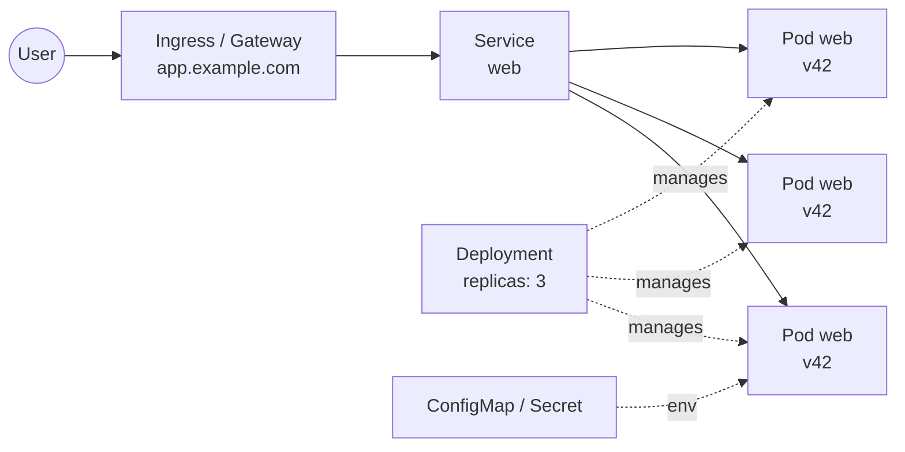

:::tldr
- **Kubernetes (k8s) runs and manages containers**: you describe the desired state in YAML, and k8s keeps reality in line with that description.
- **Six concepts are enough**: Pod, Deployment, Service, Ingress, ConfigMap/Secret and probes. Most of the YAML in a frontend repo is about these.
- **`NEXT_PUBLIC_*` is inlined at build time**, not read from a ConfigMap at runtime. This is the mistake frontend developers hit most on k8s.
- **Multiple replicas mean multiple independent copies of the app**: in-memory caches, ISR and files written to disk are not shared between Pods.
- **During a rolling update, two versions run at once**, which easily causes 404s when loading JS chunks if you do not prepare for it.
- **A static site does not need k8s**. This site runs on Cloudflare Pages and deploys in 25 seconds.
:::

At many companies, a Next.js or Nuxt app does not run on Vercel but on a Kubernetes cluster managed by a platform team. One day you open the repo and find a `k8s/` or `helm/` folder with hundreds of lines of YAML. You do not need to become a DevOps engineer, but you should be able to read it: when the app breaks in production, the first question is usually "Is the Pod running?".

This post explains Kubernetes through the parts a frontend developer actually touches.

## From `pnpm start` to a cluster

On your laptop, running the app is simple: `pnpm build && pnpm start`, then open `localhost:3000`. In production, the same app needs a lot more:

- run **several copies** to handle load and survive one of them failing;
- **restart automatically** when the app crashes;
- **ship a new version with no downtime**;
- **a stable address** (domain, HTTPS) while the copies behind it keep being replaced;
- **configuration and secrets** that differ between staging and production.

Kubernetes does all of that. The most important idea to grasp: k8s is **declarative**. You do not command "start 3 servers", you write "I want 3 copies of version `v42` at all times". K8s keeps comparing reality with that wish and fixes whatever drifts.

Sound familiar? It is the React mindset: you describe the UI from state and React takes care of updating the DOM. YAML is the "JSX" of infrastructure, and k8s is the reconciler.

## Containers and images

Everything on k8s runs in a **container**. An image packages the app together with its runtime (Node.js, system libraries), built once and run identically everywhere. For Next.js, enable `output: "standalone"` so the build only contains the files it needs:

```dockerfile
FROM node:24-alpine AS build
WORKDIR /app
RUN corepack enable
COPY package.json pnpm-lock.yaml ./
RUN pnpm install --frozen-lockfile
COPY . .
RUN pnpm build

FROM node:24-alpine
WORKDIR /app
ENV NODE_ENV=production PORT=3000 HOSTNAME=0.0.0.0
COPY --from=build /app/.next/standalone ./
COPY --from=build /app/.next/static ./.next/static
COPY --from=build /app/public ./public
USER node
EXPOSE 3000
CMD ["node", "server.js"]
```

CI builds this image, tags it (usually with the commit SHA, for example `web:a1b2c3d`) and pushes it to a registry. From here on, k8s only knows about the image; it does not care whether Next.js or Go is inside.

:::advanced
### Why `HOSTNAME=0.0.0.0`

A server may listen only on `localhost` by default, meaning it accepts requests only from inside the container itself. Traffic from a Service arrives through the Pod's network interface, so the app must listen on `0.0.0.0`. Forget this line and the Pod is still "Running", but every request is refused and the readiness probe fails forever.
:::

## The six core concepts



### 1. Pod: one running copy of the app

A **Pod** is the smallest unit and usually holds one container. Think of a Pod as a terminal tab running `node server.js`: it has its own IP, it can die at any moment, and once dead it does not come back. K8s creates a replacement Pod with a new name and a new IP.

So never treat a Pod as permanent. Anything written to its disk or memory can disappear.

### 2. Deployment: "always keep N copies of version X"

You almost never create Pods directly. A **Deployment** describes which image, how many copies, and how to swap versions. When you change the image tag from `v41` to `v42`, the Deployment performs a **rolling update**: it gradually creates new Pods, waits until they are ready, and only then stops the old ones. No downtime.

```yaml
apiVersion: apps/v1
kind: Deployment
metadata:
  name: web
spec:
  replicas: 3
  selector:
    matchLabels:
      app: web
  template:
    metadata:
      labels:
        app: web
    spec:
      containers:
        - name: web
          image: registry.example.com/web:a1b2c3d
          ports:
            - containerPort: 3000
          envFrom:
            - configMapRef:
                name: web-config
            - secretRef:
                name: web-secrets
          readinessProbe:
            httpGet:
              path: /api/health
              port: 3000
          livenessProbe:
            httpGet:
              path: /api/health
              port: 3000
            initialDelaySeconds: 10
          resources:
            requests:
              cpu: 250m
              memory: 256Mi
            limits:
              memory: 512Mi
```

This is almost all the YAML you need to be able to read. The rest of the post explains each block.

### 3. Service: a stable address for a group of Pods

Pods change IPs all the time, so something with a fixed address has to sit in front of them. A **Service** selects Pods by label (`app: web`) and load-balances across them. Inside the cluster, other apps just call `http://web`, without knowing how many Pods exist or where they are.

```yaml
apiVersion: v1
kind: Service
metadata:
  name: web
spec:
  selector:
    app: web
  ports:
    - port: 80
      targetPort: 3000
```

For frontend work, this shows up when calling APIs from Server Components or route handlers: instead of going out to the internet via `https://api.example.com`, the server can call `http://api` directly inside the cluster, which is faster and skips the CDN.

### 4. Ingress and Gateway API: from a domain to a Service

A Service only has an internal address. For users to reach `app.example.com` over HTTPS, you need a routing layer from the outside in. For years that was **Ingress**; now it is the **Gateway API** with `HTTPRoute`, the newer model Kubernetes recommends (the popular Ingress NGINX project has been out of maintenance since March 2026).

```yaml
apiVersion: gateway.networking.k8s.io/v1
kind: HTTPRoute
metadata:
  name: web
spec:
  parentRefs:
    - name: public-gateway
  hostnames:
    - app.example.com
  rules:
    - backendRefs:
        - name: web
          port: 80
```

Think of it as `_redirects` or `vercel.json` at the infrastructure level: which domain and path go to which Service. The Gateway itself is usually owned by the platform team; you only declare your app's route.

### 5. ConfigMap and Secret: environment variables

A **ConfigMap** holds regular configuration, a **Secret** holds sensitive values (API keys, tokens). Both are injected into the container as environment variables through `envFrom`, like a `.env` file kept separate from the image. The same image runs in staging and production; only the ConfigMap differs.

```yaml
apiVersion: v1
kind: ConfigMap
metadata:
  name: web-config
data:
  API_URL: http://api
  NEXT_PUBLIC_API_URL: https://api.example.com # has no effect, see below
```

:::advanced
### The biggest trap: `NEXT_PUBLIC_*` is inlined at build time

Next.js (and Vite with `import.meta.env.VITE_*`) **replaces public variables with their values in the JS bundle at build time**. Once the image is built, changing `NEXT_PUBLIC_API_URL` in a ConfigMap changes nothing in the browser, because client code already contains the old string.

This breaks the "one image, many environments" principle. There are three ways out:

1. **Use only unprefixed variables on the server**, and pass values down to the client as props from a Server Component. This is the cleanest option with the App Router.
2. **A runtime config endpoint**: the client calls `/api/config` on startup to fetch the values.
3. **Build one image per environment**. Simple, but what you tested in staging is no longer exactly what runs in production.

The same goes for secrets: never put a secret in a `NEXT_PUBLIC_*` variable, because it ends up in a JS file anyone can download.
:::

### 6. Probes: k8s asks the app "are you alive?"

K8s cannot guess whether your app is healthy, so it asks over HTTP:

- **readinessProbe**: "ready to take traffic?". Until it is, the Service sends no requests to that Pod. This is what makes rolling updates zero-downtime.
- **livenessProbe**: "still alive?". After several failures in a row, k8s restarts the container.

A simple route handler is enough:

```ts
// app/api/health/route.ts
export const dynamic = "force-dynamic";

export function GET() {
  return Response.json({ ok: true });
}
```

Do not let the liveness probe call the database or other APIs. If a backend gets slow, k8s will restart every frontend Pod, turning a small incident into a big one.

## Resources and autoscaling

`resources.requests` is the CPU and RAM k8s **reserves** for the Pod, used to decide which machine to place it on. `limits.memory` is the ceiling: exceed it and the container is killed with status `OOMKilled`.

With Node.js, keep the heap a margin below the limit, for example `NODE_OPTIONS=--max-old-space-size=384` with a 512Mi limit. Otherwise Node assumes it has plenty of RAM, does not collect garbage in time, and gets killed mid-request instead of slowing down.

`250m` CPU means 250 millicores, a quarter of a core. Many teams leave out the CPU limit, because CPU limits throttle SSR and raise response times in ways that are hard to explain.

When traffic grows, a **HorizontalPodAutoscaler** (HPA) adds replicas automatically based on CPU or another metric:

```yaml
apiVersion: autoscaling/v2
kind: HorizontalPodAutoscaler
metadata:
  name: web
spec:
  scaleTargetRef:
    apiVersion: apps/v1
    kind: Deployment
    name: web
  minReplicas: 3
  maxReplicas: 20
  metrics:
    - type: Resource
      resource:
        name: cpu
        target:
          type: Utilization
          averageUtilization: 70
```

## A cheat sheet for Vercel users

| You know | On Kubernetes |
| --- | --- |
| A deployment | A new image + a new tag in the Deployment |
| Instance / serverless function | Pod |
| Instance count, autoscaling | `replicas` + HPA |
| Domains, routing | Gateway API (`HTTPRoute`) or Ingress |
| Environment Variables | ConfigMap, Secret |
| Instant rollback | `kubectl rollout undo` |
| Runtime logs | `kubectl logs` |
| Preview deployments | A namespace per PR (if your team builds it) |

## Common frontend mistakes on k8s

**Caches are not shared between Pods.** In-memory caches, ISR and the default Next.js Data Cache live on each Pod's disk. With 3 replicas, `revalidatePath` only refreshes the cache of the Pod that received the request; the other two keep serving stale data. You need a shared cache handler (usually Redis) if you rely on ISR.

**Chunk load errors during rolling updates.** During a deploy, `v41` and `v42` Pods run side by side. A user gets HTML from `v42`, then the request for `/_next/static/chunks/abc.js` lands on a `v41` Pod, where that file does not exist: 404. The most reliable fix is to push `.next/static` to a CDN or object storage (via `assetPrefix`) and keep files from a few previous versions. Next.js also supports `deploymentId` to detect version skew and reload the page.

**No graceful shutdown.** When k8s stops a Pod, it sends `SIGTERM`, waits for a grace period (30 seconds by default), then kills it. A Node server should stop accepting new connections and finish in-flight requests. Note: if you start the app with `pnpm start` inside the container, the signal may never reach the Node process. Run `node server.js` directly, as in the Dockerfile above.

**`localhost` is not another service.** Inside a container, `localhost` is that container. To call another API, use its Service name (`http://api`), not `localhost:8080`.

**The Pod is "Running" but gets no traffic.** It is almost always a failing readiness probe: wrong path, wrong port, or the app listening on `localhost` instead of `0.0.0.0`.

## A handful of `kubectl` commands

```sh
kubectl get pods -l app=web             # list Pods and their status
kubectl describe pod web-7d9f-abcde     # why a Pod is not running (see Events)
kubectl logs -f deploy/web              # app logs
kubectl logs web-7d9f-abcde --previous  # logs from before the last crash
kubectl rollout status deploy/web       # follow a deploy
kubectl rollout undo deploy/web         # roll back to the previous version
kubectl port-forward svc/web 3000:80    # open the in-cluster app at localhost:3000
```

When a Pod fails, its status usually names the cause: `ImagePullBackOff` means a wrong image name or missing registry access, `CrashLoopBackOff` means the app crashes on startup (check `logs --previous`), `OOMKilled` means it went over its memory limit.

## When you do not need Kubernetes

K8s solves the problem of operating many services at scale, and the price is complexity. If your app is a static site or an SPA, a CDN is enough. This site is static HTML on Cloudflare Pages, [deployed in about 25 seconds](/en/blog/fast-ci-under-30-seconds/), with no server to look after. For a small SSR app, Vercel, Cloudflare Workers or a managed container platform is usually cheaper in both money and effort.

K8s pays off when your company already has it: the platform team runs the cluster, and you only need a Deployment, a Service and a route.

## Wrapping up

For a frontend developer, Kubernetes is not something to master but something to read fluently. Once you know Pods, Deployments, Services, routes, ConfigMaps/Secrets and probes, you can read most of the YAML in your repo, debug a Pod that will not start, and avoid the frontend-specific traps: `NEXT_PUBLIC_*` variables, unsynchronized caches and chunk 404s during deploys.

If you need a frontend developer who understands the whole path from code to production: **I am open to new opportunities**. [Get in touch](/en/contact/), I would be glad to talk.
