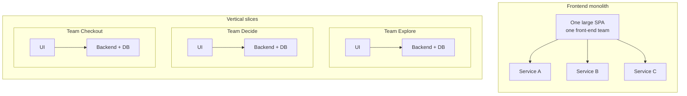

:::tldr
- Micro-frontends are an **organizational split** before they are a technique: each team owns a business area end to end, from database to UI, and deploys independently.
- There are five main ways to integrate: **server (SSI/ESI)**, **build time (npm packages)**, **iframes**, **JavaScript runtime** (including Module Federation) and **Web Components**. Build-time integration is not real micro-frontends because everything still releases together.
- **The DOM is the API**: a custom element's tag name, attributes and events are the contract between teams. Parent → child passes attributes, child → parent dispatches a `CustomEvent`. No shared global state.
- **Prefix everything** that is still shared with the team name: tag names, CSS, events, localStorage, cookies.
- The costs are real: bigger payloads, more to operate, drifting UI. With only one or two teams, a **modular monolith** is almost always the better choice.
:::

My [9-step front-end system design checklist](/en/blog/frontend-system-design-cheatsheet/) has a one-line item under architecture: "monolith front end or micro-frontends". This post expands that line, based mostly on [micro-frontends.org](https://micro-frontends.org/) by Michael Geers and Cam Jackson's [Micro Frontends](https://martinfowler.com/articles/micro-frontends.html) on Martin Fowler's site, plus what the web platform has changed since.

## What are micro-frontends?

The backend has been split into microservices, but on top sits one huge SPA built by a separate front-end team. It keeps growing, gets harder to maintain, and every team ends up queuing behind it. That is the **frontend monolith**.

Micro-frontends (first on the [ThoughtWorks Technology Radar](https://www.thoughtworks.com/radar/techniques/micro-frontends) in late 2016) treat a website as **a composition of features**, each owned by an **independent team** with a clear business mission, building **from database to UI**, and **deploying without asking anyone**.



The key word is **independent**: codebases, releases and teams.

:::advanced
### Origins and definition

The idea is not new. It is close to [Self-contained Systems](https://scs-architecture.org/), and before that OTTO called it "Frontend Integration for Verticalised Systems". "Micro-frontends" is just a friendlier name.

Cam Jackson's definition: *"An architectural style where independently deliverable frontend applications are composed into a greater whole."* He lists four benefits: incremental upgrades (strangling instead of rewriting), small codebases decoupled along bounded contexts, independent deployment with separate pipelines, and autonomous teams. Teams must be formed around **vertical slices of business functionality**, not horizontal technical concerns like "the styling team" or "the forms team".

The running example is micro-frontends.org's model tractor store with three teams: **Team Product** (red) owns the product page, **Team Checkout** (blue) owns the buy button and mini basket, **Team Inspire** (green) owns recommendations. [Tractor Store 2.0](https://micro-frontends.org/tractor-store/) is a full shop reimplemented with many stacks, a TodoMVC for micro-frontends.
:::

## When should you (not) use them?

Micro-frontends solve an **organizational problem**, not a technical one.

**Use them** when three or four or more teams work on one product and keep stepping on each other (merge conflicts, release queues), when you need to **migrate gradually** off an old stack with the [strangler fig](https://martinfowler.com/bliki/StranglerFigApplication.html) approach, or when parts of the product have very different release rhythms.

**Don't** when there are only one or two teams (a **modular monolith** in a monorepo gets most of the benefit at a fraction of the cost), when the main reason is "each team wants its own framework", or when every part of the app interacts densely with every other part (a graphics editor, say).

## Five core ideas

From micro-frontends.org, and they still hold:

1. **Be technology agnostic**: each team picks and upgrades its stack without coordinating.
2. **Isolate team code**: no shared runtime, shared state or globals.
3. **Use team prefixes** for whatever isn't isolated yet: CSS, events, localStorage, cookies.
4. **Prefer native browser features**: DOM events instead of a homemade global PubSub.
5. **Be resilient**: features work even when JavaScript fails or hasn't run, thanks to server rendering and progressive enhancement.

## Integration approaches

First place your product on the [document ↔ application spectrum](https://ar.al/notes/the-documents-to-applications-continuum/): content-heavy sites are fine with **server** composition; e-commerce and PWAs need **both server and browser**; pure interactive apps compose on the **client**.

| Approach | Pros | Cons |
| --- | --- | --- |
| **Server (SSI, ESI, edge)** | Fast first load, works without JS, good SEO, simple | The slowest fragment sets the speed of the whole page |
| **Build time (npm packages)** | One bundle, easy dedupe | Lockstep releases: not real micro-frontends |
| **iframes** | Strongest isolation, good for third-party content | Routing, deep links, responsiveness, a11y all get hard |
| **JavaScript runtime** (import maps, Module Federation) | Most flexible, shareable dependencies | Mostly client-side; shared deps are an implicit version contract |
| **Web Components** | Web standard, works with any framework, pairs well with SSR | You handle SSR and hydration yourself |

:::advanced
### Server-side: SSI, ESI

The page-owning team's server renders the HTML shell and pulls in other teams' fragments with [Server Side Includes](https://en.wikipedia.org/wiki/Server_Side_Includes):

```html
<blue-buy sku="t_porsche">
  <!--#include virtual="/blue-buy?sku=t_porsche" -->
</blue-buy>
```

Each team runs its own server; nginx turns on `ssi` and routes by URL prefix. The response of `/blue-buy?sku=t_porsche` replaces the `#include` comment before the page goes to the browser:

```nginx
upstream team_blue  { server team_blue:3001; }
upstream team_green { server team_green:3002; }
upstream team_red   { server team_red:3003; }

server {
  listen 3000;
  ssi on;

  location /blue  { proxy_pass http://team_blue; }
  location /green { proxy_pass http://team_green; }
  location /red   { proxy_pass http://team_red; }
  location /      { proxy_pass http://team_red; } # team red owns the product page
}
```

Variations: [ESI](https://en.wikipedia.org/wiki/Edge_Side_Includes) (composition at the CDN/edge, supported by Varnish, Akamai, Fastly), or libraries like Zalando's Tailor. Today you can also do it in an edge worker (Cloudflare Workers with `HTMLRewriter`) or use platform routing like Vercel Microfrontends to split URLs between apps.
:::

:::advanced
### Build time and iframes

Build time: each micro-frontend is a package listed in the container's `package.json`:

```json
{
  "dependencies": {
    "@feed-me/browse-restaurants": "^1.2.3",
    "@feed-me/order-food": "^4.5.6",
    "@feed-me/user-profile": "^7.8.9"
  }
}
```

Changing one part means rebuilding and releasing the whole app, exactly what micro-frontends are meant to remove. Cam Jackson recommends strongly against it. It is still useful for organizing code inside a monolith; just don't call it micro-frontends.

iframes: the container swaps `src` by route.

```html
<iframe id="micro-frontend-container"></iframe>
<script>
  const routes = {
    "/": "https://browse.example.com/index.html",
    "/order-food": "https://order.example.com/index.html",
  };
  document.getElementById("micro-frontend-container").src = routes[location.pathname];
</script>
```

CSS, JS, globals and even crashes are isolated; a good fit for payment widgets or old internal tools (add `sandbox` if you don't trust the content). In exchange: communication goes through `postMessage`, iframes don't size to their content, history and deep linking get complicated, and each iframe loads its own framework.
:::

:::advanced
### JavaScript runtime, import maps and Module Federation 2.0

Cam Jackson calls this the default. Each micro-frontend registers a mount function; the container decides which to mount, where and when. Keep the contract tiny:

```ts
type MicroFrontend = {
  mount(el: HTMLElement, ctx: { basePath: string; navigate(to: string): void }): void;
  unmount(el: HTMLElement): void;
};
```

Instead of hanging functions on `window` like the 2019 example, teams today publish an ES module, and the container maps module names to hashed URLs with an [import map](https://developer.mozilla.org/en-US/docs/Web/HTML/Reference/Elements/script/type/importmap):

```html
<script type="importmap">
  {
    "imports": {
      "@checkout/app": "https://checkout.example.com/app.3f9a1c.js",
      "@explore/app": "https://explore.example.com/app.7b2e04.js"
    }
  }
</script>
```

```ts
const mfe: MicroFrontend = await import("@checkout/app");
mfe.mount(document.getElementById("checkout-root")!, { basePath: "/checkout", navigate });
```

Deploying a team is a one-line change in the import map (or manifest); nobody else rebuilds.

**Module Federation** is the "organized" version: each app is a **remote** exposing modules, a **host** consumes them at runtime, and both declare **shared dependencies** (`react`, `react-dom`) so they aren't loaded twice. Module Federation 2.0 is now stable and runs on Webpack, Rspack, Rollup/Rolldown, Vite, Rsbuild, plus Next.js and React Native, adding dynamic type hints for remotes, preloading, DevTools and tree shaking for shared dependencies. [single-spa](https://single-spa.js.org/), Piral and Native Federation (built on import maps) belong to this group too.

The main risk: shared dependencies are an implicit **version contract**. What if the host is on React 19 and a remote on React 18? Failures like that only show up at runtime.
:::

## The DOM is the API

micro-frontends.org centers on **Custom Elements**. Each team wraps its feature (in any framework) in a custom element; its **tag name, attributes and events** are the public API for other teams. Team Product places Team Checkout's buy button with nothing more than:

```html
<blue-buy sku="t_porsche"></blue-buy>
```

The `[team]-[feature]` convention prevents collisions and makes ownership visible in the DOM.

**Parent → child: attributes.** When the user picks another model, Team Product just changes an attribute; the element declares `observedAttributes` and re-renders itself:

```js
document.querySelector("blue-buy").setAttribute("sku", "t_fendt");
```

**Child → parent and siblings: DOM events.** Clicking buy should refresh the mini basket. Instead of having the components know each other, use the browser's built-in PubSub:

```js
// in <blue-buy>
this.dispatchEvent(new CustomEvent("blue:basket:changed", { bubbles: true }));

// in <blue-basket> (remember to remove the listener in disconnectedCallback)
window.addEventListener("blue:basket:changed", () => this.refresh());
```

Other channels: the **URL** for passing state between pages, the **server/BFF** for data that must be consistent like the cart. Avoid a **shared global store**: it's like sharing a database between microservices. If you use Redux, give each micro-frontend its own store.

:::advanced
### Writing the custom elements properly

The full buy button, with an observed attribute:

```js
const prices = { t_porsche: "66,00 €", t_fendt: "54,00 €", t_eicher: "58,00 €" };

class BlueBuy extends HTMLElement {
  static observedAttributes = ["sku"];

  connectedCallback() {
    this.render();
  }

  attributeChangedCallback() {
    this.render();
  }

  render() {
    const root = this.shadowRoot ?? this.attachShadow({ mode: "open" });
    const price = prices[this.getAttribute("sku")];
    root.innerHTML = `<button type="button">buy for ${price}</button>`;
  }
}

customElements.define("blue-buy", BlueBuy);
```

(The first snippet on micro-frontends.org writes `this.shadowRoot = \`...\``; `shadowRoot` is read-only, so you assign to `this.shadowRoot.innerHTML` as the later snippets in that article do.)

`render()` is where a team would boot its own framework if it uses one. Changing attributes (declarative) should be preferred over calling methods on the element (imperative). The spec only requires a dash in the name, and custom elements **cannot be self-closing**: `<green-recos sku="t_porsche" />` won't work as expected.

The event part, with listeners removed properly:

```js
class BlueBuy extends HTMLElement {
  #onClick = () => {
    // call the add-to-cart API...
    this.dispatchEvent(
      new CustomEvent("blue:basket:changed", { bubbles: true, composed: true }),
    );
  };

  connectedCallback() {
    this.render();
    this.shadowRoot.querySelector("button").addEventListener("click", this.#onClick);
  }

  disconnectedCallback() {
    this.shadowRoot.querySelector("button")?.removeEventListener("click", this.#onClick);
  }
  // render() as above
}

class BlueBasket extends HTMLElement {
  #refresh = () => {
    // fetch fresh basket data and re-render
  };

  connectedCallback() {
    window.addEventListener("blue:basket:changed", this.#refresh);
  }

  disconnectedCallback() {
    window.removeEventListener("blue:basket:changed", this.#refresh);
  }
}
```

Two details that often go wrong:

- **Keep the same function reference** when adding and removing listeners. Passing a class method like `this.refresh` as a callback loses `this`; use an arrow function as a class field, as above.
- Events dispatched from inside a shadow root need `composed: true` to cross the shadow boundary. Here the event is dispatched from the host element itself, so `bubbles: true` is enough, but `composed` keeps you safe if the dispatch point moves later.

If you'd rather the basket not listen on `window` (outside its own scope), the owning page (Team Product) can listen for the event and call `refresh()` on the basket element. That "page orchestrates" style is more explicit, but the owning team then knows more about the others.

Web Components are a web standard, so every major framework can use them (see [Custom Elements Everywhere](https://custom-elements-everywhere.com/); React 19 fully supports properties and custom events on custom elements). Custom Elements and Shadow DOM work in every modern browser without polyfills.
:::

:::advanced
### Communication channels table

| Channel | When to use | Notes |
| --- | --- | --- |
| Attributes / properties | Parent passes data down | The clearest contract; properties for complex data |
| DOM `CustomEvent` | Child notifies up, siblings notify each other | Team-prefixed; document payloads like an API |
| URL (path, query) | Passing state between pages/apps | Free deep links; Cam Jackson's example communicates only through routes |
| Server / BFF | Data that must be consistent (cart, session) | Each team reads the source of truth instead of syncing client state |
| `BroadcastChannel` | Syncing across tabs | Easy to abuse as a global event bus |
| Shared global store | Almost never | Massive coupling |

The Redux docs themselves list "isolating a Redux app as a component in a bigger application" as a valid reason for multiple stores.
:::

## Server rendering and loading states

The original micro-frontends.org article lamented that Web Components have no server rendering, and worked around it by exposing each team's `render()` via a URL and stitching with SSI. Since 2024, [Declarative Shadow DOM](https://developer.mozilla.org/en-US/docs/Web/HTML/Reference/Elements/template#shadowrootmode) works in every major browser: a server-rendered fragment carries its shadow root and encapsulated styles without any JavaScript.

Because **the slowest fragment sets the speed of the whole page**, a fragment that is expensive and hard to cache (personalized recommendations, say) can move to client rendering. But when it arrives it pushes the layout down (bad for CLS). Don't make the page-owning team fix the area's height, because then both teams have to release together whenever the design changes. Instead, the fragment owner server-renders a correctly sized **skeleton** and the real content fills in later.

:::advanced
### Declarative Shadow DOM and SSR with Module Federation

The fragment returned by Team Checkout's server:

```html
<blue-buy sku="t_porsche">
  <template shadowrootmode="open">
    <style>button { font: inherit; }</style>
    <button type="button">buy for 66,00 €</button>
  </template>
</blue-buy>
```

When Team Checkout's JavaScript loads, `connectedCallback` finds `this.shadowRoot` already there and only needs to attach listeners (which is why `render()` uses `this.shadowRoot ?? this.attachShadow(...)`).

SSR is possible with Module Federation too (MF 2.0 runs on Node.js and integrates with Next.js and Modern.js), but it is far more involved than "servers return HTML, nginx stitches it together". If SEO and first-load speed matter, server composition is still the simplest place to start.
:::

:::advanced
### Dropping the include and client-side skeletons

Moving a fragment from server to client rendering is just removing the include:

```html
<!-- Before: server rendered -->
<green-recos sku="t_porsche">
  <!--#include virtual="/green-recos?sku=t_porsche" -->
</green-recos>

<!-- After: client rendered only -->
<green-recos sku="t_porsche"></green-recos>
```

The area starts empty, JavaScript loads, the API call runs, markup renders, images load, and the rest of the page gets pushed down. A server-rendered skeleton reuses the real content's layout styles to reserve the right space.

Skeletons help with client rendering too: a freshly inserted element can draw its skeleton immediately while it waits for data. On an attribute change you can switch back to the skeleton, but if the API answers fast, a skeleton flicker is worse than none; keep the old data or only show the skeleton after a short delay.
:::

## CSS and the design system

CSS is global: two teams writing `h2 { … }` in two repos will collide. From weakest to strongest: team-prefixed class names, CSS Modules, `@scope` + `@layer`, and Shadow DOM. Any of them works as long as every team is sure its styles won't affect anyone else. Use **CSS custom properties** for design tokens, since they pass through shadow DOM.

Users should see **one** product. A shared component library should hold **UI logic only** (`Button`, `Combobox`), never business logic (`ProductTable`). Don't build too many components too early, and make sure a person or team is responsible for it.

And don't mix React, Angular and Vue on the same page. ThoughtWorks calls that [micro frontend anarchy](https://www.thoughtworks.com/radar/techniques/micro-frontend-anarchy) and put it on **Hold**. Mixing frameworks only makes sense during a migration.

:::advanced
### More on CSS and the design system

CSS isolation options:

1. **Team-prefixed naming conventions** (`.blue-buy__button`, BEM): relies on discipline.
2. **CSS Modules / CSS-in-JS**: the build tool generates unique class names.
3. **`@scope`** and **cascade layers** (`@layer`): standard CSS for limiting selector reach and controlling precedence between the shell, the design system and each team.
4. **Shadow DOM**: real isolation in the browser. Outside styles don't leak in (except inherited properties like `font`, `color`, and CSS custom properties), inside styles don't leak out.

Design system:

- **Harvest, don't guess.** Cam Jackson suggests letting teams write their own components first, accepting some duplication, and waiting until an API becomes obvious from real use before harvesting it into the shared library.
- **Custodian.** "Everyone owns it" means no one does; full centralization puts the builders far from the users. The best model: anyone can contribute, one person or team is responsible for quality.
- **Version it**, and accept that teams may sit on different versions at any given moment. Tokens via CSS custom properties let you change the look everywhere without every team releasing.
- Tractor Store 2.0 suggests starting the unification with the simplest component there is: the button.

On anarchy: mixing frameworks is technically possible, but users download several frameworks, teams struggle to share knowledge and a shared component library becomes nearly impossible. Outside a migration (an old AngularJS app running next to new React parts, moving route by route), keep one main framework, one design system and one shared set of build, test and monitoring tools.
:::

## App shell, routing and auth

Most architectures have an **app shell** that handles the header/footer, **authentication** (obtain a token and pass it on mount, or use a same-domain `HttpOnly` cookie) and **top-level routing** (`/checkout/*` belongs to Team Checkout, which routes the rest internally). A shell isn't required: Tractor Store 2.0 shows that self-contained systems following a few shared rules are just as valid.

:::advanced
### Navigation and backend

Moving between two micro-frontends can be a **real navigation** (MPA, each page reloads): simplest and best isolated, and [cross-document View Transitions](https://developer.mozilla.org/en-US/docs/Web/API/View_Transition_API) now make it feel nearly as smooth as an SPA. Or it can be **client-side navigation** inside the shell: smoother, but you have to manage the mount/unmount lifecycle and memory leaks.

**Backend**: the [Backend for Frontend (BFF)](https://samnewman.io/patterns/architectural/bff/) pattern extends naturally to one BFF per micro-frontend, owned by the same team. The guiding principle: the team building a micro-frontend shouldn't have to wait for another team to build its API.
:::

:::advanced
### Testing

Not much different from a monolith: each micro-frontend has its own full test suite (unit, component, integration). The gap is **integration**:

- A few end-to-end tests that check the page is **assembled correctly** (load a URL, see each fragment's heading), not re-testing business logic inside each fragment.
- **Contract tests** (consumer-driven contracts) for the cross-team contracts: tag names, attributes, event names and payloads, the `mount` signature. Each team declares what it needs from others without standing up the whole system.
- A **standalone mode**: every micro-frontend should run on its own, outside the shell, for fast development and testing.
:::

## The costs

| Cost | Mitigation |
| --- | --- |
| Bigger payload (React may load twice) | Shared dependencies, one main framework, per-team bundle budgets |
| Dev differs from production | Standalone mode, preview environments that compose every app |
| More repos, pipelines and infrastructure to run | Project templates, standard pipelines, monitoring tagged per team |
| Drifting UI | A design system with a custodian, shared tokens |
| Contract breaks only show up at runtime | Contract tests, an error boundary per fragment |

When one fragment fails, the rest of the page must **survive**: wrap each fragment in an error boundary, provide a fallback and put a timeout on loading remotes.

:::advanced
### More on the costs

- **Performance is hard to own**: nobody owns "the whole page". Set per-page performance budgets and make the page-owning team accountable for Core Web Vitals.
- **Runtime failures**: the contract lives in the DOM or a remote module, not in the type system. MF 2.0 generates types from remotes, which catches some of these earlier.
- **Dev vs production**: besides standalone mode, you can proxy other teams from staging to run the whole page locally.
- **Fallbacks** for broken fragments: a skeleton, or a link to the feature's standalone page; for remotes, `try/catch` around `import()` and `mount`.
:::

## Which integration to choose?

| Situation | Suggestion |
| --- | --- |
| Content-heavy site, SEO matters | Server/edge composition, Web Components + Declarative Shadow DOM for interactive parts |
| E-commerce, several teams on one page | Server-rendered fragments + Custom Elements + DOM events |
| Internal dashboard, one framework | App shell + Module Federation or import maps, one app per route |
| Migrating off an old stack | Strangle by route; iframes or Web Components to embed the old parts |
| Embedding third-party apps | iframes with `sandbox` |
| One or two teams | Don't split: modular monolith |

## In a system design interview

When asked "should we use micro-frontends?", ask about the **organization** first: how many teams, do they need independent releases, is a migration in progress. Then cover:

1. **Boundaries** by business area, not technical layer.
2. **Integration**: server, client or both.
3. **Contracts**: tag names, attributes, events, the `mount` signature; small, versioned, contract-tested.
4. **What's shared**: design system, tokens, auth in the shell; no shared business state.
5. **Costs**: payload, UI consistency, resilience when a fragment breaks.

Being able to talk through point 5 is what separates someone who has actually run micro-frontends from someone who has only read about them.

## Wrapping up

Micro-frontends are **Conway's law applied on purpose**: design the organization first and the architecture follows. What micro-frontends.org proposed back in 2017 still holds because it rests on browser fundamentals: Custom Elements as the contract, DOM events for communication, server rendering for resilience, team prefixes for whatever isn't isolated yet. And if you don't have many teams stepping on each other yet, you don't need micro-frontends yet.

### References

- [Micro Frontends, Michael Geers](https://micro-frontends.org/)
- [Tractor Store 2.0, neuland](https://micro-frontends.org/tractor-store/)
- [Micro Frontends, Cam Jackson on martinfowler.com](https://martinfowler.com/articles/micro-frontends.html)
- [Micro frontends, ThoughtWorks Technology Radar](https://www.thoughtworks.com/radar/techniques/micro-frontends)
- [Micro frontend anarchy, ThoughtWorks Technology Radar](https://www.thoughtworks.com/radar/techniques/micro-frontend-anarchy)
- [MF 2.0 Stable Release, Module Federation](https://module-federation.io/blog/v2-stable-version.html)
- [Microfrontends, Vercel Docs](https://vercel.com/docs/microfrontends)
- [Self-contained Systems](https://scs-architecture.org/)
- [Using custom elements, MDN](https://developer.mozilla.org/en-US/docs/Web/API/Web_components/Using_custom_elements)
- [`<template>` and `shadowrootmode`, MDN](https://developer.mozilla.org/en-US/docs/Web/HTML/Reference/Elements/template#shadowrootmode)
- [Custom Elements Everywhere](https://custom-elements-everywhere.com/)
- [Backends For Frontends, Sam Newman](https://samnewman.io/patterns/architectural/bff/)
