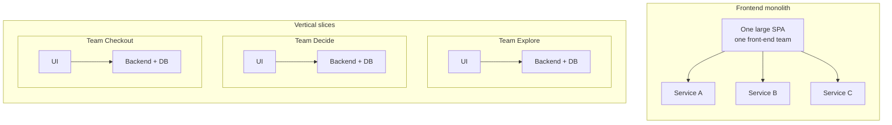

:::tldr
- Micro-frontends are an **organizational split** before they are a technique: each team owns a business area end to end, from database to UI, and deploys independently.
- There are five main ways to integrate: **server (SSI/ESI)**, **build time (npm packages)**, **iframes**, **JavaScript runtime** (including Module Federation) and **Web Components**. Build-time integration is not real micro-frontends because everything still releases together.
- **The DOM is the API**: a custom element's tag name, attributes and events are the contract between teams. Parent → child passes attributes, child → parent dispatches a `CustomEvent`. No shared global state.
- **Prefix everything** that is still shared with the team name: tag names, CSS, events, localStorage, cookies.
- The costs are real: bigger payloads, more to operate, drifting UI. With only one or two teams, a **modular monolith** is almost always the better choice.
:::

My [9-step front-end system design checklist](/en/blog/frontend-system-design-cheatsheet/) has a one-line item under architecture: "monolith front end or micro-frontends". This post expands that line. The notes are mostly based on [micro-frontends.org](https://micro-frontends.org/) by Michael Geers (author of *Micro Frontends in Action*) and Cam Jackson's [Micro Frontends](https://martinfowler.com/articles/micro-frontends.html) article on Martin Fowler's site, plus what has changed since those were written.

## What are micro-frontends?

The term first showed up on the [ThoughtWorks Technology Radar](https://www.thoughtworks.com/radar/techniques/micro-frontends) at the end of 2016, carrying the microservices idea over to the front end.

The setting is familiar: the backend has been split into microservices, but on top sits one huge SPA built by a separate front-end team. Over time that SPA grows, gets harder to maintain, and every backend team ends up queuing behind the front-end team. That is the **frontend monolith**.

Micro-frontends treat a website as **a composition of features**, each owned by an **independent team**. Each team:

- has a clear **business area** or **mission** (for example "help users pick a product", "guide users through checkout"),
- is **cross-functional** and builds its features **end to end**, from database to user interface,
- **builds, tests and deploys independently**, without asking other teams.



The idea is not new. It is close to [Self-contained Systems](https://scs-architecture.org/), and before that OTTO called it "Frontend Integration for Verticalised Systems". "Micro-frontends" is just a friendlier name.

Cam Jackson's definition is the tightest: *"An architectural style where independently deliverable frontend applications are composed into a greater whole."* The key word is **independent**: independent codebases, independent releases, independent teams.

## When should you (not) use them?

Micro-frontends solve an **organizational problem**, not a technical one. They are worth it when:

- **Several teams** (usually three or four or more) work on one product and keep stepping on each other: merge conflicts, release queues, one team breaking the build for the whole company.
- You want to **migrate gradually** off an old stack (AngularJS, jQuery, an in-house framework) with the [strangler fig](https://martinfowler.com/bliki/StranglerFigApplication.html) approach instead of a rewrite.
- Parts of the product have **different release rhythms**: checkout needs to be stable, the promotions page changes daily.

Don't use them when:

- There are only **one or two teams**. The operational cost outweighs the benefit. A monorepo with clear module boundaries (a modular monolith) gives you most of the benefit for very little cost.
- The main reason is "each team wants its own framework". That is a symptom, not a goal (see "Avoid micro-frontend anarchy" below).
- The product is an app with dense interactions between every part (a graphics editor, say). Team boundaries will cut through shared state and you will spend most of your time synchronizing.

Even Vercel's micro-frontends docs suggest trying monorepos, feature flags and faster builds before splitting.

## Five core ideas

micro-frontends.org lists five ideas, and they still hold up:

1. **Be technology agnostic.** Each team chooses and upgrades its stack without coordinating with others. Custom Elements hide implementation details behind a neutral interface.
2. **Isolate team code.** Don't share a runtime, even when every team uses the same framework. Don't rely on shared state or global variables.
3. **Establish team prefixes.** Where isolation isn't possible yet, agree on naming: CSS, events, localStorage, cookies. That avoids collisions and makes ownership obvious.
4. **Favor native browser features over custom APIs.** Use browser events for communication instead of building a global PubSub. If you need a cross-team API, keep it as simple as possible.
5. **Build a resilient site.** Features should still be useful when JavaScript fails or hasn't run yet. Use server rendering and progressive enhancement.

## Find your spot on the document ↔ application spectrum

Before picking an integration technique, place your product on Aral Balkan's [Documents-to-Applications Continuum](https://ar.al/notes/the-documents-to-applications-continuum/):

- **Left side** (content-heavy sites, mostly documents connected by links): **server** integration is enough. The server concatenates HTML fragments; updates happen through page reloads or partial AJAX replacement.
- **Middle** (e-commerce, PWAs, anything needing instant feedback like optimistic UI or skeleton screens): you need integration on **both the server and the browser**.
- **Right side** (pure behavior-driven apps with little content, like an online photo editor): integration is mostly **client side**.

That decision shapes everything after it: integration technique, data fetching, loading states.

## Integration approaches

### 1. Server-side: SSI, ESI

The oldest approach and also the most stable. The server of the team that owns the page renders the HTML shell and pulls in other teams' fragments with [Server Side Includes](https://en.wikipedia.org/wiki/Server_Side_Includes):

```html
<blue-buy sku="t_porsche">
  <!--#include virtual="/blue-buy?sku=t_porsche" -->
</blue-buy>
```

A web server (nginx), a CDN (via [ESI](https://en.wikipedia.org/wiki/Edge_Side_Includes)) or an edge worker replaces the `#include` comment with HTML returned by the fragment owner's server before sending the page to the browser.

**Pros**: fast first load, works with JavaScript disabled, good for SEO, boringly simple (in a good way).
**Cons**: **the slowest fragment determines the response time of the whole page**, so fragments need careful caching.

:::advanced
### Nginx config and variations

Each team runs its own server; nginx turns on `ssi` and routes by URL prefix. The response of `/blue-buy?sku=t_porsche` is inserted where the `#include` comment was:

```nginx
upstream team_blue  { server team_blue:3001; }
upstream team_green { server team_green:3002; }
upstream team_red   { server team_red:3003; }

server {
  listen 3000;
  ssi on;

  location /blue  { proxy_pass http://team_blue; }
  location /green { proxy_pass http://team_green; }
  location /red   { proxy_pass http://team_red; }
  location /      { proxy_pass http://team_red; } # team red owns the product page
}
```

Variations: ESI (composition at the CDN/edge, supported by Varnish, Akamai, Fastly), or libraries like Zalando's Tailor. Today you can also do it in an edge worker (Cloudflare Workers with `HTMLRewriter`) or use platform routing like Vercel Microfrontends to split URLs between apps.
:::

### 2. Build time: npm packages

Each micro-frontend is a package, and the container app lists them in `package.json`:

```json
{
  "dependencies": {
    "@feed-me/browse-restaurants": "^1.2.3",
    "@feed-me/order-food": "^4.5.6",
    "@feed-me/user-profile": "^7.8.9"
  }
}
```

It looks reasonable (one bundle, easy dependency dedupe), but changing one part means rebuilding and releasing **the whole app**. That is a **lockstep release**, exactly what micro-frontends are meant to remove. Cam Jackson recommends strongly against it. It is still useful for **organizing code** inside a monolith; just don't call it micro-frontends.

### 3. iframes

```html
<iframe id="micro-frontend-container"></iframe>
<script>
  const routes = {
    "/": "https://browse.example.com/index.html",
    "/order-food": "https://order.example.com/index.html",
  };
  document.getElementById("micro-frontend-container").src = routes[location.pathname];
</script>
```

**Pros**: the strongest isolation (CSS, JS, globals, even crashes), no framework agreements needed. A good fit for embedding things you **don't fully trust** or third-party apps (payment widgets, old internal tools).
**Cons**: routing, history and deep linking get complicated; responsive layouts are harder because iframes don't size to their content; communication goes through `postMessage`; accessibility and SEO are weaker; each iframe loads its own framework.

### 4. JavaScript runtime: the container calls mount

Cam Jackson calls this the default, and it is the most common approach. Each micro-frontend is loaded via `<script>` and registers a mount function; the container decides which one to mount, where and when:

```ts
// The contract between container and micro-frontend: keep it tiny.
type MicroFrontend = {
  mount(el: HTMLElement, ctx: { basePath: string; navigate(to: string): void }): void;
  unmount(el: HTMLElement): void;
};
```

Teams today usually publish an ES module, the container loads it with dynamic `import()`, and the real URL is mapped through an import map or a manifest. **Module Federation** is the "organized" version of this: each app is a **remote** that exposes modules, a **host** consumes them at runtime, and both sides declare **shared dependencies** (`react`, `react-dom`) so they aren't loaded twice.

**Pros**: the most flexible, independent deploys, shareable dependencies.
**Cons**: client-only unless you invest in SSR; "shared dependencies" are an implicit **version contract** between teams (what if the host is on React 19 and a remote on React 18?), and failures only show up at runtime.

:::advanced
### Import maps and Module Federation 2.0

Instead of hanging functions on `window` like the 2019 example, the container maps module names to hashed URLs with an [import map](https://developer.mozilla.org/en-US/docs/Web/HTML/Reference/Elements/script/type/importmap):

```html
<script type="importmap">
  {
    "imports": {
      "@checkout/app": "https://checkout.example.com/app.3f9a1c.js",
      "@explore/app": "https://explore.example.com/app.7b2e04.js"
    }
  }
</script>
```

```ts
const mfe: MicroFrontend = await import("@checkout/app");
mfe.mount(document.getElementById("checkout-root")!, { basePath: "/checkout", navigate });
```

Deploying a team is a one-line change in the import map (or manifest); nobody else rebuilds.

Module Federation 2.0 is now stable and runs on Webpack, Rspack, Rollup/Rolldown, Vite, Rsbuild, plus Next.js and React Native, adding dynamic type hints for remotes, preloading, DevTools and tree shaking for shared dependencies. Frameworks like [single-spa](https://single-spa.js.org/), Piral and Native Federation (built on import maps) belong to this group too.
:::

### 5. Web Components: the DOM is the API

micro-frontends.org puts this approach at the center. Each team wraps its feature (built with any framework) in a [Custom Element](https://developer.mozilla.org/en-US/docs/Web/API/Web_components/Using_custom_elements). The element's **tag name, attributes and events** are its public API. Other teams don't need to know whether it's React or Svelte inside; they only need to work with the DOM.

The example on micro-frontends.org is a model tractor store with three teams: **Team Product** (red) owns the product page, **Team Checkout** (blue) owns the buy button and mini basket, **Team Inspire** (green) owns the recommendations. Team Product places the buy button on the page with nothing more than:

```html
<blue-buy sku="t_porsche"></blue-buy>
```

The `[team-color]-[feature]` convention prevents name collisions and makes ownership visible just by looking at the DOM. The spec only requires the name to contain a dash (`-`). Note that custom elements **cannot be self-closing**: `<green-recos sku="t_porsche" />` won't work as expected.

Web Components are a web standard, so every major framework can use them (see [Custom Elements Everywhere](https://custom-elements-everywhere.com/); React 19 fully supports properties and custom events on custom elements). Custom Elements and Shadow DOM work in every modern browser without polyfills.

## Communication between micro-frontends

The shared advice from both sources: **communicate as little as possible**. Every channel is a contract that has to stay stable across many releases by many teams.

### Parent → child: attributes

When the user picks another tractor, the buy button has to update its price. Team Product just changes the attribute:

```js
document.querySelector("blue-buy").setAttribute("sku", "t_fendt");
```

If Team Product uses React or any framework with DOM diffing, that happens automatically. On Team Checkout's side, the element declares `observedAttributes` and re-renders in `attributeChangedCallback`. Changing attributes (declarative) should be preferred over calling methods on the element (imperative).

### Child → parent and siblings: DOM events

Clicking the buy button should refresh the mini basket. Both belong to Team Checkout, but having the two instances know about each other directly breaks isolation. The browser already ships a PubSub: **events**. The buy button dispatches a team-prefixed `CustomEvent` and the basket listens:

```js
// in <blue-buy>
this.dispatchEvent(new CustomEvent("blue:basket:changed", { bubbles: true }));

// in <blue-basket> (remember to remove the listener in disconnectedCallback)
window.addEventListener("blue:basket:changed", () => this.refresh());
```

:::advanced
### Writing the custom elements properly

The full buy button, with an observed attribute:

```js
const prices = { t_porsche: "66,00 €", t_fendt: "54,00 €", t_eicher: "58,00 €" };

class BlueBuy extends HTMLElement {
  static observedAttributes = ["sku"];

  connectedCallback() {
    this.render();
  }

  attributeChangedCallback() {
    this.render();
  }

  render() {
    const root = this.shadowRoot ?? this.attachShadow({ mode: "open" });
    const price = prices[this.getAttribute("sku")];
    root.innerHTML = `<button type="button">buy for ${price}</button>`;
  }
}

customElements.define("blue-buy", BlueBuy);
```

(The first snippet on micro-frontends.org writes `this.shadowRoot = \`...\``; `shadowRoot` is read-only, so you assign to `this.shadowRoot.innerHTML` as the later snippets in that article do.)

`render()` is where a team would boot its own framework if it uses one.

The event part, with listeners removed properly:

```js
class BlueBuy extends HTMLElement {
  #onClick = () => {
    // call the add-to-cart API...
    this.dispatchEvent(
      new CustomEvent("blue:basket:changed", { bubbles: true, composed: true }),
    );
  };

  connectedCallback() {
    this.render();
    this.shadowRoot.querySelector("button").addEventListener("click", this.#onClick);
  }

  disconnectedCallback() {
    this.shadowRoot.querySelector("button")?.removeEventListener("click", this.#onClick);
  }
  // render() as above
}

class BlueBasket extends HTMLElement {
  #refresh = () => {
    // fetch fresh basket data and re-render
  };

  connectedCallback() {
    window.addEventListener("blue:basket:changed", this.#refresh);
  }

  disconnectedCallback() {
    window.removeEventListener("blue:basket:changed", this.#refresh);
  }
}
```

Two details that often go wrong:

- **Keep the same function reference** when adding and removing listeners. Passing a class method like `this.refresh` as a callback loses `this`; use an arrow function as a class field, as above.
- Events dispatched from inside a shadow root need `composed: true` to cross the shadow boundary. Here the event is dispatched from the host element itself, so `bubbles: true` is enough, but `composed` keeps you safe if the dispatch point moves later.

If you'd rather the basket not listen on `window` (outside its own scope), the owning page (Team Product) can listen for the event and call `refresh()` on the basket element. That "page orchestrates" style is more explicit, but the owning team then knows more about the others.
:::

### Other channels

| Channel | When to use | Notes |
| --- | --- | --- |
| Attributes / properties | Parent passes data down | The clearest contract; properties for complex data |
| DOM `CustomEvent` | Child notifies up, siblings notify each other | Team-prefixed; document payloads like an API |
| URL (path, query) | Passing state between pages/apps | Free deep links; Cam Jackson's example communicates only through routes |
| Server / BFF | Data that must be consistent (cart, session) | Each team reads the source of truth instead of syncing client state |
| `BroadcastChannel` | Syncing across tabs | Easy to abuse as a global event bus |
| Shared global store | Almost never | Like sharing a database between microservices: massive coupling |

If you use Redux or a similar store, **give each micro-frontend its own store**. The Redux docs themselves list "isolating a Redux app as a component in a bigger application" as a valid reason for multiple stores.

## Server rendering and Web Components

Back in 2017–2019, micro-frontends.org lamented that "the web component spec does not talk about server rendering at all: no JavaScript, no Custom Elements". The fix then was for each team to expose `render()` via a URL (tag name becomes the path, attributes become query parameters) and compose with SSI as above. The result is close to a **Universal Web Component**: HTML from the server, then JavaScript takes over.

Since 2024, [Declarative Shadow DOM](https://developer.mozilla.org/en-US/docs/Web/HTML/Reference/Elements/template#shadowrootmode) works in every major browser, so a server-rendered fragment can carry its shadow root and encapsulated styles without any JavaScript. If SEO and first-load speed matter, server composition is still the simplest place to start.

:::advanced
### Declarative Shadow DOM and SSR with Module Federation

The fragment returned by Team Checkout's server:

```html
<blue-buy sku="t_porsche">
  <template shadowrootmode="open">
    <style>button { font: inherit; }</style>
    <button type="button">buy for 66,00 €</button>
  </template>
</blue-buy>
```

When Team Checkout's JavaScript loads, `connectedCallback` finds `this.shadowRoot` already there and only needs to attach listeners (which is why `render()` uses `this.shadowRoot ?? this.attachShadow(...)`).

SSR is possible with Module Federation too (MF 2.0 runs on Node.js and integrates with Next.js and Modern.js), but it is far more involved than "servers return HTML, nginx stitches it together".
:::

## Data fetching and loading states

The big downside of SSI/ESI: **the slowest fragment determines the response time of the whole page**. For a fragment that is both expensive and hard to cache (Team Inspire's personalized recommendations), you can drop the include and render it client side. But that causes a large **layout shift**: the recommendation area starts empty, JavaScript loads, the API call runs, markup renders, images load, and the rest of the page gets pushed down. Bad for users and for CLS.

The "easy" fix is for Team Product to give the recommendation area a fixed height. But that is **coupling between two teams**: if Team Inspire wants to add a sub-headline, it has to coordinate a new height with Team Product and both have to release at the same time.

The better fix: keep the include, but have Team Inspire's server render a **skeleton** that reuses the real content's layout styles to reserve the right space. The real data fills in later without pushing the layout. The decision about size stays with the team that owns the fragment.

:::advanced
### Dropping the include and client-side skeletons

Moving a fragment from server to client rendering is just removing the include:

```html
<!-- Before: server rendered -->
<green-recos sku="t_porsche">
  <!--#include virtual="/green-recos?sku=t_porsche" -->
</green-recos>

<!-- After: client rendered only -->
<green-recos sku="t_porsche"></green-recos>
```

Skeletons help with client rendering too: a freshly inserted element can draw its skeleton immediately while it waits for data. On an attribute change you can switch back to the skeleton, but if the API answers fast, a skeleton flicker is worse than none; keep the old data or only show the skeleton after a short delay.
:::

## CSS: isolating styles

CSS is global and inheriting by nature. Team A writes `h2 { color: black }`, team B writes `h2 { color: blue }`, in different repos, and someone is going to be disappointed. Options from weakest to strongest:

1. **Team-prefixed naming conventions** (`.blue-buy__button`, BEM): relies on discipline.
2. **CSS Modules / CSS-in-JS**: the build tool generates unique class names.
3. **`@scope`** and **cascade layers** (`@layer`): standard CSS for limiting selector reach and controlling precedence between the shell, the design system and each team.
4. **Shadow DOM**: real isolation in the browser. Outside styles don't leak in (except inherited properties like `font`, `color`, and CSS custom properties), inside styles don't leak out.

Which one you pick matters less than **every team knowing its styles won't affect anyone else** once composed. A useful trick: use **CSS custom properties** (`--color-primary`, `--space-2`) as the bridge for design tokens, since they pass through shadow DOM.

## A shared design system

Users should see **one** product, not three. A shared component library is the usual answer, and it is easy to get wrong:

- **Don't build too many components too early.** Cam Jackson suggests letting teams write their own first, accepting some duplication, waiting until a component's API becomes obvious from real use, then **harvesting** it into the shared library.
- **Share UI logic only, never business logic.** `Button`, `Icon`, `Combobox`, `DataTable` are fine. `ProductTable` is not: it carries assumptions about what a "product" is and couples teams together.
- **Have a custodian.** "Everyone owns it" means no one does. Full centralization puts the builders far from the users. The best model: anyone can contribute, one person or team is responsible for quality and consistency.
- **Version the design system**, and accept that teams may sit on different versions at any given moment. Tokens (color, spacing, typography) via CSS custom properties let you change the look everywhere without every team releasing.

Tractor Store 2.0 suggests starting the unification with the simplest component there is: the button.

## Avoid micro-frontend anarchy

In 2020 ThoughtWorks put [micro frontend anarchy](https://www.thoughtworks.com/radar/techniques/micro-frontend-anarchy) on **Hold**: using micro-frontends as an excuse to mix React, Angular and Vue on the same page. It's technically possible, but users download several frameworks, teams struggle to share knowledge, and a shared component library becomes nearly impossible.

Mixing technologies is most useful **during a migration**: the old AngularJS app runs next to the new React parts, and routes move over one by one. Outside of that, keep a reasonable level of alignment: one main framework, one design system, one shared set of build, test and monitoring tools.

## Routing, auth and cross-cutting concerns

Most architectures have a **container / app shell** responsible for:

- rendering common parts (header, footer, navigation),
- **authentication**: the shell obtains the token and passes it to micro-frontends on mount (or uses a same-domain `HttpOnly` cookie so nobody touches the token),
- **top-level routing**: `/checkout/*` belongs to Team Checkout, and the rest of the URL is routed internally by that team.

A shell isn't required. Tractor Store 2.0 shows that a set of self-contained systems following a few shared rules is as valid as a meta-framework with a shell.

:::advanced
### Navigation and backend

Moving between two micro-frontends can be a **real navigation** (MPA, each page reloads): simplest and best isolated, and [cross-document View Transitions](https://developer.mozilla.org/en-US/docs/Web/API/View_Transition_API) now make it feel nearly as smooth as an SPA. Or it can be **client-side navigation** inside the shell: smoother, but you have to manage the mount/unmount lifecycle and memory leaks.

**Backend**: the [Backend for Frontend (BFF)](https://samnewman.io/patterns/architectural/bff/) pattern extends naturally to one BFF per micro-frontend, owned by the same team. The guiding principle: the team building a micro-frontend shouldn't have to wait for another team to build its API.
:::

:::advanced
### Testing

Not much different from a monolith: each micro-frontend has its own full test suite (unit, component, integration). The gap is **integration**:

- A few end-to-end tests that check the page is **assembled correctly** (load a URL, see each fragment's heading), not re-testing business logic inside each fragment.
- **Contract tests** (consumer-driven contracts) for the cross-team contracts: tag names, attributes, event names and payloads, the `mount` signature. Each team declares what it needs from others without standing up the whole system.
- A **standalone mode**: every micro-frontend should run on its own, outside the shell, for fast development and testing.
:::

## The costs

| Cost | Why | Mitigation |
| --- | --- | --- |
| Bigger payload | Each team bundles its own dependencies; React might load twice | Shared dependencies (Module Federation, import maps), one main framework, per-team bundle budgets |
| Dev differs from production | Dev runs one app, production composes many | Standalone mode, preview environments that compose every app, proxying other teams from staging |
| Operations and governance | More repos, pipelines, infrastructure, versions | Project templates, standard pipelines, monitoring and error tracking tagged per team |
| Inconsistent UI | Each team interprets the design its own way | A design system with a custodian, shared tokens, cross-team UX review |
| Failures only at runtime | The contract lives in the DOM or a remote module, not the type system | Contract tests, types generated from remotes (MF 2.0), an error boundary per fragment |
| Performance is hard to own | Nobody owns "the whole page" | Per-page performance budgets; the page-owning team is accountable for Core Web Vitals |

One point that gets forgotten: when one micro-frontend fails, the rest of the page must **survive**. Wrap each fragment in an error boundary (or a `try/catch` around `mount`), provide a fallback (a skeleton, a link to a standalone page), and put a timeout on loading remotes.

## Which integration to choose?

| Situation | Suggestion |
| --- | --- |
| Content-heavy site, SEO matters, must work when JS fails | Server/edge composition (SSI, ESI, edge worker), one team per page, Web Components + Declarative Shadow DOM for interactive parts |
| E-commerce with several teams on one page | Server-render each fragment + Custom Elements as the client contract, DOM events for communication |
| Internal dashboard / SPA, no SEO, one framework | App shell + Module Federation or import maps, one micro-frontend per route |
| Gradual migration off an old stack | Strangle by route: new routes go to the new app, old ones stay; iframes or Web Components to embed old in new (or vice versa) |
| Embedding third-party or untrusted apps | iframes (with `sandbox`) |
| One or two teams | Don't split. A modular monolith in a monorepo with clear module boundaries |

## In a system design interview

If the interviewer asks "should we use micro-frontends?", a good answer starts with questions about the **organization**: how many teams, do they need independent releases, is there a migration in progress. Then the technical part:

1. **Boundaries**: split by business area (vertically), not by technical layer ("CSS team", "forms team").
2. **Integration**: server, client or both, based on where the product sits on the document ↔ application spectrum.
3. **Contracts**: tag names, attributes, events, the `mount` signature. Small, versioned, contract-tested.
4. **What's shared**: design system and tokens, auth in the shell, no shared business state.
5. **Costs**: payload, UI consistency, resilience when a fragment breaks.

Being able to talk through point 5 is what separates someone who has actually run micro-frontends from someone who has only read about them.

## Wrapping up

At heart, micro-frontends are **Conway's law applied on purpose**: architecture mirrors the organization, so design the organization first. On the technical side, what micro-frontends.org proposed back in 2017 still holds up because it rests on browser fundamentals: Custom Elements as the contract, DOM events for communication, server rendering for resilience, and team prefixes for whatever isn't isolated yet. The platform has only gotten better: Declarative Shadow DOM solves the SSR problem, import maps and Module Federation 2.0 make dependency sharing cleaner, and View Transitions make MPAs feel like SPAs.

But don't forget the most important advice: if you don't yet have a problem with many teams stepping on each other, you don't yet need micro-frontends.

### References

- [Micro Frontends, Michael Geers](https://micro-frontends.org/)
- [Tractor Store 2.0, neuland](https://micro-frontends.org/tractor-store/)
- [Micro Frontends, Cam Jackson on martinfowler.com](https://martinfowler.com/articles/micro-frontends.html)
- [Micro frontends, ThoughtWorks Technology Radar](https://www.thoughtworks.com/radar/techniques/micro-frontends)
- [Micro frontend anarchy, ThoughtWorks Technology Radar](https://www.thoughtworks.com/radar/techniques/micro-frontend-anarchy)
- [MF 2.0 Stable Release, Module Federation](https://module-federation.io/blog/v2-stable-version.html)
- [Microfrontends, Vercel Docs](https://vercel.com/docs/microfrontends)
- [Self-contained Systems](https://scs-architecture.org/)
- [Using custom elements, MDN](https://developer.mozilla.org/en-US/docs/Web/API/Web_components/Using_custom_elements)
- [`<template>` and `shadowrootmode`, MDN](https://developer.mozilla.org/en-US/docs/Web/HTML/Reference/Elements/template#shadowrootmode)
- [Custom Elements Everywhere](https://custom-elements-everywhere.com/)
- [Backends For Frontends, Sam Newman](https://samnewman.io/patterns/architectural/bff/)
