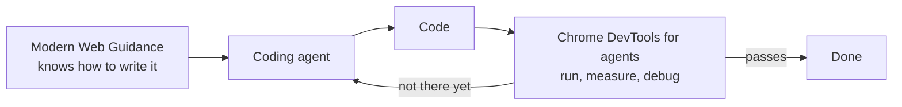

:::tldr
- **Modern Web Guidance (MWG)** is a set of skills for coding agents with best practices, browser compatibility data (Baseline), and expert-vetted advice. Version **1.0** shipped on **November 10, 2026**.
- What is new: a **modernization workflow** that scans existing codebases, a **larger guide database** targeting hundreds of AI knowledge gaps, **deeper review** (including a dedicated accessibility review), and a **public eval dashboard**.
- **Firefox and Edge** have joined Chrome, so this is no longer a Google-only project.
- Install with `npx modern-web-guidance@latest install`, or through the plugin marketplaces of Claude Code, Codex, Cursor, Copilot, WebStorm, and other agents.
- Pair it with **Chrome DevTools for agents**: MWG helps the agent write the right code, DevTools lets the agent run and measure it to verify.
:::

Coding agents are pretty good at building for the web now: ask for something and it usually works. But hand that code to a strong frontend engineer for review, and they can almost always find ways to make it faster, more accessible, or more secure. Modern Web Guidance exists to close that gap. This post summarizes [Chrome's announcement](https://developer.chrome.com/blog/modern-web-guidance-v1) by Philip Walton.

## What Modern Web Guidance Is

MWG is a set of **skills** (instructions an agent loads on its own when a task calls for them) that bundles three things:

- **Web platform knowledge**: which HTML, CSS, and APIs to use for each job.
- **Best practices** for accessibility, performance, security, and user experience.
- **Browser compatibility data**, based on [Baseline](https://web.dev/baseline), so the agent knows which features fit your project's browser support targets.

An early preview was shown at Google I/O in May. Version 1.0 is the first stable release.

## What Is New in 1.0

- **New modernization workflow**: scans an existing codebase to find opportunities to upgrade safely.
- **Expanded guide database**: targets hundreds of verified AI knowledge gaps, each with a cross-browser solution.
- **Deeper expert review**: every guide is signed off by the tech lead for its area; user-facing guides are also tested by accessibility experts with real assistive technologies.
- **Full eval coverage**: every guide has evals, with results on a [public dashboard](https://goo.gle/mwg-evals) comparing agents with and without MWG.

MWG is also now a **cross-browser effort**: [Firefox and Edge](https://github.com/GoogleChrome/modern-web-guidance-src/blob/main/GOVERNANCE.md#owners) are joining to support the project, improve compatibility, and contribute guides.

## Installation

Run this from your project directory:

```bash
npx modern-web-guidance@latest install
```

If you installed an earlier version, update to 1.0:

```bash
npx modern-web-guidance@latest update
```

You can also install it through the plugin marketplaces of most popular coding agents: Claude Code, Codex, Cursor, Antigravity, Copilot, WebStorm, Kimi Code, and Grok Build. See the [official docs](https://developer.chrome.com/docs/modern-web-guidance) for details.

## Why Use It

When everyone has a coding agent, writing code fast is no longer an advantage. What sets you apart is quality: is the page easy to use, fast, and secure?

### Best Practices Models Often Miss

According to [Chrome's evals](https://goo.gle/mwg-evals), today's frontier models still fall short in a few areas:

| Area | Examples models often get wrong |
| --- | --- |
| Accessibility | Keyboard focus and `inert` management, reduced-motion support, accessible form validation |
| User experience | Swipe and touch gestures, dialog and popover transitions, light/dark themes |
| Performance | Main-thread task scheduling, offscreen rendering isolation, layout shift prevention |
| Security | Safe HTML sanitization, strict Content Security Policies, passkey management |

Accessibility matters most here, because bad ARIA can make a page **less accessible than no ARIA at all**.

### The Best Feature for the Job

AI is very good at making things work with JavaScript. But many tasks already have an HTML or CSS feature that does the same with less code, runs faster because the browser handles it, and comes with accessibility built in. For example:

- Animating popovers and dialogs with CSS instead of JS.
- Scroll- and swipe-based interactions using native browser features.
- Smooth page transitions with View Transitions.
- **Passkeys and WebAuthn** for faster, more secure sign-in.
- **Autofill** for checkout forms, which often breaks with custom JavaScript form controls (especially on mobile).

Since the guides embed Baseline data, the agent recommends features that match the browser support you need, not just the newest thing.

### Modernizing Existing Codebases

Most work does not happen in new projects but in codebases that have piled up years of outdated workarounds, unneeded dependencies, and polyfills. Version 1.0 adds a [modernization workflow](https://developer.chrome.com/docs/modern-web-guidance/modernization-workflow) that analyzes your HTML, CSS, JavaScript, and `package.json` to find safe upgrades, then guides the agent through the changes:

```text
/modern-web-guidance Modernize the code in this directory
```

The first release uses **static analysis** on a limited set of patterns. Chrome deliberately started narrow for predictable results and plans to expand, including agentic audits where the agent reasons about your code directly instead of only matching known patterns.

### Keeping Up With the Platform

Every browser release ships new features, and features you could not use before keep [becoming Baseline](https://web.dev/baseline#the-baseline-monthly-digest). Because MWG is built on Baseline data and maintained by browser engineers, web standards experts, and accessibility specialists, its advice evolves with the platform. New APIs such as [HTML-in-Canvas](/en/blog/html-in-canvas/) or [Device Bound Session Credentials](/en/blog/device-bound-session-credentials/) are exactly the kind of knowledge a model has not caught up on yet.

### A Learning Resource

MWG is built for agents, but many developers find the guides useful on their own. You can read them directly or use the CLI to search by use case and discover techniques relevant to your project.

## Pairing With Chrome DevTools for Agents

Writing code is only half the job. The agent also needs to run it to know whether it works. That is why Chrome recommends using MWG together with [Chrome DevTools for agents](https://developer.chrome.com/docs/devtools/agents):



Three examples from the post:

- **Optimize until you hit a performance target.** MWG teaches the agent how to break up long JavaScript tasks, but cannot measure how long they actually block the main thread. DevTools runs a performance trace on a simulated low-end CPU, and the agent iterates until no task blocks the main thread for more than **50ms** (so it does not hurt INP).
- **Test and refine animations.** MWG shows how to animate dialogs, tooltips, and popovers properly. DevTools runs the page, interacts with it, records the screen, and reviews the recording to confirm the animation works and fits the site. It can also check that the component honors `prefers-reduced-motion`.
- **Cache views without memory leaks.** MWG teaches how to keep SPA views in memory for instant transitions while hiding them correctly from the accessibility tree. DevTools' memory tools let the agent confirm memory does not grow without bound when users stay on the page.

## Real-World Results

Some numbers from companies already using it:

| Company | How they used it | Result |
| --- | --- | --- |
| Pensionbazaar (India) | MWG + DevTools to build and verify new pages | Turnaround cut by **over 90%** (about 4 days to a few hours), UI bugs down **over 90%** |
| Policybazaar | DevTools automating performance audits on about 30 landing pages | **92%** less manual audit effort |
| WeTV (Tencent) | Agent in CI/CD: DevTools diagnoses, MWG fixes | Resolves **90%** of failed performance checks automatically, fix time down **87%** (4 hours to 30 minutes) |
| note inc. (Japan) | MWG with an in-house design system on a Next.js frontend | Modern web check pass rate from **61% to 94%**; correct LCP image priority up **28%** across 431 PRs |
| MetaMask | MWG as a review bot on every pull request, with a 3-line prompt | About 480 PRs reviewed in 5 weeks, **43 findings** fixed (mostly accessibility, HTML, forms), median **15 minutes** from comment to fix |

The MetaMask setup is the one I find most worth copying: no change to how the team writes code, just one extra review bot, and it catches the kind of issues linters miss.

## Wrapping Up

What I like about MWG is that it targets the real weakness of coding agents: not "make it work" but "do it the web's way". Models know a lot, but their knowledge often lags behind browsers, and they reach for JavaScript when HTML and CSS would do. A set of skills maintained by browser engineers, backed by Baseline data and public evals, is a sensible way to pull agents closer to how a strong frontend engineer works.

If you use a coding agent on a web project, try `npx modern-web-guidance@latest install`, then run the modernization workflow on a small directory to see what it suggests. If you notice gaps in what agents know, you can [contribute a guide](https://github.com/GoogleChrome/modern-web-guidance-src/blob/main/CONTRIBUTING.md) on GitHub.
