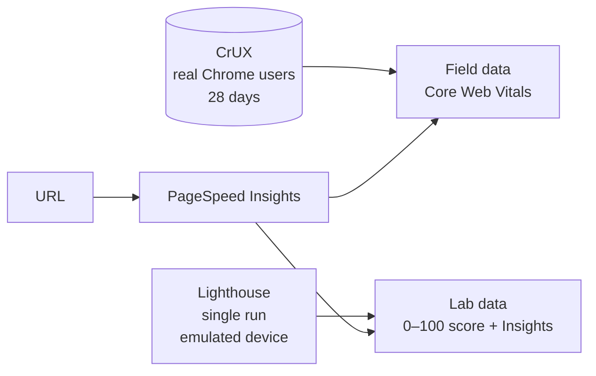

:::tldr
- **[PageSpeed Insights](https://pagespeed.web.dev/) (PSI)** is Google's free tool: paste a URL and get a performance report for both mobile and desktop.
- The report has **two fundamentally different parts**: **field** data from real Chrome users (CrUX, last 28 days) and **lab** data from a single simulated Lighthouse run.
- **Core Web Vitals** (LCP, INP, CLS) live in the field data, measured at the **75th percentile**. This is the part that reflects what your readers actually experience.
- **The 0–100 Performance score** comes from the lab only: a weighted average of TBT, LCP, CLS, FCP and Speed Index.
- Lab scores **vary from run to run** and can shift when Google upgrades Lighthouse, even if the page has not changed.
- Use the lab to **find problems**; use field data to **know whether users really see a fast page**.
:::

When people say "this page scores 100 on PageSpeed", they usually mean a lab number. That number is useful, but it is only half the report.
This post explains what PageSpeed Insights measures, where its data comes from and how to read each part.

## What PageSpeed Insights is

PageSpeed Insights is the site at [pagespeed.web.dev](https://pagespeed.web.dev/). Paste a public URL, pick the **Mobile** or **Desktop** tab, and about half a minute later you get a report.

PSI does not measure anything new on its own. It puts two existing Google data sources on one page:



- **Field data** comes from the Chrome User Experience Report (CrUX): anonymized measurements from Chrome users who opted in, across every kind of device and network.
- **Lab data** comes from one [Lighthouse](https://developer.chrome.com/docs/lighthouse/) run on Google's servers, under fixed emulated conditions.

The two parts answer different questions, so do not mix them up.

## Part 1: field data, "what real users see"

The top of the report is **"Discover what your real users are experiencing"**. These are measurements from real people over the **last 28 days**, refreshed daily in PSI.

### Core Web Vitals

The three Core Web Vitals each measure one aspect of the experience:

| Metric | What it measures | Good | Needs improvement | Poor |
|---|---|---|---|---|
| **LCP** (Largest Contentful Paint) | How soon the main content appears | ≤ 2.5 s | ≤ 4 s | > 4 s |
| **INP** (Interaction to Next Paint) | How quickly the page responds to taps and typing | ≤ 200 ms | ≤ 500 ms | > 500 ms |
| **CLS** (Cumulative Layout Shift) | Whether the layout jumps while you read | ≤ 0.1 | ≤ 0.25 | > 0.25 |

PSI also shows **FCP** (First Contentful Paint, good at ≤ 1.8 s) and **TTFB** (Time to First Byte, good at ≤ 800 ms) for diagnosis, but neither is a Core Web Vital.

### Why the 75th percentile

Each metric has a green/amber/red bar showing what share of visits falls in each bucket. The big number above it is the **75th percentile**: 75% of visits were as good as or better than that value.

Google picks p75 instead of the average so a page has to work well for **most** users, including those on slow phones or flaky networks. A nice average can hide a quarter of your readers waiting a long time.

A page **passes Core Web Vitals** when the p75 of LCP, INP and CLS are all Good. If there is not enough INP data, LCP and CLS alone decide.

### When there is no field data

New or low-traffic pages often show "not enough data". CrUX only covers URLs that are public, indexable and have enough samples.
When a URL lacks data, PSI falls back to the **origin** (all pages on the domain combined). If the origin lacks data too, this section stays empty and you only get lab data.

:::advanced
### The "This URL" and "Origin" tabs

When there is enough data, PSI lets you switch between **This URL** and **Origin**. Origin numbers tell you about the overall health of the site; URL numbers help you find the specific page dragging it down.
Search Console uses the same CrUX source but groups similar URLs together, so the numbers in the two tools may differ slightly.
:::

## Part 2: lab data, "diagnose the problem"

The lower part is **"Diagnose performance issues"**: the result of one Lighthouse run, with four gauges for **Performance, Accessibility, Best Practices and SEO**. Each uses the same scale: **90–100** good (green), **50–89** needs improvement (amber), **0–49** poor (red).

### The emulated conditions

On the **Mobile** tab, Lighthouse emulates a mid-range phone (the report currently says Moto G Power) on a **Slow 4G** network with a **4x CPU slowdown**. The Desktop tab uses a wired connection and much lighter CPU throttling.
That is why mobile scores are almost always lower than desktop. Hover over the environment details at the bottom of the report to see the device, network, server location and **Lighthouse version**.

### How the Performance score is calculated

The Performance score is a **weighted average** of five lab metrics:

| Metric | Weight |
|---|---|
| Total Blocking Time (TBT) | 30% |
| Largest Contentful Paint (LCP) | 25% |
| Cumulative Layout Shift (CLS) | 25% |
| First Contentful Paint (FCP) | 10% |
| Speed Index (SI) | 10% |

A few things worth noting:

- **INP is not in the lab**, because nobody clicks on the page during a lab run. Lighthouse uses **TBT** (the total time long tasks block the main thread) as a stand-in, and TBT carries the largest weight. Heavy JavaScript is the fastest way to lose points.
- Each metric is mapped to a score along a **log-normal curve**, not a straight line. Going from 50 to 90 is much easier than going from 95 to 100.
- The [Lighthouse Scoring Calculator](https://googlechrome.github.io/lighthouse/scorecalc/) shows how much improving one metric would change the score.

### Insights: the part actually worth reading

Below the metrics is a list of **Insights**, such as "LCP breakdown", "Render-blocking requests", "Layout shift culprits" and "Improve image delivery".
Since Lighthouse 13, the old "Opportunities" and "Diagnostics" sections have been folded into Insights, shared with the Performance panel in Chrome DevTools.

Insights **do not add or subtract points directly**. The score comes only from the five metrics above. Insights explain **why** a metric is slow, and PSI sorts them by estimated impact.
An effective way to read them: see which metric is red or amber, filter Insights by that metric (the "Show audits relevant to" buttons), then fix the highest-impact item first.

## Why the score changes when you changed nothing

This is the most common PSI question. There are a few reasons:

- **Natural variance**: every run is a real page load from Google's servers, affected by network conditions, machine load, and ads or third-party scripts that return different things. A few points of difference between runs is normal.
- **Different test regions**: PSI may run from North America, Europe or Asia. If your server is far from that region, TTFB changes.
- **Lighthouse upgrades**: for example, Lighthouse 13.6 (late October 2026) reworked the Lantern simulation model; many JavaScript-heavy pages saw their lab scores jump without a single code change.

So when comparing before and after, run several times, take the **median**, and only compare runs on the **same Lighthouse version**.

## Why lab and field data can disagree

The lab measures **one load**, on **one emulated device**, with an **empty cache**. The field is thousands of people on every kind of device and network, often with a warm cache, who also scroll, tap and open menus.

Common situations:

- **Red in the lab, green in the field**: most of your users have better devices and faster networks than the emulated ones, or they are returning visitors with a warm cache.
- **Green in the lab, red in the field**: the problem is something the lab cannot see, such as poor INP during interaction, layout shifts while scrolling, or ads that only load for real visitors.

When the two disagree, **trust the field data**. That is your readers' actual experience, and it is the signal Google uses for Core Web Vitals in search. The 0–100 Lighthouse score is not a ranking signal.

## Using PSI well

1. **Read the field data first**: does the page pass Core Web Vitals, and which metric is failing?
2. **Use the lab to reproduce and find causes**: filter Insights by the failing metric and start with the highest-impact item.
3. **Always check mobile**: most traffic comes from phones, and mobile is where problems show up most clearly.
4. **Re-measure properly**: run several times, note the Lighthouse version, and give field data 28 days to catch up.
5. **Automate when needed**: PSI has a [free API](https://developers.google.com/speed/docs/insights/v5/get-started) that returns the same data as JSON.

:::advanced
### Calling the PSI API from the terminal

```bash
curl -s "https://www.googleapis.com/pagespeedonline/v5/runPagespeed?url=https://buikhuongduy.com/&strategy=mobile" \
  | jq '{
      score: .lighthouseResult.categories.performance.score,
      lighthouse: .lighthouseResult.lighthouseVersion,
      fieldLCP: .loadingExperience.metrics.LARGEST_CONTENTFUL_PAINT_MS.percentile
    }'
```

A few test calls work without an API key; for regular use, create a key to get a higher quota.
If you want scores checked automatically on every push, running Lighthouse CI in your pipeline is more stable than calling PSI, because you control the Lighthouse version and can run each page several times. I described how in [my post on CI under 30 seconds](/en/blog/fast-ci-under-30-seconds/).
:::

## Wrapping up

PageSpeed Insights is more than one number. The top part tells you what real users see; the bottom part helps you find out why.
A lab score of 100 is a fun goal (I wrote about reaching it in [my post on a perfect Lighthouse score](/en/blog/perfect-lighthouse-score/)), but what matters in the long run is green Core Web Vitals for real readers.
