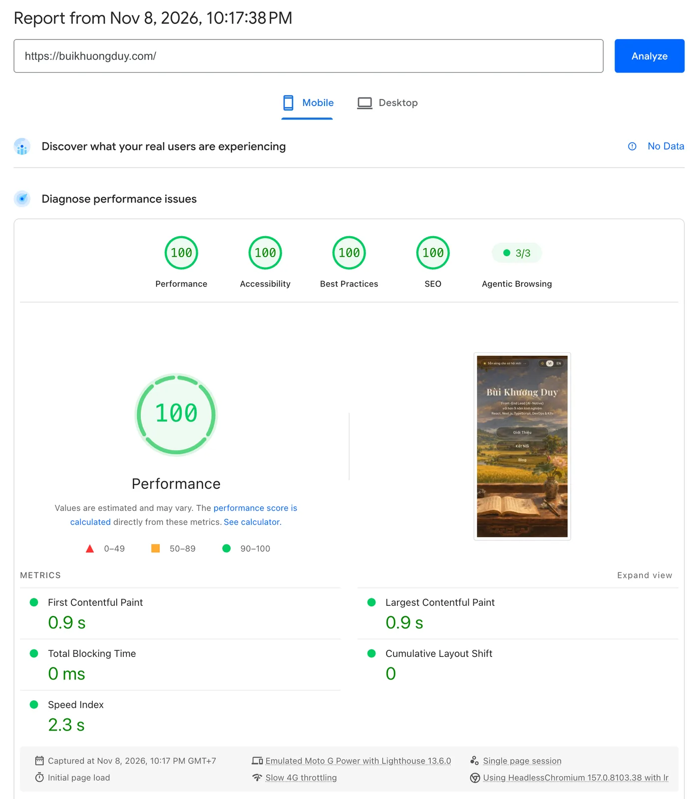
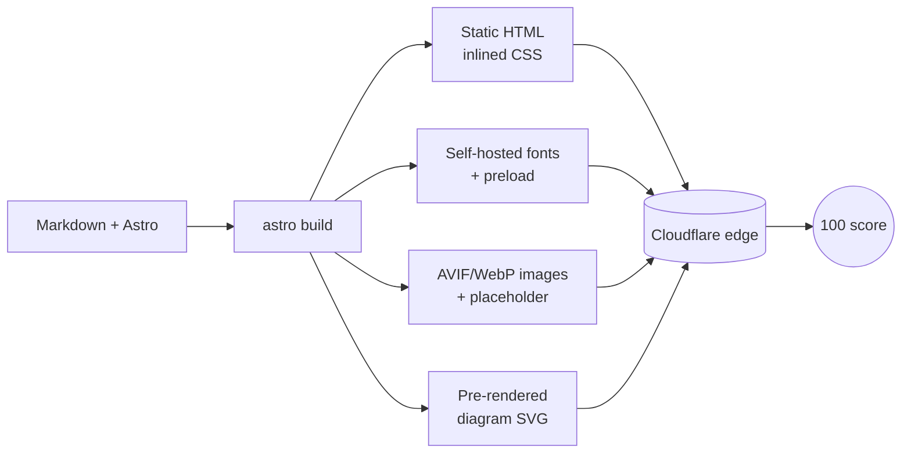

:::tldr
- **100 in all four categories on mobile**, where Lighthouse emulates Slow 4G and a 4x slower CPU: far harder than desktop.
- **0 KB of JavaScript by default**: pages are static HTML; scripts appear only where interaction needs them.
- **No render-blocking requests**: CSS is inlined, fonts are self-hosted and the right subsets are preloaded.
- **LCP and Speed Index**: the background image loads with high priority, backed by a 24px blurred placeholder inlined in the HTML.
- **CLS = 0**: fallback fonts are metric-matched to the real ones, so the font swap does not move text.
- **Mermaid rendered at build time**: readers get ready-made SVG, with no diagram library to download.
- **Accessibility, Best Practices and SEO** reach 100 through attention to detail: contrast, `prefers-reduced-motion`, metadata, `hreflang`, JSON-LD.
:::

A 100 Lighthouse score does not come from a single trick. It is the sum of many small decisions, each removing something the browser has to wait for.
This post sums up what I did for this site, following Lighthouse's four categories.

Measured with PageSpeed Insights in **mobile** mode, emulating a Moto G Power on Slow 4G (Lighthouse 13.6.0): FCP **0.9 s**, LCP **0.9 s**, Total Blocking Time **0 ms**, CLS **0**, Speed Index **2.3 s**. [See the original PageSpeed Insights report](https://pagespeed.web.dev/analysis/https-buikhuongduy-com/x7i018oiwk?form_factor=mobile).

## Why 100 on mobile is a real challenge

A 100 on desktop is not that rare. Mobile is a different game: Lighthouse emulates a mid-range phone on **Slow 4G** (about 150 ms latency, about 1.6 Mbps bandwidth) with a **4x CPU slowdown**.
Under those conditions, every KB downloaded, every render-blocking request and every millisecond of JavaScript is magnified. Many sites that score 95+ on desktop drop into the orange zone on mobile.

The scale is not linear either. Going from 90 to 99 is already hard, but a round 100 needs **every metric** close to its best at the same time. One weak spot, such as a late font swap nudging CLS or a small script holding the main thread, and the score slips to 98 or 99.

My home page also has everything that usually costs points: a **full-screen background image** as the LCP element, **two font families with Vietnamese diacritics**, intro animations, and view transitions between pages.
I kept all of them. Instead, I optimized each one until all four circles turned green at 100 on mobile, with **0 ms Total Blocking Time** and **CLS 0**, even with the CPU slowed down 4x.

## 1. Performance: remove everything the browser waits for

### Static HTML, JavaScript only when needed

The site is built with Astro and fully rendered to HTML at build time. No framework has to hydrate.
Interactive parts, such as the reading mode switch or the diagram viewer, are small scripts included only on pages that actually use them.

### Removing render-blocking requests

The site CSS is small, so I turned on `build.inlineStylesheets: 'always'`. The browser gets every style in the first HTML response and does not need another request for a `.css` file before painting.

### Fonts: self-hosted, preloaded where it counts, no layout shift

Vietnamese fonts are a classic trap: an external CDN adds DNS + TLS, a full font set is heavy, and a late font swap makes text jump.
I used the Astro Fonts API to:

- self-host the fonts on the same domain as the site;
- include only the weights and subsets I need (`latin`, `latin-ext`, `vietnamese`);
- preload only the `latin` and `vietnamese` subsets for above-the-fold text;
- generate **metric-matched** fallback fonts, so when the real font arrives, lines keep their size.

:::advanced
### Lesson: a green build does not mean the preload works

At first, my preload filter did not match the actual font files. The build passed with no warning, but the `<link rel="preload">` for Be Vietnam Pro was simply missing.
I only found it by reading the HTML in `dist/`. Since then, I check the built HTML after every font change instead of trusting the config.
:::

### The LCP image: high priority, and something to see right away

The home page background is the LCP element, so it is:

- exported as **AVIF/WebP** in several widths, letting the browser pick the right one;
- marked `loading="eager"` and `fetchpriority="high"`;
- paired with a blurred **24px placeholder**, inlined in the HTML as base64 (a few hundred bytes).

The placeholder means the first frame already shows the layout and colors of the real image instead of a flat color, which lowers Speed Index noticeably.

### Animations must not slow the score

Lighthouse also measures when the page becomes visually stable. I shortened the intro animations and the stagger between elements.
The "open to work" badge used to wait for the page's `load` event and then appear through JavaScript. I replaced that with a pure CSS `animation-delay`: it still appears last to catch the eye, but no longer depends on the heaviest image, and one script is gone.

### Mermaid diagrams rendered at build time

Mermaid is a large library. Shipping it to the browser just to draw a few diagrams is wasteful.
I wrote a remark plugin that uses `mermaid-isomorphic` to render diagrams to SVG during the build, with the site's own palette. Readers get the SVG inside the HTML, with no runtime to download.

:::advanced
### Keeping build-time diagrams identical to runtime ones

Mermaid measures text to size its boxes. If the build measures with a different font than the page displays, labels overflow or fall short.
The plugin loads Be Vietnam Pro into the headless browser before rendering, and uses the system Chrome (also present on GitHub Actions runners), so the build downloads no extra browser.
The zoomable diagram viewer is included only on posts with diagrams, thanks to a flag the plugin sets in the frontmatter.
:::

### Served from the edge

The site is built and deployed to Cloudflare Pages by GitHub Actions. Static HTML sits at the edge, close to readers, giving a low TTFB with no server tuning. The same setup is why [the site costs nothing to host](/en/blog/zero-cost-hosting-millions-of-requests/).

## 2. Accessibility: the easiest place to lose points

- **Contrast**: a few secondary text lines were too faint. Lighthouse caught them, and I raised their opacity to meet WCAG.
- **Respecting `prefers-reduced-motion`**: click effects, view transitions and animations turn off when the user asks for reduced motion.
- **Decorative elements** carry `aria-hidden`, and the background image uses `alt=""` so screen readers skip it.
- **Keyboard access**: diagrams have a dedicated expand button instead of relying on mouse clicks.
- **Page language** is set correctly in `<html lang>` for both the vi and en versions.

## 3. Best Practices: nothing extra

No third-party scripts, no trackers, no ad iframes. Everything is served over HTTPS from the same domain, and the console stays free of errors.
The feedback form at the end of each post uses `mailto:`, so it needs no backend or external service.

## 4. SEO: helping machines understand the page

- `description`, `canonical` and Open Graph on every page; each post gets its **own OG image**, generated at build time with Satori + resvg.
- **Proper bilingual setup**: `hreflang` pairs for vi/en (`/about/` ↔ `/en/about/`), plus `x-default`.
- `sitemap`, `robots.txt` and **JSON-LD** structured data (`ProfilePage`, `BlogPosting`).
- An `llms.txt` file so language models can read a summary of the site too.

## Conclusion

None of the steps above is complicated. The hard part is doing all of them, and verifying against the real build output instead of trusting the config.

This is only the summary. The full version includes the detailed configuration, before/after measurements for each step, and the checklist I use on every deploy.
If you would like to see it, or you need someone who brings this mindset for performance and quality to your product: **I am open to new opportunities**.

[Get in touch](/en/contact/), I would be glad to talk.
