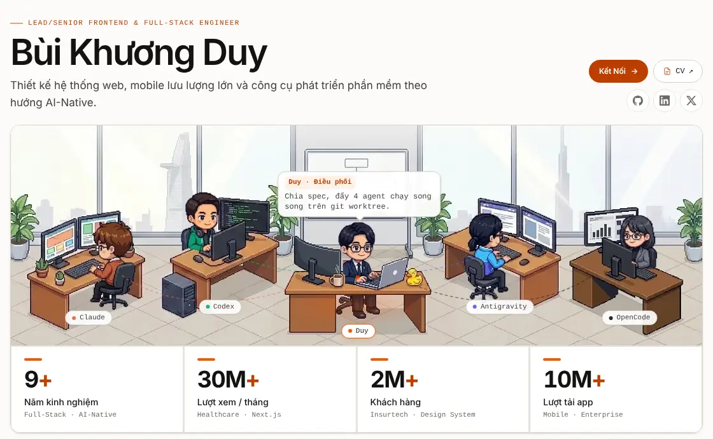

:::tldr
- **Nov 26–28, 2026**: rebuilt most of the site in **10 PRs** plus a few large UI commits.
- Every task was a thread with **Claude Code**: the agent wrote the code, ran Lighthouse and opened a PR. I read the diff and merged.
- **Lighthouse CI** blocks any PR below 100, so I could move fast without breaking things.
- Result: production PageSpeed scores **100 in all 4 categories**, mobile and desktop.
:::

Three days ago, this was a fairly plain personal page. Now it has a completely new UI, and PageSpeed is still 100/100/100/100.



## What is new

- **A pixel-art office hero**: I sit in the middle orchestrating the 4 agents I use every day (Claude, Codex, Antigravity, OpenCode). Click a desk and a speech bubble tells you what that agent is doing.
- A new orange palette, a mobile navigation bar, and a theme toggle with a circular reveal.
- An experience timeline, a 28-technology grid with a Tech Radar view, and a projects section with pixel GIFs.
- SEO: a new OG image, meta descriptions cut from 204 to under 150 characters, and a fuller `Person` JSON-LD.

## How it went this fast

I split the work into several Claude Code threads running in parallel. Each thread took one problem, read the code, made the fix, ran Lighthouse and opened a PR with the cause and before/after numbers. My job was to read the diff, question anything odd, and make the calls.

What made speed safe was a hard threshold in CI:

```js
// lighthouserc.cjs
'categories:performance': ['error', { minScore: 1, aggregationMethod: 'optimistic' }],
'categories:accessibility': ['error', { minScore: 1 }],
'categories:best-practices': ['error', { minScore: 1 }],
'categories:seo': ['error', { minScore: 1 }],
'categories:agentic-browsing': ['error', { minScore: 1 }],
```

Any PR that drops a score on any of the 7 audited pages cannot merge. I can hand off work without watching over it.

## Keeping 100 with a much heavier UI

The new UI has bigger images and more interaction, and production briefly dropped to 99. These changes brought it back:

- **Dropped web fonts for system fonts.** 6 woff2 files were blocking the LCP image. Without them, lab LCP went from about 1.9 s to 1.3 s.
- **Re-encoded the poster images** at WebP quality 65: about 30% smaller, no visible change in the pixel art.
- **Google Analytics (Partytown) loads after `load`**, so it no longer competes with the hero image. The Cloudflare Web Analytics beacon (injected at the edge, invisible to CI) was the last thing I dealt with.
- **A lighter home page**: the Tech Radar is built only when opened, post CSS is split out, and small scripts are inlined.
- **Accessibility**: fixed the speech bubble position, an invalid ARIA role, truncated tech names on mobile, and two links with the same name.

The details of each technique are in my [perfect Lighthouse score post](/en/blog/perfect-lighthouse-score/) and my [gtag post](/en/blog/why-gtag-did-not-lower-lighthouse-score/).

## Takeaway

With agents, I finished this much work in 3 days. But speed only helps when there is an automatic quality gate, and when the trade-offs (like dropping Be Vietnam Pro, a font I really liked) are still my decisions.

If your team needs a frontend or full-stack engineer who ships fast and keeps quality high: **I am open to new opportunities**. [Get in touch](/en/contact/).
