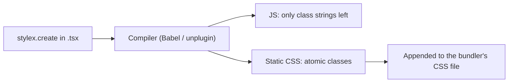

:::tldr
- **StyleX** ([stylexjs.com](https://stylexjs.com/), repo [meta/stylex](https://github.com/meta/stylex)) is Meta's open source styling library, MIT licensed, with more than 10,000 GitHub stars. The latest release is **0.19.2** (November 12, 2026).
- You write styles as objects in JavaScript (`stylex.create`) and **a compiler turns them into static atomic CSS at build time**. Nothing injects `<style>` tags at runtime; all that is left is a tiny class-merging function.
- One simple rule: **the last style applied wins** for a given property, with no specificity to think about. Styles can be passed as props, so components ship default styles and still let consumers override them.
- Themes come from `defineVars` + `createTheme` (typed CSS custom properties). Styling based on a parent's or sibling's state goes through `stylex.when.*`.
- My test: a Vite + React app with a theme, overrides and dynamic styles produced only **1.47 KB of CSS (0.59 KB gzipped)**, and StyleX added about **1.3 KB of gzipped JS** compared with an empty React app. The trade-offs: you need a bundler plugin, and the new `sx` prop has no TypeScript types out of the box.
:::

If you have written React for a while, you have probably gone through a few rounds of this: plain CSS until class names collide, CSS Modules until you need to pass styles in from outside, styled-components until you pay the runtime cost, Tailwind until the class string fills the whole line. **StyleX** is Meta's answer to the same problem at Facebook.com scale.

I only knew StyleX by name until I wrote about [Astryx](/en/blog/astryx-design-system/), Meta's design system built on top of it. This time I read through the [docs](https://stylexjs.com/docs/learn), the post [StyleX: A Styling Library for CSS at Scale](https://engineering.fb.com/2025/11/11/web/stylex-a-styling-library-for-css-at-scale/) on Meta's engineering blog and the [release notes](https://github.com/meta/stylex/releases), then built a small app to see what it actually generates.

## Where StyleX came from

According to Meta's post, CSS at their scale ran into every problem in the book: class collisions across bundles, hard-to-manage dependencies between stylesheets, and specificity wars that ended in complex selectors and `!important` everywhere. Huge monolithic CSS bundles also meant browsers downloaded hundreds of kilobytes of unused rules on every page load.

When Meta rebuilt Facebook.com, it wanted to keep what CSS-in-JS got right (styles next to components, styles driven by state, types, following the import graph) without the runtime cost of the first generation, which generated `<style>` tags and mutated the DOM during render. The result is a system that is **"CSS-in-JS only in form"**: you write it in JS, but it compiles to static CSS. Meta says atomic CSS cut its **CSS size by about 80%**.

StyleX was open sourced at the end of 2023 and is now the default styling system across Facebook, Instagram, WhatsApp, Messenger and Threads, and it is used at Figma and Snowflake too.

## The core idea: atomic CSS generated at build time

Every `property: value` pair becomes **a class with exactly one declaration**. Two components that both write `padding: 16px` share one class, so as a project grows, its CSS grows less and less until it mostly plateaus.

```tsx
import * as stylex from "@stylexjs/stylex";

const styles = stylex.create({
  root: { padding: 16, borderRadius: 12 },
  active: { backgroundColor: "#0866ff" },
});

function Item({ isActive }: { isActive: boolean }) {
  return <div {...stylex.props(styles.root, isActive && styles.active)} />;
}
```

After the build, `stylex.create` is gone. For styles used in the same file, the compiler precomputes the class string:

```tsx
// Actual output from the bundle I built
className: "xrvj5dj xou54vl xggk2y7"
```

```css
.xrvj5dj { display: grid; }
.xou54vl { gap: 16px; }
.xggk2y7 { padding: 24px; }
```

Only when styles cross a component boundary (say, a `style` prop passed in from outside) does `stylex.props` run at runtime to merge classes. That function is tiny.



## The APIs worth knowing

| API | Used for |
| --- | --- |
| `stylex.create` | Defining styles, including pseudo-classes, media queries and dynamic styles as functions |
| `stylex.props` | Merging styles into `{ className, style }` to spread on an element |
| `sx={...}` | Shorthand for `stylex.props` on HTML elements (new, handled by the compiler) |
| `stylex.defineVars` / `createTheme` | Tokens as CSS custom properties, themes that override them for a subtree |
| `stylex.defineConsts` | Constants inlined at build time, with no CSS variable generated |
| `stylex.when.*` | Styling based on the state of a parent, child or sibling (`:hover`, `[data-state]`...) |
| `stylex.keyframes`, `viewTransitionClass`, `positionTry` | Animations, View Transitions, anchor positioning |
| `@stylexjs/atoms` | Utility-style inline styles: `x.display.flex`, `x.padding._16px` |

### Conditions live inside each property

Instead of a separate `:hover` or `@media` block, StyleX puts conditions **inside each property**:

```tsx
const styles = stylex.create({
  card: {
    borderColor: { default: "#ddd", ":hover": colors.accent },
    maxWidth: { default: 320, "@media (min-width: 768px)": 480 },
  },
});
```

One property shows you every case it can be in. It felt verbose at first, but when I reread the code, it was much clearer than hunting through media query blocks.

### Styles as props, the last one wins

This is my favorite part. A component accepts styles from outside and puts them **last** in `stylex.props`, and consumers can override it without bumping specificity or reaching for `!important`:

```tsx
import * as stylex from "@stylexjs/stylex";
import type { StyleXStyles } from "@stylexjs/stylex";

export function Card({ style }: { style?: StyleXStyles }) {
  return <article {...stylex.props(styles.card, style)} />;
}

// At the call site
<Card style={overrides.wide} />;
```

Use `StyleXStyles<{ ... }>` or `StyleXStylesWithout<{ ... }>` to restrict which properties can be overridden, for example allowing color changes but not layout changes.

### Themes with typed CSS variables

Tokens are declared in a `.stylex.ts` file (the extension is required, and they must be named exports):

```ts
// tokens.stylex.ts
import * as stylex from "@stylexjs/stylex";

export const colors = stylex.defineVars({
  bg: "white",
  text: "#111",
  accent: "#0866ff",
});
```

Then create a theme and apply it to a subtree:

```tsx
const dark = stylex.createTheme(colors, { bg: "#111", text: "#eee", accent: "#7cb4ff" });

<div {...stylex.props(dark)}>
  <Card />
</div>;
```

The compiler generates CSS variables with hashed names derived from the file path and variable name, so they never collide across packages.

:::advanced
### `stylex.when` and markers

StyleX bans "styling at a distance": there are no `.parent .child` selectors. To change a child's style when its parent is hovered, you mark the parent with a marker and declare the condition on the child itself:

```tsx
const styles = stylex.create({
  title: {
    color: { default: colors.text, [stylex.when.ancestor(":hover")]: colors.accent },
  },
});

<article {...stylex.props(styles.card, stylex.defaultMarker())}>
  <h2 {...stylex.props(styles.title)}>...</h2>
</article>;
```

The compiler emits `.x4dk5e8:where(.x-default-marker:hover *)`. Besides `ancestor`, there are `descendant`, `siblingBefore`, `siblingAfter` and `anySibling`, and you can observe attribute selectors such as `[data-state="open"]` too. For several independent groups (say, hovering a table row versus a cell), use `stylex.defineMarker()`. Note that `descendant`, `siblingAfter` and `anySibling` rely on `:has()`.

### Cascade layers or specificity hacks

By default, StyleX enforces priority order (so `marginTop` beats `margin`) by repeating `:not(#\#)` to raise specificity. With `useCSSLayers: true`, it uses `@layer priority1, priority2...` instead. The CSS is smaller (from 1.77 KB to 1.47 KB in my test app) and **unlayered CSS always beats StyleX**. If your project has a reset, Tailwind or a design system with its own layers, pass `{ before, after, prefix }` to make the layer order explicit.
:::

## Adding it to a project

The quickest way is to start from an official template:

```bash
npm create @stylexjs my-app -- --framework vite-react
```

There are 13 templates: Next.js, Vite + React, Vite + RSC, React Router, Waku, RedwoodSDK, Webpack, Rspack, Rollup, esbuild, Storybook and more. For an existing project, since 0.17 StyleX ships `@stylexjs/unplugin`, one plugin for Vite, Rollup, Webpack, Rspack, esbuild and Bun:

```bash
npm install @stylexjs/stylex
npm install -D @stylexjs/unplugin @stylexjs/eslint-plugin
```

```ts
// vite.config.ts
import { defineConfig } from "vite";
import react from "@vitejs/plugin-react";
import stylex from "@stylexjs/unplugin";

export default defineConfig({
  // Put StyleX before the React plugin to keep Fast Refresh working
  plugins: [stylex.vite({ useCSSLayers: true }), react()],
});
```

Import at least one CSS file from the app root: the plugin appends StyleX's CSS to it. For Next.js, use the Babel plugin plus `@stylexjs/postcss-plugin`, and put `@stylex;` in your global CSS.

Don't skip the ESLint plugin. The compiler is forgiving and will compile invalid styles. `@stylexjs/valid-styles` catches those, while `sort-keys`, `valid-shorthands` and `no-unused` keep the code consistent.

## What I found when I tried it

I created an app with `npm create @stylexjs app -- --framework vite-react` (tested November 15, 2026, StyleX 0.19.2, Vite 7.3, React 19.2), then wrote a `Card` that used everything: tokens via `defineVars` and `defineConsts`, a dark theme via `createTheme`, hover, a media query, `stylex.when.ancestor`, a dynamic style for a progress bar, the `sx` prop and an override through a `style` prop.

**What worked well:**

- The template is one command: it downloads the template, installs 244 packages in about 35 seconds, and comes with ESLint, TypeScript, the React Compiler and a sample `shared-ui` package that shows StyleX coming from another library.
- The output is tiny. All of the app's CSS came to **1.47 KB (0.59 KB gzipped)** with `useCSSLayers` on. Compared with the same template rendering only a `<main>`, JS went from 69.31 KB to 70.57 KB gzipped, about **1.3 KB** for both the StyleX runtime and my component code.
- Builds are fast: `vite build` took under a second for this small app.
- Overrides work exactly as documented. I opened the build in Chrome: the `Card` that received `maxWidth: "none"` and `borderRadius: 4` from outside had **both of the component's `maxWidth` classes removed** (the default and the media query one) and the new class added. No more two classes for the same property fighting on one element.
- The dynamic `bar(progress)` style does not create a new class per value. It uses one fixed `width: var(--x-width)` class plus an inline `style="--x-width: 75%"`.

**What to weigh:**

- **The `sx` prop has no types.** It compiles fine, but `tsc` reports `Property 'sx' does not exist` on every HTML element. I had to add a declaration myself:

  ```ts
  // src/sx.d.ts
  import type { StyleXStyles } from "@stylexjs/stylex";

  declare module "react" {
    interface HTMLAttributes<T> {
      sx?: StyleXStyles;
    }
  }
  ```

  Even then, passing a `createTheme` theme to `sx` is still a type error, so for themes I went back to `{...stylex.props(dark)}`.
- **ESLint is strict.** The template sets `sort-keys` to `error`, so my freshly written `Card` had 5 property-order errors right away. `eslint --fix` fixed them all, but be ready for that if you migrate an existing codebase.
- **It depends on the build.** StyleX does not work without the compiler (there is a `runtimeInjection` mode for development, but it is not meant for production). Every tool that touches your code, from the test runner to Storybook, needs the plugin configured.
- **Values must be static.** `stylex.create` only accepts values the compiler can resolve within that file. To share values across files, go through `defineVars`/`defineConsts` in a `.stylex.ts` file; you can't import a plain constants object.
- **Hashed classes are hard to read when debugging.** `x1va8c73` tells you nothing. Turn on the compiler's `dev` mode for extra debug info, and since 0.19.1 StyleX has a [DevTools extension](https://github.com/meta/stylex/releases/tag/0.19.1) for all browsers.
- It is still **0.x**. The core APIs are fairly stable, but every minor release still changes things, and the repo has just moved from `facebook/stylex` to `meta/stylex`.

## When to choose StyleX

Compared with other popular options, based on my experience:

| | StyleX | Tailwind | CSS Modules | styled-components / Emotion |
| --- | --- | --- | --- | --- |
| Where you write it | Objects in JS/TS | Classes in JSX | Separate `.css` files | Template strings in JS |
| Runtime | Almost none | None | None | Yes, injects styles on render |
| CSS as the project grows | Plateaus (atomic) | Plateaus (atomic) | Grows with code | Grows with code |
| Overrides from outside | Explicit, last one wins | Needs `tailwind-merge` | Specificity fights | Specificity fights |
| Type safety | Yes, down to each property | Via editor plugin | No | Partial |
| Needs a build plugin | Yes | Yes | Built into bundlers | Not required |

StyleX fits best when you **build a component library or design system used in many places**, need components with default styles that can still be customized safely, and your project is big enough that CSS bloat and collisions are real problems. That is exactly why Astryx chose it.

For a small landing page, or a team that is comfortable with Tailwind and rarely passes styles through props, the build setup and the rules StyleX asks you to learn are probably not worth it.

## Wrapping up

StyleX is not new as an idea: atomic CSS and statically compiled CSS-in-JS have been around for a while. What it does well is **deliberate constraints**: no styling at a distance, static values only, the last style wins. Those constraints let thousands of engineers at Meta write styles without stepping on each other, and for me they made the code easier to read when I came back to it a few days later.

To try it without installing anything, open the [Playground](https://stylexjs.com/playground) and see how styles turn into CSS. If you write code with an AI agent, StyleX has an [LLM Resources](https://stylexjs.com/docs/llm-resources) page and an [llms-full.txt](https://stylexjs.com/llms-full.txt) file to load into context.

To see StyleX inside a real design system, read the [Astryx](/en/blog/astryx-design-system/) post next.
