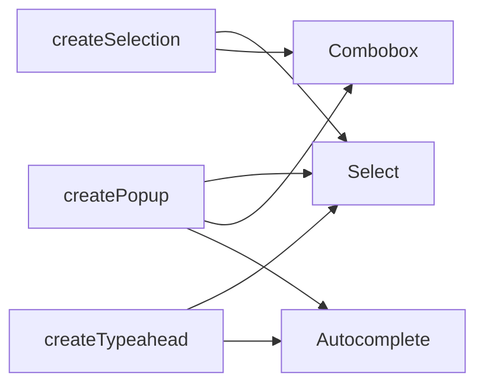

:::tldr
- **UI SDK** ([ui-sdk.dev](https://ui-sdk.dev/)) from Vercel Labs is a library of **behaviors**: interaction pieces like focus, keyboard navigation, selection, popups and drag and drop, plus the ARIA they need, in `@ui-sdk/core`.
- Instead of handing an agent a ready-made `Select`, you give it the pieces that make one (`createPopup`, `createSelection`, `createTypeahead`). The agent composes them into a Select, a Combobox, an Autocomplete, or something nobody has built yet.
- Adapters for **React, Vue, Svelte, Solid and Web Components**, plus 50+ unstyled components built from the same behaviors.
- Agents can also **use** the UI through an agent bridge (`createAgent`) or **WebMCP**: read state and call actions directly. In Vercel's benchmark: **69% fewer tool calls**, **61% faster**, **56% cheaper** than driving the page with browser tools.
- Currently in **beta**, Apache 2.0 licensed.
:::

Give an agent a `Select` component and it can build a Select. Makes sense. But when you need a searchable combobox, or an input that suggests people when you type `@`, the agent either fights the existing component or rewrites everything from scratch: focus, arrow keys, dismiss on outside click, ARIA. Exactly the things models get wrong most often.

UI SDK takes the opposite approach. Here is what I found worth noting, from the [homepage](https://ui-sdk.dev/), the [docs](https://ui-sdk.dev/docs) and the [GitHub repo](https://github.com/vercel-labs/ui).

## What a Behavior Is

Behaviors are **the pieces that make a component work**, separated from how it looks. A few examples:

| Behavior | What it does |
| --- | --- |
| `createRovingFocus` | Arrow keys move through a list, with one Tab stop |
| `createTypeahead` | Type a few letters to jump to an item |
| `createPopup` | Opens next to its button, stays on screen, dismisses when needed |
| `createSelection` | Pick one or many, with Shift and Ctrl like a file manager |
| `createReorder` | Sort a list with a pointer or the keyboard |
| `createResize` | Resize boxes from their handles |
| `createViewport` | Pan and zoom a canvas |
| `createVirtualizer` | Render only the rows you can see |

There are more than 50 of them. A `Select` is really just `createPopup` + `createSelection` + `createTypeahead`. Combine them a little differently and you get a combobox, an autocomplete, or a brand-new component.



## Primitives: Where Behaviors Meet State

Behaviors are brought together in a **primitive** with `definePrimitive`: state, an API (actions), and **slots** (DOM parts) with their attributes and events. Here is a mute button from the docs:

```ts
import { definePrimitive } from "@ui-sdk/core";

const muteButton = definePrimitive({
  name: "mute-button",
  state: () => ({ muted: false }),
  api: (context) => ({
    toggle: () => context.store.set({ muted: !context.store.get().muted }),
  }),
  slots: (slot) => ({
    root: slot({
      attrs: (state) => ({ type: "button", "aria-pressed": String(state.muted) }),
      press: ({ api }) => api.toggle(),
    }),
  }),
});

export { muteButton };
```

Pressing the button flips `muted`, and `aria-pressed` follows. The same primitive renders in all five frameworks through `createParts`:

```tsx
import { createParts } from "@ui-sdk/react/primitive";
import { muteButton } from "./mute-button";

const parts = createParts(muteButton, { root: "button" });
const MuteButton = parts.Root;
```

Vercel's pitch: **you don't need to learn how to write this, your agent will**. You describe what the component needs, and the agent picks the behaviors and wires them up in your framework.

:::advanced
### Composing Several Behaviors in One Primitive

The search field from the README: the Clear button only shows when there is text, and after clearing, focus goes back to the input thanks to `createFocusRecovery`.

```ts
import { createFocusRecovery, definePrimitive } from "@ui-sdk/core";

const searchField = definePrimitive({
  name: "search-field",
  state: () => ({ value: "" }),
  api: (context) => ({
    set: (value: string) => context.store.set({ value }),
    recovery: createFocusRecovery({ fallback: () => context.element("input") }),
  }),
  slots: (slot) => ({
    input: slot({
      attrs: (state) => ({ value: state.value }),
      on: { input: (event, { api }) => api.set((event.target as HTMLInputElement).value) },
    }),
    clear: slot({
      present: (state) => state.value !== "",
      attrs: () => ({ type: "button" }),
      press: ({ api }) => api.set(""),
      bind: (el, part) => part.api.recovery.bind(el, part),
    }),
  }),
});
```

- `present` decides whether a slot is rendered.
- `press` covers click as well as Enter/Space, so you don't handle keys yourself.
- `bind` attaches a behavior to the real element after mount.

Each package ships Markdown docs for the installed version (`node_modules/@ui-sdk/react/docs/llms.txt`, `core.md`, `rendering.md`) and a **testing kit** so the agent can check keyboard behavior, focus and ARIA in the component it just built.
:::

## A Ready-Made Component Library

If you don't want to start from zero, UI SDK ships 50+ **unstyled** (headless) components, all built from the same behaviors: Select, Combobox, Command, Date Picker, Calendar, Color Picker, Token Input, OTP Input, Resizable, Tree, Toolbar, Toast, Drawer, Image Cropper, Waterfall and more. You style them with your own CSS.

What I like is that these components are not black boxes: when you need a variant, the agent can open one up, see which behaviors it uses, and recombine them.

## Agents Don't Just Build the UI, They Use It

This is the part I find most interesting. Today, agents mostly use the web by reading the DOM, taking screenshots, and clicking coordinates. Slow, token-hungry, and error-prone.

With UI SDK, you create an **agent bridge** before the page renders:

```ts
import { createAgent } from "@ui-sdk/react/agent";

const agent = createAgent();
```

`agent.snapshot()` lists components, their state and their actions:

```json
{ "ref": "c1", "component": "input", "label": "Project name", "value": "Apollo", "actions": ["setValue", "clear"] }
```

The agent changes the value by calling an action, with no clicking or typing:

```ts
await agent.act({
  steps: [{ ref: "Project name", action: "setValue", args: ["Atlas"] }],
});
```

The change goes through the component's own API and change callback. Your app can pass an `allow` callback to approve or refuse requested actions, and change callbacks receive `source: "agent"` so you know where a change came from and can cancel it. Besides handing these tools to your own agent, you can register them with the browser through **[WebMCP](https://ui-sdk.dev/docs/agents)** so a browser's built-in agent can use your components.

### Benchmark

Vercel had agents complete a project-settings task: rename a project, update members and notification settings, then save. One used browser tools on a page built with another component library; the other used the agent bridge on the same screen built with UI SDK. Both ran Sonnet through Claude Code; numbers are medians of three runs:

| | Browser tools | UI SDK + agent bridge | Delta |
| --- | --- | --- | --- |
| Tool calls | 16 | 5 | **-69%** |
| Text read | 39.8k | 6.8k | **-83%** |
| Time | 41 s | 16 s | **-61%** |
| Cost | $0.073 | $0.032 | **-56%** |

It is a small sample measured by Vercel itself, so treat it as indicative. But the direction makes sense: when components describe their own state and actions, the agent doesn't have to guess from pixels.

## Getting Started

Install core and the adapter for your framework (swap `react` for `vue`, `svelte`, `solid` or `web`):

```bash
npm install @ui-sdk/react @ui-sdk/core
npx skills add vercel-labs/ui --skill ui-sdk
```

The React adapter needs React 19 or newer. The docs suggest adding a note to `AGENTS.md`: before using UI SDK, follow the `ui-sdk` skill and read `node_modules/@ui-sdk/react/docs/llms.txt`. Then just ask your agent, for example:

```text
Build a search field with ui-sdk: a text input and a Clear button that only shows
when there's text. Clear empties the input and puts focus back in it. Use our existing styles.
```

To go deeper, read the [Introduction](https://ui-sdk.dev/docs), the [Build a Component](https://ui-sdk.dev/docs/guides) guide and [Built for Agents](https://ui-sdk.dev/docs/agents).

## What I Found Trying It

I asked Opus 5.5 (via the API) to build an accessible Combobox two ways, two runs each (tested November 14, 2026, `@ui-sdk/core` and `@ui-sdk/react` 0.1.0-beta.1, React 19). Way **A** was plain React with no docs. Way **B** composed it from UI SDK behaviors, with about 123 KB of docs and types in the prompt. Then I ran all four results through 22 automated keyboard and ARIA checks (Playwright + Chrome 157) and axe.

| | Plain React (A) | UI SDK behaviors (B) |
|---|---|---|
| Built as-is, no fixes | 2/2 | 2/2 |
| Passed 22 keyboard/ARIA checks | 2/2 | 2/2 |
| axe violations | 0 | 1 critical in one run |
| Input / output tokens | ~580 / ~3,900 | ~46,000 / ~7,300 |
| Generation time | ~30 s | ~69 s |
| JS added to the bundle (gzip) | ~1.5 KB | ~16.5 KB |

This wasn't what I expected: **for a well-known component like a Combobox, Opus 5.5 writing plain React is already good enough**, so UI SDK gave no accessibility edge here while costing more tokens and bundle. The axe violation in run B was in the "no results" state: `aria-controls` pointed to a list that was no longer on the page.

Other beta rough edges:

- `npm install` gets beta.1 because the `latest` tag doesn't point to beta.2 yet.
- `llms.txt` is 385 KB, a full copy of the docs rather than an index. I had to pick the relevant sections for the prompt by hand.
- The docs point agents to `createListbox` for a combobox, not `createPopup` + `createSelection` + `createTypeahead` as I described above. In both runs the model chose `createListbox`.
- The ready-made Combobox has a bug: passing `items` together with custom-rendered options **turns filtering off**, contrary to the docs. Removing `items` fixes it.

My take: this was a small test (two runs per way, one component, and the model couldn't run tests and fix its own code), so it says nothing about unusual or more complex components. That may be where UI SDK shines. For common components it isn't worth the tokens and bundle size yet. The part I find more promising is the agent bridge and WebMCP for agents *using* the UI, but I haven't measured that.

## Wrapping Up

I think UI SDK draws the line between people and agents in the right place. The hardest, most error-prone parts of a component (focus, keyboard, ARIA, popups) are packaged as tested behaviors. The most flexible part, combining them into whatever the product needs, goes to the agent. And because components describe themselves, agents use them far more efficiently than by looking at screenshots.

Two caveats: the library is in **beta**, so APIs may still change, and the benchmark covers a single scenario. But if you already let agents write your UI, this is a promising way to have them write less code and get more of it right.

This fits alongside [A2UI 1.0](/en/blog/a2ui-1-0/) (agents answering with UI) and [Modern Web Guidance](/en/blog/modern-web-guidance/) (teaching agents to build the web right): three different ways to help agents and interfaces understand each other.
