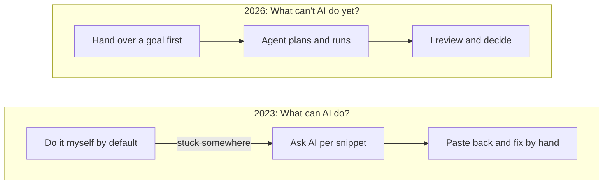
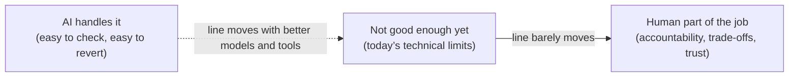

:::tldr
- In 2023 I asked "can AI do this?" and defaulted to doing it myself. By late 2026 I ask "what can't AI do *yet*?" and default to letting an agent try first.
- I say "yet" because things people wrote off in 2023 (reading a whole repo, running tests, opening a complete pull request) are now routine.
- The answer has two parts. Some limits are technical and shrink with every model release. The rest needs a person behind it: owning outcomes, picking trade-offs, questioning the task.
- In practice: hand verifiable, reversible work to agents first, and keep reading diffs and making the calls yourself.
:::

Back in 2023, every time I opened an AI chat tab I had the same doubt: can it actually write this, or will fixing its output take longer than typing it myself? Doing it by hand was the default. AI was something I asked when stuck on one function.

Three years later that habit is gone. I use AI nearly every day, from those early chat boxes, to rolling out Claude Code for a team, to building my own extension for orchestrating agents. Now when a new task lands, my first thought is: "What can't AI do *yet*?"

The default flipped. I let an agent run first, and I handle direction and checking the result.

## How Fast Things Moved from 2023 to 2026

Here's my everyday web work, year by year:

- **2023, a chat box on the side.** I copied small snippets into a browser tab to ask about a regex, a TypeScript error, or a helper function. Models regularly made up APIs. I still typed most of the code.
- **2024, AI moves into the editor.** It could read a few open files and edit across them for a small feature. Anything that needed terminal commands, build logs, and several rounds of test fixes, and it stalled.
- **2025, agents running in a loop.** This was the real jump. Once models were wired to a shell and tools, they could search the repo, edit code, run typechecks and tests, open a browser to check the page, and keep fixing. When our team wrote its conventions into `AGENTS.md` and Claude Code became a habit, my days shifted to writing specs and reading diffs.
- **2026, several agents in parallel.** One session can open a few git worktrees to compare approaches, like I do in [KD Code](/en/blog/why-i-built-kd-code/), or run migrations that take hours, like when I tested [Claude Fable 5.2](/en/blog/claude-fable-5-2/).

| | 2023 ("What can AI do?") | 2026 ("What can't AI do yet?") |
| --- | --- | --- |
| Default | Do it myself, ask for ideas now and then | Let an agent try first, except for risky actions |
| Size of a handoff | A function, a snippet | A feature, a bug, a migration |
| Cost of trying | High (trim context by hand, copy back and forth) | Low (run in a separate worktree, throw it away if it misses) |
| Bottleneck | Weak models, small context windows | Unclear specs, missing tests, slow human review |
| My main job | Writing code | Framing the task and reviewing output |

## Why "Yet"

I try not to say "AI will *never* do X." In 2023 there were plenty of confident predictions, like LLMs never reasoning across many steps or never handling a real repository. A few years later, they were all wrong.

Today agents run commands in the repo, check pages in a real browser, pull in guidance from skill packs like [Modern Web Guidance](/en/blog/modern-web-guidance/), and reply with interactive UI over [A2UI 1.0](/en/blog/a2ui-1-0/). Whatever is weak today may well get fixed in the next model, or by better tooling around it.

Believing the opposite, that "AI can do everything now," causes real production bugs. People start skimming diffs and then get surprised when something simple breaks.

So I split the answer in two. First, the technical gaps, which move every quarter. Second, the human part of the job, which stays put however good models get.

## Where AI Still Trips

### Old Codebases

On a fresh project or a tightly scoped task, agents are fast. A codebase with 3–5 years of history is a different story. It's full of conventions nobody wrote down, plus workarounds someone added on purpose to hit a launch date. An agent can write a new module that passes every test and still duplicate logic that already exists elsewhere, or add a second state pattern next to the one the team uses.

Even with a Memory layer like the one in [the 5-layer AI agent infrastructure stack](/en/blog/agent-infrastructure-stack/), agents still mix up which conventions are current and which code is debt about to be removed.

### Things That Aren't in Any File

Agents only see code, docs, and tool output. A lot of important constraints live outside the repo. Say, a compatibility promise made to a big customer in last week's meeting. Or the reason an awkward API has to stay as is until a partner upgrades.

As long as that lives in someone's head, the agent doesn't know it's missing anything. It fills the gap with whatever sounds most reasonable.

### Work Without a Clear Test

Wherever a compiler, a test suite, or an automated score acts as referee, AI improves fast. Work that depends on taste moves much slower. Whether a UX flow feels good, or whether a blog post gives readers what they need, isn't something a machine can grade. Agents easily produce something that looks polished and still feels off once real people use it.

### Knowing When to Stop and Ask

Models are trained to push through to an answer. When a request has two hidden requirements that clash, or an assumption doesn't match the real code, an agent usually picks a direction and keeps going instead of asking.

Leave it running without a limit and you can burn money for nothing. When I tested [Claude Fable 5.2](/en/blog/claude-fable-5-2/), I hit exactly this with Opus 5.5 at `effort: max`: on the hard task, it spent around 19 minutes thinking through its whole 128,000-token output budget and returned zero lines of code.

### Actions You Can't Undo

Say an agent gets things right 95–99% of the time. On a git branch, where you can look at the diff and drop it in two seconds, that's great. That remaining 1–5% is not fine when the agent is running commands on a production database, editing IAM policies, or sending notifications to thousands of real users.

If the agent also reads outside input (emails, web pages, issues from strangers), prompt injection comes into play: someone plants instructions in the content to steer the model. Sandboxing and tight permissions are still a must.

:::advanced
### Why AI Moves Fast on Some Tasks and Barely at All on Others

Looking at those gaps together, almost all of them come down to one thing: how fast and how objectively you can check the result.

When feedback is quick and clear (a typechecker failing immediately, tests finishing in seconds, or a proof checker like Lean), both training and the agent's own self-correction go smoothly. A mistake gets flagged right away and the next step fixes it.

When you have to wait months to know if something was right, like whether an architecture will still be easy to maintain in two years, the agent has almost nothing to steer by.

When I hand out work day to day, I sort it with this 2×2:

| | A machine can check it | Hard to check, needs taste |
| --- | --- | --- |
| **Easy to revert (git branch)** | Hand it to an agent in a separate worktree, let CI filter, then read the diff (bugs with tests, writing tests, small refactors) | Have an agent draft a few versions for ideas, then pick one and rework it myself (UX, copy, architecture spikes) |
| **Hard to revert (production, money, permissions)** | Agent writes the script and runs it on staging or as a dry run; a person checks it and runs it for real (migrations, infra, security) | A person does it start to finish; AI only helps research and push back on assumptions (product direction, client commitments) |
:::

## What a Better Model Still Won't Do for You

Say the next few model generations close most of the technical gaps above. Some work still has to be done by people, because someone has to answer for it.

### Owning It When Things Break

Even if an agent wrote 90% of a pull request, nobody calls the model provider at 2 AM when production goes down. The person who hit merge and the team that ships the product still take the hit and do the fixing.

### Choosing Where to Take the Hit

Engineering rarely optimizes one number. Most of it is choosing where you're willing to lose: ship this week, or clean up so next quarter hurts less? Keep the product simple for most users, or bend for one big customer?

AI lays out the options and the pros and cons fast. Picking one is still on the people who live with the result.

### Questioning the Task

An agent optimizes well inside whatever frame you give it. But a lot of an experienced engineer's value shows up before the editor opens, when they ask: do we need to build this at all? Sometimes a team asks for a whole caching layer when deleting one unnecessary query would do. AI almost never says "don't build this feature."

### Trust Between People

Getting a team to agree on an architecture change, or renegotiating scope with an impatient client, runs on your own credibility. A smooth AI-written summary doesn't replace that.

## What I Do Differently Now

Since the question in my head became "What can't AI do yet?", my work has settled into a few habits.

If a task fits in its own branch or worktree, I just let an agent try instead of guessing. Seeing where it trips on my own codebase tells me more than any debate online.

I also put effort into the setup around agents: clear specs, a short and accurate `AGENTS.md`, fast CI (this site builds and deploys in [under 30 seconds](/en/blog/fast-ci-under-30-seconds/)), and a comfortable place to read diffs like [KD Code](/en/blog/why-i-built-kd-code/).

And I keep reading diffs. Green tests and tidy code make it tempting to hit merge and move on. Once you stop understanding what's going to production, AI speed turns into technical debt just as fast.

On the career side: if your edge is remembering syntax or typing boilerplate a bit faster than a model, that edge won't last. Framing the right problem and owning the result last much longer.

## Where I've Landed

I now treat what models can do as the starting point. Anything checkable and reversible goes to an agent. Decisions and responsibility stay with me.

For more on organizing products and workflows around agent speed, see [What Is AI-Native?](/en/blog/what-is-ai-native/). The "yet" list in this post will probably be shorter in a few months, and I'll update it when it is.
