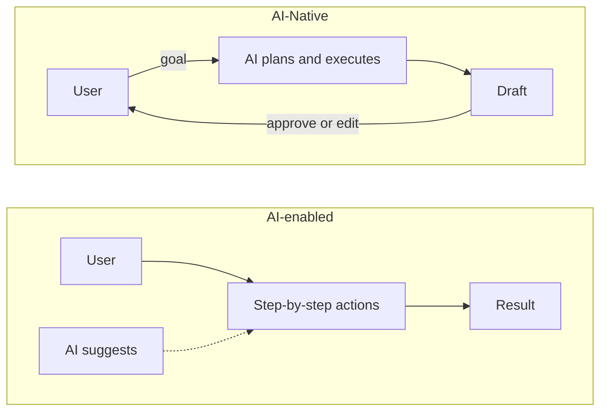
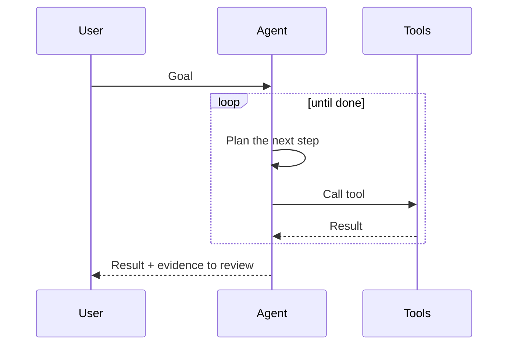

:::tldr
- **AI-Native** means designed around AI from the start: remove the AI, and people **can still do the work**, but **much more slowly**, because the whole process is built around the speed of AI.
- **AI-enabled** means an old system with AI added on: remove the AI, and almost nothing changes, you only lose one convenient feature.
- Signs: AI is in the **main flow**, not in a corner of the screen; users **state a goal** instead of clicking step by step; and the system **gets better over time** from usage data.
- For developers, AI-Native means moving from "writing every line myself" to **describing, delegating, and checking** the work of agents.
:::

Lately the term "AI-Native" shows up everywhere: in product descriptions, job posts, and funding slides. Many places use it as a marketing keyword, so its real meaning is easy to lose.

The simplest way to understand it: **AI-Native is something born together with AI**. It is like "cloud-native," which means software designed to run on the cloud from the start, not old software moved onto a rented server.

## AI-Native and AI-enabled

The quickest way to tell them apart is to ask: **what happens if you turn off the AI?**

AI-Native does not mean the work is impossible without AI. Anything the AI does, a person can also do, it just **takes much more time and effort**. The difference is this: in an AI-Native setup, the whole process is designed around the speed of AI, so turning the AI off can stretch a 5-minute task into half a day. In an AI-enabled setup, turning the AI off barely changes the speed.

| | AI-enabled (AI added on) | AI-Native |
| --- | --- | --- |
| Role of AI | A side feature | The core of the product |
| Turn AI off | Almost no change, only one feature is lost | People can still do it, but much more slowly |
| How users work | Click step by step, AI suggests on the side | State the goal, AI does the work, a person approves |
| Interface | Built for manual actions, plus a chat box | Built for delegating and checking work |
| Data | Stored for reports | A feedback loop that makes the system better |

Example: a text editor with a "Rewrite with AI" button is **AI-enabled**. A tool where you just say "draft a house rental contract from the company template, fill in the details from this email," and then read back the draft, is **AI-Native**.

## Signs a Product Is Truly AI-Native

### AI Is in the Main Flow

If AI is just a sparkle icon in the corner of the screen, it is a side feature. In an AI-Native product, the main task that users come to do goes through AI.

### Users Give Goals, Not Steps

Traditional software makes users know **how** to do the work: which menu to open, which button to press, and in what order. An AI-Native product lets users say **what they want**, and the system handles the how.

### Humans Can Check the Work

AI can be wrong. A good AI-Native product does not hide this. It builds in a review step: it shows the diff, the sources, the confidence level, and makes it easy to undo.

### Gets Better Over Time

Every time a user edits a result, that is a signal. An AI-Native system collects those signals so it does better next time, instead of just saving logs for show.

:::advanced
### Architecture Often Seen Underneath

An AI-Native application usually has a few layers that repeat:

- **Model**: an LLM or a specialized model, called through an API or self-hosted.
- **Context**: data put into the prompt at the right time, often through RAG (finding related documents and adding them to the context) or through connections such as MCP.
- **Tools**: functions the model is allowed to call to take real actions: read files, call APIs, run commands.
- **Agent loop**: the cycle of *plan → call a tool → read the result → decide the next step*, until the goal is done.
- **Evals and guardrails**: test suites that measure output quality, plus limits on permissions and cost.

The difference from traditional software: the output is **not fixed** (the same input can give different results). So evals work like unit tests, but they measure a pass rate, not absolute right or wrong.
:::

## AI-Native for Software Builders

The word is not only for products. A **developer** or a **team** can also work in an AI-Native way.

In the past, most of the time went into typing code. When you work AI-Native, the time goes to other things:

- **Describe the requirements clearly**: write specs, constraints, and examples, because how well an agent works depends on how clearly you state the task.
- **Prepare context**: project docs, code conventions, and instruction files for agents (such as `AGENTS.md` in this repo).
- **Delegate in parallel**: many agents run at once on many branches, and I move into the role of coordinator.
- **Review and verify**: read the diff, run tests, and check in the browser. Final responsibility still belongs to the person.

In other words, the skill shifts from "writing code fast" to "**making the right decisions and checking carefully**."

## A Real Example: This Website

The site you are reading is built and maintained in an AI-Native way. I set the direction and check the work, while coding agents do most of the hands-on work:

- **Agent instructions live in the repo.** The `AGENTS.md` file holds the project rules: code and comments in English, slugs in English kebab-case, and a 301 redirect whenever a slug changes. Agents read this file before they start, so I do not have to repeat myself every time.
- **Delegating with one sentence.** This post started from the request "add a blog post explaining what AI-Native is." The agent looked at the content collection setup, read the older posts to match their tone and format, wrote a draft, translated it into English, and ran the build to check it. I read it back and gave feedback. For example, the idea that "without AI people can still do the work, just more slowly" came from my revision.
- **Bilingual thanks to an agent translator.** Each post is written in Vietnamese first, then an agent translates it into English, keeping the frontmatter, diagrams, and content blocks intact.
- **Quality is checked by machines.** On every push, CI builds and deploys in [about 25 seconds](/en/blog/fast-ci-under-30-seconds/), and Lighthouse runs in parallel to keep the [score at 100](/en/blog/perfect-lighthouse-score/). Agents work fast, and tests and CI keep the site from breaking.

This matches the test above: without agents, I could still do all of this myself. A bilingual post with diagrams would just take a whole afternoon instead of a few dozen minutes, and keeping the site updated regularly would be much harder.

## Common Misunderstandings

- **"Having a chatbot makes it AI-Native."** No. A chat box added to an old product is still AI-enabled.
- **"AI-Native means it cannot work without AI."** People can still do all of it, just more slowly. AI-Native is about designing to use that speed, not about fully replacing what people can do.
- **"AI-Native means removing people."** The opposite. Good design always leaves room for people to approve the important decisions.
- **"Just use the strongest model."** The model is only one layer. Context, tools, evals, and the review experience are what make the difference.
- **"Only startups can be AI-Native."** Long-established companies can do it too, but they must redesign their processes, not just buy more tools.

## Conclusion

AI-Native is not about how much AI is in a product. It is about **how much AI matters in the way the product works**. The question "if you turn off the AI, how much slower does it get?" is a simple test, and it is quite accurate: barely slower means AI-enabled, many times slower means AI-Native.

For me, when writing and running this site, AI-Native means this: I decide what to do and check the results, while the agent does most of the hands-on work. Without the agent I could still do it all myself, it would just take a lot longer.
