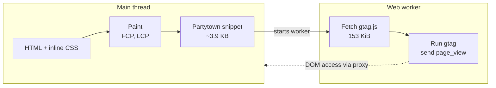

:::tldr
- I just added **Google Analytics 4 (gtag.js)** through **Partytown**. The home page grew by **154 KiB** (188 → 342 KiB), but the mobile Lighthouse score **is still 100**.
- The Performance score is **computed from five metrics only**: FCP, LCP, TBT, CLS and Speed Index. Total page weight **is not part of the formula**.
- gtag.js loads **asynchronously, after the content is painted**, so it does not touch FCP or LCP. It adds nothing visible to the page, so CLS stays at 0.
- The surprise: in my experiment, **gtag running directly, without Partytown, also scored 100**. The script takes about 90 ms on the main thread, not enough to create long tasks that move TBT.
- Partytown is still worth it: **the main thread runs zero lines of gtag**, Lighthouse no longer flags 71 KiB of unused JavaScript, and users on slow phones do not wait for analytics when they tap.
- A lab score of 100 **does not prove** analytics is harmless. Real-user INP, CSP and data accuracy are where to look.
:::

The latest commit on this site adds GA4. I was ready to watch the Lighthouse score drop into the 90s, because "Google Analytics slows down your site" is something almost everyone has heard.
The Lighthouse CI job finished: **100/100/100/100**, same as before. Not a single point lost.

A good result is worth understanding too, otherwise you will not know why it turns bad next time. So I measured it properly.

## How I added GA4

The `Analytics.astro` component renders two script tags with `type="text/partytown"`:

```astro
<script type="text/partytown" src={`https://www.googletagmanager.com/gtag/js?id=${id}`} />
<script type="text/partytown" define:vars={{ id }}>
  window.dataLayer = window.dataLayer || [];
  window.gtag = function () {
    dataLayer.push(arguments);
  };
  gtag("js", new Date());
  gtag("config", id);
</script>
```

Browsers do not know the `text/partytown` type, so they **ignore** both tags: nothing is downloaded or executed.
[Partytown](https://partytown.qwik.dev/) (via the `@astrojs/partytown` integration) inlines a small snippet of about 3.9 KB into the HTML. That snippet starts a **web worker**, and the worker downloads `gtag.js` and runs it off the main thread.



## The experiment: no GA, GA via Partytown, GA on the main thread

To see how much Partytown contributes, I built three versions of the site and ran Lighthouse 13.6.0 (mobile, simulated Slow 4G and 4× CPU slowdown), three runs per page:

- **No GA**: built without `PUBLIC_GA4_ID`.
- **Partytown**: exactly what runs in production.
- **Direct**: the same build, with `type="text/partytown"` swapped for a plain `<script async>`, which is how Google tells you to install gtag.

Results for the home page:

| | No GA | Partytown | Direct |
|---|---|---|---|
| Performance score | 100 | 100 | 100 |
| FCP / LCP | 0.75–0.83 s | 0.75 s | 0.75 s |
| Total Blocking Time | 0–14 ms | 0–14 ms | 0–33 ms |
| CLS | 0 | 0 | 0 |
| Total page weight | 188 KiB | 342 KiB | 342 KiB |
| gtag.js runs on | – | worker | main thread |
| Main-thread time spent in gtag | – | 0 ms | 84–91 ms |
| "Reduce unused JavaScript" warning | no | no | 71 KiB |

All three score 100. Partytown is not the only reason the score held. To see why, look again at how Lighthouse scores a page.

## Reason 1: the score only counts five metrics

As I wrote in the [post on PageSpeed Insights](/en/blog/pagespeed-insights-explained/), the Performance score is a weighted average of **TBT (30%), LCP (25%), CLS (25%), FCP (10%) and Speed Index (10%)**.

Things that are **not** in the formula:

- **Total page weight.** "Avoid enormous network payloads" is a diagnostic only. An extra 154 KiB costs no points as long as it does not slow those five metrics.
- **Insights** such as "Reduce unused JavaScript". The direct build was flagged for 71 KiB of unused JavaScript and still scored 100.
- **The number of third-party requests.** Lighthouse lists them but does not penalize the count.

So the right question is not "how heavy is gtag" but "does gtag get in the way of **painting** or **block the main thread**".

## Reason 2: gtag arrives after the page is painted

This site is static HTML with inline CSS and preloaded fonts. The browser has everything it needs to paint from the first response, so FCP and LCP land at about 0.75 s.

gtag.js is not on that path:

- With `async`, the browser downloads the script in parallel and **does not block HTML parsing**. The script also has lower priority than CSS, fonts and the LCP image.
- With Partytown it arrives even later: the gtag request starts at about **130–180 ms** in my runs, versus **15–40 ms** when embedded directly, because the worker has to boot first.

LCP is the largest element painted. gtag paints nothing, so whenever it loads, LCP does not change. Same for CLS: GA4 inserts no visible banner or iframe, so nothing shifts the layout.

## Reason 3: 90 ms is not enough to become "blocking time"

TBT does not add up all JavaScript execution. It only counts **the part beyond 50 ms** of each long task between FCP and the page settling:

```text
40 ms task  → 0 ms blocking
83 ms task  → 33 ms blocking
200 ms task → 150 ms blocking
```

In the direct build, gtag used 84–91 ms of CPU, yet TBT for the whole page was only 0–33 ms. Most of the work ran in tasks shorter than 50 ms, or only slightly over the threshold. On Lighthouse's mobile scoring curve, a TBT of a few dozen milliseconds still earns almost full marks, and the overall score rounds to 100.

In other words: **on a page with almost no JavaScript, a single analytics script still fits in the budget**. On a page that already ships 300 ms of framework JavaScript, those 90 ms can be the last straw.

:::advanced
### Does Lighthouse see scripts running in a worker?

It sees the request but not the CPU time. In the Partytown report the `gtag/js` request has `sessionTargetType: "worker"` and still counts toward the 342 KiB total.
JavaScript audits such as `bootup-time`, `unused-javascript` and `third-parties-insight` only analyze scripts on the page's main thread, so gtag disappears from them.

That is technically correct: TBT measures how long the **main thread** is blocked, and a worker does not block it. But the worker still uses the user's CPU, battery and bandwidth; it just does not make the page less responsive.

To check this yourself, open the `lhr-*.json` files Lighthouse CI writes and look in `audits["network-requests"].details.items`.
:::

## So what is Partytown for?

If the direct version also scores 100, why add a library, a web worker and a looser CSP? Because a lab score is **one page load with nobody touching the page**. Real users are different:

- **INP**: if a user taps a menu or link while gtag is running, the browser has to finish that task before responding. On a slow phone, 90 ms in the lab can become several hundred milliseconds. Moving gtag into a worker removes that source of blocking entirely.
- **View transitions**: this site uses `ClientRouter`, and gtag sends a `page_view` after every navigation. With Partytown that happens in the worker instead of competing with the animation.
- **Headroom**: if I later add features that need JavaScript, the main-thread budget is still fully available for the page's own code.

Partytown has costs too:

- **A looser CSP**: the worker is a `blob:` URL and Partytown runs scripts with `new Function`, so the policy needs `worker-src blob:` and `'unsafe-eval'` in `script-src`.
- **Harder debugging**: gtag errors live inside the worker and DOM access goes through a proxy, so the console and network tab are harder to read.
- **Not every script works**: scripts that constantly read the DOM synchronously (chat widgets, A/B tests that tweak the UI) often run slowly or break in a worker. Analytics that only sends events, like GA4, is fine.

## Ways of adding gtag that will lower the score

The score held because of how gtag is embedded, not because gtag is light. A few setups would change that:

1. **A synchronous script in `<head>`** (no `async`): the browser stops parsing HTML to fetch 153 KiB from another origin, and FCP and LCP move right away.
2. **Google Tag Manager with many tags**: a container that adds ad pixels, heatmaps, chat… each one a script, adding up to real long tasks.
3. **A cookie consent banner inserted at the top**: content gets pushed down, CLS rises, and if the banner is the largest element, LCP changes with it.
4. **A CSP that blocks the script**: the browser logs errors to the console, and Lighthouse docks **Best Practices** under "Browser errors were logged to the console".

:::advanced
### The trap in item 4 with Lighthouse CI

Lighthouse CI for this site runs against the static build in `dist/`, served by `lhci`'s local server. `public/_headers` is only applied on Cloudflare Pages, so **CI never sees the real CSP**.
If I forgot to add `https://www.googletagmanager.com` to the CSP, CI would stay green while production would silently drop GA and fill the console with errors.

That is why, after deploying, I still open production with DevTools to make sure the `collect` request to `google-analytics.com` goes through and the console is clean.
In CI, the build uses a dummy Measurement ID, `G-LHCI000000`: Google still serves the same 153 KiB `gtag.js`, so Lighthouse measures the real weight without sending fake page views to the real property.
:::

## Wrapping up

The Lighthouse score did not change after adding gtag for three combined reasons: page weight is not scored, gtag is not on the rendering path, and on a page with almost no JavaScript, gtag's 90 ms is not enough to become blocking time. Partytown goes one step further: the main thread no longer runs gtag at all.

My takeaway: **do not treat a 100 as proof that a script is harmless**. Look at where it runs, for how long and when, and watch real-user INP over the coming weeks. If you want to know how this site reached 100 in the first place, I covered it in the [post on a perfect Lighthouse score](/en/blog/perfect-lighthouse-score/).
