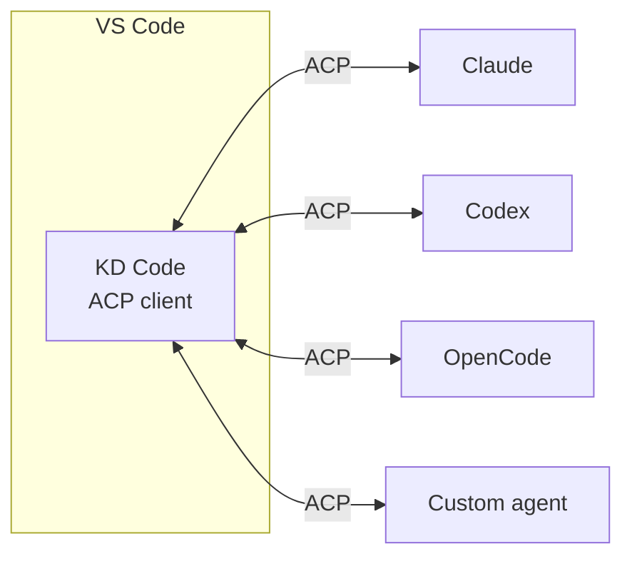
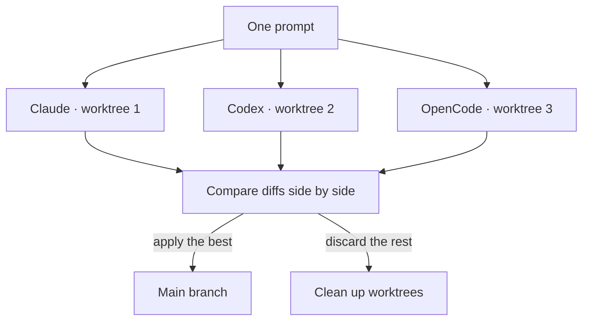
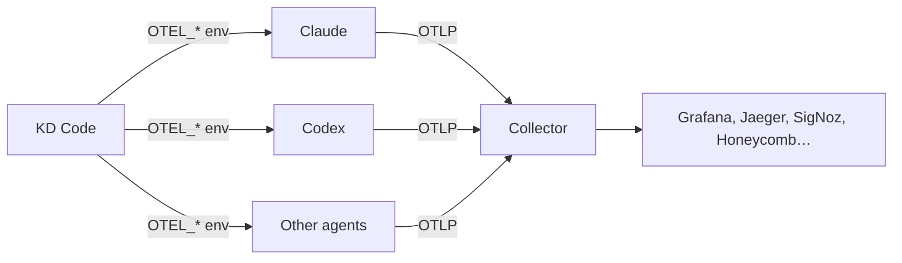

:::tldr
- An **ADE** (Agentic Development Environment) is an environment where the main job is **delegating to agents and reviewing their work**, not typing code yourself. There are plenty of options, but almost every one makes you **give something up**: you get locked into one agent, you have to leave VS Code, or you lack a safe way to run agents in parallel.
- [KD Code](https://github.com/kd-labs-io/kd-code-extension) is an open-source VS Code extension that talks to agents over the **Agent Client Protocol (ACP)**, so Claude, Codex, OpenCode and others all share one interface.
- Each conversation can run in **its own git worktree**, and **Best-of-N** mode sends one prompt to several agents or models at once, then compares the diffs so you can pick the best one.
- Turn on the **OpenTelemetry** setting and every agent's traces, metrics and logs go to an OTLP endpoint, so you can track tokens, cost and latency in Grafana, Jaeger or any backend that speaks OTLP.
- I built it because it is the tool I need every day, and I had not seen anyone put all the pieces together.
:::

In [What Is AI-Native?](/en/blog/what-is-ai-native/), I wrote that working in an AI-Native way means moving from "writing every line myself" to **describing, delegating, and checking**. When the main job changes, the tools have to change too. That gave rise to a whole category of products called **ADEs**: Agentic Development Environments.

In 2026 there is no shortage of ADEs. If anything, there are too many. And yet I still sat down and wrote one more. This post explains why.

## The landscape

I group today's ADEs into a few categories. Each is strong at one thing and asks you to give up something else:

| Category | Examples | Strong at | Trade-off |
| --- | --- | --- | --- |
| VS Code forks | Cursor, Kiro | Seamless, deeply optimized AI experience | You leave stock VS Code and depend on the vendor's agent and pricing |
| Per-agent extensions | Claude Code, Codex, Copilot | Closest to that agent's latest features | One interface, one diff review flow and one chat history per agent |
| Editors with built-in ACP | Zed, JetBrains | Open standard, easy to switch agents | You have to switch editors |
| Standalone orchestration apps | Apps that run several agents in parallel on worktrees | Good at parallel runs | Yet another window next to your editor, often only a few agents |
| Terminal agents | Each agent's CLI | Flexible, scriptable | Reviewing diffs and juggling sessions is tedious |

None of these is wrong. But the way I work needs several things **at the same time**, and each category only covers part of them.

## What I need

### No lock-in to one agent

The best agent changes month to month, sometimes week to week. Today Claude writes cleaner refactors, next week Codex fixes bugs faster, then a new model comes out that is worth trying. If switching agents also means switching the interface, shortcuts, diff review flow and where history lives, the cost of switching is high enough that I just… don't.

I want **the interface to be mine**, and the agent to be something I plug in.

### No leaving VS Code

VS Code is where I already have everything: extensions, shortcuts, settings, the debugger, Source Control. Using a fork means accepting that it lags behind upstream releases, and accepting the risk that some extensions do not behave exactly the same. Switching to a different editor means losing the whole toolkit.

### Running in parallel without stepping on each other

Once I got used to delegating to agents, I wanted to delegate **several tasks at once**: one agent fixes a bug, one writes tests, one tries a different refactor. If they all edit the same working directory, they overwrite each other, and the code I am in the middle of writing.

### Compare instead of trusting right away

Agents can be wrong, and two different agents are often wrong in different ways. For important work, I want to give **the same prompt** to a few agents or models, then look at the diffs side by side and pick the best one. Doing that by hand (opening several terminals, creating branches, diffing, cleaning up branches) is annoying enough that I skip it.

## How KD Code puts the pieces together

### ACP: one interface, many agents

The [Agent Client Protocol](https://agentclientprotocol.com) is an open standard for editors to talk to coding agents, much like LSP did for language servers. Any agent that supports ACP works in any editor that supports ACP.

KD Code is an **ACP client inside VS Code**. I install Claude, Codex, OpenCode and other agents from the ACP Registry in one click, then use one chat view, one way of reviewing changes and one conversation history for all of them. Switching agents is just picking from a list.



### One worktree per conversation

A chat tab can run in **its own git worktree**, on a branch named after the first prompt. The agent edits freely without touching the folder I am working in. New worktrees get ignored files such as `.env` and `node_modules` copied in, and can run the project's setup command (after I allow it).

When the work is done, one button lets me **merge**, **create a pull request** (with a description drafted by the agent, via the GitHub CLI), or **copy the changes as staged changes**. Worktrees I no longer need are cleaned up in one go.

### Best-of-N: send once, pick the best

Tick **Compare**, choose a few agents, models and effort levels, then send one prompt. Each choice works in its own worktree, grouped under one tab. I look at each diff side by side, apply the best one and discard the rest.



This is the part I use most. It turns "which agent is better?" from a gut feeling into something I can see, on my own codebase.

### Review is the main flow

In the AI-Native spirit: if agents do most of the hands-on work, **reviewing** has to be easy. KD Code offers Keep/Undo per file or per change, both in the chat and in the editor, restoring to a checkpoint from before any message, and following the agent in the editor as it opens and edits files.

### OpenTelemetry: trace every agent in one place

If you delegate to agents, you need to know what they did: which tools they called, how many tokens they used, which step was slow, why one session suddenly cost twice as much. KD Code has a built-in **Tracing** mode that shows each turn's tokens, cost, context and duration right in the chat. But when I run several agents in parallel every day, I want that data in a real observability system, kept long term and queryable.

So KD Code has an **OpenTelemetry** setting: turn it on, and agents are started with the standard `OTEL_*` variables that point their traces, metrics and logs at an **OTLP** endpoint of your choice.

```jsonc
// settings.json (User), machine scope
"kdCode.telemetry": {
  "enabled": true,
  "endpoint": "http://localhost:4318", // 4318 for HTTP, 4317 for gRPC
  "protocol": "http/protobuf",          // or "http/json", "grpc"
  "logPrompts": false,                  // also send prompts and answers
  "logToolDetails": false               // also send tool input: commands, file paths
}
```

The quickest way to try it is to run a collector bundled with Grafana on your machine:

```bash
docker run --rm -p 3000:3000 -p 4317:4317 -p 4318:4318 grafana/otel-lgtm
```

Then open KD Code's Settings page, turn on OpenTelemetry, click **Check connection** to send an empty test batch to the endpoint, and open a new chat tab (or restart the agent) so the settings take effect.



Why OpenTelemetry instead of a custom dashboard:

- **Open standard, no vendor lock-in.** Same spirit as ACP: OTLP is supported by almost every observability system, so I can move from Grafana to Honeycomb or SigNoz just by changing the endpoint, without touching the agents.
- **One place for every agent.** Each agent gets a `kd.agent.id` resource attribute, so on one dashboard I can filter and compare Claude against Codex: tokens, cost, latency, tool error rates. It is a great way to back up Best-of-N results with numbers instead of gut feeling.
- **The data is mine.** The collector can run on my machine or in the team's infrastructure, with no third-party service in between.
- **It fits with the rest of the system.** If the team already uses OpenTelemetry for its backend, agent traces live next to application traces, with the same alerts and the same familiar queries.
- **Easier debugging.** When a session runs unusually long or burns unusually many tokens, I open the trace and look at each step instead of guessing.
- **Configure once.** No need to turn on telemetry in each agent. KD Code sets the environment variables when it starts an agent, and Claude Code also gets `CLAUDE_CODE_ENABLE_TELEMETRY`. Agents without OpenTelemetry support simply ignore the variables.

A few things to keep in mind:

- **Headers** such as the backend's API key are entered on the Settings page and kept in **VS Code's secret storage**, not in `settings.json`.
- `kdCode.telemetry` can only be set at **machine scope**, so an unfamiliar repo cannot point your telemetry at its own server.
- Telemetry can contain your account's email and IDs, file paths, and with `logPrompts` or `logToolDetails` turned on, your prompts and the commands agents run. Both options are off by default; when off, agents that support it redact that content. Only send it to an endpoint you trust.

:::advanced
### Security when agents run commands

An extension that lets agents run commands on your machine is easy to abuse if you open an unfamiliar repo. A few design decisions in KD Code reduce that risk:

- **Settings that decide what runs** (custom agents, MCP servers, environment variables, Node and ccusage paths) can only be set at **machine scope**, so a workspace cannot override them. A malicious repo cannot declare its own agent or MCP server.
- **A project's worktree setup command** asks first, and asks again when the command or a file it names changes.
- **Links from agents** open only after asking, and only over https, or over http to localhost and hosts you list.
- **Registry entries with unsafe paths** are refused at install.

The README is also explicit: permission rules save clicks but are **not a security boundary**, and a worktree is **not a sandbox**. Agents describe their own tools, so do not treat rules as a layer of protection.
:::

## Why not wait for someone else

A fair question: the big vendors will build this sooner or later, so why not wait?

- **Their incentives differ from mine.** An agent vendor wants me to use their agent. An editor vendor wants me to stay in their editor. A tool that is neutral across agents and runs in stock VS Code is nobody's priority.
- **ACP is mature enough.** Supporting many agents used to mean writing an adapter for each one. With a shared standard and a registry, one person can build a complete client.
- **I am the user.** I use KD Code every day on other projects, including this site. Every friction point becomes a backlog item, so the tool is shaped by real needs, not by slides.
- **It is open source.** MIT-licensed, so anyone can read the code, know what the extension does on their machine, and change or fork it.

## What KD Code does not try to do

To be clear:

- **It is not an agent.** KD Code has no model of its own and does not replace Claude or Codex. It is just a better place to use them.
- **It is not a VS Code fork.** It is a regular extension, installed from the Marketplace or Open VSX.
- **It does not replace review.** Best-of-N helps you pick a better version, but reading diffs and running tests is still a human job.

## Conclusion

Among all these ADEs, I did not need another agent or another editor. I needed a place inside VS Code where I can **use any agent, run several in parallel without them stepping on each other, and compare results before choosing**. I had not seen anyone put those pieces together, so I built it myself.

If you work the same way, try [KD Code on the VS Code Marketplace](https://marketplace.visualstudio.com/items?itemName=kd-labs.kd-code) or browse [the source on GitHub](https://github.com/kd-labs-io/kd-code-extension). Issues and feedback are always welcome.
