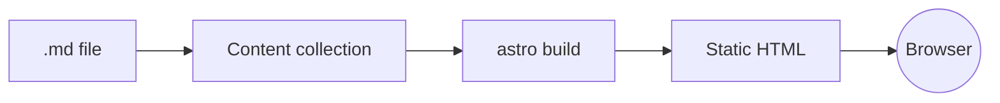
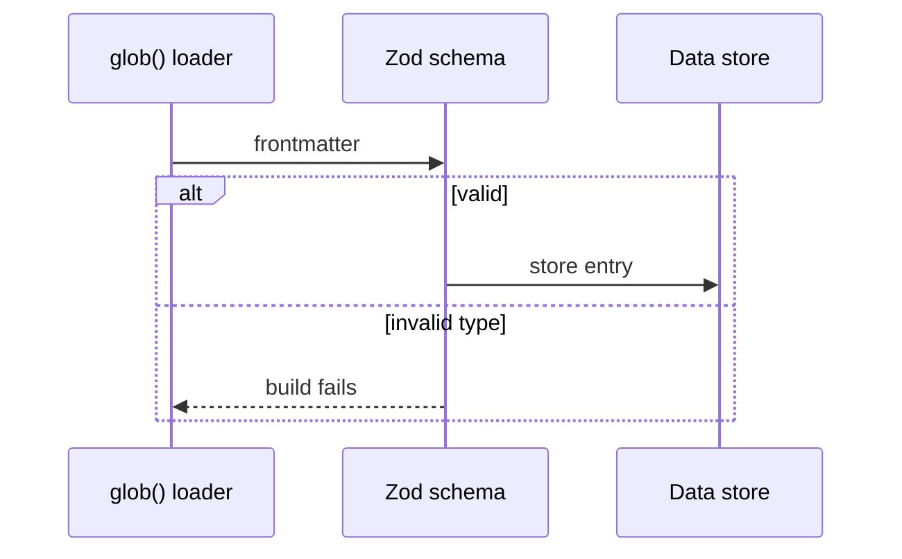

:::tldr
- My personal site is mostly static content, so Astro ships **0 KB of JavaScript** by default.
- Markdown + content collections make writing posts fast, with frontmatter checks.
- When you need interactivity, add an "island" where it fits, instead of pulling React into every page.
:::

When I rebuilt my personal site, I had three goals: fast loading, easy writing, and low maintenance.
Next.js is the framework I know best, but for a site that is almost all static content, it feels like overkill.

## Content is at the center

Astro renders everything to HTML at build time. The browser gets a finished page and does not have to wait for hydration.
For the blog, I just drop Markdown files into `src/content/blog/` and a new post is live.



:::advanced
### How content collections work

The `glob()` loader scans files at build time, parses the frontmatter, and validates it with a Zod schema:

```ts
const blog = defineCollection({
  loader: glob({ pattern: "{vi,en}/**/*.md", base: "./src/content/blog" }),
  schema: z.object({ title: z.string(), pubDate: z.coerce.date() }),
});
```

Invalid data types (for example `pubDate: yesterday`) make the build fail right away, instead of a silent error in production.
The result is cached in `.astro/data-store.json`, so the next build only processes changed files.


:::

## Interactivity when you really need it

The reading mode switch at the top is a small script that runs only on this page.
The rest of the page is still plain HTML.

:::advanced
### Islands and the `client:*` directive

A framework component is hydrated only when it has a directive like `client:visible` or `client:idle`.
Without a directive, it is rendered as static HTML and its JS never reaches the browser.
This way, JavaScript cost grows with the number of interactive parts, not with the size of the page.
:::

## Conclusion

For a personal site, Astro gives me exactly what I need: fast by default, writing in Markdown, and added complexity only when there is a reason.

For what changed in Astro recently, see [Astro in October 2026](/en/blog/astro-october-2026/). For why a static site like this one costs nothing to host, see [zero-cost hosting for millions of requests](/en/blog/zero-cost-hosting-millions-of-requests/).
