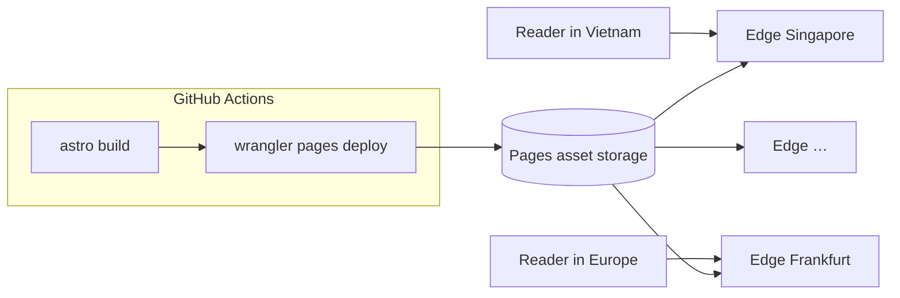

:::tldr
- Hosting, CDN, SSL, DNS, CI/CD and analytics for this site all cost **nothing**. The only bill is the **domain name**, renewed yearly.
- The site is **static HTML**: no server running code, no database. Every request is just a read of a file built ahead of time.
- **Cloudflare Pages** puts those files on Cloudflare's network and serves them from the location closest to the reader. Per Cloudflare's docs, **static asset requests are free and unlimited**, and bandwidth is not billed.
- The home page is about **20 KB of HTML** with Brotli. A million home page views is roughly 180 GiB of bandwidth, and I pay nothing for it.
- Builds run on **GitHub Actions** (free for public repos), then Wrangler uploads `dist/` to Pages.
- The zero cost only holds while **no code runs per request**. Add SSR, Pages Functions or an API and you start using Workers quota.
:::

"Where is this site hosted, and what does it cost per month?" Short answer: Cloudflare Pages, nothing.
The follow-up is usually: "Free, so can it handle real traffic?" Also a short answer: yes, and the reason is that **this site barely asks any server to do work**.

## The monthly bill

| Part | Service | Cost |
|---|---|---|
| Hosting + CDN | Cloudflare Pages (Free plan) | $0 |
| DNS, SSL, DDoS protection | Cloudflare (Free plan) | $0 |
| Build and deploy | GitHub Actions, public repo | $0 |
| Analytics | Cloudflare Web Analytics + Google Analytics 4 | $0 |
| Source code | GitHub | $0 |
| Domain `buikhuongduy.com` | Domain registrar | paid yearly |

"Zero" refers to running the site. Nobody gives domains away, but that is a fixed cost that does not grow with traffic.

## Reason 1: nothing runs when someone visits

A WordPress site or a Next.js app with SSR does real work for every request: start a runtime, run code, query a database, render HTML, then respond. Ten times the traffic means ten times the CPU, RAM and database connections. That is why dynamic hosting costs money, and why it falls over under a spike.

This site is built with [Astro](/en/blog/why-i-chose-astro/) in static mode. Every page is rendered **once, at build time**, into an HTML file in `dist/`:

```text
dist/
├── index.html
├── about/index.html
├── blog/why-i-chose-astro/index.html
├── _astro/…            # hashed images, fonts, JS
└── …                    # about 130 files, under 20 MB
```

When you open a page, no code runs to produce it. The server finds the right file and sends it. That is the cheapest thing a web server can do, and the cost barely changes between the first request and the millionth.

## Reason 2: files live on the edge, not on a server

When `wrangler pages deploy dist` finishes, the files do not land on a VPS somewhere. Cloudflare Pages uploads them to Cloudflare's global network and serves them from the data center nearest the reader.



You can check it with `curl`:

```bash
curl -sI https://buikhuongduy.com/ | grep -iE "server|cf-ray|content-encoding"
```

```text
server: cloudflare
cf-ray: a58652d9ff48ce24-SIN
```

The `SIN` suffix in `cf-ray` means the response came from Singapore, the data center nearest me when I measured. Readers elsewhere will see a different code.

The upshot: there is no origin server to overload. Traffic is spread across hundreds of locations, each already built to serve millions of other websites at the same time. A personal site's traffic, even on the front page of Hacker News, is a rounding error there.

:::advanced
### Does `cf-cache-status: DYNAMIC` mean nothing is cached?

The HTML response carries `cf-cache-status: DYNAMIC`, which makes it look like every request goes back to some server. It does not.
`cf-cache-status` describes the **zone cache** (Cloudflare's regular CDN layer). Pages does not go through it: files are served straight from Pages' asset storage, which already sits on the edge network. There is no origin behind it to "miss".

Files in `_astro/` get `cache-control: public, max-age=14400, must-revalidate`, the Pages default. The browser keeps them for 4 hours, then revalidates with the `ETag` and usually gets an empty `304`. Since those file names are hashed, a one-year `immutable` rule in `_headers` would skip the revalidation entirely. That one is still on my list.
:::

## Reason 3: static requests are not billed

This is where the pricing model decides everything. According to [Cloudflare's docs](https://developers.cloudflare.com/workers/static-assets/billing-and-limitations/), **requests to static assets are free and unlimited**, and storing assets costs nothing extra. Cloudflare Pages on the Free plan does not cap bandwidth.

Cloudflare only bills when **your code runs**: Pages Functions or Workers. This site has no `functions/` directory and no SSR, so no request touches that quota.

The bandwidth math:

- The home page HTML is about 111 KB uncompressed because the CSS is inlined, **about 20 KB with Brotli**.
- A first visit to the home page, fonts, images and scripts included, is about **188 KiB** according to Lighthouse (not counting gtag.js, which Google serves).
- A million first visits: 188 KiB × 1,000,000 ≈ **180 GiB**.

On a VPS or a cloud provider that bills egress, 180 GiB is a line on the invoice. On Pages, it is not on any invoice. And the real number is smaller, since returning readers already have the fonts and images in their browser cache.

A light page is not just for a [100 Lighthouse score](/en/blog/perfect-lighthouse-score/). It is also what makes the bandwidth question harmless.

## Reason 4: CI is free too, and skips the Pages build quota

Pages has its own build system, limited to 500 builds a month and one build at a time on the Free plan. I do not use it.
The whole build runs on GitHub Actions, then Wrangler uploads `dist/` as a direct upload. The repo is public, so standard GitHub Actions runner minutes are free. I covered the workflow in [the CI under 30 seconds post](/en/blog/fast-ci-under-30-seconds/).

A small but real bonus: every pull request gets its own **preview deployment** on `*.pages.dev`, and Pages does not cap the number of active previews.

## The real limits of the Free plan

"Free" does not mean "no limits". Here are the [Cloudflare Pages Free plan limits](https://developers.cloudflare.com/pages/platform/limits/) and where this site sits:

| Limit | Free plan | This site |
|---|---|---|
| Files per site | 20,000 | about 130 |
| Size per file | 25 MiB | largest is an OG image, about 500 KB |
| Rules in `_headers` | 100 | 1 |
| Redirects in `_redirects` | 2,000 static + 100 dynamic | 4 |
| Builds per month (Pages builds) | 500 | 0, builds run on GitHub Actions |

None of these are about traffic. They limit **how big the site is**, not **how many people read it**. For a blog, I would need thousands of posts to get near 20,000 files.

## What "millions of requests" means, and what it does not

I did not load test production. Firing millions of requests at shared infrastructure just to get a number to show off is not worth it, and not fair to Cloudflare either.
The argument here comes from the architecture: no server of my own to overload, no database to run out of connections, and a pricing model that does not charge per static request. None of that changes between a thousand requests and a million.

There are things this setup does not solve:

- **Bots are still bots.** Cloudflare includes DDoS protection on the Free plan, but crawlers and bots can still pollute analytics.
- **Third parties have their own limits.** gtag.js is served by Google and GA4 events go to Google. If Google is slow, analytics is slow, but the content is not, because gtag [runs in a worker and arrives after the page has painted](/en/blog/why-gtag-did-not-lower-lighthouse-score/).
- **"Free" is a policy, not a law of physics.** Cloudflare can change its pricing. The risk is low because the site is just a folder of HTML: if needed, I can move it to any static host in an afternoon.

## What would end the zero-cost setup

The zero cost is not Cloudflare being generous. It comes from the site **not asking a server to do anything per request**. Add any of these and code starts running per request, with a quota to watch:

1. **SSR or Pages Functions**: every request to that route counts as a Workers request. The Free plan has a daily allowance, and past it requests are refused instead of served.
2. **A self-handled contact form**: needs an endpoint to receive data, then send an email or store it somewhere.
3. **Server-side search, comments, view counters**: all need a database or an API, and databases are rarely free without limits.
4. **On-the-fly image resizing**: edge image services usually bill per transformation. This site optimizes images **at build time**, so they are already AVIF/WebP at the right sizes before deploy.
5. **Self-hosted video**: files over 25 MiB do not fit on Pages and have to move to R2 or a video service.

That does not mean never adding them. But each time, the question should be: **can this happen at build time?** If it can, it is still a static file, and still free.

## Wrapping up

This site handles heavy traffic for free not because of a trick, but because of three decisions working together: render everything at build time, put the files on an edge network, and pick a platform that does not bill for serving static files. When each request is just a read of a small, pre-compressed file, a million requests is just a million file reads.

The lesson I take into bigger projects: **the cheapest thing to run is the thing that does not need to run**. Whatever can be computed at build time should be, and servers should only do work that truly depends on each user.

If your team wants to cut infrastructure costs or move part of a product to static: **I am open to new opportunities**. [Get in touch](/en/contact/), I would be happy to talk.
