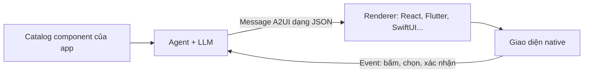

:::tldr
- **A2UI 1.0** ra mắt ngày **11/11/2026**: bản ổn định đầu tiên của giao thức mở (Apache 2.0) giúp AI agent trả lời bằng **giao diện tương tác** như form, thẻ, biểu đồ thay vì chỉ chữ.
- Agent chỉ **mô tả cần hiện gì**; mỗi app tự vẽ bằng **component của chính nó**. Agent không gửi code chạy được, chỉ gửi JSON khai báo, và chỉ dùng được component bạn đã đăng ký.
- Có sẵn renderer cho **React, Angular, Lit, Flutter, SwiftUI** (Jetpack Compose sắp lên 1.0) và Agent SDK cho **Python, TypeScript, Dart**. Chạy được cả trong **MCP Apps** trên Claude và Gemini.
- Đã có **Atlassian (Jira), Alation, ByteDance (Lynx), Bloomberg** và nhiều sản phẩm của Google dùng.
:::

Phần lớn agent hôm nay vẫn trả lời giống máy tính thời terminal: làm được nhiều việc, nhưng cái gì cũng là chữ. Muốn so sánh ba sản phẩm hay sửa rồi duyệt một kế hoạch chi tiết, bạn nhận về một bức tường chữ và vài vòng hỏi lại “bạn chọn cái nào?”.

A2UI muốn đổi điều đó. Dưới đây là những điểm mình thấy đáng chú ý, lấy từ [bài công bố của Google](https://developers.googleblog.com/a2ui-10-build-delightful-fast-reliable-agentic-experiences/) và [tài liệu tại a2ui.org](https://a2ui.org/).

## A2UI hoạt động thế nào

Ý tưởng chính: **tách việc “nói cần hiện gì” khỏi việc “vẽ nó ra”**.

1. App (client) khai báo một **catalog**: danh sách component được phép dùng, ví dụ `Card`, `Text`, `Button` hay `FlightCard` riêng của bạn.
2. Agent đọc catalog đó và trả về **message A2UI**: một cây component kèm dữ liệu, dạng JSON khai báo.
3. **Renderer** trong app đọc message và vẽ bằng component native của app: React trên web, SwiftUI trên iOS, Flutter trên mobile…
4. Khi người dùng bấm nút hay chọn gì đó, app gửi **event** ngược về agent.



Cách này có ba cái lợi rõ ràng:

- **Đúng thương hiệu.** Agent chỉ đặt được component bạn đã đăng ký, nên giao diện luôn theo design system của bạn.
- **An toàn.** Thứ đi qua mạng là dữ liệu khai báo, **không phải code chạy được**. Dữ liệu nhạy cảm được gắn vào giao diện ở phía server nên không phải đi qua model.
- **Viết một lần, chạy mọi nơi.** Cùng một output của agent hiện native trên điện thoại lẫn laptop, trong app của bạn hay trong trợ lý AI bên thứ ba.

## Ví dụ: một buổi sáng bị ốm

Google đưa ra một ví dụ dễ hình dung. Bạn thức dậy bị ốm, và để xoay xở buổi sáng cần tới sáu app: đặt lịch khám online, dời cuộc họp, báo cho team, bật trả lời tự động, nhờ người nhà đón con và đặt cháo.

Hỏi một agent chỉ biết trả lời bằng chữ, bạn nhận một danh sách đánh số dài rồi hết vòng này đến vòng khác “những cái nào?”. Với A2UI, lập trình viên có thể làm một agent trả lời bằng **một màn hình gộp cả sáu việc**. Sửa kế hoạch chỉ là vài lần chạm, và **không gì được gửi đi cho tới khi bạn xác nhận**.

Một ví dụ khác: “dời bữa tối với Priya sang thứ Sáu”. Agent có thể trả về một màn hình xếp cạnh nhau lịch của bạn, bàn trống từ app đặt nhà hàng và giá từ app gọi xe, nên nhìn là biết giờ nào hợp với mọi người.

## Có gì mới ở 1.0

- **Giao thức ổn định.** Thêm **gọi hàm hai chiều**: ví dụ một bộ chọn chuyến bay hay đặt bàn có thể kiểm tra chỗ trống ngay lúc người dùng đang chọn. Có thêm hỗ trợ **accessibility** và **extension** để gắn metadata tuỳ ý.
- **Renderer cho các nền tảng lớn.** [React](https://www.npmjs.com/package/@a2ui/react), [Angular](https://www.npmjs.com/package/@a2ui/angular), [Lit](https://www.npmjs.com/package/@a2ui/lit) trên web; [Flutter](https://pub.dev/packages/a2ui_flutter) cho mobile, web, desktop; [SwiftUI](https://github.com/a2ui-project/a2ui/tree/main/swift/swiftui) trên iOS; [Jetpack Compose](https://developer.android.com/jetpack/androidx/releases/a2ui-compose) trên Android (hiện vẫn ở 0.9.1, 1.0 sắp có). Renderer web và Flutter chạy được trong [MCP Apps](https://modelcontextprotocol.io/extensions/apps/overview), nên màn hình A2UI hiện được trong Claude và Gemini.
- **Agent SDK cho TypeScript, Python, Dart.** SDK lo phần sinh prompt từ catalog, dịch message, **tự sửa lỗi** khi model viết sai, và cho phép **đổi định dạng sinh** (inference format) để giảm độ trễ. Riêng Python có thêm [Macros](https://a2ui.org/guides/macros/) để mở rộng component và gắn dữ liệu bằng code.

## A2UI Express: ít token hơn khoảng 3 lần

Đây là phần mình thấy thông minh nhất. JSON rất hợp để gửi qua mạng, nhưng bắt LLM viết JSON từng token thì tốn: key lặp lại (`"id"`, `"component"`…), ngoặc lồng nhau, ID tự đặt bằng tay, dễ sai với model nhỏ.

Nên A2UI tách hai thứ: model viết bằng một ngôn ngữ gọn tên là **Express**, rồi **server biên dịch** sang JSON chuẩn trước khi gửi cho client. Client luôn nhận cùng một loại JSON, bất kể model sinh ra bằng cách nào.

Theo [benchmark của A2UI](https://a2ui.org/concepts/inference-formats/) trên 54 mẫu với `gemini-3.8-flash`, so với để model viết JSON trực tiếp:

| | Direct JSON | Express |
| --- | --- | --- |
| Token đầu vào (trung vị) | 10.980 | 6.000 (**-45%**) |
| Token code sinh ra (không thinking) | 807 | 297 (**-63%**, ít hơn ~2,7 lần) |
| Độ chính xác Pass@1 | 98,1% | 98,1% |

Tức là rẻ hơn, nhanh hơn mà không kém chính xác. A2UI còn cho phép bỏ hẳn LLM ở bước chọn giao diện: dùng một **decision model** (Google gọi là kiểu “system one”, ví dụ Jev) chỉ chọn component và giá trị thay vì viết chữ, hoặc dựng message bằng code server theo state machine cho các quy trình cần chắc chắn.

:::advanced
### Express trông như thế nào

Ví dụ một thẻ chuyến bay, model viết trong thẻ `<a2ui>`:

```text
<a2ui>
$/flight/number = "NH 105"
$/flight/gate = "B12"
root = Card(
  Column([
    Text($/flight/number),
    Text($/flight/gate, "caption"),
    Button(Text("Board now"), action=Event("check_in", {flight: $/flight/number}))
  ])
)
</a2ui>
```

- `$/path = value` ghi vào **data model**; component đọc dữ liệu qua `$/path` (data binding).
- Component lồng nhau trực tiếp, không cần tự đặt ID.
- `Event(...)` là hành động gửi ngược về agent khi người dùng bấm.

Compiler sẽ làm phẳng cây, tự gán ID (`root`, `root_child`, `root_child_children_0`…) và sinh message wire JSON của 1.0, rút gọn:

```json
{
  "version": "1.0",
  "createSurface": {
    "surfaceId": "main",
    "catalogId": "https://a2ui.org/specification/v1_0/catalogs/basic/catalog.json",
    "components": [
      { "id": "root", "component": "Card", "child": "root_child" },
      { "id": "root_child_children_1", "component": "Text", "text": { "@path": "/flight/gate" }, "variant": "caption" }
    ],
    "dataModel": { "flight": { "number": "NH 105", "gate": "B12" } }
  }
}
```

Ở 1.0, dữ liệu ban đầu được gộp vào `createSurface.dataModel`; cập nhật sau đó dùng `updateComponents` và `updateDataModel`.

### Đổi inference format trong Agent SDK

Mặc định SDK dùng Express; muốn đổi chỉ cần truyền factory khác, không phải sửa catalog hay renderer:

```ts
import { A2uiGenerator, CatalogConfig, DirectJsonFormatFactory, ExpressFormatFactory } from "@a2ui/agent";

const generator = new A2uiGenerator([new CatalogConfig(catalog)], undefined, new ExpressFormatFactory());

// Each request can override the format; prompt generation and parsing stay the same.
const processor = generator.createProcessor(rendererCapabilities, new DirectJsonFormatFactory());
const systemPrompt = processor.promptSnippet;
const parts = processor.parseResponse(llmOutput);
```

Khi stream, SDK tách phần chữ hội thoại khỏi các khối UI, “vá” chuỗi đang viết dở để giao diện hiện dần, và kiểm tra từng message; message sai được trả lại cho model tự sửa.
:::

## Ai đang dùng

- **Atlassian (Jira).** Khi giao work item cho AI agent và agent cần thêm thông tin hoặc một quyết định, nó hỏi bằng một **thẻ tương tác ngay trong work item**, team trả lời luôn trong Jira.
- **Alation.** Hệ thống AIOS dựng feed bằng A2UI: thẻ số liệu, biểu đồ, mỗi biểu đồ xem được câu SQL và dữ liệu phía sau. Cùng một feed hiện gần như y hệt trong Claude lẫn trong app của Alation.
- **ByteDance (Lynx).** Ra renderer A2UI cho Lynx từ tháng 6/2026, có [GenUI Playground](https://lynx-stack.dev/genui/#/a2ui) để xem message A2UI được vẽ native, ví dụ lịch trình hai ngày ở Kyoto. Lynx đang hỗ trợ 0.9 và chuẩn bị lên 1.0.
- **Gemini Notebook.** Khi bạn xin một bộ slide, nó trả về thẻ hỏi kiểu slide và chủ đề, sau đó là thẻ duyệt lại định dạng, trọng tâm, phong cách để bạn sửa trước khi tạo.
- **Gemini Enterprise.** Tổ chức có thể [đăng ký agent riêng](https://docs.cloud.google.com/gemini/enterprise/docs/a2ui-agents/register-and-manage-an-a2ui-agent) trả lời bằng A2UI; hiện hỗ trợ 0.9.1, đang nâng lên 1.0.

## A2UI và MCP Apps

Hai thứ này bổ sung cho nhau chứ không cạnh tranh. MCP Apps là cách để một trợ lý AI (Claude, Gemini) nhúng giao diện của bên thứ ba; A2UI là cách mô tả giao diện đó sao cho vẽ native và an toàn. Alation đang dùng cả hai để đưa feed vào Claude. Xem thêm [hướng dẫn chạy A2UI trong MCP Apps](https://a2ui.org/guides/a2ui-in-mcp-apps/).

## Bắt đầu từ đâu

- Thử nhanh trên [A2UI Playground của CopilotKit](https://go.copilotkit.ai/a2ui-playground), không cần cài gì.
- Làm theo [quickstart](https://a2ui.org/quickstart/) (khoảng 5 phút), hoặc thêm skill cho coding agent: `npx skills add a2ui-project/a2ui`.
- Đang dùng 0.9? Đọc [evolution guide](https://github.com/a2ui-project/a2ui/blob/main/specification/v1_0/docs/evolution_guide.md) để biết mọi thay đổi.
- Xem các demo theo ngành: [bất động sản](https://homeward-genui.web.app/), [đầu tư](https://finance-a2ui-v1.web.app/), [hồ sơ y tế](https://genui-clinic.solid.software/), [nhà thông minh](https://a2ui-vgv-smart-home.web.app/)…
- Mã nguồn và issue: [github.com/a2ui-project/a2ui](https://github.com/a2ui-project/a2ui).

## Mình thử thì thấy

Mình dựng một app React + Vite nhỏ với renderer của A2UI (thử ngày 14/11/2026, `@a2ui/react` 0.15.0, Chrome 157). Vài điều đáng biết trước khi bắt tay vào:

- **"1.0" là phiên bản giao thức, không phải package.** Trên npm, `@a2ui/react` và `@a2ui/web_core` vẫn là 0.15.0. Bạn chọn bản 1.0 qua `"version": "1.0"` trong message.
- **Lệnh cài trên trang chủ bị lỗi `ERESOLVE`**: `@a2ui/markdown-it` 0.2.2 vẫn đòi `web_core` ^0.14. Bỏ package đó khỏi lệnh cài (nó vẫn được kéo về qua `@a2ui/react`) và ghim `zod@3` là chạy. Sau đó build qua ngay lần đầu, form nhập liệu và action gửi dữ liệu về đều hoạt động.
- **Bundle tăng khoảng 135 KB gzip** so với template Vite trống (204 KB so với 69 KB). Với app chat thì chấp nhận được, với trang nội dung thì nên lazy-load.

**Token.** Mình viết cùng một màn hình bằng Express và bằng JSON rồi đếm bằng tokenizer của Claude:

| Màn hình | Express | JSON format đẹp | JSON minify |
|---|---:|---:|---:|
| Thẻ chuyến bay (6 component) | 118 | 514 (4,4×) | 359 (3,0×) |
| Form xin nghỉ ốm (8) | 293 | 874 (3,0×) | 614 (2,1×) |
| Kế hoạch buổi sáng (17) | 547 | 1.621 (3,0×) | 1.190 (2,2×) |

Con số "ít hơn khoảng 3 lần" đúng khi so với JSON format đẹp như ví dụ chính thức. So với JSON đã minify thì còn khoảng **2–3 lần**. Khoản tiết kiệm lớn nữa nằm ở system prompt mà SDK sinh ra: 7.849 token cho Express so với 16.738 cho JSON, ít hơn 53%. Phần này được tính ở mọi lượt gọi.

**Component chưa đăng ký.** Mình cho agent gửi một `DatePicker` không có trong catalog. Với cấu hình mặc định, renderer **không báo lỗi gì**: phần còn lại của form vẫn hiện, ô DatePicker lặng lẽ biến mất, lỗi chỉ đi vào `onError`. Bật validation chặt hoặc dùng Agent SDK thì cả message bị từ chối kèm lỗi gửi ngược lại được cho agent. Vì vậy câu "agent chỉ dùng được component bạn đã đăng ký" chỉ đúng hoàn toàn khi bạn bật validation. Hiện chưa có UI fallback cho trường hợp này.

Nhận định của mình: giao thức đã đủ ổn để thử trong sản phẩm, nhưng tooling còn non. Nên ghim phiên bản, bật strict validation và tự xử lý `onError` ngay từ đầu.

## Kết

Với người làm frontend, mình thấy A2UI đáng để ý vì nó trả lại cho mình đúng phần việc mình giỏi: **làm component tốt và design system chặt chẽ**. Agent lo quyết định hiện gì, còn hiện ra sao vẫn là component của mình, chạy native, theo đúng brand.

Điều mình thích nhất là cách thiết kế thực dụng: model viết một ngôn ngữ gọn, server biên dịch và kiểm tra, client chỉ nhận dữ liệu khai báo. Không có code lạ chạy trong app, không lộ dữ liệu nhạy cảm cho model, và không phải làm lại giao diện cho từng nền tảng.

Nếu bạn đang đọc về cách đưa agent vào sản phẩm, có thể xem thêm [AI-Native là gì](/blog/what-is-ai-native/) và [5 lớp hạ tầng cho AI agent](/blog/agent-infrastructure-stack/). A2UI là mảnh ghép nằm ở lớp trên cùng: nơi agent gặp người dùng.
