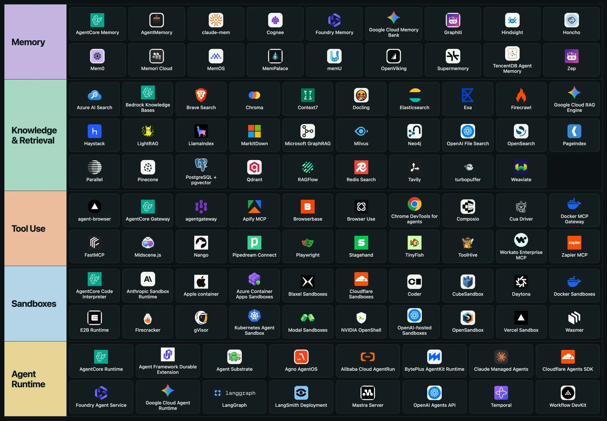
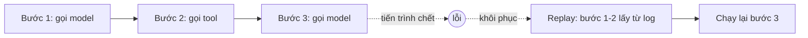

:::tldr
- Một AI agent chạy thật cần nhiều hơn một model: nó cần **trí nhớ**, **kiến thức**, **công cụ**, **môi trường chạy code an toàn** và **runtime** để chạy lâu dài.
- Hệ sinh thái chia khá rõ thành 5 lớp: **Memory**, **Knowledge & Retrieval**, **Tool Use**, **Sandboxes**, **Agent Runtime**.
- Các nhà cung cấp cloud lớn (AWS, Google, Microsoft, OpenAI, Cloudflare…) đều đang có mặt ở gần như mọi lớp.
:::

Ảnh dưới đây là một snapshot về các công cụ hạ tầng cho AI agent hiện nay, xếp theo từng lớp.

## 1. Memory: agent nhớ gì

Model không tự nhớ giữa các phiên. Lớp này lưu lại sự kiện, sở thích người dùng và ngữ cảnh cũ để agent dùng lại ở lần sau.

Tiêu biểu: **Mem0**, **Zep**, **Graphiti**, **Supermemory**, **Cognee**, **memU**, cùng bản của các cloud: **AgentCore Memory** (AWS), **Google Cloud Memory Bank**, **Foundry Memory** (Microsoft).

## 2. Knowledge & Retrieval: agent biết gì

Lớp RAG: tìm kiếm và đưa đúng tài liệu vào ngữ cảnh. Gồm ba nhóm:

- **Vector database / search engine**: Pinecone, Qdrant, Milvus, Weaviate, Chroma, turbopuffer, PostgreSQL + pgvector, Elasticsearch, OpenSearch, Redis Search.
- **Framework và graph RAG**: LlamaIndex, Haystack, LightRAG, Microsoft GraphRAG, RAGFlow, Neo4j.
- **Tìm kiếm web và xử lý tài liệu**: Exa, Tavily, Brave Search, Firecrawl, Parallel, Context7, Docling, MarkItDown.

:::advanced
### Memory khác Retrieval ở đâu?

Cả hai đều "đưa thông tin cũ vào ngữ cảnh", nên dễ bị gộp làm một. Khác biệt nằm ở **ai ghi dữ liệu** và **dữ liệu thay đổi thế nào**:

| | Memory | Knowledge & Retrieval |
| --- | --- | --- |
| Nguồn dữ liệu | Chính agent ghi ra trong lúc làm việc | Tài liệu có sẵn, được nạp (ingest) trước |
| Phạm vi | Thường theo từng người dùng hoặc phiên | Dùng chung cho mọi người dùng |
| Đọc / ghi | Đọc và ghi liên tục | Chủ yếu chỉ đọc |
| Bài toán khó | Gộp, cập nhật, quên thông tin đã lỗi thời | Chia đoạn (chunking), xếp hạng, độ tươi của index |

Bài toán khó nhất của memory là **thông tin mâu thuẫn theo thời gian**: hôm qua người dùng nói "tôi dùng Postgres", hôm nay nói "đã chuyển sang MySQL". Lưu cả hai vào vector store rồi tìm theo độ tương đồng thì agent có thể lấy nhầm câu cũ. Vì vậy một số công cụ như Graphiti (nền tảng của Zep) lưu memory dưới dạng knowledge graph có mốc thời gian, đánh dấu một sự kiện hết hiệu lực khi có sự kiện mới thay thế, thay vì chỉ cộng dồn.

Trong thực tế, nhiều hệ thống bắt đầu bằng cách dùng chung một vector database cho cả hai, tách bằng namespace hoặc metadata, và chỉ tách thành dịch vụ memory riêng khi logic cập nhật bắt đầu phức tạp.
:::

## 3. Tool Use: agent làm được gì

Agent cần gọi API, điều khiển trình duyệt và kết nối với ứng dụng khác. **MCP** gần như đã trở thành chuẩn chung ở lớp này.

- **Trình duyệt**: Playwright, Browser Use, Browserbase, Stagehand, Chrome DevTools for agents, agent-browser, Midscene.js.
- **MCP và tích hợp**: FastMCP, Composio, Zapier MCP, Pipedream Connect, Nango, Apify MCP.
- **Gateway quản lý tool**: AgentCore Gateway, Docker MCP Gateway, agentgateway, ToolHive.

## 4. Sandboxes: agent chạy code ở đâu

Code do agent sinh ra không nên chạy thẳng trên máy thật. Sandbox cô lập nó trong container hoặc micro-VM.

- **Dịch vụ sandbox**: E2B, Daytona, Modal, Vercel Sandbox, Cloudflare Sandboxes, Blaxel, OpenAI-hosted Sandboxes, Anthropic Sandbox Runtime.
- **Công nghệ cô lập nền tảng**: Firecracker, gVisor, Kubernetes Agent Sandbox, Apple container, Wasmer.

:::advanced
### Container, gVisor hay micro-VM?

Các dịch vụ sandbox khác nhau chủ yếu ở **ranh giới cô lập**: code của agent bị ngăn với máy chủ bằng lớp nào.

| Cách cô lập | Ranh giới | Đánh đổi |
| --- | --- | --- |
| Container thường (Docker) | Namespace và cgroup, **dùng chung kernel** với máy chủ | Khởi động nhanh, nhẹ; một lỗ hổng kernel là đủ để thoát ra |
| gVisor | Một "kernel" chạy ở user space chặn và xử lý system call | An toàn hơn container; chậm hơn với tác vụ nặng I/O, một số syscall không hỗ trợ |
| Micro-VM (Firecracker) | Mỗi sandbox có **kernel riêng**, cô lập bằng phần cứng ảo hóa (KVM) | Ranh giới mạnh nhất; tốn tài nguyên hơn, cần máy hỗ trợ ảo hóa |
| WebAssembly (Wasmer) | Máy ảo Wasm, chỉ truy cập những gì được cấp | Rất nhẹ; không chạy được mọi chương trình Linux tùy ý |

Với code do model sinh ra, nên coi nó như **code không đáng tin** từ người lạ. Đó là lý do nhiều dịch vụ sandbox cho agent chọn micro-VM (E2B dùng Firecracker) thay vì container thường.

Ngoài lớp cô lập, cần kiểm soát thêm vài thứ mà sandbox không tự lo:

- **Mạng ra ngoài**: chặn mặc định, chỉ mở domain cần thiết, để code không gửi dữ liệu đi nơi khác.
- **Secret**: không đặt API key thật trong sandbox; để một proxy bên ngoài gắn thông tin xác thực vào request.
- **Giới hạn tài nguyên và thời gian**: CPU, RAM, thời gian chạy tối đa, để một vòng lặp vô hạn không đốt tiền.
:::

## 5. Agent Runtime: agent sống ở đâu

Lớp chạy agent lâu dài: giữ trạng thái, chịu lỗi, chạy lại khi gián đoạn, mở rộng theo tải.

- **Runtime của cloud**: AgentCore Runtime, Google Cloud Agent Runtime, Foundry Agent Service, Claude Managed Agents, OpenAI Agents API, Cloudflare Agents SDK.
- **Framework và durable execution**: LangGraph, Mastra, Agno AgentOS, Temporal, Workflow DevKit.

:::advanced
### Durable execution giải quyết việc gì?

Một tác vụ agent có thể kéo dài hàng chục phút với hàng trăm lượt gọi model và tool. Nếu tiến trình chết ở bước 80 (deploy mới, máy bị thu hồi, API trả lỗi tạm thời), chạy lại từ đầu vừa tốn tiền token vừa có thể lặp lại các hành động đã làm.

Durable execution xử lý bằng cách **ghi lại kết quả của từng bước** vào nơi lưu trữ bền vững. Khi khôi phục, runtime phát lại (replay) lịch sử: các bước đã xong trả ngay kết quả đã lưu, không gọi lại model hay tool, rồi tiếp tục từ bước dang dở.

Mô hình này kéo theo hai yêu cầu cho code của bạn:

- **Phần điều phối phải tất định.** Những gì không tất định (gọi model, thời gian hiện tại, số ngẫu nhiên) phải nằm trong một bước được ghi log, nếu không lúc replay sẽ đi theo nhánh khác.
- **Tool có tác dụng phụ nên idempotent.** Nếu tiến trình chết ngay sau khi tool chạy nhưng trước khi kết quả kịp ghi, bước đó sẽ chạy lại. Gửi email, trừ tiền hay tạo đơn hàng nên kèm idempotency key để lần thứ hai không gây hậu quả gấp đôi.

Đây cũng là lớp nên đặt các điểm **chờ người duyệt** (human-in-the-loop): workflow dừng lại, không giữ tài nguyên, và chạy tiếp khi có người bấm duyệt, kể cả sau vài ngày.
:::

## Kết

Nếu mới bắt đầu, không cần dùng đủ cả 5 lớp. Một agent đơn giản thường chỉ cần **Tool Use** (qua MCP) và một ít **Retrieval**. Khi agent bắt đầu chạy code, chạy lâu hoặc phục vụ nhiều người dùng, lúc đó mới cần thêm **Sandbox**, **Memory** và **Runtime**.
