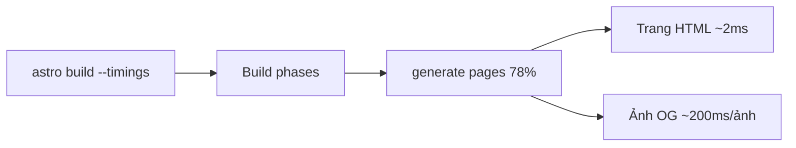

:::tldr
- Tin chính của tháng là **Astro 7.4**: cờ `astro build --timings` cho biết build tốn thời gian ở đâu.
- Image service giờ tách được **build** và **runtime**, hợp với site vừa prerender vừa render on-demand.
- Hai tính năng experimental: **prerender song song** trên nhiều luồng và **trang redirect tuỳ biến** cho build tĩnh.
- Mình chạy `--timings` trên trang này: gần như toàn bộ thời gian render nằm ở việc tạo ảnh OG.
:::

Mỗi tháng, team Astro ra một bài [What's new in Astro](https://astro.build/blog/whats-new-october-2026/) tổng hợp bản phát hành, site hay, bài viết và integration từ cộng đồng.
Bản tháng 10 khá dài, nên mình lọc lại những phần liên quan tới việc làm site hằng ngày, kèm vài thử nghiệm trên chính trang này.

## Astro 7.4: build chậm ở đâu?

Thay đổi mình thích nhất là cờ `--timings`:

```bash
astro build --timings
```

Build xong, Astro in ra bảng tổng hợp: các phase của build, Vite plugin, file bundle chậm, Markdown, syntax highlighting, ảnh, integration và những trang render lâu nhất.
Trước đây muốn biết build chậm vì đâu thì phải đoán hoặc tự gắn `console.time`.

Mình chạy thử trên trang này (43 trang, output tĩnh). Kết quả rút gọn:

```text
total 5.22s · 43 pages · output "static"

Build phases
  resolve config                       451ms   8.6%
  setup                                241ms   4.6%
  prerender bundle                     336ms   6.4%
  generate pages                       4.10s  78.5%

Slowest pages (median 2ms · p95 227ms)
  /og/en/what-is-ai-native.png         1.64s   /og/[...id].png
  /og/en/why-i-built-kd-code.png       260ms   /og/[...id].png
  /og/vi/hello.png                     227ms   /og/[...id].png
```

Trang HTML chỉ mất trung vị **2 ms**. Phần nặng là endpoint `/og/[...id].png`, nơi mình dùng satori + resvg để vẽ ảnh chia sẻ cho từng bài.
Ảnh đầu tiên mất 1,64 s vì phải đọc font và ảnh nền một lần cho cả build; các ảnh sau khoảng 200 ms mỗi cái.
Không cần profiler, chỉ một cờ là thấy ngay chỗ cần tối ưu nếu sau này số bài tăng lên.



:::advanced
### Đọc báo cáo từ trên xuống

Bài [Astro 7.4](https://astro.build/blog/astro-740/) có một ví dụ hay: component `<Comment>` tự `fetch` profile người bình luận, nên mỗi trang phải chờ hai lượt request nối tiếp nhau.
Báo cáo cho thấy `generate pages` chiếm 81%, gần như tất cả nằm ở `component render` chứ không phải pipeline của Astro, và chỉ các trang dùng layout bài viết bị chậm.
Gom các request lại bằng `Promise.all()` ở component cha giúp thời gian generate giảm từ 2,10 s xuống 1,13 s.

Cách đọc chung: xem phase nào chiếm nhiều nhất, rồi xem trong phase đó là code của mình hay của framework, cuối cùng nhìn danh sách trang chậm để biết route nào cần sửa.
Team Astro khuyên chạy `--timings` trước khi bật prerender song song hay incremental build, để biết mình đang tối ưu đúng phần nào.
:::

## Image service tách build và runtime

Trang prerender và trang on-demand có nhu cầu xử lý ảnh khác nhau.
Lúc build có đủ thời gian và Node.js đầy đủ, nên Sharp chạy tốt. Trang on-demand thường chạy ở edge, nơi Sharp không chạy được, nên dùng image CDN hợp hơn.

Từ 7.4, `image.service` nhận hai service riêng:

```js
// astro.config.mjs
export default defineConfig({
  image: {
    service: {
      build: { entrypoint: "astro/assets/services/sharp" },
      runtime: { entrypoint: "my-image-cdn-service" },
    },
  },
});
```

`build` xử lý ảnh trên trang prerender (và lúc dev), `runtime` lo các trang on-demand và image endpoint trên production.
Trang này hoàn toàn tĩnh nên chưa cần, nhưng nếu sau này thêm vài route SSR trên Cloudflare thì đây là cấu hình mình sẽ dùng.
Lưu ý: cần nâng `@astrojs/cloudflare` và `@astrojs/markdoc` cùng lúc với `astro`, vì bản mới của chúng yêu cầu `astro@^7.4.0`.

## Mấy thay đổi nhỏ nhưng đáng biết

- **`notFound()` cho entrypoint tự viết**: nếu bạn ghép `pages()` từ `astro/hono` hoặc `astro/fetch` mà không dùng `astro()`, request không khớp route trước đây trả về 404 rỗng. Giờ thêm `notFound()` trước `pages()` là có trang `404.astro`.
- **Cảnh báo cấu hình font**: font provider có thể báo những weight, style, subset mà một font thật sự có, và Astro sẽ cảnh báo nếu config của bạn đòi thứ provider không có. Trang này dùng Be Vietnam Pro và Fraunces qua Fontsource với subset `vietnamese`, build không có cảnh báo nào.
- **Node.js tối thiểu là 22.22.0**: kiểm tra Node trên CI trước khi nâng cấp.

## Hai tính năng experimental

### Prerender song song

Astro vốn render các trang tĩnh đồng thời nhưng chỉ trên một luồng. Cờ `experimental.parallelPrerender` chia việc render ra các worker thread:

```js
export default defineConfig({
  experimental: {
    parallelPrerender: { workers: 4 },
  },
});
```

Mặc định Astro dùng số core trừ đi một. Mỗi worker tốn thêm bộ nhớ, nên nếu build hết RAM hoặc không nhanh hơn thì giảm `workers`.
Cờ này không có tác dụng khi adapter tự lo prerender, hiện chỉ có `@astrojs/cloudflare`.

Với trang này, báo cáo `--timings` cho thấy phần nặng là ảnh OG, việc tốn CPU, nên đây là trường hợp prerender song song có thể giúp được. Nhưng tổng build chỉ khoảng 5 giây, chưa đáng để bật một cờ experimental.

### Trang redirect tuỳ biến

Site tĩnh không có server để gửi header `Location`, nên với mỗi redirect Astro tạo một trang HTML nhỏ dùng `<meta http-equiv="refresh">`. Trang đó trước đây cố định nội dung và không dịch được.
Bật `experimental.redirectPage` rồi tạo `src/pages/3xx.astro` là bạn tự thiết kế được trang này, kèm các props `from`, `to`, `status`, `delay`.

:::advanced
### Vì sao trang này chưa cần `3xx.astro`

Trang này chạy trên Cloudflare Pages và khai báo redirect trong `public/_redirects`, ví dụ khi đổi slug tiếng Việt cũ sang tiếng Anh:

```text
/gioi-thieu/ /about/ 301
```

Cloudflare trả về 301 thật ở tầng hosting, nên trình duyệt và Google không bao giờ thấy trang meta refresh.
`3xx.astro` hữu ích khi host không hỗ trợ redirect phía server, hoặc khi bạn dùng `redirects` trong config, `Astro.redirect()` trong trang prerender hay redirect i18n mà muốn trang chuyển hướng mang giao diện và ngôn ngữ của site.
Nhớ là trong build tĩnh, thẻ meta refresh chính là cơ chế redirect, nên trang của bạn bắt buộc phải render thẻ đó trỏ về `to`.
:::

## Từ cộng đồng

Vài bài trong phần Reading List mình thấy đáng đọc:

- **Owner** [dựng lại hạ tầng web bằng Astro](https://building.owner.com/project-speed) cho các nhà hàng: trang menu nhanh hơn 83% và doanh thu mỗi nhà hàng tăng hơn 4%. Một ví dụ hiếm có số liệu rõ ràng về giá trị của tốc độ.
- **Miguel Fernandez** [chuyển khoảng 800 trang đa ngôn ngữ từ Webflow sang Astro trong một ngày](https://www.useomnia.com/blog/webflow-to-astro-migration), với sự trợ giúp của agent.
- [Make missing translations fail your Astro build](https://dev.to/mabb0512/make-missing-translations-fail-your-astro-build-4m49): cùng ý tưởng với việc trang này để schema Zod làm build fail khi frontmatter sai.
- [Chasing 100 Lighthouse scores on my Astro blog](https://tomekdev.com/posts/chasing-100-lighthouse-scores-on-my-astro-blog), đọc kèm [bài về điểm Lighthouse của mình](/blog/perfect-lighthouse-score/).

Ngoài ra còn rất nhiều integration mới về SEO, `llms.txt`, CMS dựa trên Git và i18n. Đáng chú ý là [`@cloudflare/polystella-astro`](https://github.com/cloudflare/polystella), dịch nội dung Markdown bằng AI lúc build và cache trên R2.

## Kết

Với mình, `--timings` là thay đổi hữu ích nhất tháng: chỉ một lần chạy là biết thời gian build của trang này nằm ở ảnh OG chứ không phải HTML hay CSS.
Nếu bạn đang dùng Astro, thử chạy lệnh đó trên project của bạn trước khi tối ưu bất cứ thứ gì.
