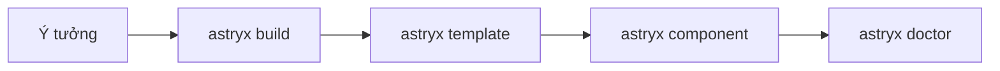

:::tldr
- **Astryx** ([astryx.atmeta.com](https://astryx.atmeta.com/)) là design system mã nguồn mở của Meta, giấy phép MIT, dựng trên **React 19+** và **StyleX**. Nó lớn lên trong Meta suốt 8 năm và đang chạy trong hơn **13.000 ứng dụng** nội bộ.
- Một bộ gồm: hơn **170 component** accessible (bản 0.7.16 mình cài báo 174), **7 theme** có sẵn, dark mode, khoảng **60 page template** và một **CLI**.
- Dùng đơn giản: import CSS dựng sẵn và component có type, **không cần plugin build**. Override bằng `className` với Tailwind, CSS Modules hay CSS thường đều được.
- Điểm khác biệt lớn nhất: **CLI là docs cho agent**. `astryx init` ghi quy tắc vào `AGENTS.md`/`CLAUDE.md`, `astryx build "<ý tưởng>"` chọn template phù hợp, `astryx component <Tên>` in props và best practice.
- Đang **beta** (0.7.x). Mình thử thấy bundle khá nặng: một trang chỉ có `Button` đã là ~162 KB JS gzip cộng ~48 KB CSS.
:::

Viết React lâu năm thì ai cũng từng dựng lại date picker, table, form… ở dự án này rồi dự án khác. Meta gặp đúng vấn đề đó ở quy mô hàng nghìn công cụ nội bộ, nên họ làm một design system chung. Tám năm sau, họ dựng lại nó trên stack mã nguồn mở và công bố với tên **Astryx**.

Mình chú ý tới Astryx vì nó không chỉ là "thêm một thư viện component". Ngay từ đầu, team đã thiết kế API, docs và CLI để **người và AI agent dùng cùng một cách, từ cùng một nguồn tài liệu**. Dưới đây là những gì mình đọc được từ [trang chủ](https://astryx.atmeta.com/), [docs](https://astryx.atmeta.com/docs/getting-started), [repo GitHub](https://github.com/meta/astryx) và bài [How Astryx works](https://astryx.atmeta.com/blog/how-astryx-works), cộng với một lần cài thử.

## Vì sao Meta làm lại design system

Theo bài [How Astryx works](https://astryx.atmeta.com/blog/how-astryx-works), Meta có văn hóa "chưa có công cụ thì tự làm", nên các team cứ dựng đi dựng lại cùng một component. Design system nội bộ ra đời để giải quyết chuyện đó một lần, và dần thành design system lớn nhất công ty, với khoảng một nửa số thay đổi do chính cộng đồng người dùng đóng góp.

Rồi AI thay đổi bài toán. Trợ lý code làm tốt hơn hẳn với những thứ nằm "trong phân phối": TypeScript, thư viện mã nguồn mở phổ biến, API chuẩn của trình duyệt. Hệ thống nội bộ thì không thuộc nhóm đó. Vì vậy Meta dựng lại nó trên stack mở, giữ lại độ phủ và quy ước đã tích lũy, đồng thời làm cho nó "AI-fluent" ngay từ thiết kế. Họ cũng nói thẳng: chính AI giúp một team nhỏ làm được việc dựng lại và mở mã nguồn cả hệ thống.

## Có gì trong Astryx

| Phần | Nội dung |
| --- | --- |
| `@astryxdesign/core` | Component, hệ thống theme, hook và tiện ích |
| `@astryxdesign/cli` | Docs component, template, scaffold, theme, codemod nâng cấp |
| `@astryxdesign/theme-*` | 7 theme: neutral, butter, chocolate, matcha, stone, gothic, y2k |
| `@astryxdesign/richtext` | Ô soạn thảo rich text dựng trên Lexical, đọc ghi Markdown |
| `@astryxdesign/build` | Plugin build cho ai muốn dựng từ source StyleX |

Component trải từ cơ bản (Button, Badge, Avatar, VStack) tới những thứ khó làm cho đúng như Table có virtualization cả hàng lẫn cột, PowerSearch, Lightbox, BottomSheet, DateInput theo nhiều lịch. Từ bản [0.5.0](https://astryx.atmeta.com/blog/astryx-v0-5-0), Astryx hỗ trợ khoảng 30 locale và RTL.

Bốn nguyên tắc team nhấn mạnh:

- **Open internals**: các mảnh dựng nên component được export thẳng ra. Cần sâu hơn thì `swizzle` đẩy toàn bộ source của component vào dự án để bạn tự sở hữu.
- **Không khóa vào một cách style**: Astryx viết style bằng StyleX nhưng người dùng không cần biết. Override bằng `className` với Tailwind, CSS Modules hay CSS thường.
- **Tùy biến không cần bọc component**: theme là tập CSS custom property và override cho từng component, sinh từ một config. Designer làm chủ theme, developer không phải fork hay wrap component.
- **Một hệ thống cho người và AI**: API, quy ước và CLI được thiết kế cùng nhau, và được đo bằng cách xem LLM thực sự dùng thư viện ra sao.

## Cài đặt và component đầu tiên

Astryx cần React 19 trở lên:

```bash
npm install @astryxdesign/core @stylexjs/stylex @astryxdesign/theme-neutral @astryxdesign/cli
npx @astryxdesign/cli init
npx @astryxdesign/cli theme add neutral
```

`theme add` sinh ra file `astryx-themes.js` (import theme và font). Sau đó thêm CSS gốc và bọc app trong `Theme`:

```css
/* globals.css */
@import "@astryxdesign/core/reset.css";
@import "@astryxdesign/core/astryx.css";
```

```tsx
import { Theme } from "@astryxdesign/core/theme";
import { themes, defaultThemeSlug } from "./astryx-themes";

<Theme theme={themes[defaultThemeSlug]}>
  <App />
</Theme>;
```

Mỗi component import từ đường dẫn riêng để bundle chỉ lấy thứ cần dùng:

```tsx
import { Button } from "@astryxdesign/core/Button";
import { VStack } from "@astryxdesign/core/VStack";

export default function Page() {
  return (
    <VStack gap={2}>
      <Button label="Hello Astryx" onClick={() => alert("Hi!")} />
    </VStack>
  );
}
```

Để ý `Button` nhận `label` chứ không nhận children. Label đồng thời là accessible name, nên khó quên nhãn cho nút.

:::advanced
### Override bằng StyleX và thứ tự cascade layer

Nếu dự án đã dùng StyleX, truyền style qua prop `xstyle`:

```tsx
import * as stylex from "@stylexjs/stylex";

const overrides = stylex.create({
  save: { alignSelf: "flex-end", marginTop: 16 },
});

<Button label="Save" xstyle={overrides.save} />;
```

CSS của Astryx nằm trong cascade layer: reset ở `@layer reset`, component ở `@layer astryx-base`. Style không thuộc layer nào, hoặc thuộc layer khai báo sau, luôn thắng `astryx-base` **bất kể specificity**. Nếu dự án có sẵn global CSS, reset cũ hay Tailwind, hãy khai báo thứ tự layer rõ ràng và gán từng stylesheet vào layer có chủ đích, nếu không sẽ gặp cảnh "sao style của component tự nhiên bị đè". Docs chi tiết: `npx @astryxdesign/cli docs migration/migration-setup`.

Astryx còn có đường build từ source TypeScript + StyleX: bundler chỉ giữ style của component bạn dùng, theo Meta là khoảng một phần ba stylesheet đầy đủ trong app mẫu của họ.
:::

## CLI: docs cho agent, chạy trong terminal

Đây là phần mình thấy đáng học hỏi nhất. Thay vì để agent đoán props từ dữ liệu huấn luyện, Astryx đưa docs **đúng phiên bản đã cài** vào terminal:

```bash
npx @astryxdesign/cli search button        # tìm component, hook, docs, template
npx @astryxdesign/cli component Button     # props, anatomy, best practice, accessibility
npx @astryxdesign/cli build "settings page with a table of team members"
npx @astryxdesign/cli template table-page --type page src/TablePage.tsx
npx @astryxdesign/cli doctor --built .     # kiểm tra dự án trước khi bàn giao
```

`astryx init` không hỏi gì (an toàn cho agent và CI) và ghi một khối quy tắc vào `AGENTS.md`, đồng thời vào `CLAUDE.md` nếu dự án có, và một dòng import vào `GEMINI.md`. Khối đó dạy agent một quy trình ba bước:



1. `build "<ý tưởng>"` chọn một page template gần nhất, gợi ý thêm hai template khác và các block còn thiếu.
2. `template <tên> <path>` scaffold template vào dự án; giữ khung và spacing, chỉ thay nội dung.
3. `component <Tên>` đọc props trước khi dùng.

Kèm theo là các quy tắc khá "cứng": không dùng `<div>` thô, không `style={{}}`, không hex hay px viết tay mà dùng token, dữ liệu dày thì dùng Table/List thay vì Card. Lý do được team giải thích trong bài [AI is a copycat so we gave it good examples to copy](https://astryx.atmeta.com/blog/astryx-cli-build-command): agent hay bắt chước, nên hãy đưa nó template do designer làm sẵn để bắt chước.

Trang chủ cũng nhắc tới MCP để agent dùng cùng các chức năng này mà không cần qua terminal.

## Mình thử thì thấy

Mình cài Astryx vào một dự án Vite + React 19 trống (thử ngày 15/11/2026, `@astryxdesign/core` và `@astryxdesign/cli` 0.7.16, theme neutral) rồi làm theo đúng quy trình mà CLI dạy agent.

**Phần làm tốt:**

- `init` chạy không hỏi gì, ghi `AGENTS.md` khoảng 2,7 KB: ngắn, đủ ý, có số phiên bản và số component (174) ở dòng đầu. Gọn hơn nhiều so với kiểu nhét cả bộ docs vào một file `llms.txt`.
- `build "settings page with a table of team members"` trả về template `settings`, kèm `table-page` và `settings-sidebar` làm phương án, còn nhắc luôn dependency cần cài (`@heroicons/react`). Đúng thứ mình cần.
- `component Button` in ra anatomy, best practice dạng Do/Don't và yêu cầu contrast cụ thể cho từng trạng thái. Đây là loại thông tin agent hay bỏ qua nhất.
- Template `table-page` (gần 1.000 dòng: bảng có tìm kiếm, lọc theo cột, sắp xếp, tổng động) scaffold xong là build được ngay với Vite, không cần plugin hay config gì thêm. `doctor` báo 0 lỗi, 2 cảnh báo về font Figtree tải từ bên ngoài.

**Phần cần cân nhắc:**

| Trang build bằng Vite | JS (gzip) | CSS (gzip) |
| --- | --- | --- |
| Chỉ một `Button` trong `VStack` | ~162 KB | ~48 KB |
| Template `table-page` | ~464 KB tổng mọi chunk (chunk chính ~332 KB) | ~48 KB |

Đã tính cả React 19 (khoảng 60 KB gzip). Với một nút bấm thì con số này lớn: `Theme` và các phần dùng chung kéo theo nhiều code. CSS dựng sẵn luôn là ~292 KB (~45 KB gzip) dù dùng ít hay nhiều component. Đường build từ source StyleX được cho là cắt được phần CSS này, nhưng mình chưa thử.

Vài điểm nhỏ khác:

- npm bản mới chặn script `postinstall` của `@astryxdesign/core` nếu chưa duyệt. Script đó chỉ in lời nhắc chạy `astryx init`, nên bỏ qua cũng không sao.
- Đừng chạy `npx astryx` khi chưa cài CLI: tên không có scope trỏ tới một package npm khác hẳn. Luôn dùng `npx @astryxdesign/cli`.
- Con số component mỗi chỗ một khác: README ghi 150+, trang chủ 180+, CLI báo 174.

Nhận định của mình: với **công cụ nội bộ, dashboard, admin**, tức đúng loại ứng dụng Meta dùng nó suốt 8 năm, Astryx rất đáng thử, nhất là khi bạn để agent viết phần lớn UI. Template và CLI giúp agent ra kết quả có cấu trúc hơn hẳn so với tự nghĩ từ đầu. Còn với trang công khai cần tải nhanh trên mạng chậm thì kích thước bundle hiện tại là điểm trừ lớn. Mình sẽ chờ bản 1.0 và thử đường build từ source trước khi cân nhắc cho loại dự án đó.

## Kết

Astryx thú vị không phải vì có nhiều component (nhiều thư viện có), mà vì nó coi **AI agent là người dùng hạng nhất** của design system. Docs đúng phiên bản nằm trong CLI, quy tắc nằm trong `AGENTS.md`, template do designer làm cho agent bắt chước, và `doctor` để kiểm tra trước khi bàn giao. Đó là một khuôn mẫu tốt cho bất kỳ team nào đang tự duy trì design system riêng.

Hai lưu ý: thư viện đang **beta** nên API vẫn có thể đổi giữa các bản 0.x, và cách tốt nhất để đánh giá là tự dựng một trang thật trong [Playground](https://astryx.atmeta.com/playground) hoặc với một trong các [app mẫu](https://github.com/meta/astryx) (Next.js, Next.js + StyleX, Next.js + Tailwind, Vite + Tailwind).

Muốn hiểu lớp styling bên dưới Astryx, xem bài [StyleX](/blog/stylex/). Nếu bạn quan tâm cách cho agent làm UI tốt hơn, có thể đọc thêm [UI SDK của Vercel](/blog/vercel-ui-sdk/) (đưa agent behavior thay vì component) và [A2UI 1.0](/blog/a2ui-1-0/) (agent trả lời bằng giao diện).
