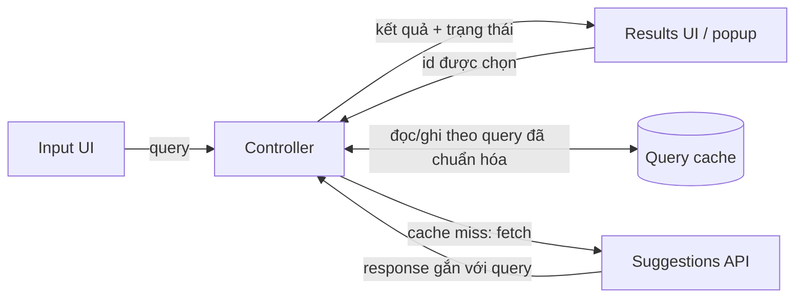
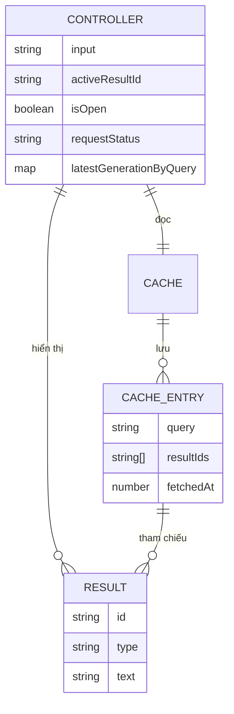
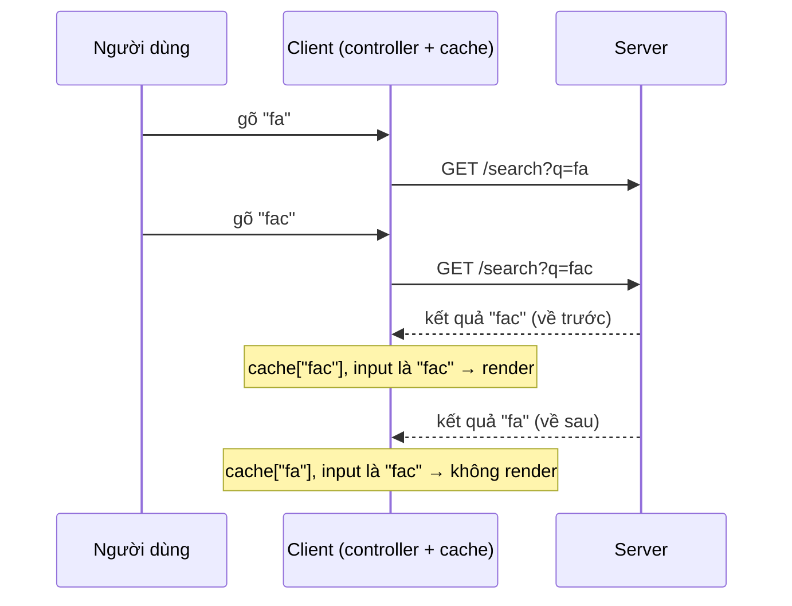
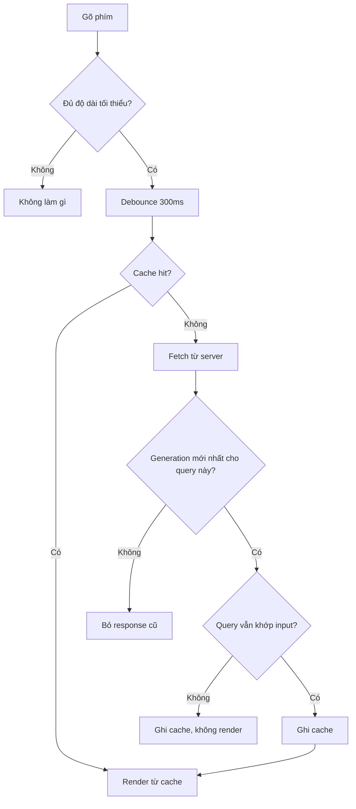
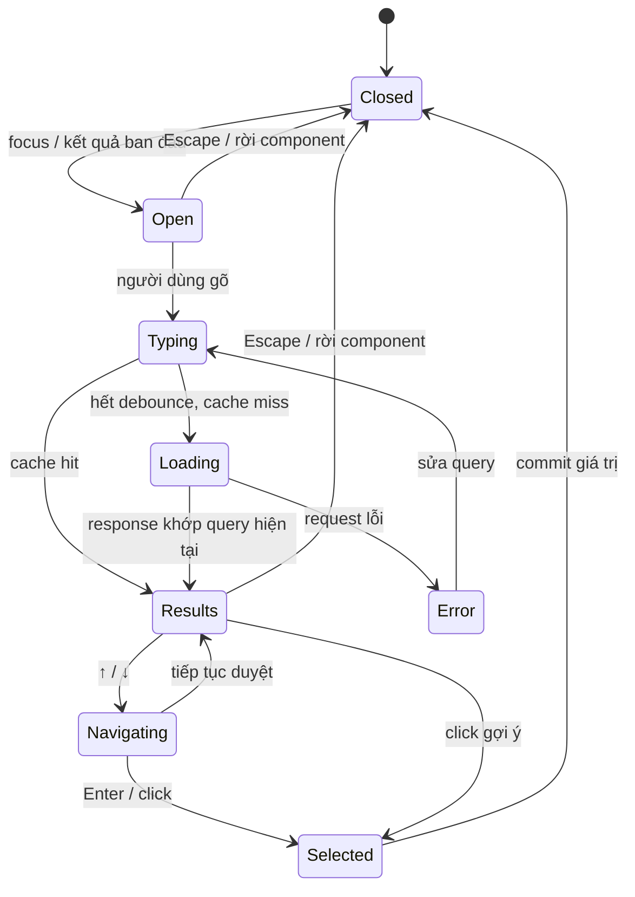

:::tldr
- Autocomplete là bài system design "nhỏ mà đủ món": xử lý input, gọi API bất đồng bộ, cache, race condition, keyboard và accessibility.
- Đặt một **controller** ở giữa: input, popup kết quả, cache và server đều chỉ nói chuyện với controller. Race condition và state cũ chỉ cần xử lý ở một chỗ.
- **Không bao giờ tin thứ tự response.** Gắn kết quả với query đã sinh ra nó, chỉ render khi query đó vẫn khớp với input hiện tại.
- Chọn cấu trúc cache theo **vòng đời trang**: map `query → results` cho trang ngắn hạn, cache chuẩn hóa `query → ids` + `id → entity` cho SPA sống lâu.
- Debounce ~300ms cho việc gọi API (không phải cho việc hiển thị chữ), và dùng đúng pattern **combobox** của WAI-ARIA thay vì tự chế role.
:::

Đây là bài tiếp theo sau [checklist Front-end System Design 9 bước](/blog/frontend-system-design-cheatsheet/), lần này áp vào một đề cụ thể và rất hay gặp: thiết kế component autocomplete. Ghi chú dựa trên bài [Autocomplete của GreatFrontEnd](https://www.greatfrontend.com/questions/system-design/autocomplete), mình viết lại theo cách hiểu của mình và thêm code ví dụ.

## Đề bài

Thiết kế một component autocomplete: người dùng gõ vào ô input, một popup hiện danh sách gợi ý, người dùng chọn một kết quả. Ví dụ quen thuộc là ô tìm kiếm của Google (gợi ý chủ yếu là text) hay của Facebook (gợi ý "giàu" hơn: người, trang, nhóm, kèm ảnh).

Đã có sẵn một API backend trả về kết quả theo query. Yêu cầu:

- Component đủ **tổng quát** để nhiều website khác nhau dùng được.
- Giao diện ô input và danh sách kết quả **tùy biến được**.

## 1. Làm rõ yêu cầu

Những câu nên hỏi người phỏng vấn trước khi vẽ gì:

| Câu hỏi | Câu trả lời hợp lý cho bản đầu |
| --- | --- |
| Kết quả có những dạng nào? | Text, ảnh, hoặc ảnh kèm text. Không đoán trước được hết, nên phải cho phép tự render. |
| Chạy trên thiết bị nào? | Mọi thiết bị: laptop, tablet, điện thoại. |
| Có cần fuzzy search không? | Chưa cần ở bản đầu, để dành nếu còn thời gian. |

Câu trả lời đầu tiên quan trọng nhất: vì không biết trước kết quả trông thế nào, component **không được** giả định một kiểu hiển thị cố định cho mỗi dòng.

## 2. Kiến trúc

Bốn khối, một "bộ não" ở giữa:



- **Input UI**: hiển thị chữ đang gõ, báo cho controller khi nội dung hoặc focus thay đổi.
- **Results UI (popup)**: render danh sách kết quả hiện tại do controller đưa xuống, báo lại **id** của kết quả được chọn. Popup không tự sửa input; nó báo cho controller, controller quyết định.
- **Cache**: giữ kết quả của các query trước, đánh key theo query. Cache chỉ lưu, không quyết định popup đang hiện query nào.
- **Controller**: giống Controller trong MVC. Nhận input, tra cache, gọi server khi cache miss, ghi response vào cache và đẩy kết quả xuống popup.

Lợi ích của việc gom mọi luồng qua controller: khi có lỗi kiểu "kết quả cũ đè kết quả mới", bạn biết chính xác phải sửa ở đâu.

## 3. Data model

Chia state theo vòng đời:



- **Controller** giữ state UI tạm thời: chuỗi đang gõ, kết quả đang được highlight (`activeResultId`), popup đang mở hay đóng, trạng thái request và "thế hệ" (generation) mới nhất của request cho từng query. Cộng thêm các props/options người dùng truyền vào.
- **Cache** giữ lịch sử query lâu hơn: kết quả ban đầu (khi chưa gõ gì) và kết quả đã fetch, key là query đã chuẩn hóa.

`requestStatus` nên phân biệt `idle`, `loading`, `success`, `error`, `offline`. Lưu ý **"không có kết quả" không phải là một trạng thái riêng**: đó là `success` với danh sách rỗng.

Hai thứ **không** nên đưa vào state: HTML đã highlight từ server làm nhãn gốc (dùng để hiển thị thì được, nhưng nhãn gốc nên là text thuần), và danh sách DOM node đang mount làm thứ tự kết quả (thứ tự phải đến từ dữ liệu, không phải từ DOM).

## 4. API

### API của component

**Nhóm cơ bản**, quyết định chức năng:

- **Số kết quả** hiển thị.
- **Request adapter**: một hàm nhận query, giới hạn số kết quả, cursor (nếu có) và `AbortSignal`, trả về kết quả có id ổn định. Việc dựng URL, gắn token, parse response đều nằm ngoài component. Nhờ vậy component không biết gì về backend cụ thể.
- **Event hook**: `input`, `focus`, `blur`, `change`, `select`, hữu ích cho việc log hành vi người dùng.
- **Tùy biến giao diện**, từ dễ dùng đến linh hoạt:
  1. **Object theme** (`{ textSize: '12px', textColor: 'red' }`): dễ nhất, ít linh hoạt nhất.
  2. **Class name**: người dùng tự viết CSS cho từng phần.
  3. **Render function** (inversion of control, kiểu render props của React): component đưa dữ liệu, người dùng tự quyết định render. Linh hoạt nhất nhưng tốn công nhất.

**Nhóm nâng cao**, ảnh hưởng UX và hiệu năng:

- **Độ dài query tối thiểu**: query quá ngắn ("a") cho ra kết quả vô nghĩa, có thể chỉ tìm khi đủ 2–3 ký tự.
- **Thời gian debounce**: ví dụ 300ms, chỉ gọi API khi người dùng ngừng gõ 300ms.
- **Timeout API**: chờ bao lâu thì coi là lỗi.
- **Cache**: kết quả ban đầu, nguồn dữ liệu (chỉ network, network + cache, chỉ cache), thời gian sống của cache.

### Hợp đồng với server

Request adapter nên trả về một hình dạng nhỏ và thống nhất:

```ts
type Suggestion = {
  id: string;     // ổn định, dùng làm key và cho aria-activedescendant
  text: string;   // nhãn hiển thị
  value?: string; // giá trị commit khi chọn; mặc định là text
  type?: string;  // để renderer chọn cách vẽ (người, trang, text...)
};

type SuggestionPage<T extends Suggestion = Suggestion> = {
  items: T[];
  nextCursor?: string;
};

type FetchSuggestions<T extends Suggestion = Suggestion> = (args: {
  query: string;
  limit: number;
  cursor?: string;
  signal: AbortSignal;
}) => Promise<SuggestionPage<T>>;
```

Vài quyết định đáng nói khi phỏng vấn:

- **Id ổn định, không dùng index mảng.** Index thay đổi mỗi lần danh sách đổi, làm hỏng key khi render và hỏng `aria-activedescendant`.
- **Server trả dữ liệu, không trả HTML render sẵn.** Nếu không, phần "tùy biến giao diện" trở nên vô nghĩa.
- **Cursor thay vì số trang**, vì danh sách đã xếp hạng có thể đổi giữa hai lần gọi.
- Người dùng mở rộng `Suggestion` với field riêng (ảnh, subtitle…) qua generic.

## 5. Đi sâu: mạng

Autocomplete gần như bắn một request mỗi lần gõ, nên lớp mạng phải chịu được: response về sai thứ tự, lỗi tạm thời và mất mạng.

### Race condition

Người dùng gõ `fa` rồi `fac`. Hai request bay song song, và không ai đảm bảo request gửi trước sẽ về trước:



Nếu cứ render response mới nhất *nhận được*, người dùng sẽ thấy gợi ý của `fa` trong khi ô input ghi `fac`.

Cách xử lý gồm hai lớp:

1. **Key theo query**: lưu response vào map theo query đã gửi, và chỉ hiển thị kết quả của query **đang khớp với input**. Response của `fa` vẫn được lưu vào cache (có ích nếu người dùng xóa bớt chữ), chỉ là không render.
2. **Generation theo từng query**: key theo query chưa phân biệt được hai request **cùng một query** (ví dụ retry, hoặc gõ `fa` → `fac` → `fa`). Gắn mỗi request một số tăng dần, chỉ response có generation mới nhất cho query đó mới được ghi đè cache.

`AbortController` để hủy request đã lỗi thời là một **tối ưu** (đỡ tốn băng thông và CPU), không phải cơ chế đảm bảo đúng: lệnh hủy có thể đến quá muộn, response vẫn về. Giữ cả hai lớp kiểm tra ở trên dù có hủy hay không.

```ts
class SuggestionController {
  private generation = 0;
  private latestGen = new Map<string, number>();
  private cache = new Map<string, { items: Suggestion[]; fetchedAt: number }>();
  private inflight?: AbortController;

  constructor(
    private fetchSuggestions: FetchSuggestions,
    private render: (items: Suggestion[]) => void,
    private getInput: () => string,
  ) {}

  async load(rawQuery: string) {
    const key = normalize(rawQuery);
    const cached = this.cache.get(key);
    if (cached) return this.render(cached.items);

    const gen = ++this.generation;
    this.latestGen.set(key, gen);

    this.inflight?.abort(); // tối ưu, không phải cơ chế đúng
    this.inflight = new AbortController();

    const { items } = await this.fetchSuggestions({
      query: rawQuery,
      limit: 10,
      signal: this.inflight.signal,
    });

    // Lớp 1: chỉ response mới nhất cho query này được ghi cache.
    if (this.latestGen.get(key) !== gen) return;
    this.cache.set(key, { items, fetchedAt: Date.now() });

    // Lớp 2: chỉ render nếu query vẫn khớp với input hiện tại.
    if (normalize(this.getInput()) === key) this.render(items);
  }
}

const normalize = (q: string) => q.trim().toLowerCase();
```

(Code lược bớt xử lý lỗi `AbortError` và trạng thái loading cho gọn.)

Cache lịch sử keystroke có ích khi gõ nhầm: `foot` → `footr` → xóa `r` → `foot`, kết quả của `foot` hiện ngay. Nhưng nếu có debounce, request cho `foot` có thể chưa từng được gửi, nên lợi ích này lớn nhất với người gõ chậm hơn khoảng debounce.

### Lỗi và retry

Request có thể lỗi do mạng chập chờn. Tự động retry là hợp lý, nhưng dùng **exponential backoff** (và jitter) để không dội thêm tải vào server đang có vấn đề. GET gợi ý là idempotent nên retry an toàn.

### Offline

Khi thiết bị mất mạng hoàn toàn, không làm được nhiều, nhưng có thể:

- Chỉ đọc từ cache (vô ích nếu cache rỗng).
- Không bắn request nào để đỡ tốn CPU và pin.
- Báo rõ trong component là đang không có mạng.

## 6. Đi sâu: cache

Cache đổi bộ nhớ lấy tốc độ: query đã gặp thì hiện ngay, không cần round-trip.

### Có nên dùng trie?

Trie đánh chỉ mục chuỗi theo tiền tố: tìm `fac` bằng cách đi theo `f` → `a` → `c` rồi gom các từ bên dưới. Hữu ích khi **trình duyệt đã có sẵn toàn bộ tập dữ liệu**, nhỏ và ít đổi (ví dụ danh sách quốc gia). Với vài trăm phần tử, `array.filter` thường là đủ.

Nhưng **đừng lọc kết quả của `fa` để trả lời `fac`**. Server chỉ trả top N cho `fa`; các kết quả đúng cho `fac` có thể không nằm trong top đó. Dựng trie từ cache cũng mắc cùng lỗi này. Với dữ liệu từ server, cache theo nguyên query.

### Ba cách tổ chức cache

**1. Map `query → results`.** Đơn giản nhất, tra cứu O(1):

```ts
const cache = {
  fa: [{ id: "fb", text: "Facebook" }, { id: "face", text: "face" }],
  fac: [{ id: "fb", text: "Facebook" }, { id: "face", text: "face" }, { id: "fbm", text: "facebook messenger" }],
};
```

Nhược điểm: trùng lặp nhiều. `Facebook` nằm trong cả `fa`, `fac`, `face`… Không debounce thì trùng lặp càng nặng.

**2. Một danh sách phẳng, tự lọc ở client.** Không trùng lặp, nhưng phải lọc trên main thread (chậm với dữ liệu lớn và máy yếu) và mất thứ tự xếp hạng của server. Thường không nên.

**3. Cache chuẩn hóa** (ý tưởng giống [normalizr](https://github.com/paularmstrong/normalizr)): lưu entity theo id một lần, mỗi query chỉ giữ danh sách id:

```ts
const entities = {
  fb: { id: "fb", type: "organization", text: "Facebook" },
  face: { id: "face", type: "text", text: "face" },
  fbm: { id: "fbm", type: "text", text: "facebook messenger" },
};

const queries = {
  fa: ["fb", "face"],
  fac: ["fb", "face", "fbm"],
};

const resultsFor = (q: string) => (queries[q] ?? []).map((id) => entities[id]);
```

Tra cứu vẫn nhanh, không trùng dữ liệu; chi phí map id → entity không đáng kể vì mỗi lần chỉ hiện vài kết quả.

### Chọn cách nào?

| Bối cảnh | Nên dùng | Lý do |
| --- | --- | --- |
| Trang sống ngắn (trang tìm kiếm Google) | Map `query → results` | Đơn giản; người dùng ít khi gõ đủ nhiều để bộ nhớ thành vấn đề; trang reset khi bấm vào kết quả |
| SPA sống lâu (Facebook, dashboard mở cả ngày) | Cache chuẩn hóa | Cùng entity lặp lại qua nhiều query; tiết kiệm bộ nhớ khi tích lũy lâu |

Bắt đầu bằng map, chỉ chuyển sang chuẩn hóa khi **đo được** trùng lặp đáng kể.

### Kết quả ban đầu

Khi người dùng vừa focus vào ô mà chưa gõ gì, có thể hiện sẵn: xu hướng hôm nay, lịch sử tìm kiếm (Google), lịch sử tìm kiếm (Facebook), mã cổ phiếu đang hot (sàn giao dịch). Đơn giản nhất là lưu chúng vào cache với key là chuỗi rỗng `""`.

Facebook từng tải trước danh sách bạn bè, trang, nhóm của người dùng vào trình duyệt để lọc ngay ở client mà không cần request ([The Life of a Typeahead Query](https://engineering.fb.com/2010/05/17/web/the-life-of-a-typeahead-query/)).

### Khi nào xóa cache?

Cache giữ quá lâu vừa tốn bộ nhớ vừa trả kết quả cũ:

- **Tìm kiếm chung**: kết quả đổi chậm, TTL dài được.
- **Tìm kiếm cá nhân hóa**: TTL ngắn, và cache phải gắn với người dùng đang đăng nhập.
- **Sàn chứng khoán hiện giá trong gợi ý**: có khi không nên cache, giá đổi từng phút.

Trong thực tế: chuẩn hóa query trước khi làm key (`trim`, lowercase…), gắn TTL cho từng entry, và giới hạn số entry bằng LRU.

## 7. Đi sâu: hiệu năng

- **Tốc độ hiển thị**: không làm server nhanh hơn được, nhưng cache giúp query trùng hiện gần như tức thì.
- **Debounce**: giảm số request và tải CPU. Lưu ý: **debounce việc gọi API, không debounce việc cập nhật ô input**. Chữ phải hiện ngay khi gõ, chỉ việc tìm kiếm mới chờ. Throttle hợp với tín hiệu liên tục như scroll, resize hơn là gõ phím.
- **Bộ nhớ**: trang sống lâu cần dọn cache, lúc trình duyệt rảnh (`requestIdleCallback`) hoặc khi vượt ngưỡng số entry.
- **Virtualized list**: nếu danh sách có hàng trăm, hàng nghìn kết quả, chỉ render các dòng đang thấy và tái sử dụng DOM node, dùng phần tử đệm để giữ chiều cao thanh cuộn.

Toàn bộ đường đi từ một lần gõ phím đến lúc render:



## 8. Đi sâu: trải nghiệm người dùng

- **Autofocus** khi trang tồn tại chủ yếu để tìm kiếm (như Google). Đừng lạm dụng ở trang khác.
- **Đủ trạng thái**: loading (spinner), lỗi (kèm nút thử lại), không có mạng, và không có kết quả. Khi không có kết quả: giữ nguyên query, hiện thông báo rõ ràng, cho người dùng gõ tiếp. Đừng xóa query hay giữ kết quả cũ kèm spinner.
- **Chuỗi dài**: cắt bằng dấu ba chấm hoặc xuống dòng gọn gàng, không để tràn ra ngoài popup.
- **Mobile**: mỗi dòng đủ lớn để chạm; cho cấu hình `autocapitalize`, `autocomplete`, `autocorrect`, `spellcheck`. `autocomplete="off"` chỉ là gợi ý cho trình duyệt; chỉ tắt autocorrect/spellcheck khi chúng cản trở loại dữ liệu đang nhập.
- **Phím tắt** toàn cục để focus vào ô tìm kiếm, phổ biến nhất là `/` (Facebook, X, YouTube đều dùng). Nhớ bỏ qua phím tắt khi người dùng đang gõ trong một ô input khác.
- **Gõ sai chính tả**: fuzzy search. Nếu lọc ở client, tính edit distance (ví dụ Levenshtein) giữa query và kết quả. Nếu tìm ở server, gửi query nguyên văn và để server lo.
- **Vị trí popup**: mặc định nằm dưới input, nhưng nếu input ở sát đáy màn hình thì lật lên trên. Phải cập nhật khi cuộn và resize. Trong production, dùng thư viện định vị có sẵn (như Floating UI) thay vì tự viết.

## 9. Đi sâu: accessibility

Một `<input>` trơn không có ngữ nghĩa gì về "có danh sách gợi ý". Hãy theo đúng [pattern Combobox của WAI-ARIA](https://www.w3.org/WAI/ARIA/apg/patterns/combobox/); trình đọc màn hình đã biết cách đọc pattern này, còn ARIA tự chế thường được đọc lung tung hoặc không đọc gì.

### Markup

- Input có label hiển thị; nếu không có thì dùng `aria-label`.
- Input: `role="combobox"`, `aria-autocomplete="list"`, `aria-expanded`, `aria-controls` trỏ tới popup.
- Popup: `role="listbox"`; mỗi gợi ý: `role="option"` với id ổn định. Dùng `<ul>/<li>` không thay được các role này.
- **Focus DOM luôn ở input.** Kết quả đang highlight được báo qua `aria-activedescendant` trên input và `aria-selected` trên option. Đừng chuyển focus vào danh sách khi kết quả về, và đừng đưa từng option vào thứ tự Tab.
- Loading, số kết quả, không có kết quả, lỗi: thông báo qua một phần tử `aria-live` riêng, **không** biến listbox thành live region.

```html
<label for="search">Tìm kiếm</label>
<input
  id="search"
  role="combobox"
  aria-autocomplete="list"
  aria-expanded="true"
  aria-controls="search-listbox"
  aria-activedescendant="opt-fb"
/>
<ul id="search-listbox" role="listbox">
  <li id="opt-fb" role="option" aria-selected="true">Facebook</li>
  <li id="opt-face" role="option" aria-selected="false">face</li>
</ul>
<div role="status" aria-live="polite" class="sr-only">2 kết quả</div>
```

### Bàn phím

- **↑ / ↓**: di chuyển giữa các gợi ý. Có quay vòng ở đầu/cuối không là quyết định sản phẩm.
- **Enter**: nếu đang có gợi ý được highlight thì chọn nó; nếu không thì submit form bao ngoài.
- **Escape**: đóng popup.
- Khi đang gõ bằng **IME** (tiếng Việt với một số bộ gõ, tiếng Nhật, tiếng Trung…), để Enter và phím mũi tên cho bộ gõ xử lý, chỉ xử lý giá trị sau sự kiện `compositionend`. Đây là lỗi rất hay gặp: người dùng nhấn Enter để chốt chữ thì component lại hiểu là chọn gợi ý.

### Vòng đời của popup



Một chi tiết hay bị sai: **đừng đóng popup ngay khi input blur**. Khi người dùng click vào một gợi ý, input blur trước khi sự kiện click hoàn tất; đóng popup lúc đó sẽ unmount gợi ý và click bị mất. Chỉ đóng khi focus và tương tác chuột đã rời khỏi **toàn bộ** component (hoặc dùng `mousedown` + `preventDefault` trên option để input không bị blur).

## Google, Facebook và X làm thế nào?

Ảnh chụp các thuộc tính HTML của ô tìm kiếm trên ba sản phẩm (có thể đã thay đổi, chỉ để tham khảo):

| Thuộc tính | Google | Facebook | X |
| --- | --- | --- | --- |
| Phần tử | `<textarea>` | `<input>` | `<input>` |
| Nằm trong `<form>` | Có | Không | Có |
| `type` | — | `"search"` | `"text"` |
| `autocomplete` | `"off"` | `"off"` | `"off"` |
| `autofocus` | Có | Không | Có |
| `role` | `"combobox"` | Không có | `"combobox"` |
| `spellcheck` | `"false"` | `"false"` | `"false"` |
| `aria-activedescendant` | Có | Không | Có |
| `aria-autocomplete` | `"both"` | `"list"` | `"list"` |
| `aria-expanded` | Có | Có | Có |
| `enterkeyhint` | Không | Không | `"search"` |

Ngay cả sản phẩm lớn cũng không đồng nhất (Facebook không có `role="combobox"`). Đừng chép theo một sản phẩm cụ thể; theo chuẩn WAI-ARIA.

## Kết

Ba quyết định chính cần trình bày rõ:

1. **Controller làm trung tâm.** Mọi luồng đi qua một chỗ: tra cache, cache miss thì gọi server, ghi lại vào cache. Race condition chỉ phải xử lý ở đó.
2. **Cache theo vòng đời trang.** Map đơn giản cho trang ngắn hạn, cache chuẩn hóa cho SPA sống lâu khi trùng lặp đáng kể. Dùng generation để response cũ không ghi đè response mới cùng query.
3. **Debounce, tái dùng cache, đúng pattern combobox.** ~300ms debounce gom nhiều phím gõ thành một request; xóa ngược hay gõ lại query cũ thì lấy từ cache; accessibility theo `role="combobox"`, `aria-expanded`, `aria-activedescendant`.

Nếu còn thời gian và người phỏng vấn muốn đi sâu hơn: key cache có tính đến quyền riêng tư (không để người dùng A thấy gợi ý cá nhân hóa của B trên máy dùng chung), log query một cách có kiểm soát, giới hạn số lần retry, xung đột giữa virtualization và `aria-activedescendant` (option được trỏ tới phải có trong DOM), và phòng ngừa autofocus hay phím tắt toàn cục cướp focus ngoài ý muốn.

### Tham khảo

- [Autocomplete, GreatFrontEnd](https://www.greatfrontend.com/questions/system-design/autocomplete)
- [The Life of a Typeahead Query, Facebook Engineering](https://engineering.fb.com/2010/05/17/web/the-life-of-a-typeahead-query/)
- [Combobox Pattern, W3C ARIA Authoring Practices Guide](https://www.w3.org/WAI/ARIA/apg/patterns/combobox/)
- [Building an accessible autocomplete control, Adam Silver](https://adamsilver.io/blog/building-an-accessible-autocomplete-control/)
- [AbortController, MDN](https://developer.mozilla.org/en-US/docs/Web/API/AbortController)
- [Trie, Wikipedia](https://en.wikipedia.org/wiki/Trie)
