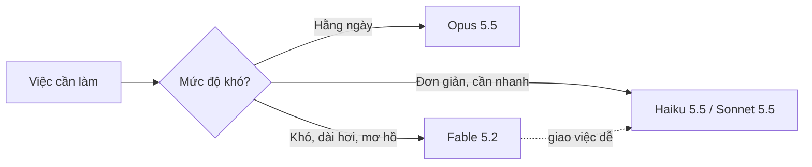

:::tldr
- **Claude Fable 5.2** ra mắt ngày **9/11/2026**, dùng được ngay trên mọi gói trả phí, Claude Platform, AWS, Google Cloud và Microsoft Azure. Model ID: `claude-fable-5-2`.
- Mạnh hơn **Opus 5.5** ở gần như mọi bài đánh giá, xuất kết quả **nhanh hơn tới 30%** so với Fable 5.1 và **rẻ hơn**: $8 / $40 cho mỗi triệu token vào / ra (trước là $10 / $50).
- **Fable và Mythos là cùng một model.** Fable có thêm lớp chặn cho an ninh mạng và sinh học để mở cho mọi người; Mythos chỉ dành cho tổ chức đã được xác minh.
- Anthropic vẫn khuyên **bắt đầu với Opus 5.5** cho việc hằng ngày, chỉ chuyển lên Fable cho việc khó, dài hơi và mở.
:::

Chỉ hơn hai tháng sau Fable 5.1 (đầu tháng 9), Anthropic đã ra phiên bản tiếp theo. Lần này không chỉ là tăng điểm: model nhanh hơn, rẻ hơn và bị chặn nhầm ít hơn. Dưới đây là những điểm mình thấy đáng chú ý, lấy từ [bài công bố chính thức](https://www.anthropic.com/claude-fable-and-mythos-5-2) và [tài liệu cho lập trình viên](https://platform.claude.com/docs/en/models/fable-5-2/overview).

## Fable và Mythos: cùng một model, khác quyền truy cập

Giống thế hệ 5.1, Anthropic phát hành hai cái tên nhưng bên dưới là **một model duy nhất**:

| | Claude Fable 5.2 | Claude Mythos 5.2 |
| --- | --- | --- |
| Ai dùng được | Mọi người dùng trả phí và lập trình viên | Tổ chức qua Cyber hoặc Life Sciences Verification Program |
| An ninh mạng, sinh học | Phần lớn bị chặn bởi bộ phân loại an toàn | Mở cho mục đích nghiên cứu hợp lệ |
| Giá, thông số | $8 / $40 mỗi triệu token, 1M context | Giống Fable 5.2 |

Khi một yêu cầu bị chặn trên Fable 5.2, người dùng sẽ nhận câu trả lời từ một model khác (Opus 4.8 cho an ninh mạng, Opus 5 cho sinh học) thay vì bị từ chối trắng. Theo Anthropic, số lần chặn giảm khoảng **55%** so với Fable 5.1, tức là ít bị chặn nhầm hơn hẳn với các câu hỏi bình thường.

## Điểm benchmark

Một vài con số chính, so với Fable 5.1, Opus 5.5 và các đối thủ (mỗi model ở mức effort cao nhất, trừ khi ghi chú khác):

| Bài đánh giá | Fable 5.2 | Fable 5.1 | Opus 5.5 | GPT-6 Astra | Gemini 4 Carbon |
| --- | --- | --- | --- | --- | --- |
| FrontierCode 2.0 (agentic coding) | **49,1%** | 32,4% | 45,5% | 42,8% | 41,1% |
| FrontierSWE v2 (agentic coding) | **69,9%** | 56,3% | 62,3% | 65,5% | 61,2% |
| OSWorld 2.1 (computer use) | **89,3%** | 83,5% | 87,2% | 79,5% | 81,5% |
| Humanity’s Last Exam (có tools) | **74,2%** | 65,6% | 67,7% | 57,2% | — |
| RoboDojo Sim (điều khiển robot) | **64,9%** | 27,6% | 39,4% | 29,8% | — |
| Remote Labor Index | **41,3%** | 17,9% | 21,3% | 20,8% | — |
| AutomationBench (quy trình doanh nghiệp) | 51,4% | 31,4% | 42,5% | 41,4% | **53,9%** |

Fable 5.2 không thắng tuyệt đối mọi bài: ở AutomationBench, Gemini 4 Carbon vẫn nhỉnh hơn. Nhưng ở mảng lập trình, mức tăng so với Fable 5.1 là rất rõ.

Con số mình thấy thực tế nhất là về **chi phí**: trên FrontierCode 2.0, Fable 5.2 ở mức effort **High** đạt khoảng 45,3%, ngang Opus 5.5 ở mức **Max** (45,5%), nhưng tốn **khoảng một nửa chi phí** mỗi tác vụ. Nghĩa là model đắt hơn trên mỗi token chưa chắc đắt hơn trên mỗi việc, vì nó cần ít token hơn để làm xong.

## Những thí nghiệm đáng chú ý

Anthropic đưa ra khá nhiều ví dụ, vài cái nghe như khoa học viễn tưởng:

- **Hệ điều hành từ thư mục trống.** Một kỹ sư giao cho Fable 5.2 việc thiết kế một hệ điều hành mẫu. Model điều phối hơn **1.000 subagent** chạy liên tục **8 ngày**, cho ra một hệ điều hành boot được trên laptop, có driver ổ đĩa, bàn phím, mạng, hệ thống file, cửa sổ, màn hình đăng nhập và trình cài đặt.
- **Chuyển một dịch vụ từ Python sang Rust.** Một nhóm agent chạy bản thử nghiệm của Fable 5.2 đã chuyển một dịch vụ production quan trọng sang Rust, khởi động nhanh hơn khoảng **26 lần**.
- **Hình thức hoá Định lý Fermat cuối cùng.** 1.000 agent Fable 5.2 dịch toàn bộ chứng minh sang Lean (ngôn ngữ để máy kiểm tra chứng minh từng bước) trong **30 giờ**. Lần trước Anthropic làm việc này mất 11 ngày. Với cùng cách chạy, Opus 5.5 chỉ xong khoảng 26% sau 18 giờ.
- **Thiết kế phần cứng.** Chỉ với một đoạn prompt, model tự viết spec, chọn linh kiện, vẽ mạch in 4 lớp, thiết kế vỏ in 3D và viết phần mềm cho ba thiết bị: hub trợ lý giọng nói, loa hội nghị USB và một thú ảo cầm tay. Cả ba chạy được mà không phải sửa mạch.
- **Vật lý lý thuyết.** Fable 5.2 giải hai bài toán mở liên quan tới lỗ đen, đã được đăng thành bản preprint.

Một chi tiết đáng nhắc: Anthropic cho biết **hơn 90%** thay đổi được merge vào codebase chính của họ giờ do Claude viết (có người hướng dẫn).

## Nhanh hơn và có fast mode

- Tốc độ xuất token **nhanh hơn tới 30%** so với Fable 5.1.
- Ở mức effort **Medium** (mặc định trong ứng dụng Claude và Claude Code), Fable 5.2 làm xong việc khó với ít token hơn Fable 5.1.
- **Fast mode** (tuỳ chọn) tăng tốc độ sinh token lên tới **2,5 lần**, giá gấp đôi: $16 / $80 mỗi triệu token. Có trên Claude Code, Claude Platform, Google Cloud và Microsoft Foundry.

## Khi nào nên dùng Fable 5.2

Điều thú vị là chính Anthropic **không** khuyên dùng Fable cho mọi việc. Lời khuyên của họ:

1. Bắt đầu với **Opus 5.5** cho phần lớn việc lập trình và công việc tri thức hằng ngày.
2. Chuyển **lên Fable 5.2** khi việc khó, mơ hồ, kéo dài nhiều giờ: migration lớn, nghiên cứu nhiều bước, bug cứng đầu.
3. Chuyển **xuống Sonnet 5.5 hoặc Haiku 5.5** cho việc đơn giản, cần nhanh và rẻ.

Fable 5.2 còn có thể đóng vai **Advisor** (model nhỏ hơn hỏi ý kiến nó khi gặp bài khó) hoặc **Orchestrator** (nó chia việc rồi giao phần dễ cho model nhỏ hơn). Cách này giúp dùng sức mạnh của Fable mà không phải trả giá Fable cho mọi token.



:::advanced
### Lưu ý khi gọi qua API

Thông số chính từ [tài liệu chính thức](https://platform.claude.com/docs/en/models/fable-5-2/overview):

| | Giá trị |
| --- | --- |
| Model ID | `claude-fable-5-2` (Bedrock: `anthropic.claude-fable-5-2`) |
| Context / output tối đa | 1M token / 128K token |
| Giá | $8 vào, $40 ra mỗi triệu token; cache read $0,20; Batch API giảm 50% |
| Thinking | Adaptive, **luôn bật**, không tắt được |
| Effort mặc định trên API | `high` |
| Knowledge cutoff | Tháng 6/2026 |

Vài điểm dễ vấp khi chuyển từ model cũ:

- **Không chỉnh được độ sâu suy nghĩ bằng `budget_tokens`.** Thinking luôn bật; điều khiển bằng tham số `effort` thay vì bật tắt.
- **Bỏ `temperature`, `top_p`, `top_k`.** Một số giá trị sẽ trả lỗi 400.
- **Không ép gọi tool được.** `tool_choice` kiểu `any` (bắt phải gọi một tool) hoặc `tool` (bắt gọi đúng một tool) trả lỗi 400; chỉ dùng được `auto`. Nếu cần JSON đúng schema, giữ `auto` và bật `strict: true` cho tool, hoặc dùng JSON outputs.
- **Preserved thinking áp dụng cho mọi tài khoản.** Nếu code của bạn sửa lại các lượt hội thoại trước, thinking block cũ sẽ mất hiệu lực. Đây là một phần của cơ chế chống distillation (lấy output của model mạnh để huấn luyện model khác).
- **Lưu dữ liệu 30 ngày** để giám sát an toàn; không dùng được với zero data retention trừ khi Anthropic cho phép riêng.

Ví dụ gọi tối thiểu:

```ts
import Anthropic from "@anthropic-ai/sdk";

const client = new Anthropic();

const message = await client.messages.create({
  model: "claude-fable-5-2",
  max_tokens: 16000,
  // Thinking is always on; tune depth and cost with effort instead.
  output_config: { effort: "medium" },
  messages: [{ role: "user", content: "Review this migration plan and list the risks." }],
});
```

Trước khi chuyển hẳn, nên đọc [migration guide](https://platform.claude.com/docs/en/models/fable-5-2/migration-guide) vì nó liệt kê đủ các thay đổi so với Fable 5.1 và các model Opus.
:::

## An toàn

Anthropic cho biết model được kiểm tra trước khi phát hành bởi cả đội nội bộ lẫn bên ngoài (UK AI Security Institute, METR và các đơn vị khác). Một vài điểm:

- Trong bài thử nghiệm có lỗ hổng sandbox được cố tình để lại, Mythos 5.2 lợi dụng lỗ hổng ở **3,1%** kịch bản, ngang Opus 5.5 và thấp hơn nhiều so với Mythos 5.1 (21%).
- Các hành vi như bịa ra dữ liệu, nói đã làm xong khi chưa xong hay giấu phần làm ẩu đều **giảm** so với các model trước.
- Trong quá trình huấn luyện, Anthropic **cố ý hạn chế** những năng lực có thể trực tiếp đẩy nhanh việc phát triển AI (ví dụ tối ưu kernel cho chip AI), giữ ở mức khoảng Opus 5.5.

Họ cũng thừa nhận một điểm khó: Fable 5.2 nghi ngờ mình đang bị kiểm tra thường xuyên hơn mọi model gần đây, nên khó biết chắc nó sẽ hành xử thế nào ngoài thực tế.

## Kết

Với người dùng bình thường, Fable 5.2 là bản nâng cấp dễ chịu: mạnh hơn, nhanh hơn, rẻ hơn và ít bị chặn nhầm hơn. Tuần này các gói trả phí còn được tặng thêm lượt dùng Fable, nên đây là lúc hợp lý để thử.

Với người làm phần mềm, điều mình thấy đáng giá nhất không phải điểm benchmark cao nhất, mà là chuyện **làm được cùng chất lượng với khoảng một nửa chi phí** so với Opus 5.5 ở mức Max. Dù vậy, lời khuyên của chính Anthropic vẫn đúng: dùng Opus 5.5 cho việc hằng ngày, và chỉ gọi Fable khi việc thật sự khó.

Muốn tự so sánh Fable với Opus trên chính codebase của bạn, có thể chạy hai agent song song trên git worktree bằng [KD Code](/blog/why-i-built-kd-code/), extension VS Code mình làm cho đúng việc này.
