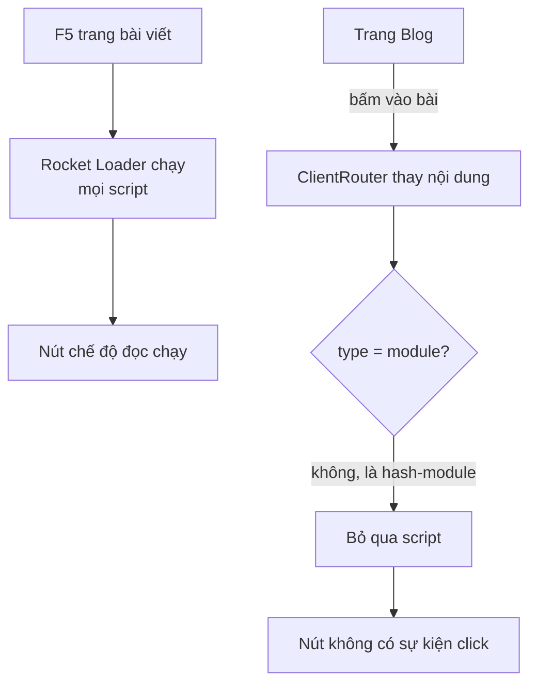
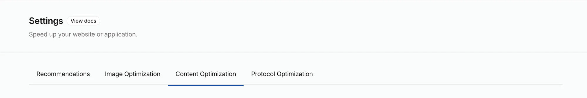
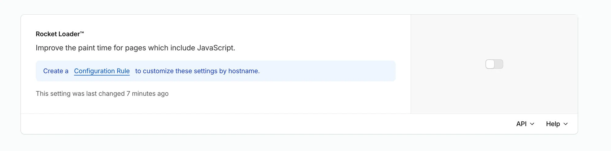

:::tldr
- Lỗi: từ trang Blog bấm vào một bài viết, **nút chuyển chế độ đọc và sơ đồ phóng to không bấm được**. F5 lại thì mọi thứ chạy bình thường.
- Dev server và bản build chạy với `astro preview` đều **không bị**. Chỉ production trên Cloudflare bị.
- Thủ phạm là **Rocket Loader**, một tính năng tăng tốc của Cloudflare. Nó đổi `type="module"` thành kiểu `type="3d45…-module"` để tự quản lý việc chạy script.
- Khi chuyển trang, `ClientRouter` của Astro chỉ chạy lại script có type `module` hoặc `text/javascript`. Script có type lạ bị **bỏ qua**, và Rocket Loader cũng không chạy giúp.
- Cách sửa: **tắt Rocket Loader**. Script của Astro vốn đã là module, tức đã được tải không chặn trang, nên Rocket Loader không giúp gì thêm.
- Bài học: thứ chạy trên CDN không phải thứ nằm trong `dist/`. Nên kiểm tra HTML thật mà người dùng nhận được.
:::

Trang này dùng `<ClientRouter />` của Astro để chuyển trang mượt, không tải lại toàn bộ. Mình vừa thêm hai bài Front-end System Design, mở thử từ trang Blog thì thấy các nút **TL;DR / Tiêu chuẩn / Mở rộng** đứng im, bấm vào sơ đồ cũng không phóng to được. Nhấn F5 thì mọi thứ lại chạy.

Lỗi kiểu "chỉ hỏng khi chuyển trang" trong một site dùng view transition thường có một nghi phạm quen thuộc: script chỉ chạy một lần lúc tải trang, còn sau khi chuyển trang thì không chạy lại. Nhưng lần này nghi phạm đó vô tội.

## Bước 1: thử lại ở local

Script của component chế độ đọc đã được viết đúng cách cho `ClientRouter`, tức là gắn vào sự kiện `astro:page-load` thay vì chạy thẳng:

```ts
document.addEventListener("astro:page-load", () => {
  const options = document.querySelectorAll("[data-mode-option]");
  if (options.length === 0) return;
  // gắn sự kiện click cho từng nút…
});
```

`astro:page-load` chạy cả lúc tải trang lần đầu lẫn sau mỗi lần chuyển trang, nên về lý thuyết không thể hỏng kiểu này. Mình vẫn thử lại bằng trình duyệt tự động, theo đúng các bước trên:

- **`astro dev`**: Blog → bài viết → bấm nút: chạy.
- **`astro build` + `astro preview`**: chạy. Thử thêm bài này → Blog → bài khác, rồi Back và Forward: vẫn chạy.
- **Kiểm tra phần tử che nút** bằng `document.elementFromPoint` tại tọa độ nút: đúng là nút, không có lớp nào phủ lên.

Code đúng, bản build đúng. Vậy phần khác nhau nằm giữa `dist/` và trình duyệt của người đọc, tức là **Cloudflare**.

## Bước 2: nhìn HTML thật trên production

Lặp lại các bước đó trên `buikhuongduy.com` thì lỗi xuất hiện ngay. Console có một dòng đáng chú ý, xuất phát từ một file mình chưa từng thêm vào site:

```text
A preload for '…/ClientRouter.astro_astro_type_script_index_0_lang.CnDxeVtR.js' is found,
but is not used because the request credentials mode does not match.
  rocket-loader.min.js
```

Tải HTML về bằng `curl` để xem các thẻ script:

```bash
curl -s https://buikhuongduy.com/blog/frontend-system-design-cheatsheet/ \
  | grep -o '<script[^>]*>'
```

```html
<script type="3d45018fbc5e20ffe1c88196-module" src="/_astro/ClientRouter…js">
<script type="3d45018fbc5e20ffe1c88196-text/javascript">
<script type="3d45018fbc5e20ffe1c88196-module">
<script type="3d45018fbc5e20ffe1c88196-module" src="/_astro/MediaViewer…js">
```

Trong `dist/`, các thẻ này là `type="module"`. Trên production, type đã bị gắn thêm một chuỗi hex ở đầu. Đó là dấu hiệu của **Rocket Loader**.

## Rocket Loader làm gì?

Rocket Loader là một tính năng trong mục Speed của Cloudflare. Mục tiêu của nó là không để JavaScript chặn việc vẽ trang:

1. Ở edge, nó **đổi type** của mọi thẻ script thành một giá trị mà trình duyệt không hiểu, ví dụ `<hash>-module`. Trình duyệt gặp type lạ thì bỏ qua script đó, giống cách [Partytown dùng `type="text/partytown"`](/blog/why-gtag-did-not-lower-lighthouse-score/).
2. Nó chèn thêm `rocket-loader.min.js`. Sau khi trang tải xong, file này tìm các script có type đã bị đổi, rồi **tự chạy chúng** theo đúng thứ tự.

Với site cũ có nhiều `<script>` đồng bộ trong `<head>`, cách này giúp trang hiện nhanh hơn. Nhưng nó dựa trên một giả định: mọi script đều xuất hiện **lúc tải trang lần đầu**.

## Vì sao chỉ hỏng khi chuyển trang

Khi chuyển trang, `ClientRouter` tải HTML của trang mới, thay nội dung vào trang hiện tại, rồi chạy các script mới. Đây là đoạn chạy script trong mã nguồn của Astro (`astro/dist/transitions/router.js`):

```js
for (const script of document.getElementsByTagName("script")) {
  if (script.dataset.astroExec === "") continue;
  const type = script.getAttribute("type");
  if (type && type !== "module" && type !== "text/javascript") continue;
  // tạo thẻ script mới để trình duyệt chạy nó…
}
```

Dòng `continue` thứ hai là nơi lỗi xảy ra. Script có type `3d45…-module` không phải `module`, nên Astro coi nó như dữ liệu (giống `application/ld+json`) và bỏ qua. Rocket Loader thì đã làm xong việc của nó lúc trang đầu tiên tải xong, nên cũng không chạy script này.



Điều này cũng giải thích vì sao lỗi khó thấy. Các script **có trên mọi trang**, như ô tìm kiếm hay hiệu ứng con trỏ, đã chạy một lần lúc tải trang đầu tiên và vẫn còn sống sau khi chuyển trang, nên trông như mọi thứ vẫn ổn. Chỉ những script **chỉ có trên trang bài viết** mới hỏng, vì lần đầu chúng xuất hiện là qua `ClientRouter`:

- `ReadingModes`: nút TL;DR / Tiêu chuẩn / Mở rộng.
- `MediaViewer`: bấm vào ảnh hoặc sơ đồ để phóng to.
- `PostActions`, `PostFeedback`: nút thích, chia sẻ, đánh giá bài.

Còn khi F5 trực tiếp trang bài viết, mọi script có mặt từ đầu, Rocket Loader chạy hết, nên không có lỗi gì.

:::advanced
### Vì sao Lighthouse CI không bắt được lỗi này

Lighthouse CI của trang này chạy trên thư mục `dist/` bằng server local, không đi qua Cloudflare. Mình đã gặp cái bẫy tương tự với CSP trong [bài về gtag](/blog/why-gtag-did-not-lower-lighthouse-score/). Các tính năng biến đổi HTML ở edge, như Rocket Loader, chèn script Email Obfuscation hay Zaraz, cũng nằm ngoài tầm nhìn của CI.

Hơn nữa, Lighthouse chỉ đo **một lần tải trang, không ai bấm vào đâu**. Lỗi này chỉ xuất hiện khi chuyển trang rồi bấm, nên dù Lighthouse có chạy trên production thì điểm vẫn 100.

Một cách kiểm tra rẻ là thêm một bước sau deploy, chạy `curl` vào production và báo lỗi nếu có thẻ script mang type lạ:

```bash
curl -s https://buikhuongduy.com/ \
  | grep -Eq '<script[^>]*type="[0-9a-f]+-' \
  && { echo "HTML scripts were rewritten at the edge"; exit 1; }
```
:::

## Cách sửa

Mình chọn **tắt Rocket Loader** trong Cloudflare Dashboard: chọn zone, vào **Speed → Settings**, mở tab **Content Optimization**.



Kéo xuống tới thẻ **Rocket Loader™** và gạt công tắc sang tắt:



Sau đó purge cache để HTML cũ (đã bị đổi type) không còn được phục vụ.

Tắt đi không làm site chậm hơn, vì Rocket Loader không còn gì để tối ưu ở đây:

- Mọi script Astro tạo ra đều là `type="module"`. Trình duyệt **mặc định tải module script không chặn việc parse HTML** và chạy nó sau khi parse xong, giống `defer`.
- Script phân tích (GA4) đã chạy trong web worker qua Partytown.
- Ngược lại, Rocket Loader còn **thêm** một file JavaScript phải tải, và làm hỏng preload của chính các script đó (dòng cảnh báo "credentials mode does not match" ở trên).

:::advanced
### Các cách khác và vì sao mình không dùng

- **`data-cfasync="false"`**: Rocket Loader bỏ qua thẻ script có thuộc tính này. Nhưng với Astro, thêm bất kỳ thuộc tính nào khác `src` vào `<script>` sẽ biến nó thành `is:inline`: script không còn được bundle, không dùng được TypeScript hay `import`. Phải làm vậy với mọi component có script thì quá nhiều đánh đổi.
- **Configuration Rules**: Cloudflare cho phép tắt Rocket Loader chỉ trên một số đường dẫn. Hữu ích khi một phần của zone là site cũ cần nó. Còn ở đây cả site là Astro, nên tắt luôn cho cả zone là gọn nhất.
- **Sửa phía client**: lắng nghe `astro:after-swap`, tìm các script có type bị đổi rồi tự chạy lại. Làm được, nhưng đó là vá lỗi của một tính năng không cần dùng, và sẽ hỏng tiếp nếu Cloudflare đổi cách đặt type.
:::

## Kết

Lỗi không nằm trong code và không nằm trong bản build. Nó nằm ở một công tắc trên CDN, được bật từ lâu và quên mất, cho tới khi gặp một cách chạy script mà nó không lường trước.

Mình rút ra ba điều:

1. **Lỗi "F5 thì hết"** trong site dùng view transition: trước hết xem script có được chạy lại sau khi chuyển trang không. Nếu code đã dùng `astro:page-load` đúng cách mà vẫn lỗi, hãy xem HTML thật trên production.
2. **So sánh `dist/` với HTML mà người dùng nhận được.** Một lệnh `curl` là đủ để thấy CDN có sửa gì không.
3. **Tính năng tối ưu tự động cần được xem lại khi kiến trúc thay đổi.** Rocket Loader hợp với site nhiều script đồng bộ. Với site tĩnh dùng module script như trang này, nó không làm nhanh thêm mà chỉ thêm rủi ro. Nếu bạn muốn biết trang này nhanh nhờ những gì, mình đã viết trong [bài về điểm Lighthouse tuyệt đối](/blog/perfect-lighthouse-score/).
