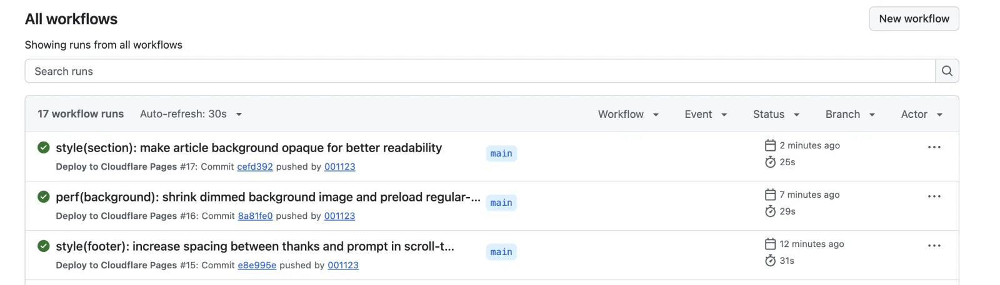
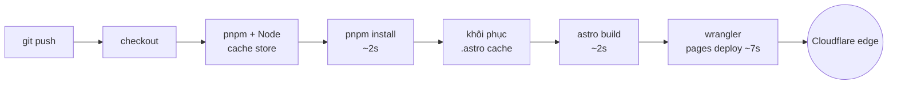
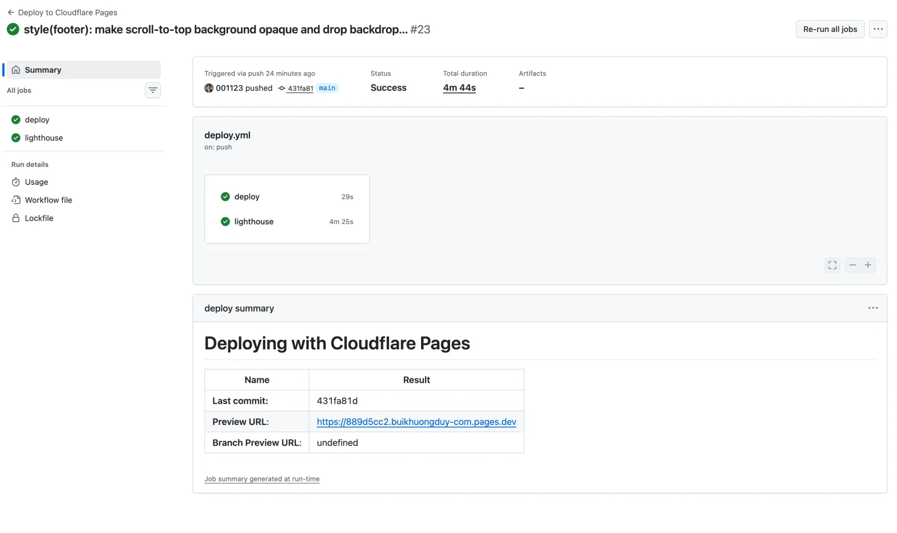

:::tldr
- **Khoảng 25 giây từ push tới khi site mới lên mạng**, phần job thật sự chạy chỉ khoảng 19 giây.
- **Cache build của Astro** (`node_modules/.astro`) là thay đổi lớn nhất: bước build giảm từ **16–36 giây xuống 2–5 giây**.
- **Deploy gói trong một job**: không chia nhỏ, không matrix, không phải chuyển artifact qua lại.
- **Lighthouse chạy song song ở job riêng**: giữ điểm 100 mà không làm deploy chậm thêm giây nào.
- **pnpm + cache store**: cài dependency chỉ mất khoảng 2 giây.
- **Không tải gì thừa**: Mermaid dùng Chrome có sẵn trên runner, Wrangler ghim sẵn trong `devDependencies`.
- **`cancel-in-progress`**: push liên tục thì chỉ commit mới nhất được deploy.
:::

Mỗi lần push lên `main`, trang này được build lại và deploy lên Cloudflare Pages. Ba lần chạy gần nhất mất **25, 29 và 31 giây**, tính cả thời gian chờ runner.



Không có bí quyết nào đặc biệt. Chỉ là mỗi bước chỉ làm đúng việc của nó, và không bước nào phải làm lại việc đã làm ở lần trước.

## Mỗi giây đi đâu

Đây là thời gian từng bước của lần chạy 25 giây (commit `cefd392`), lấy từ API của GitHub Actions:

| Bước | Thời gian |
| --- | --- |
| Khởi tạo job + checkout | ~1 s |
| Cài pnpm + Node 24 (khôi phục cache store) | ~5 s |
| `pnpm install --frozen-lockfile` | ~2 s |
| Khôi phục cache Astro | ~1 s |
| `pnpm build` | ~2 s |
| Deploy bằng Wrangler | ~7 s |
| Dọn dẹp, lưu cache | ~1 s |

Tổng job khoảng 19 giây. Phần còn lại tới con số 25 giây là thời gian GitHub xếp hàng và cấp runner, mình không kiểm soát được.

Bước tốn nhất bây giờ là deploy, tức là phần tải file lên Cloudflare. Build, thứ thường chiếm phần lớn thời gian CI, chỉ còn vài giây.



## 1. Cache build của Astro: từ 30 giây xuống 2 giây

Đây là thay đổi tạo khác biệt lớn nhất. Astro giữ một thư mục cache ở `node_modules/.astro`, chứa:

- font đã tải về qua Astro Fonts API;
- ảnh đã tối ưu (AVIF/WebP ở nhiều kích thước);
- data store của content collections.

Trên máy mình, thư mục này tồn tại sẵn nên build rất nhanh. Trên CI, mỗi runner là một máy mới tinh: không có cache, Astro phải tải lại font, nén lại toàn bộ ảnh và dựng lại content store mỗi lần.

Trước khi có cache, 10 lần chạy gần nhất có bước build từ **16 đến 36 giây**. Sau khi thêm `actions/cache` cho `node_modules/.astro`, ba lần chạy tiếp theo chỉ còn **3, 5 và 2 giây**.

```yaml
- uses: actions/cache@v6
  with:
    path: node_modules/.astro
    key: astro-${{ runner.os }}-${{ hashFiles('pnpm-lock.yaml') }}-${{ github.sha }}
    restore-keys: |
      astro-${{ runner.os }}-${{ hashFiles('pnpm-lock.yaml') }}-
      astro-${{ runner.os }}-
```

:::advanced
### Vì sao key có `github.sha`

Cache của GitHub Actions là bất biến: khi một key đã được lưu, nó không bao giờ bị ghi đè. Nếu key chỉ dựa vào `pnpm-lock.yaml`, cache sẽ đóng băng ở lần build đầu tiên, và mọi ảnh mới thêm sau đó lại phải nén lại ở mỗi lần chạy.

Thêm `github.sha` làm key luôn mới, nên cuối mỗi job cache được lưu lại với nội dung mới nhất. Lúc khôi phục, key chính không bao giờ khớp, và `restore-keys` lấy bản gần nhất cùng lockfile. Nếu lockfile đổi (nâng cấp Astro chẳng hạn), nó lùi về bản gần nhất của cùng hệ điều hành.

Lần chạy đầu tiên sau khi thêm cache vẫn mất 30 giây cho bước build, vì chưa có gì để khôi phục. Từ lần thứ hai trở đi mới thấy hiệu quả.
:::

## 2. Deploy gói trong một job

Toàn bộ đường deploy nằm trong một job: checkout, cài, build, deploy. Không có job lint riêng, test riêng hay matrix nhiều phiên bản Node. Ngoại lệ duy nhất là job Lighthouse ở phần 6, và nó không nằm trên đường deploy.

Với một site tĩnh cá nhân, việc chia job không đem lại gì. Mỗi job mới là một runner mới phải khởi động, checkout lại và cài lại dependency, rồi còn phải upload và download artifact `dist/` giữa các job. Một job duy nhất tránh được toàn bộ chi phí đó.

Bản thân `astro build` đã đóng vai trò kiểm tra: frontmatter sai schema hay link ảnh hỏng đều làm build thất bại, và khi build thất bại thì không có gì được deploy.

## 3. pnpm và cache store

`actions/setup-node` với `cache: pnpm` khôi phục store của pnpm từ lần chạy trước. Khi đó `pnpm install --frozen-lockfile` gần như chỉ còn tạo hard link từ store vào `node_modules`, mất khoảng **2 giây**.

`--frozen-lockfile` đảm bảo CI cài đúng những gì có trong lockfile. Nếu lockfile lệch với `package.json`, CI dừng ngay thay vì âm thầm cài phiên bản khác.

## 4. Không tải thứ không cần

Một số dependency có thói quen tải thêm thứ nặng lúc cài hoặc lúc chạy. Mình chặn hai chỗ:

- **Chrome cho Mermaid**: sơ đồ được render thành SVG lúc build bằng `mermaid-isomorphic`, vốn dùng Playwright. Thay vì để Playwright tải trình duyệt riêng (hơn 100 MB), mình chỉ định `channel: "chrome"` để dùng Chrome có sẵn trên runner của GitHub.
- **Wrangler ghim trong `devDependencies`**: `cloudflare/wrangler-action` thấy Wrangler đã được cài trong project thì dùng luôn, không phải tải thêm bằng `npx` ở mỗi lần deploy. Phiên bản cũng cố định, không bị bất ngờ khi Wrangler ra bản mới.

## 5. Push liên tục, chỉ deploy bản mới nhất

```yaml
concurrency:
  group: deploy-${{ github.ref }}
  cancel-in-progress: true
```

Khi mình push hai commit sát nhau, lần chạy cũ bị hủy ngay để nhường cho commit mới. Không tốn runner cho bản sắp bị ghi đè, và không có chuyện bản cũ deploy xong sau bản mới.

## 6. Lighthouse chạy song song, không chặn deploy

Ngoài job deploy, workflow còn một job `lighthouse` để giữ điểm Lighthouse của site ở mức 100. Job này build lại site, rồi chạy Lighthouse CI (`lhci autorun`) trên thư mục `dist/` cho các trang chính, mỗi trang 3 lần. Chỉ cần một trang dưới 100 ở bất kỳ nhóm nào (Performance, Accessibility, Best Practices, SEO) là job thất bại, kèm báo cáo để xem lại. Cách đạt 100 điểm thì mình đã viết ở [bài này](/blog/perfect-lighthouse-score/).



Job này chậm, khoảng **4 phút 25 giây**, vì phải mở Chrome và đo từng trang nhiều lần. Nhưng nó chạy **song song** và không có `needs` nối với deploy, nên deploy không phải chờ. Ở lần chạy trên, cả workflow mất 4 phút 44 giây, còn job deploy vẫn chỉ **29 giây**: site mới đã lên mạng từ lâu trước khi Lighthouse chấm xong.

Đây là chỗ duy nhất mình chấp nhận tách job, vì Lighthouse là bước kiểm tra chất lượng chứ không phải điều kiện để deploy. Gộp vào cùng job thì mỗi lần push phải chờ thêm hơn 4 phút mới thấy site mới. Tách ra chỉ tốn thêm một lần cài và build, vốn chỉ vài giây nhờ cache, đổi lại vòng phản hồi của deploy giữ nguyên.

Với pull request, đặt `lighthouse` làm required check thì PR làm tụt điểm sẽ không merge được. Với push thẳng lên `main`, deploy vẫn diễn ra, còn job Lighthouse đỏ là tín hiệu để mình sửa ngay ở commit sau.

## 7. Site tĩnh là nền tảng của mọi thứ

Tất cả những điều trên chỉ hiệu quả vì site là **HTML tĩnh**. Không có server phải khởi động lại, không có migration database, không có bước health check chờ instance mới sẵn sàng.

Deploy chỉ là tải thư mục `dist/` lên Cloudflare Pages. Wrangler chỉ gửi những file thay đổi, nên một commit sửa CSS chỉ upload vài file. Khi lệnh deploy xong, bản mới đã phục vụ từ edge.

Pull request cũng đi qua cùng workflow và nhận một bản preview riêng, nên mình xem được thay đổi trên môi trường thật trước khi merge.

## Kết

CI nhanh không đến từ runner mạnh hơn hay dịch vụ trả phí. Nó đến từ việc **đo xem từng giây đi đâu**, rồi bỏ đi những việc lặp lại không cần thiết: cache thứ đã tính, không tải thứ đã có, không chia nhỏ thứ không cần chia, và đẩy việc kiểm tra chậm ra khỏi đường deploy.

Khi CI chỉ mất 25 giây, mình deploy thường xuyên hơn, mỗi thay đổi nhỏ hơn, và lỗi được phát hiện sớm hơn. Vòng phản hồi ngắn là thứ đáng đầu tư nhất.

Nếu bạn cần một người mang tư duy này vào pipeline của đội: **mình đang sẵn sàng cho cơ hội mới**. [Liên hệ với mình](/contact/), mình rất vui được trao đổi.
