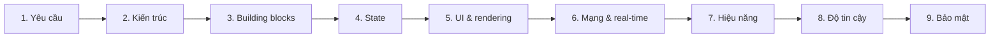

:::tldr
- Front-end System Design không phải vẽ server và database, mà là thiết kế **những gì chạy trong trình duyệt**: rendering, state, mạng, hiệu năng, độ tin cậy, bảo mật.
- Luôn bắt đầu bằng **làm rõ yêu cầu**: ai dùng, đọc nhiều hay ghi nhiều, có cần real-time, SEO, offline không. Các câu trả lời này quyết định gần như mọi lựa chọn kiến trúc phía sau.
- Thiết kế frontend phần lớn là **thiết kế state**: dữ liệu nào ở server, ở client, trên URL, cần sống sót qua refresh.
- Phần phân biệt câu trả lời senior với junior thường là **độ tin cậy**: mất kết nối, một panel lỗi, dữ liệu cache xung đột, người dùng có mất công việc đang làm không.
:::

Bài này là bản ghi chú của mình dựa trên [Frontend System Design Cheatsheet của GreatFrontEnd](https://www.greatfrontend.com/front-end-system-design-playbook), có thêm giải thích và ví dụ ở những chỗ mình thấy hay bị hỏi sâu. Bạn có thể dùng nó như một khung trả lời khi phỏng vấn, hoặc như checklist trước khi bắt tay vào một tính năng lớn.



## 1. Làm rõ yêu cầu

Đừng vội vẽ kiến trúc. Dành vài phút đầu để hiểu bài toán, dùng các câu hỏi sau làm gợi ý:

- Người dùng là ai?
- Các luồng sử dụng (user journey) cốt lõi là gì?
- Chạy trên web, mobile web, desktop hay nhúng (embedded)?
- Đọc nhiều (read-heavy) hay ghi nhiều (write-heavy)?
- Có cần real-time không?
- Có cần SEO không?
- Có cần chạy offline không?
- Yêu cầu về accessibility?
- Giới hạn về trình duyệt và thiết bị?
- Ràng buộc về bảo mật và quyền riêng tư?
- Kỳ vọng về độ trễ?

Mỗi câu trả lời loại bớt một nhánh lựa chọn. "Cần SEO" gần như loại CSR thuần. "Read-heavy, nội dung ít đổi" gợi ý SSG kèm cache CDN. "Real-time, nhiều người cùng sửa" kéo theo WebSocket và bài toán xung đột.

## 2. Các lựa chọn kiến trúc

Những quyết định lớn, khó đổi về sau:

- **Kiến trúc rendering**: CSR, SSR, SSG, ISR hay streaming.
- **Kiến trúc trang**: SPA hay MPA.
- **Kiến trúc sản phẩm**: frontend monolith hay micro-frontends.
- **API**: BFF (Backend for Frontend) hay gọi API trực tiếp; REST hay GraphQL.
- **Dữ liệu real-time**: polling, SSE hay WebSocket.
- **Vẽ giao diện**: DOM, Canvas hay WebGL.
- **Xử lý dữ liệu**: tìm kiếm, lọc ở client hay ở server.

:::advanced
### Chọn chế độ rendering thế nào?

| Chế độ | HTML được tạo khi nào | Hợp với | Đánh đổi |
| --- | --- | --- | --- |
| CSR | Trên trình duyệt, sau khi tải JS | Dashboard sau đăng nhập, app tương tác nặng | Màn hình trắng lâu hơn, SEO kém |
| SSR | Trên server, mỗi request | Trang cần SEO và dữ liệu cá nhân hóa hoặc luôn mới | Tốn server, TTFB phụ thuộc thời gian lấy dữ liệu |
| SSG | Lúc build | Blog, docs, landing page | Dữ liệu chỉ mới đến lần build gần nhất |
| ISR | Lúc build, rồi tạo lại định kỳ hoặc theo yêu cầu | Trang sản phẩm, nhiều trang và ít đổi | Có khoảng thời gian người dùng thấy bản cũ |
| Streaming SSR | Trên server, gửi dần từng phần | Trang có phần dữ liệu chậm | Phức tạp hơn khi xử lý lỗi và header |

Trong thực tế hiếm khi chọn một chế độ cho cả app. Một trang thương mại điện tử thường dùng SSG/ISR cho trang sản phẩm, SSR cho trang tìm kiếm và CSR cho giỏ hàng.

### Polling, SSE hay WebSocket?

| | Polling | SSE | WebSocket |
| --- | --- | --- | --- |
| Hướng dữ liệu | Client hỏi định kỳ | Server đẩy xuống một chiều | Hai chiều |
| Giao thức | HTTP thường | HTTP, tự reconnect | Giao thức riêng sau khi upgrade |
| Hợp với | Dữ liệu đổi chậm, dễ làm | Feed, thông báo, tiến trình, stream token của AI | Chat, cộng tác, game |
| Lưu ý | Lãng phí request khi không có gì mới | Chỉ gửi text | Tự lo reconnect, heartbeat, scale ở server khó hơn |

Bắt đầu từ lựa chọn đơn giản nhất đáp ứng được yêu cầu. Nhiều tính năng "real-time" chỉ cần SSE.
:::

## 3. Các building block cốt lõi

Một ứng dụng frontend hiện đại thường gồm các khối sau. Khi trình bày thiết kế, vẽ chúng thành sơ đồ giúp người nghe theo kịp:

- App shell
- Router
- Lớp UI component
- Store / lớp quản lý state
- Data fetching / API client
- Cache
- Bộ quản lý kết nối real-time
- Background worker (Web Worker, Service Worker)
- Lưu trữ cục bộ (local persistence)
- Analytics / logging
- Lớp xác thực và phiên đăng nhập

```mermaid
flowchart TB
  UI[UI components] --> Store[State store]
  UI --> Router
  Store --> API[API client]
  API --> Cache
  API --> Auth[Auth / session]
  RT[Real-time manager] --> Store
  Cache --> Persist[(IndexedDB / localStorage)]
  SW[Service Worker] --> Cache
  UI --> Log[Analytics / logging]
```



## 4. Dữ liệu và quản lý state

Thiết kế frontend thường trở thành thiết kế state, nên đây là phần cần đầu tư nhiều nhất:

- Server state, client state và state UI tạm thời (ephemeral)
- Nguồn sự thật (source of truth)
- Chiến lược cache
- Optimistic update
- Invalidation / revalidation
- Phân trang / cursor
- State chuẩn hóa (normalized) hay không (denormalized)
- State dẫn xuất (derived state)
- State trên URL
- State của form
- Lưu xuống localStorage / IndexedDB

Với từng mẩu dữ liệu, tự hỏi:

- Dữ liệu nào chỉ sống trong bộ nhớ?
- Dữ liệu nào thuộc về URL?
- Dữ liệu nào phải còn sau khi refresh?
- Dữ liệu nào nên cache?
- Dữ liệu nào được phép cũ (stale)?
- Dữ liệu nào cần giải quyết xung đột?

:::advanced
### Phân loại state bằng một bảng

Lấy ví dụ một trang danh sách email:

| Dữ liệu | Loại | Đặt ở đâu |
| --- | --- | --- |
| Danh sách email, nội dung thư | Server state | Cache của thư viện data fetching (TanStack Query, SWR…), có thể lưu IndexedDB để mở nhanh |
| Thư mục đang xem, từ khóa tìm kiếm, trang hiện tại | URL state | Query string, để chia sẻ link và bấm Back được |
| Bản nháp đang soạn | Form state cần bền | Bộ nhớ, autosave xuống IndexedDB |
| Email nào đang được chọn | Client state | Store hoặc state của component |
| Menu đang mở, tooltip đang hiện | Ephemeral UI state | State cục bộ của component |
| Số thư chưa đọc | Derived state | Tính từ danh sách, không lưu riêng |

Hai lỗi hay gặp: **sao chép server state vào store toàn cục** (rồi phải tự đồng bộ, tự invalidate), và **lưu derived state** (rồi nó lệch với dữ liệu gốc). Mỗi mẩu dữ liệu nên có đúng một nguồn sự thật.

Khi cùng một thực thể xuất hiện ở nhiều nơi (một user trong danh sách, trong comment, trong header), **chuẩn hóa** theo dạng `{ usersById, postIds }` giúp cập nhật một chỗ là mọi nơi đổi theo.
:::

## 5. UI và rendering

Điểm khác biệt lớn nhất của frontend system design so với backend là giao diện:

- Chiến lược rendering
- Code splitting
- Progressive hydration / islands nếu phù hợp
- Ảo hóa danh sách (list virtualization)
- Lazy loading
- Tải ảnh và video
- Skeleton / placeholder
- Chuyển trang (route transition)
- Bố cục responsive
- Theming / design system
- Trạng thái accessibility (focus, `aria-*`, thông báo cho trình đọc màn hình)

Và checklist các trạng thái UI **bắt buộc** phải nghĩ tới cho mỗi màn hình:

- Loading / Success / Error
- Rỗng (empty)
- Dữ liệu cũ (stale)
- Offline
- Không có quyền (unauthorized)
- Đang chờ optimistic update được xác nhận

Phỏng vấn viên rất hay hỏi "nếu danh sách rỗng thì hiển thị gì?" hoặc "nếu mất mạng giữa chừng thì sao?". Liệt kê sẵn các trạng thái này là cách nhanh nhất để không bị bất ngờ.

## 6. Mạng và các pattern real-time

Hầu hết ứng dụng frontend lấy dữ liệu qua mạng, một số theo thời gian thực. Cần tính đến:

- Vòng đời của request
- Retry và backoff
- Hủy request (cancel / abort)
- Gộp request trùng (deduping)
- Gom request (batching)
- Làm mới nền (background refresh)
- Kỳ vọng về idempotency
- Logic reconnect
- Giải quyết xung đột
- Thứ tự sự kiện
- Xử lý eventual consistency

Vài lời nhắc nhỏ nhưng rất có ích:

- Dùng **cursor pagination** cho danh sách thay đổi liên tục (offset sẽ bị trùng hoặc sót khi có phần tử mới chèn vào).
- **Debounce** các input "ồn ào" như ô tìm kiếm.
- **Hủy request đã lỗi thời**.
- **Phân biệt lỗi truyền tải** (mất mạng, timeout) với **lỗi nghiệp vụ** (hết hàng, không đủ quyền): lỗi đầu có thể retry, lỗi sau thì không.
- **Đối chiếu optimistic update** sau khi server xác nhận.

:::advanced
### Ví dụ: ô tìm kiếm có debounce, hủy request cũ và retry

Gõ "react" nhanh có thể sinh 5 request; nếu request "rea" về sau request "react", kết quả sai sẽ đè lên kết quả đúng. Hủy request cũ bằng `AbortController` giải quyết race condition này:

```ts
let controller: AbortController | undefined;

async function search(query: string) {
  controller?.abort(); // hủy request trước đó
  controller = new AbortController();

  const res = await fetchWithRetry(`/api/search?q=${encodeURIComponent(query)}`, {
    signal: controller.signal,
  });
  return res.json();
}

async function fetchWithRetry(url: string, init: RequestInit, retries = 3): Promise<Response> {
  for (let attempt = 0; ; attempt++) {
    try {
      const res = await fetch(url, init);
      // Chỉ retry lỗi tạm thời của server; 4xx là lỗi nghiệp vụ, retry vô ích.
      if (res.status < 500 || attempt >= retries) return res;
    } catch (err) {
      if (init.signal?.aborted || attempt >= retries) throw err;
    }
    // Exponential backoff có jitter: ~200ms, ~400ms, ~800ms...
    const delay = 200 * 2 ** attempt * (0.5 + Math.random() / 2);
    await new Promise((r) => setTimeout(r, delay));
  }
}

const debouncedSearch = debounce(search, 300);
```

Jitter quan trọng hơn vẻ ngoài của nó: nếu server sập rồi sống lại, hàng nghìn client retry **cùng một nhịp** sẽ đánh sập nó lần nữa.

Chỉ tự động retry những request **idempotent** (GET, hoặc POST có idempotency key). Retry một request "thanh toán" không có key có thể trừ tiền hai lần.

Bài [thiết kế component Autocomplete](/blog/autocomplete-system-design/) đi sâu hơn vào chính ví dụ này: cache, xử lý race condition, UX và accessibility.
:::

## 7. Checklist hiệu năng

Các kỹ thuật cần nhớ:

- Bundle splitting
- Tree shaking
- Tải theo route
- Prefetching
- Memoization
- Virtualization
- Tối ưu ảnh
- Tải font
- Đẩy việc nặng sang worker
- Tránh chặn main thread
- Tránh render thừa
- Nhiều lớp cache (HTTP, CDN, Service Worker, bộ nhớ)

Và các chỉ số cần đo:

- Core Web Vitals: **LCP / INP / CLS**, cùng **TTFB**
- Kích thước bundle JS
- Mức dùng bộ nhớ
- Số frame bị rớt
- Độ trễ API
- Tỷ lệ lỗi

Nói về hiệu năng mà không nói cách đo thì chưa đủ. Nên nêu cả hai: dữ liệu lab (Lighthouse) để debug và dữ liệu thực tế từ người dùng (RUM, CrUX) để biết có thật sự tốt hơn không. Mình có viết kỹ hơn trong bài [PageSpeed Insights giải thích](/blog/pagespeed-insights-explained/).

## 8. Độ tin cậy và khả năng phục hồi

Phần này thường là thứ phân biệt câu trả lời của senior với junior:

- Suy giảm có kiểm soát (graceful degradation)
- Retry và reconnect
- Phương án dự phòng khi offline
- Autosave / khôi phục bản nháp
- Error boundary
- Render từng phần (partial rendering)
- Feature flag
- Kill switch
- Khôi phục state sau khi refresh
- Xử lý lệch phiên bản giữa frontend và backend

Hãy tự hỏi:

- Chuyện gì xảy ra nếu socket bị ngắt?
- Nếu một panel lỗi, các panel khác có vẫn hiển thị được không?
- Nếu dữ liệu cache cũ xung đột với dữ liệu mới từ server thì sao?
- Người dùng có khôi phục được mà không mất công việc đang làm không?

:::advanced
### Lệch phiên bản frontend và backend

Đây là lỗi hay bị quên. Người dùng mở tab từ sáng, chiều bạn deploy bản mới: tab cũ vẫn chạy JS cũ, nhưng gọi API mới. Vài cách xử lý:

- **API tương thích ngược**: chỉ thêm field, không đổi nghĩa hay xóa field trong cùng một phiên bản API.
- **Gửi kèm phiên bản client** trong header; server trả mã lỗi riêng khi bản client quá cũ, frontend hiện thông báo "Có bản mới, tải lại trang".
- **Giữ lại các chunk JS cũ** một thời gian sau deploy. Nếu xóa ngay, tab cũ lazy-load một route sẽ gặp lỗi 404 khi tải chunk; bắt lỗi này và reload là phương án cuối.
:::

## 9. Bảo mật và quyền riêng tư

Bảo mật không chỉ là việc của backend:

- Luồng xác thực (auth flow)
- Xử lý token / cookie
- CSRF / XSS
- UI theo quyền (permission-based UI)
- Lộ secret
- Dữ liệu nhạy cảm trong log
- iframe và các vấn đề cross-origin
- An toàn khi upload file
- Clickjacking nếu liên quan

Hai điểm hay bị hỏi lại: **token đặt ở đâu** (cookie `HttpOnly; Secure; SameSite` an toàn trước XSS hơn localStorage), và **ẩn nút trên UI không phải là phân quyền**: UI theo quyền chỉ để trải nghiệm tốt hơn, server vẫn phải kiểm tra mọi request. Nếu quan tâm đến chuyện cookie phiên bị đánh cắp, xem thêm bài [Device Bound Session Credentials](/blog/device-bound-session-credentials/).

## Kết

Không cần nói hết 9 mục trong mọi buổi phỏng vấn hay mọi dự án. Cách dùng hiệu quả là: làm rõ yêu cầu thật kỹ, chọn ra 2–3 mục quan trọng nhất với bài toán (một app chat sẽ xoáy vào mục 6 và 8, một trang thương mại điện tử xoáy vào mục 2 và 7), đi sâu vào đó, và lướt nhanh phần còn lại để cho thấy bạn không bỏ sót.

Nguồn: [Frontend System Design Cheatsheet và Playbook của GreatFrontEnd](https://www.greatfrontend.com/front-end-system-design-playbook).
