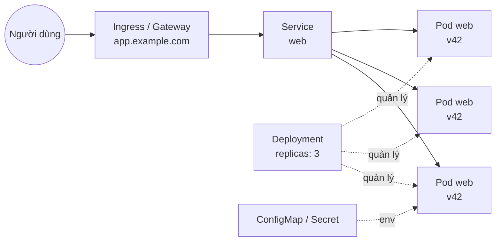

:::tldr
- **Kubernetes (k8s) là hệ thống chạy và quản lý container**: bạn mô tả trạng thái mong muốn bằng YAML, k8s tự lo cho thực tế khớp với mô tả đó.
- **Chỉ cần nắm 6 khái niệm**: Pod, Deployment, Service, Ingress, ConfigMap/Secret và probe. Phần lớn YAML trong repo frontend chỉ xoay quanh chúng.
- **`NEXT_PUBLIC_*` bị nhúng lúc build**, không đọc từ ConfigMap lúc chạy. Đây là lỗi frontend gặp nhiều nhất trên k8s.
- **Nhiều replica nghĩa là nhiều bản app độc lập**: cache trong bộ nhớ, ISR và file ghi ra đĩa không được chia sẻ giữa các Pod.
- **Rolling update có lúc hai phiên bản cùng chạy**, dễ gây lỗi 404 khi tải chunk JS nếu không chuẩn bị trước.
- **Site tĩnh không cần k8s**. Trang này chạy trên Cloudflare Pages và deploy trong 25 giây.
:::

Ở nhiều công ty, app Next.js hay Nuxt không chạy trên Vercel mà chạy trên một cụm Kubernetes do team platform quản lý. Một ngày bạn mở repo và thấy thư mục `k8s/` hay `helm/` với hàng trăm dòng YAML. Bạn không cần trở thành DevOps, nhưng nên đọc hiểu được chúng: khi app lỗi trên production, câu hỏi đầu tiên thường là "Pod có đang chạy không?".

Bài này giải thích Kubernetes theo những gì một frontend developer thật sự đụng tới.

## Từ `pnpm start` tới một cụm máy

Trên máy bạn, chạy app rất đơn giản: `pnpm build && pnpm start`, mở `localhost:3000`. Trên production, cùng app đó cần thêm nhiều thứ:

- chạy **nhiều bản** để chịu tải và không chết khi một bản lỗi;
- **tự khởi động lại** khi app crash;
- **deploy phiên bản mới không downtime**;
- **một địa chỉ ổn định** (domain, HTTPS) dù các bản app liên tục được thay;
- **cấu hình và secret** khác nhau giữa staging và production.

Kubernetes làm tất cả những việc đó. Điểm quan trọng nhất cần hiểu: k8s là hệ thống **khai báo** (declarative). Bạn không ra lệnh "khởi động 3 server", bạn viết "tôi muốn luôn có 3 bản app phiên bản `v42`". K8s liên tục so sánh thực tế với mong muốn và tự sửa phần lệch.

Nghe quen không? Đó chính là tư duy của React: bạn mô tả UI theo state, React lo phần cập nhật DOM. YAML là "JSX" của hạ tầng, còn k8s là "reconciler".

## Container và image

Mọi thứ trên k8s chạy trong **container**. Image là bản đóng gói app cùng runtime (Node.js, thư viện hệ thống), build một lần và chạy giống hệt nhau ở mọi nơi. Với Next.js, bật `output: "standalone"` để bản build chỉ chứa đúng những file cần thiết:

```dockerfile
FROM node:24-alpine AS build
WORKDIR /app
RUN corepack enable
COPY package.json pnpm-lock.yaml ./
RUN pnpm install --frozen-lockfile
COPY . .
RUN pnpm build

FROM node:24-alpine
WORKDIR /app
ENV NODE_ENV=production PORT=3000 HOSTNAME=0.0.0.0
COPY --from=build /app/.next/standalone ./
COPY --from=build /app/.next/static ./.next/static
COPY --from=build /app/public ./public
USER node
EXPOSE 3000
CMD ["node", "server.js"]
```

CI build image này, gắn tag (thường là commit SHA, ví dụ `web:a1b2c3d`) rồi đẩy lên registry. Từ đây k8s chỉ biết tới image, không quan tâm bên trong là Next.js hay Go.

:::advanced
### Vì sao `HOSTNAME=0.0.0.0`

Server mặc định có thể chỉ lắng nghe trên `localhost`, tức là chỉ nhận request từ chính bên trong container. Traffic từ Service đi vào qua network interface của Pod, nên app phải lắng nghe trên `0.0.0.0`. Quên dòng này, Pod vẫn "Running" nhưng mọi request đều bị từ chối, và readiness probe sẽ thất bại mãi.
:::

## Sáu khái niệm cốt lõi



### 1. Pod: một bản app đang chạy

**Pod** là đơn vị nhỏ nhất, thường chứa một container. Hãy coi Pod như một tab terminal đang chạy `node server.js`: nó có IP riêng, có thể chết bất cứ lúc nào, và khi chết thì không quay lại. K8s tạo Pod mới thay thế, với tên mới và IP mới.

Vì thế đừng bao giờ coi Pod là thứ lâu dài. Mọi thứ ghi vào đĩa hay bộ nhớ của Pod đều có thể biến mất.

### 2. Deployment: "luôn giữ N bản phiên bản X"

Bạn hầu như không tạo Pod trực tiếp. **Deployment** mô tả image nào, bao nhiêu bản, và cách thay phiên bản. Khi bạn đổi tag image từ `v41` sang `v42`, Deployment làm **rolling update**: tạo dần Pod mới, đợi chúng sẵn sàng, rồi mới tắt Pod cũ. Không downtime.

```yaml
apiVersion: apps/v1
kind: Deployment
metadata:
  name: web
spec:
  replicas: 3
  selector:
    matchLabels:
      app: web
  template:
    metadata:
      labels:
        app: web
    spec:
      containers:
        - name: web
          image: registry.example.com/web:a1b2c3d
          ports:
            - containerPort: 3000
          envFrom:
            - configMapRef:
                name: web-config
            - secretRef:
                name: web-secrets
          readinessProbe:
            httpGet:
              path: /api/health
              port: 3000
          livenessProbe:
            httpGet:
              path: /api/health
              port: 3000
            initialDelaySeconds: 10
          resources:
            requests:
              cpu: 250m
              memory: 256Mi
            limits:
              memory: 512Mi
```

Đây gần như là toàn bộ YAML bạn cần đọc hiểu. Phần còn lại của bài giải thích từng khối.

### 3. Service: địa chỉ ổn định cho một nhóm Pod

Pod đổi IP liên tục, nên cần một địa chỉ cố định đứng trước chúng. **Service** chọn Pod theo label (`app: web`) và cân bằng tải giữa chúng. Bên trong cluster, app khác gọi tới `http://web` là đủ, không cần biết đang có bao nhiêu Pod hay chúng ở đâu.

```yaml
apiVersion: v1
kind: Service
metadata:
  name: web
spec:
  selector:
    app: web
  ports:
    - port: 80
      targetPort: 3000
```

Với frontend, đây là chỗ hay gặp khi gọi API từ Server Components hay route handler: thay vì đi vòng ra internet qua `https://api.example.com`, server có thể gọi thẳng `http://api` trong cluster, nhanh hơn và không qua CDN.

### 4. Ingress và Gateway API: từ domain vào Service

Service chỉ có địa chỉ nội bộ. Để người dùng truy cập `app.example.com` qua HTTPS, cần một lớp định tuyến từ ngoài vào. Lâu nay đó là **Ingress**, giờ là **Gateway API** với `HTTPRoute`, mô hình mới mà Kubernetes khuyến nghị (dự án Ingress NGINX phổ biến đã ngừng bảo trì từ tháng 3/2026).

```yaml
apiVersion: gateway.networking.k8s.io/v1
kind: HTTPRoute
metadata:
  name: web
spec:
  parentRefs:
    - name: public-gateway
  hostnames:
    - app.example.com
  rules:
    - backendRefs:
        - name: web
          port: 80
```

Bạn có thể coi nó như file `_redirects` hay `vercel.json` ở tầng hạ tầng: domain nào, path nào thì chuyển vào Service nào. Gateway thường do team platform quản lý, bạn chỉ khai báo route của app mình.

### 5. ConfigMap và Secret: biến môi trường

**ConfigMap** chứa cấu hình thường, **Secret** chứa thứ nhạy cảm (API key, token). Cả hai được bơm vào container dưới dạng biến môi trường qua `envFrom`, giống file `.env` nhưng tách khỏi image. Cùng một image chạy ở staging và production, chỉ khác ConfigMap.

```yaml
apiVersion: v1
kind: ConfigMap
metadata:
  name: web-config
data:
  API_URL: http://api
  NEXT_PUBLIC_API_URL: https://api.example.com # không có tác dụng, xem bên dưới
```

:::advanced
### Bẫy lớn nhất: `NEXT_PUBLIC_*` bị nhúng lúc build

Next.js (và Vite với `import.meta.env.VITE_*`) **thay giá trị biến public vào bundle JS ngay lúc build**. Khi image đã build xong, đổi `NEXT_PUBLIC_API_URL` trong ConfigMap không làm thay đổi gì ở trình duyệt, vì code chạy trên client đã chứa sẵn chuỗi cũ.

Điều này phá vỡ nguyên tắc "một image, nhiều môi trường". Có ba cách xử lý:

1. **Chỉ dùng biến không có tiền tố `NEXT_PUBLIC_` trên server**, rồi truyền xuống client qua props từ Server Component. Đây là cách gọn nhất với App Router.
2. **Endpoint cấu hình runtime**: client gọi `/api/config` lúc khởi động để lấy giá trị.
3. **Build một image cho mỗi môi trường**. Đơn giản nhưng thứ bạn test ở staging không còn là đúng thứ chạy trên production.

Secret cũng vậy: đừng bao giờ đặt secret vào biến `NEXT_PUBLIC_*`, vì nó sẽ nằm trong file JS ai cũng tải được.
:::

### 6. Probe: k8s hỏi app "còn sống không?"

K8s không đoán được app của bạn có ổn không, nên nó hỏi qua HTTP:

- **readinessProbe**: "sẵn sàng nhận traffic chưa?". Chưa sẵn sàng thì Service không gửi request vào Pod đó. Đây là thứ giúp rolling update không downtime.
- **livenessProbe**: "còn sống không?". Thất bại nhiều lần liên tiếp thì k8s khởi động lại container.

Một route handler đơn giản là đủ:

```ts
// app/api/health/route.ts
export const dynamic = "force-dynamic";

export function GET() {
  return Response.json({ ok: true });
}
```

Đừng để liveness probe gọi tới database hay API khác. Nếu API phía sau chậm, k8s sẽ khởi động lại toàn bộ Pod frontend, biến một sự cố nhỏ thành sự cố lớn.

## Tài nguyên và autoscaling

`resources.requests` là phần CPU và RAM k8s **giữ chỗ** cho Pod, dùng để quyết định đặt Pod lên máy nào. `limits.memory` là trần: vượt qua là container bị kill với trạng thái `OOMKilled`.

Với Node.js, nên để heap nhỏ hơn limit một khoảng, ví dụ `NODE_OPTIONS=--max-old-space-size=384` khi limit là 512Mi. Nếu không, Node tưởng mình còn nhiều RAM, không dọn rác kịp, và bị kill giữa chừng thay vì chậm lại.

`250m` CPU nghĩa là 250 millicore, tức một phần tư core. Nhiều team không đặt limit CPU, vì giới hạn CPU làm SSR bị bóp (throttle) và tăng thời gian phản hồi một cách khó hiểu.

Khi traffic tăng, **HorizontalPodAutoscaler** (HPA) tự tăng số replica dựa trên CPU hoặc chỉ số khác:

```yaml
apiVersion: autoscaling/v2
kind: HorizontalPodAutoscaler
metadata:
  name: web
spec:
  scaleTargetRef:
    apiVersion: apps/v1
    kind: Deployment
    name: web
  minReplicas: 3
  maxReplicas: 20
  metrics:
    - type: Resource
      resource:
        name: cpu
        target:
          type: Utilization
          averageUtilization: 70
```

## Bảng đối chiếu cho người quen Vercel

| Bạn quen với | Trên Kubernetes |
| --- | --- |
| Một lần deploy | Image mới + đổi tag trong Deployment |
| Instance / serverless function | Pod |
| Số instance, tự scale | `replicas` + HPA |
| Domain, routing | Gateway API (`HTTPRoute`) hoặc Ingress |
| Environment Variables | ConfigMap, Secret |
| Instant rollback | `kubectl rollout undo` |
| Runtime logs | `kubectl logs` |
| Preview deployment | Namespace riêng cho mỗi PR (nếu team dựng) |

## Những lỗi frontend hay gặp trên k8s

**Cache không được chia sẻ giữa các Pod.** Cache trong bộ nhớ, ISR và Data Cache mặc định của Next.js nằm trên đĩa của từng Pod. Với 3 replica, `revalidatePath` chỉ làm mới cache của Pod nhận request đó, hai Pod còn lại vẫn trả dữ liệu cũ. Cần một cache handler dùng chung (thường là Redis) nếu bạn dựa vào ISR.

**Lỗi tải chunk khi rolling update.** Trong lúc deploy, Pod `v41` và `v42` cùng chạy. Người dùng nhận HTML từ `v42`, rồi request tải `/_next/static/chunks/abc.js` lại rơi vào Pod `v41`, nơi file đó không tồn tại: 404. Cách chắc chắn nhất là đẩy `.next/static` lên CDN hoặc object storage (qua `assetPrefix`) và giữ lại file của vài phiên bản cũ. Next.js cũng hỗ trợ `deploymentId` để phát hiện lệch phiên bản và tải lại trang.

**Không xử lý tắt máy đúng cách.** Khi k8s tắt Pod, nó gửi `SIGTERM`, chờ một khoảng (mặc định 30 giây), rồi mới kill hẳn. Server Node nên ngừng nhận kết nối mới và trả nốt request đang xử lý. Lưu ý: nếu chạy app qua `pnpm start` trong container, tín hiệu có thể không tới được tiến trình Node. Chạy thẳng `node server.js` như Dockerfile ở trên.

**`localhost` không phải là service khác.** Trong container, `localhost` là chính container đó. Gọi API khác thì dùng tên Service (`http://api`), không phải `localhost:8080`.

**Pod "Running" nhưng không nhận traffic.** Gần như luôn là readiness probe thất bại: sai path, sai port, hoặc app lắng nghe trên `localhost` thay vì `0.0.0.0`.

## Vài lệnh `kubectl` đủ dùng

```sh
kubectl get pods -l app=web             # danh sách Pod và trạng thái
kubectl describe pod web-7d9f-abcde     # vì sao Pod không chạy (xem phần Events)
kubectl logs -f deploy/web              # log của app
kubectl logs web-7d9f-abcde --previous  # log trước lần crash gần nhất
kubectl rollout status deploy/web       # theo dõi deploy
kubectl rollout undo deploy/web         # quay về phiên bản trước
kubectl port-forward svc/web 3000:80    # mở app trong cluster ở localhost:3000
```

Khi Pod lỗi, trạng thái thường đã nói lên nguyên nhân: `ImagePullBackOff` là sai tên image hoặc thiếu quyền vào registry, `CrashLoopBackOff` là app crash ngay khi khởi động (xem `logs --previous`), `OOMKilled` là vượt giới hạn bộ nhớ.

## Khi nào không cần Kubernetes

K8s giải quyết bài toán vận hành nhiều service ở quy mô lớn, và cái giá là độ phức tạp. Nếu app của bạn là site tĩnh hay SPA, một CDN là đủ. Trang này là HTML tĩnh trên Cloudflare Pages, [deploy trong khoảng 25 giây](/blog/fast-ci-under-30-seconds/), không có server nào phải chăm. Nếu là app SSR nhỏ, Vercel, Cloudflare Workers hay một container platform có sẵn thường rẻ hơn cả về tiền lẫn công sức.

K8s đáng giá khi công ty đã có nó: team platform lo cluster, còn bạn chỉ cần một Deployment, một Service và một route.

## Kết

Với frontend developer, Kubernetes không phải là thứ phải làm chủ, mà là thứ cần đọc hiểu. Nắm được Pod, Deployment, Service, route, ConfigMap/Secret và probe, bạn sẽ đọc được phần lớn YAML trong repo, tự debug khi Pod không chạy, và tránh được những lỗi đặc thù như biến `NEXT_PUBLIC_*`, cache không đồng bộ hay chunk 404 lúc deploy.

Nếu bạn cần một frontend developer hiểu cả đường đi từ code tới production: **mình đang sẵn sàng cho cơ hội mới**. [Liên hệ với mình](/contact/), mình rất vui được trao đổi.
