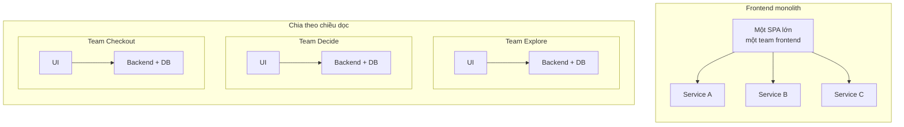

:::tldr
- Micro-frontends là **cách chia tổ chức** trước khi là kỹ thuật: mỗi team sở hữu một mảng nghiệp vụ từ database đến UI, và deploy độc lập.
- Có năm kiểu ghép chính: **server (SSI/ESI)**, **build-time (npm package)**, **iframe**, **JavaScript runtime** (bao gồm Module Federation) và **Web Components**. Build-time không phải micro-frontends thật vì vẫn release cùng nhau.
- **DOM là API**: custom element với tag name, attribute và event là hợp đồng giữa các team. Cha → con truyền attribute, con → cha bắn `CustomEvent`. Không dùng state toàn cục chung.
- Đặt **tiền tố theo team** cho mọi thứ còn dùng chung: tag name, CSS, event, localStorage, cookie.
- Cái giá có thật: payload lớn hơn, nhiều thứ cần vận hành, dễ lạc nhau về UI. Nếu chỉ có một hai team, **modular monolith** gần như luôn là lựa chọn tốt hơn.
:::

Trong [checklist Front-end System Design 9 bước](/blog/frontend-system-design-cheatsheet/), mục kiến trúc có một dòng: "frontend monolith hay micro-frontends". Bài này mở rộng dòng đó, dựa chủ yếu trên [micro-frontends.org](https://micro-frontends.org/) của Michael Geers và bài [Micro Frontends](https://martinfowler.com/articles/micro-frontends.html) của Cam Jackson trên blog Martin Fowler, cộng thêm những gì nền tảng web đã thay đổi từ đó.

> **Bản tiếng Việt của micro-frontends.org:** mình đã dịch toàn bộ trang sang tiếng Việt và gửi [pull request #108](https://github.com/neuland/micro-frontends/pull/108) lên repo gốc, hiện đang chờ merge. Trong lúc chờ, bạn có thể đọc trước bản dịch tại [001123.github.io/micro-frontends](https://001123.github.io/micro-frontends/).

## Micro-frontends là gì?

Backend đã tách thành nhiều microservice, nhưng phía trên vẫn là một SPA khổng lồ do một team frontend riêng làm. SPA đó phình dần, khó bảo trì, và mọi team đều phải xếp hàng chờ nó. Đó là **frontend monolith**.

Micro-frontends (xuất hiện trên [ThoughtWorks Technology Radar](https://www.thoughtworks.com/radar/techniques/micro-frontends) cuối 2016) nhìn website như **tập hợp tính năng**, mỗi tính năng thuộc về một **team độc lập**: có sứ mệnh nghiệp vụ rõ ràng, làm **từ database đến giao diện**, và **deploy không cần hỏi ai**.



Chữ quan trọng là **độc lập**: về codebase, về release và về team.

:::advanced
### Nguồn gốc và định nghĩa

Ý tưởng này không mới. Nó gần với [Self-contained Systems](https://scs-architecture.org/), và trước đó OTTO gọi là "Frontend Integration for Verticalised Systems". "Micro-frontends" chỉ là cái tên dễ nhớ hơn.

Định nghĩa của Cam Jackson: *"Một kiểu kiến trúc trong đó các ứng dụng frontend có thể deliver độc lập được ghép lại thành một tổng thể lớn hơn."* Ông liệt kê bốn lợi ích: nâng cấp từng phần (strangler thay vì viết lại), codebase nhỏ và tách bạch theo bounded context, deploy độc lập với pipeline riêng, và team tự chủ. Team phải được tổ chức theo **lát cắt nghiệp vụ dọc**, không theo mối quan tâm kỹ thuật ngang như "team styling" hay "team form".

Ví dụ trong suốt bài là cửa hàng máy kéo mô hình của micro-frontends.org, với ba team: **Team Product** (đỏ) sở hữu trang sản phẩm, **Team Checkout** (xanh dương) sở hữu nút mua và giỏ hàng mini, **Team Inspire** (xanh lá) sở hữu phần gợi ý. Phiên bản [Tractor Store 2.0](https://micro-frontends.org/tractor-store/) là một shop đầy đủ, được viết lại bằng nhiều stack khác nhau, giống TodoMVC cho micro-frontends.
:::

## Khi nào nên (và không nên) dùng?

Micro-frontends giải quyết **vấn đề tổ chức**, không phải vấn đề kỹ thuật.

**Nên** khi có từ ba bốn team trở lên trên cùng một sản phẩm và đang giẫm chân nhau (xung đột merge, hàng đợi release), khi cần **migrate dần** khỏi stack cũ theo kiểu [strangler fig](https://martinfowler.com/bliki/StranglerFigApplication.html), hoặc khi các mảng có nhịp release rất khác nhau.

**Không nên** khi chỉ có một hai team (một **modular monolith** trong monorepo cho phần lớn lợi ích với rất ít chi phí), khi lý do chính là "mỗi team muốn dùng framework riêng", hoặc khi mọi phần của ứng dụng tương tác dày đặc với nhau (như trình chỉnh sửa đồ họa).

## Năm nguyên tắc cốt lõi

Theo micro-frontends.org, và vẫn đúng đến giờ:

1. **Không phụ thuộc công nghệ**: mỗi team tự chọn và nâng cấp stack, không cần phối hợp.
2. **Cô lập code của team**: không chia sẻ runtime, state chung hay biến toàn cục.
3. **Đặt tiền tố theo team** cho những gì chưa cô lập được: CSS, event, localStorage, cookie.
4. **Ưu tiên tính năng của trình duyệt**: dùng DOM event thay vì tự xây PubSub toàn cục.
5. **Chống chịu**: tính năng vẫn dùng được khi JavaScript lỗi hoặc chưa chạy, nhờ server rendering và progressive enhancement.

## Các cách ghép

Trước khi chọn, xác định sản phẩm nằm đâu trên [dải document ↔ application](https://ar.al/notes/the-documents-to-applications-continuum/): site nhiều nội dung thì ghép ở **server** là đủ; thương mại điện tử hay PWA cần ghép ở **cả server lẫn trình duyệt**; ứng dụng thuần tương tác thì ghép ở **client**.

| Cách ghép | Ưu | Nhược |
| --- | --- | --- |
| **Server (SSI, ESI, edge)** | Nhanh lần đầu, chạy khi tắt JS, SEO tốt, đơn giản | Mảnh chậm nhất quyết định tốc độ cả trang |
| **Build-time (npm package)** | Một bundle, dedupe dễ | Release lockstep: không phải micro-frontends thật |
| **iframe** | Cô lập mạnh nhất, hợp với nội dung bên thứ ba | Routing, deep link, responsive, a11y đều khó |
| **JavaScript runtime** (import map, Module Federation) | Linh hoạt nhất, chia sẻ dependency được | Chủ yếu chạy ở client; shared dependency là hợp đồng version ngầm |
| **Web Components** | Chuẩn web, framework nào cũng dùng được, kết hợp tốt với SSR | Phải tự lo SSR và hydrate |

:::advanced
### Ghép ở server: SSI, ESI

Server của team sở hữu trang render khung HTML và chèn fragment của team khác bằng [Server Side Includes](https://en.wikipedia.org/wiki/Server_Side_Includes):

```html
<blue-buy sku="t_porsche">
  <!--#include virtual="/blue-buy?sku=t_porsche" -->
</blue-buy>
```

Mỗi team có server riêng, nginx bật `ssi` và định tuyến theo tiền tố URL. Response của `/blue-buy?sku=t_porsche` được chèn vào chỗ comment `#include` trước khi gửi trang cho trình duyệt:

```nginx
upstream team_blue  { server team_blue:3001; }
upstream team_green { server team_green:3002; }
upstream team_red   { server team_red:3003; }

server {
  listen 3000;
  ssi on;

  location /blue  { proxy_pass http://team_blue; }
  location /green { proxy_pass http://team_green; }
  location /red   { proxy_pass http://team_red; }
  location /      { proxy_pass http://team_red; } # team red sở hữu trang sản phẩm
}
```

Biến thể: [ESI](https://en.wikipedia.org/wiki/Edge_Side_Includes) (ghép ở CDN/edge, Varnish, Akamai, Fastly hỗ trợ), hoặc thư viện như Tailor của Zalando. Ngày nay bạn cũng có thể làm việc này trong một edge worker (Cloudflare Workers với `HTMLRewriter`) hoặc dùng routing của nền tảng như Vercel Microfrontends để chia URL cho từng app.
:::

:::advanced
### Build-time và iframe

Build-time: mỗi micro-frontend là một package, container khai báo trong `package.json`:

```json
{
  "dependencies": {
    "@feed-me/browse-restaurants": "^1.2.3",
    "@feed-me/order-food": "^4.5.6",
    "@feed-me/user-profile": "^7.8.9"
  }
}
```

Sửa một phần thì phải build và release lại cả app, đúng thứ micro-frontends muốn bỏ. Cam Jackson khuyên mạnh mẽ là không nên làm vậy. Nó vẫn hữu ích để chia code trong một monolith, chỉ đừng gọi đó là micro-frontends.

iframe: container đổi `src` theo route.

```html
<iframe id="micro-frontend-container"></iframe>
<script>
  const routes = {
    "/": "https://browse.example.com/index.html",
    "/order-food": "https://order.example.com/index.html",
  };
  document.getElementById("micro-frontend-container").src = routes[location.pathname];
</script>
```

Cô lập CSS, JS, global và cả lỗi; phù hợp để nhúng widget thanh toán hay công cụ nội bộ cũ (thêm `sandbox` nếu không tin tưởng). Đổi lại: giao tiếp phải qua `postMessage`, iframe không tự co theo nội dung, history và deep link phức tạp, mỗi iframe tải lại framework riêng.
:::

:::advanced
### JavaScript runtime, import map và Module Federation 2.0

Cam Jackson coi đây là cách "mặc định". Mỗi micro-frontend đăng ký hàm mount; container quyết định mount cái nào, ở đâu, khi nào. Hợp đồng càng nhỏ càng tốt:

```ts
type MicroFrontend = {
  mount(el: HTMLElement, ctx: { basePath: string; navigate(to: string): void }): void;
  unmount(el: HTMLElement): void;
};
```

Thay vì gắn hàm lên `window` như ví dụ năm 2019, ngày nay mỗi team xuất bản một ES module, container map tên module sang URL đã hash qua một [import map](https://developer.mozilla.org/en-US/docs/Web/HTML/Reference/Elements/script/type/importmap):

```html
<script type="importmap">
  {
    "imports": {
      "@checkout/app": "https://checkout.example.com/app.3f9a1c.js",
      "@explore/app": "https://explore.example.com/app.7b2e04.js"
    }
  }
</script>
```

```ts
const mfe: MicroFrontend = await import("@checkout/app");
mfe.mount(document.getElementById("checkout-root")!, { basePath: "/checkout", navigate });
```

Deploy một team chỉ là đổi một dòng trong import map (hoặc manifest), không ai khác phải build lại.

**Module Federation** là phiên bản "có tổ chức": mỗi app là một **remote** expose module, app **host** tiêu thụ lúc runtime, hai bên khai báo **dependency dùng chung** (`react`, `react-dom`) để không tải trùng. Module Federation 2.0 đã có bản stable, chạy trên Webpack, Rspack, Rollup/Rolldown, Vite, Rsbuild, cả Next.js và React Native, thêm type hint động cho remote, preload, DevTools và tree shaking cho shared dependency. [single-spa](https://single-spa.js.org/), Piral và Native Federation (dựa trên import map) cũng thuộc nhóm này.

Rủi ro chính: shared dependency là một **hợp đồng version** ngầm. Host dùng React 19, remote dùng React 18 thì sao? Lỗi kiểu này chỉ lộ ra lúc runtime.
:::

## DOM là API

micro-frontends.org chọn **Custom Elements** làm trọng tâm. Mỗi team bọc tính năng (viết bằng framework gì cũng được) trong một custom element; **tag name, attribute và event** là public API cho team khác. Team Product đặt nút mua của Team Checkout vào trang chỉ bằng:

```html
<blue-buy sku="t_porsche"></blue-buy>
```

Quy ước `[team]-[tính-năng]` vừa tránh trùng tên, vừa giúp nhìn DOM là biết của ai.

**Cha → con: attribute.** Người dùng chọn mẫu khác, Team Product chỉ đổi attribute; element khai báo `observedAttributes` và tự render lại:

```js
document.querySelector("blue-buy").setAttribute("sku", "t_fendt");
```

**Con → cha, anh em: DOM event.** Bấm mua thì giỏ hàng mini phải làm mới. Thay vì để hai component biết nhau, dùng PubSub sẵn có của trình duyệt:

```js
// trong <blue-buy>
this.dispatchEvent(new CustomEvent("blue:basket:changed", { bubbles: true }));

// trong <blue-basket> (nhớ gỡ listener trong disconnectedCallback)
window.addEventListener("blue:basket:changed", () => this.refresh());
```

Các kênh khác: **URL** để chuyển trạng thái giữa các trang, **server/BFF** cho dữ liệu cần nhất quán như giỏ hàng. Tránh **store toàn cục dùng chung**: nó giống chia sẻ database giữa các microservice. Nếu dùng Redux, mỗi micro-frontend một store riêng.

:::advanced
### Viết custom element cho đúng

Nút mua đầy đủ, với attribute được theo dõi:

```js
const prices = { t_porsche: "66,00 €", t_fendt: "54,00 €", t_eicher: "58,00 €" };

class BlueBuy extends HTMLElement {
  static observedAttributes = ["sku"];

  connectedCallback() {
    this.render();
  }

  attributeChangedCallback() {
    this.render();
  }

  render() {
    const root = this.shadowRoot ?? this.attachShadow({ mode: "open" });
    const price = prices[this.getAttribute("sku")];
    root.innerHTML = `<button type="button">buy for ${price}</button>`;
  }
}

customElements.define("blue-buy", BlueBuy);
```

(Ví dụ đầu tiên trên micro-frontends.org viết `this.shadowRoot = \`...\``; `shadowRoot` là thuộc tính chỉ đọc, phải gán vào `this.shadowRoot.innerHTML` như các ví dụ sau trong bài.)

`render()` là nơi khởi tạo framework riêng của team nếu có. Thay đổi attribute (khai báo) nên được ưu tiên hơn việc gọi method trên element (mệnh lệnh). Spec chỉ yêu cầu tên có dấu gạch ngang, và custom element **không tự đóng được**: `<green-recos sku="t_porsche" />` sẽ không hoạt động đúng.

Phần event, với listener được gỡ đúng cách:

```js
class BlueBuy extends HTMLElement {
  #onClick = () => {
    // gọi API thêm vào giỏ...
    this.dispatchEvent(
      new CustomEvent("blue:basket:changed", { bubbles: true, composed: true }),
    );
  };

  connectedCallback() {
    this.render();
    this.shadowRoot.querySelector("button").addEventListener("click", this.#onClick);
  }

  disconnectedCallback() {
    this.shadowRoot.querySelector("button")?.removeEventListener("click", this.#onClick);
  }
  // render() như trên
}

class BlueBasket extends HTMLElement {
  #refresh = () => {
    // fetch dữ liệu giỏ hàng mới và render lại
  };

  connectedCallback() {
    window.addEventListener("blue:basket:changed", this.#refresh);
  }

  disconnectedCallback() {
    window.removeEventListener("blue:basket:changed", this.#refresh);
  }
}
```

Hai chi tiết hay bị sai:

- **Giữ cùng một tham chiếu hàm** khi add và remove listener. `this.refresh` trong method của class bị mất `this` khi truyền làm callback; dùng arrow function làm class field như trên.
- Event bắn từ bên trong shadow root cần `composed: true` để vượt qua ranh giới shadow DOM; ở đây event bắn từ chính host element nên `bubbles: true` là đủ, nhưng thêm `composed` giúp an toàn khi sau này đổi chỗ dispatch.

Nếu không muốn giỏ hàng nghe trên `window` (ngoài phạm vi của nó), trang chủ quản (Team Product) có thể nghe event và gọi `refresh()` trên element giỏ hàng. Kiểu "page điều phối" này rõ ràng hơn nhưng làm team chủ quản biết nhiều hơn.

Web Components là chuẩn web nên mọi framework lớn đều dùng được (xem [Custom Elements Everywhere](https://custom-elements-everywhere.com/); React 19 hỗ trợ đầy đủ property và custom event cho custom element). Custom Elements và Shadow DOM chạy trên mọi trình duyệt hiện đại, không cần polyfill.
:::

:::advanced
### Bảng các kênh giao tiếp

| Kênh | Khi nào dùng | Lưu ý |
| --- | --- | --- |
| Attribute / property | Cha truyền dữ liệu xuống con | Hợp đồng rõ ràng nhất; property cho dữ liệu phức tạp |
| DOM `CustomEvent` | Con báo lên, anh em báo nhau | Có tiền tố team; document hóa payload như một API |
| URL (path, query) | Chuyển trạng thái giữa các trang/app | Deep link miễn phí; ví dụ của Cam Jackson chỉ giao tiếp qua route |
| Server / BFF | Dữ liệu cần nhất quán (giỏ hàng, phiên đăng nhập) | Mỗi team tự đọc từ nguồn thật, không đồng bộ state ở client |
| `BroadcastChannel` | Đồng bộ giữa nhiều tab | Dễ bị lạm dụng thành event bus toàn cục |
| Store toàn cục dùng chung | Gần như không bao giờ | Coupling khổng lồ |

Chính tài liệu Redux coi việc "cô lập một Redux app như một component trong ứng dụng lớn hơn" là lý do hợp lệ để có nhiều store.
:::

## Server rendering và trạng thái loading

Bài gốc trên micro-frontends.org than rằng Web Components không có server rendering, và giải bằng cách cho mỗi team expose `render()` qua URL rồi ghép bằng SSI. Từ 2024, [Declarative Shadow DOM](https://developer.mozilla.org/en-US/docs/Web/HTML/Reference/Elements/template#shadowrootmode) đã chạy trên mọi trình duyệt lớn: fragment server render mang theo cả shadow root và style đóng gói, không cần JavaScript.

Vì **mảnh chậm nhất quyết định tốc độ cả trang**, fragment vừa đắt vừa khó cache (như gợi ý cá nhân hóa) có thể chuyển sang render ở client. Nhưng khi nội dung về, nó đẩy layout xuống (xấu cho CLS). Đừng bắt team sở hữu trang cố định chiều cao vùng đó, vì như vậy hai team phải release cùng nhau mỗi khi đổi giao diện. Thay vào đó, team sở hữu fragment cho server render một **skeleton** đúng kích thước, nội dung thật lấp vào sau.

:::advanced
### Declarative Shadow DOM và SSR với Module Federation

Fragment do server của Team Checkout trả về:

```html
<blue-buy sku="t_porsche">
  <template shadowrootmode="open">
    <style>button { font: inherit; }</style>
    <button type="button">buy for 66,00 €</button>
  </template>
</blue-buy>
```

Khi JavaScript của Team Checkout tải xong, `connectedCallback` thấy `this.shadowRoot` đã tồn tại và chỉ cần gắn listener (đây là lý do dùng `this.shadowRoot ?? this.attachShadow(...)` trong `render()`).

Với Module Federation, SSR cũng khả thi (MF 2.0 chạy trên Node.js, có tích hợp cho Next.js và Modern.js), nhưng phức tạp hơn nhiều so với "server trả HTML, nginx ghép lại". Nếu SEO và tốc độ tải lần đầu quan trọng, ghép ở server vẫn là điểm khởi đầu đơn giản nhất.
:::

:::advanced
### Bỏ include và skeleton ở client

Chuyển một fragment từ server render sang client render chỉ là bỏ dòng include:

```html
<!-- Trước: server render -->
<green-recos sku="t_porsche">
  <!--#include virtual="/green-recos?sku=t_porsche" -->
</green-recos>

<!-- Sau: chỉ render ở client -->
<green-recos sku="t_porsche"></green-recos>
```

Vùng gợi ý ban đầu trống, JavaScript tải, gọi API, render, ảnh tải, rồi đẩy phần dưới trang xuống. Skeleton do server render tái dùng style layout của nội dung thật để giữ đúng chỗ.

Skeleton cũng hữu ích khi render ở client: element mới chèn vào DOM thì vẽ skeleton ngay trong lúc chờ dữ liệu. Khi attribute đổi, có thể quay về skeleton, nhưng nếu API trả nhanh thì skeleton nháy qua lại còn khó chịu hơn; giữ dữ liệu cũ hoặc chỉ hiện skeleton sau một khoảng chờ ngắn.
:::

## CSS và design system

CSS vốn toàn cục: hai team cùng viết `h2 { … }` ở hai repo là xung đột. Từ yếu đến mạnh có: tiền tố team trong tên class, CSS Modules, `@scope` + `@layer`, và Shadow DOM. Cách nào cũng được, miễn mọi team chắc chắn style của mình không ảnh hưởng ai. Dùng **CSS custom properties** làm design token, vì chúng xuyên qua được shadow DOM.

Người dùng phải thấy **một** sản phẩm. Thư viện component dùng chung nên **chỉ chứa logic UI** (`Button`, `Combobox`), không chứa logic nghiệp vụ (`ProductTable`). Đừng làm quá nhiều component quá sớm, và phải có một người hoặc team chịu trách nhiệm.

Cũng đừng trộn React, Angular, Vue trên cùng một trang. ThoughtWorks gọi đó là [micro frontend anarchy](https://www.thoughtworks.com/radar/techniques/micro-frontend-anarchy) và xếp vào mục **Hold**. Trộn framework chỉ hợp lý trong giai đoạn migrate.

:::advanced
### Chi tiết về CSS và design system

Các lựa chọn cô lập CSS:

1. **Quy ước đặt tên có tiền tố team** (`.blue-buy__button`, BEM): dựa vào kỷ luật.
2. **CSS Modules / CSS-in-JS**: build tool sinh tên class duy nhất.
3. **`@scope`** và **cascade layers** (`@layer`): chuẩn CSS, giới hạn phạm vi selector và kiểm soát thứ tự ưu tiên giữa style của shell, design system và từng team.
4. **Shadow DOM**: cô lập thật ở trình duyệt. Style ngoài không lọt vào (trừ thuộc tính kế thừa như `font`, `color` và CSS custom properties), style trong không lọt ra.

Design system:

- **Thu hoạch thay vì đoán trước.** Cam Jackson khuyên để các team tự viết trước, chấp nhận trùng lặp ban đầu, đợi API của component lộ rõ qua thực tế rồi mới "harvest" vào thư viện chung.
- **Custodian.** "Ai cũng sở hữu" nghĩa là không ai sở hữu; tập trung hoàn toàn thì người làm xa người dùng. Mô hình tốt nhất: ai cũng đóng góp được, một người hoặc team chịu trách nhiệm chất lượng.
- **Có version**, và chấp nhận các team ở các version khác nhau trong một thời điểm. Token qua CSS custom properties giúp đổi giao diện đồng loạt mà không cần mọi team release.
- Tractor Store 2.0 gợi ý bắt đầu thống nhất từ component đơn giản nhất: nút bấm.

Về anarchy: kỹ thuật thì trộn framework được, nhưng người dùng tải nhiều framework, các team khó chia sẻ kiến thức và gần như không thể có thư viện component chung. Ngoài giai đoạn migrate (app AngularJS cũ chạy song song phần React mới, chuyển dần từng route), giữ một framework chính, một design system, một bộ công cụ build, kiểm thử và giám sát chung.
:::

## App shell, routing và auth

Phần lớn kiến trúc có một **app shell** lo header/footer, **xác thực** (lấy token rồi truyền vào khi mount, hoặc dùng cookie `HttpOnly` cùng domain) và **routing cấp cao** (`/checkout/*` thuộc Team Checkout, phần còn lại team đó tự định tuyến). Shell không bắt buộc: Tractor Store 2.0 cho thấy một tập self-contained system theo vài quy tắc chung cũng hợp lệ.

:::advanced
### Điều hướng và backend

Chuyển trang giữa hai micro-frontend có thể là **điều hướng thật** (MPA, mỗi trang tải lại). Đơn giản và cô lập tốt nhất, và [View Transitions giữa các document](https://developer.mozilla.org/en-US/docs/Web/API/View_Transition_API) giờ giúp trải nghiệm mượt gần như SPA. Hoặc là **điều hướng client** trong shell, mượt hơn nhưng phải quản lý vòng đời mount/unmount và rò rỉ bộ nhớ.

**Backend**: mẫu [Backend for Frontend (BFF)](https://samnewman.io/patterns/architectural/bff/) mở rộng tự nhiên thành một BFF cho mỗi micro-frontend, do chính team đó sở hữu. Nguyên tắc: team làm micro-frontend không phải chờ team khác làm API cho mình.
:::

:::advanced
### Kiểm thử

Không khác monolith nhiều: mỗi micro-frontend có bộ test riêng đầy đủ (unit, component, integration). Khoảng trống là **tích hợp**:

- Một vài test end-to-end kiểm tra trang được **ghép đúng** (tải URL, thấy tiêu đề của từng fragment), không kiểm tra lại logic nghiệp vụ bên trong.
- **Contract test** (consumer-driven contracts) cho các hợp đồng giữa team: tag name, attribute, tên event và payload, chữ ký hàm `mount`. Mỗi team khai báo mình cần gì từ team khác mà không cần dựng cả hệ thống.
- Test **chế độ standalone**: mỗi micro-frontend nên chạy được một mình, ngoài shell, để dev và test nhanh.
:::

## Cái giá phải trả

| Chi phí | Giảm nhẹ |
| --- | --- |
| Payload lớn hơn (có thể tải React hai lần) | Shared dependency, một framework chính, ngân sách bundle theo team |
| Dev khác production | Chế độ standalone, môi trường preview ghép đủ các app |
| Nhiều repo, pipeline, hạ tầng phải vận hành | Template dự án, pipeline chuẩn, giám sát gắn nhãn theo team |
| UI lệch nhau | Design system có custodian, token dùng chung |
| Lỗi hợp đồng chỉ lộ ra lúc runtime | Contract test, error boundary cho từng fragment |

Khi một fragment lỗi, phần còn lại của trang phải **sống sót**: bọc mỗi fragment trong error boundary, có fallback và đặt timeout khi tải remote.

:::advanced
### Thêm về chi phí

- **Hiệu năng khó sở hữu**: không ai sở hữu "cả trang". Đặt ngân sách hiệu năng theo trang, và để team sở hữu trang chịu trách nhiệm Core Web Vitals.
- **Lỗi runtime**: hợp đồng nằm ở DOM hoặc remote module, không nằm trong type system. MF 2.0 sinh type từ remote, giúp bắt một phần lỗi sớm hơn.
- **Dev khác production**: ngoài chế độ standalone, có thể proxy các team khác từ staging để chạy cả trang ở local.
- **Fallback** cho fragment lỗi: skeleton, hoặc một liên kết đến trang riêng của tính năng đó; với remote, `try/catch` quanh `import()` và `mount`.
:::

## Chọn cách ghép nào?

| Tình huống | Gợi ý |
| --- | --- |
| Site nhiều nội dung, SEO quan trọng | Ghép ở server/edge, Web Components + Declarative Shadow DOM cho phần tương tác |
| Thương mại điện tử, nhiều team trên một trang | Fragment server render + Custom Elements + DOM event |
| Dashboard nội bộ, một framework | App shell + Module Federation hoặc import map, mỗi route một app |
| Migrate từ stack cũ | Strangler theo route; iframe hoặc Web Components để nhúng phần cũ |
| Nhúng bên thứ ba | iframe có `sandbox` |
| Một đến hai team | Không tách: modular monolith |

## Trong phỏng vấn system design

Gặp câu "có nên dùng micro-frontends không?", hãy hỏi lại về **tổ chức** trước: bao nhiêu team, có cần release độc lập không, có đang migrate không. Sau đó trình bày:

1. **Ranh giới** theo mảng nghiệp vụ, không theo lớp kỹ thuật.
2. **Cách ghép**: server, client hay cả hai.
3. **Hợp đồng**: tag name, attribute, event, chữ ký `mount`; nhỏ, có version, có contract test.
4. **Dùng chung**: design system, token, auth ở shell; không chia sẻ state nghiệp vụ.
5. **Chi phí**: payload, UI nhất quán, chống lỗi khi một fragment hỏng.

Nói được mục 5 là thứ phân biệt người đã thực sự làm micro-frontends với người chỉ đọc về nó.

## Kết

Micro-frontends là **định luật Conway áp dụng có chủ đích**: thiết kế tổ chức trước, kiến trúc sẽ đi theo. Những gì micro-frontends.org đề xuất từ 2017 vẫn vững vì dựa trên nền tảng trình duyệt: Custom Elements làm hợp đồng, DOM event để giao tiếp, server rendering để chống chịu, tiền tố team cho phần chưa cô lập được. Còn nếu chưa có nhiều team giẫm chân nhau, bạn chưa cần micro-frontends.

### Tham khảo

- [Micro Frontends, Michael Geers](https://micro-frontends.org/) ([bản tiếng Việt](https://001123.github.io/micro-frontends/), [PR #108](https://github.com/neuland/micro-frontends/pull/108) đang chờ merge)
- [Tractor Store 2.0, neuland](https://micro-frontends.org/tractor-store/)
- [Micro Frontends, Cam Jackson trên martinfowler.com](https://martinfowler.com/articles/micro-frontends.html)
- [Micro frontends, ThoughtWorks Technology Radar](https://www.thoughtworks.com/radar/techniques/micro-frontends)
- [Micro frontend anarchy, ThoughtWorks Technology Radar](https://www.thoughtworks.com/radar/techniques/micro-frontend-anarchy)
- [MF 2.0 Stable Release, Module Federation](https://module-federation.io/blog/v2-stable-version.html)
- [Microfrontends, Vercel Docs](https://vercel.com/docs/microfrontends)
- [Self-contained Systems](https://scs-architecture.org/)
- [Using custom elements, MDN](https://developer.mozilla.org/en-US/docs/Web/API/Web_components/Using_custom_elements)
- [`<template>` và `shadowrootmode`, MDN](https://developer.mozilla.org/en-US/docs/Web/HTML/Reference/Elements/template#shadowrootmode)
- [Custom Elements Everywhere](https://custom-elements-everywhere.com/)
- [Backends For Frontends, Sam Newman](https://samnewman.io/patterns/architectural/bff/)
