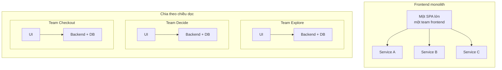

:::tldr
- Micro-frontends là **cách chia tổ chức** trước khi là kỹ thuật: mỗi team sở hữu một mảng nghiệp vụ từ database đến UI, và deploy độc lập.
- Có năm kiểu ghép chính: **server (SSI/ESI)**, **build-time (npm package)**, **iframe**, **JavaScript runtime** (bao gồm Module Federation) và **Web Components**. Build-time không phải micro-frontends thật vì vẫn release cùng nhau.
- **DOM là API**: custom element với tag name, attribute và event là hợp đồng giữa các team. Cha → con truyền attribute, con → cha bắn `CustomEvent`. Không dùng state toàn cục chung.
- Đặt **tiền tố theo team** cho mọi thứ còn dùng chung: tag name, CSS, event, localStorage, cookie.
- Cái giá có thật: payload lớn hơn, nhiều thứ cần vận hành, dễ lạc nhau về UI. Nếu chỉ có một hai team, **modular monolith** gần như luôn là lựa chọn tốt hơn.
:::

Trong [checklist Front-end System Design 9 bước](/blog/frontend-system-design-cheatsheet/), mục kiến trúc có một dòng ngắn: "frontend monolith hay micro-frontends". Bài này mở rộng dòng đó. Ghi chú dựa chủ yếu trên [micro-frontends.org](https://micro-frontends.org/) của Michael Geers (tác giả cuốn *Micro Frontends in Action*) và bài [Micro Frontends](https://martinfowler.com/articles/micro-frontends.html) của Cam Jackson trên blog Martin Fowler, cộng thêm những gì đã thay đổi từ khi hai bài đó ra đời.

## Micro-frontends là gì?

Thuật ngữ này xuất hiện lần đầu trên [ThoughtWorks Technology Radar](https://www.thoughtworks.com/radar/techniques/micro-frontends) cuối năm 2016, mang ý tưởng microservices sang frontend.

Bối cảnh quen thuộc: backend đã tách thành nhiều microservice, nhưng phía trên vẫn là một SPA khổng lồ do một team frontend riêng làm. Theo thời gian SPA đó phình ra, khó bảo trì, và mọi team backend đều phải xếp hàng chờ team frontend. Đó là **frontend monolith**.

Micro-frontends nhìn một website như **tập hợp các tính năng**, mỗi tính năng thuộc về một **team độc lập**. Mỗi team:

- có một **mảng nghiệp vụ** hoặc **sứ mệnh** rõ ràng (ví dụ: "giúp người dùng chọn sản phẩm", "dẫn người dùng qua bước thanh toán"),
- là team **cross-functional**, làm tính năng **từ đầu đến cuối**, từ database đến giao diện,
- **build, test và deploy độc lập**, không cần hỏi team khác.



Ý tưởng này không mới. Nó gần với [Self-contained Systems](https://scs-architecture.org/), và trước đó OTTO gọi là "Frontend Integration for Verticalised Systems". "Micro-frontends" chỉ là cái tên dễ nhớ hơn.

Định nghĩa của Cam Jackson gọn nhất: *"Một kiểu kiến trúc trong đó các ứng dụng frontend có thể deliver độc lập được ghép lại thành một tổng thể lớn hơn."* Chữ quan trọng là **độc lập**: độc lập về codebase, về release, và về team.

## Khi nào nên (và không nên) dùng?

Micro-frontends giải quyết **vấn đề của tổ chức**, không phải vấn đề kỹ thuật. Nó đáng giá khi:

- Có **nhiều team** (thường từ ba bốn team trở lên) cùng làm trên một sản phẩm và đang giẫm chân nhau: xung đột merge, hàng đợi release, một team làm hỏng build của cả công ty.
- Muốn **migrate dần** khỏi một stack cũ (AngularJS, jQuery, một framework nội bộ) theo kiểu [strangler fig](https://martinfowler.com/bliki/StranglerFigApplication.html), không phải đập đi viết lại.
- Các mảng của sản phẩm có **nhịp release khác nhau**: trang thanh toán cần ổn định, trang khuyến mãi đổi hằng ngày.

Không nên dùng khi:

- Chỉ có **một hoặc hai team**. Chi phí vận hành lớn hơn lợi ích. Một monorepo có ranh giới module rõ ràng (modular monolith) cho bạn phần lớn lợi ích với rất ít chi phí.
- Lý do chính là "muốn mỗi team dùng framework riêng". Đó là triệu chứng, không phải mục tiêu (xem phần "Tránh micro-frontend anarchy" bên dưới).
- Sản phẩm là một ứng dụng có tương tác dày đặc giữa mọi phần (ví dụ trình soạn thảo đồ họa). Ranh giới team sẽ cắt ngang qua state dùng chung, và bạn sẽ dành phần lớn thời gian để đồng bộ.

Ngay cả tài liệu micro-frontends của Vercel cũng khuyên thử monorepo, feature flag và build nhanh hơn trước khi tách.

## Năm nguyên tắc cốt lõi

micro-frontends.org nêu năm ý, mình thấy vẫn đúng đến giờ:

1. **Không phụ thuộc công nghệ.** Mỗi team chọn và nâng cấp stack của mình mà không cần phối hợp với team khác. Custom Elements giúp giấu chi tiết bên trong sau một interface trung lập.
2. **Cô lập code của team.** Không chia sẻ runtime, kể cả khi mọi team cùng dùng một framework. Không dựa vào state chung hay biến toàn cục.
3. **Đặt tiền tố theo team.** Ở những chỗ chưa cô lập được, thống nhất quy ước đặt tên: CSS, event, localStorage, cookie. Vừa tránh xung đột vừa nhìn vào là biết của ai.
4. **Ưu tiên tính năng sẵn có của trình duyệt.** Dùng browser event để giao tiếp thay vì tự xây một hệ thống PubSub toàn cục. Nếu buộc phải có API giữa các team, giữ nó đơn giản nhất có thể.
5. **Xây site có khả năng chống chịu.** Tính năng vẫn phải dùng được khi JavaScript lỗi hoặc chưa chạy xong. Dùng server rendering và progressive enhancement.

## Chọn vị trí trên dải "document ↔ application"

Trước khi chọn kỹ thuật ghép, xác định sản phẩm nằm đâu trên [dải Documents-to-Applications](https://ar.al/notes/the-documents-to-applications-continuum/) của Aral Balkan:

- **Bên trái** (website nhiều nội dung, chủ yếu là document nối với nhau bằng link): ghép ở **server** là đủ. Server nối các mẩu HTML lại, cập nhật bằng cách tải lại trang hoặc thay một phần qua AJAX.
- **Ở giữa** (thương mại điện tử, PWA, cần phản hồi tức thì như optimistic UI hay skeleton screen): cần ghép ở **cả server lẫn trình duyệt**.
- **Bên phải** (ứng dụng thuần hành vi, ít nội dung, như trình chỉnh ảnh online): ghép chủ yếu ở **client**.

Quyết định này ảnh hưởng mọi thứ phía sau: kỹ thuật ghép, cách lấy dữ liệu, cách xử lý loading.

## Các cách ghép micro-frontends

### 1. Ghép ở server: SSI, ESI

Cách "cổ" nhất và cũng ổn định nhất. Server của team sở hữu trang render khung HTML, chèn các mảnh (fragment) của team khác bằng [Server Side Includes](https://en.wikipedia.org/wiki/Server_Side_Includes):

```html
<blue-buy sku="t_porsche">
  <!--#include virtual="/blue-buy?sku=t_porsche" -->
</blue-buy>
```

Web server (nginx), CDN (qua [ESI](https://en.wikipedia.org/wiki/Edge_Side_Includes)) hoặc edge worker thay comment `#include` bằng HTML do server của team sở hữu fragment trả về, rồi mới gửi trang cho trình duyệt.

**Ưu**: nhanh lần đầu, chạy được khi tắt JavaScript, SEO tốt, đơn giản đến nhàm chán (theo nghĩa tốt).
**Nhược**: **mảnh chậm nhất quyết định thời gian phản hồi của cả trang**, nên phải cache fragment cẩn thận.

:::advanced
### Cấu hình nginx và các biến thể

Mỗi team có server riêng, nginx bật `ssi` và định tuyến theo tiền tố URL. Response của `/blue-buy?sku=t_porsche` được chèn vào chỗ comment `#include`:

```nginx
upstream team_blue  { server team_blue:3001; }
upstream team_green { server team_green:3002; }
upstream team_red   { server team_red:3003; }

server {
  listen 3000;
  ssi on;

  location /blue  { proxy_pass http://team_blue; }
  location /green { proxy_pass http://team_green; }
  location /red   { proxy_pass http://team_red; }
  location /      { proxy_pass http://team_red; } # team red sở hữu trang sản phẩm
}
```

Biến thể: ESI (ghép ở CDN/edge, Varnish, Akamai, Fastly hỗ trợ), hoặc thư viện như Tailor của Zalando. Ngày nay bạn cũng có thể làm việc này trong một edge worker (Cloudflare Workers với `HTMLRewriter`) hoặc dùng routing của nền tảng như Vercel Microfrontends để chia URL cho từng app.
:::

### 2. Ghép lúc build: npm package

Mỗi micro-frontend là một package, ứng dụng container khai báo chúng trong `package.json`:

```json
{
  "dependencies": {
    "@feed-me/browse-restaurants": "^1.2.3",
    "@feed-me/order-food": "^4.5.6",
    "@feed-me/user-profile": "^7.8.9"
  }
}
```

Trông hợp lý (một bundle, dedupe dependency dễ), nhưng muốn sửa một phần thì phải build và release lại **cả app**. Đó là **lockstep release**, đúng thứ micro-frontends muốn bỏ. Cam Jackson khuyên mạnh mẽ là không nên làm vậy. Nó vẫn hữu ích để **chia code** trong một monolith, chỉ đừng gọi đó là micro-frontends.

### 3. iframe

```html
<iframe id="micro-frontend-container"></iframe>
<script>
  const routes = {
    "/": "https://browse.example.com/index.html",
    "/order-food": "https://order.example.com/index.html",
  };
  document.getElementById("micro-frontend-container").src = routes[location.pathname];
</script>
```

**Ưu**: cô lập mạnh nhất (CSS, JS, global, cả lỗi), không cần thỏa thuận gì về framework. Phù hợp khi nhúng thứ **không tin tưởng hoàn toàn** hoặc từ bên thứ ba (widget thanh toán, ứng dụng nội bộ cũ).
**Nhược**: routing, history, deep link phức tạp; khó làm responsive vì iframe không tự co theo nội dung; giao tiếp phải qua `postMessage`; accessibility và SEO kém hơn; mỗi iframe tải lại framework riêng.

### 4. JavaScript runtime: container gọi hàm mount

Đây là cách Cam Jackson gọi là "mặc định" và cũng là cách phổ biến nhất. Mỗi micro-frontend tải qua `<script>` và đăng ký một hàm mount; container quyết định mount cái nào, ở đâu, khi nào:

```ts
// Hợp đồng giữa container và micro-frontend: càng nhỏ càng tốt.
type MicroFrontend = {
  mount(el: HTMLElement, ctx: { basePath: string; navigate(to: string): void }): void;
  unmount(el: HTMLElement): void;
};
```

Ngày nay mỗi team thường xuất bản một ES module, container tải bằng `import()` dynamic, URL thật được map qua import map hoặc manifest. **Module Federation** là phiên bản "có tổ chức" của cách này: mỗi app là một **remote** expose module, app **host** tiêu thụ lúc runtime, hai bên khai báo **dependency dùng chung** (`react`, `react-dom`) để không tải trùng.

**Ưu**: linh hoạt nhất, deploy độc lập, chia sẻ dependency được.
**Nhược**: chỉ chạy ở client nếu không đầu tư thêm cho SSR; "shared dependency" là một **hợp đồng phiên bản** ngầm giữa các team (React 19 ở host, React 18 ở remote thì sao?), và lỗi chỉ lộ ra lúc runtime.

:::advanced
### Import map và Module Federation 2.0

Thay vì gắn hàm lên `window` như ví dụ năm 2019, container map tên module sang URL đã hash qua một [import map](https://developer.mozilla.org/en-US/docs/Web/HTML/Reference/Elements/script/type/importmap):

```html
<script type="importmap">
  {
    "imports": {
      "@checkout/app": "https://checkout.example.com/app.3f9a1c.js",
      "@explore/app": "https://explore.example.com/app.7b2e04.js"
    }
  }
</script>
```

```ts
const mfe: MicroFrontend = await import("@checkout/app");
mfe.mount(document.getElementById("checkout-root")!, { basePath: "/checkout", navigate });
```

Deploy một team chỉ là đổi một dòng trong import map (hoặc manifest), không ai khác phải build lại.

Module Federation 2.0 đã có bản stable, chạy được trên Webpack, Rspack, Rollup/Rolldown, Vite, Rsbuild, cả Next.js và React Native, thêm type hint động cho remote, preload, DevTools và tree shaking cho shared dependency. Các framework như [single-spa](https://single-spa.js.org/), Piral hay Native Federation (dựa trên import map) cũng nằm trong nhóm này.
:::

### 5. Web Components: DOM là API

micro-frontends.org chọn cách này làm trọng tâm. Mỗi team bọc tính năng (viết bằng bất cứ framework gì) trong một [Custom Element](https://developer.mozilla.org/en-US/docs/Web/API/Web_components/Using_custom_elements). **Tag name, attribute và event** của element đó chính là public API cho team khác. Team khác không cần biết bên trong dùng React hay Svelte, chỉ cần biết thao tác DOM.

Ví dụ trên micro-frontends.org là một cửa hàng máy kéo mô hình với ba team: **Team Product** (đỏ) sở hữu trang sản phẩm, **Team Checkout** (xanh dương) sở hữu nút mua và giỏ hàng mini, **Team Inspire** (xanh lá) sở hữu phần gợi ý sản phẩm. Team Product đặt nút mua vào trang chỉ bằng:

```html
<blue-buy sku="t_porsche"></blue-buy>
```

Quy ước `[màu-team]-[tính-năng]` vừa tránh trùng tên, vừa giúp nhìn DOM là biết tính năng của team nào. Spec chỉ yêu cầu tên có dấu gạch ngang (`-`). Lưu ý custom element **không tự đóng được**: `<green-recos sku="t_porsche" />` sẽ không hoạt động đúng.

Web Components là chuẩn web nên mọi framework lớn đều dùng được (xem [Custom Elements Everywhere](https://custom-elements-everywhere.com/); React 19 đã hỗ trợ đầy đủ property và custom event cho custom element). Custom Elements và Shadow DOM chạy trên mọi trình duyệt hiện đại, không cần polyfill.

## Giao tiếp giữa các micro-frontend

Nguyên tắc chung từ cả hai nguồn: **giao tiếp càng ít càng tốt**. Mỗi kênh giao tiếp là một hợp đồng phải giữ ổn định qua nhiều lần release của nhiều team.

### Cha → con: attribute

Khi người dùng chọn mẫu máy kéo khác, nút mua phải cập nhật giá. Team Product chỉ cần đổi attribute:

```js
document.querySelector("blue-buy").setAttribute("sku", "t_fendt");
```

Nếu Team Product dùng React hay framework có DOM diffing, việc này xảy ra tự động. Phía Team Checkout, element khai báo `observedAttributes` và render lại trong `attributeChangedCallback`. Thay đổi attribute (khai báo) nên được ưu tiên hơn việc gọi method trên element (mệnh lệnh).

### Con → cha, anh em: DOM event

Khi bấm nút mua, giỏ hàng mini phải làm mới. Cả hai đều của Team Checkout, nhưng để hai instance biết nhau trực tiếp là vi phạm sự cô lập. Trình duyệt đã có sẵn PubSub: **event**. Nút mua bắn một `CustomEvent` có tiền tố team, giỏ hàng lắng nghe:

```js
// trong <blue-buy>
this.dispatchEvent(new CustomEvent("blue:basket:changed", { bubbles: true }));

// trong <blue-basket> (nhớ gỡ listener trong disconnectedCallback)
window.addEventListener("blue:basket:changed", () => this.refresh());
```

:::advanced
### Viết custom element cho đúng

Nút mua đầy đủ, với attribute được theo dõi:

```js
const prices = { t_porsche: "66,00 €", t_fendt: "54,00 €", t_eicher: "58,00 €" };

class BlueBuy extends HTMLElement {
  static observedAttributes = ["sku"];

  connectedCallback() {
    this.render();
  }

  attributeChangedCallback() {
    this.render();
  }

  render() {
    const root = this.shadowRoot ?? this.attachShadow({ mode: "open" });
    const price = prices[this.getAttribute("sku")];
    root.innerHTML = `<button type="button">buy for ${price}</button>`;
  }
}

customElements.define("blue-buy", BlueBuy);
```

(Ví dụ đầu tiên trên micro-frontends.org viết `this.shadowRoot = \`...\``; `shadowRoot` là thuộc tính chỉ đọc, phải gán vào `this.shadowRoot.innerHTML` như các ví dụ sau trong bài.)

`render()` là nơi khởi tạo framework riêng của team nếu có.

Phần event, với listener được gỡ đúng cách:

```js
class BlueBuy extends HTMLElement {
  #onClick = () => {
    // gọi API thêm vào giỏ...
    this.dispatchEvent(
      new CustomEvent("blue:basket:changed", { bubbles: true, composed: true }),
    );
  };

  connectedCallback() {
    this.render();
    this.shadowRoot.querySelector("button").addEventListener("click", this.#onClick);
  }

  disconnectedCallback() {
    this.shadowRoot.querySelector("button")?.removeEventListener("click", this.#onClick);
  }
  // render() như trên
}

class BlueBasket extends HTMLElement {
  #refresh = () => {
    // fetch dữ liệu giỏ hàng mới và render lại
  };

  connectedCallback() {
    window.addEventListener("blue:basket:changed", this.#refresh);
  }

  disconnectedCallback() {
    window.removeEventListener("blue:basket:changed", this.#refresh);
  }
}
```

Hai chi tiết hay bị sai:

- **Giữ cùng một tham chiếu hàm** khi add và remove listener. `this.refresh` trong method của class bị mất `this` khi truyền làm callback; dùng arrow function làm class field như trên.
- Event bắn từ bên trong shadow root cần `composed: true` để vượt qua ranh giới shadow DOM; ở đây event bắn từ chính host element nên `bubbles: true` là đủ, nhưng thêm `composed` giúp an toàn khi sau này đổi chỗ dispatch.

Nếu không muốn giỏ hàng nghe trên `window` (ngoài phạm vi của nó), trang chủ quản (Team Product) có thể nghe event và gọi `refresh()` trên element giỏ hàng. Đây là kiểu "page điều phối", rõ ràng hơn nhưng làm team chủ quản biết nhiều hơn.
:::

### Các kênh khác

| Kênh | Khi nào dùng | Lưu ý |
| --- | --- | --- |
| Attribute / property | Cha truyền dữ liệu xuống con | Hợp đồng rõ ràng nhất; property cho dữ liệu phức tạp |
| DOM `CustomEvent` | Con báo lên, anh em báo nhau | Có tiền tố team; document hóa payload như một API |
| URL (path, query) | Chuyển trạng thái giữa các trang/app | Deep link miễn phí; ví dụ của Cam Jackson chỉ giao tiếp qua route |
| Server / BFF | Dữ liệu cần nhất quán (giỏ hàng, phiên đăng nhập) | Mỗi team tự đọc từ nguồn thật, không đồng bộ state ở client |
| `BroadcastChannel` | Đồng bộ giữa nhiều tab | Dễ bị lạm dụng thành event bus toàn cục |
| Store toàn cục dùng chung | Gần như không bao giờ | Giống chia sẻ database giữa microservices: coupling khổng lồ |

Nếu dùng Redux hay một store tương tự, **mỗi micro-frontend một store riêng**. Chính tài liệu Redux coi việc "cô lập một Redux app như một component trong ứng dụng lớn hơn" là lý do hợp lệ để có nhiều store.

## Server rendering và Web Components

Năm 2017–2019, bài trên micro-frontends.org than rằng "spec Web Components không nói gì về server rendering: không JavaScript, không Custom Elements". Giải pháp lúc đó là mỗi team expose `render()` qua URL (tag name thành path, attribute thành query) và ghép bằng SSI như ở trên. Kết quả là gần như một **Universal Web Component**: có HTML từ server, sau đó JavaScript tiếp quản.

Từ năm 2024, [Declarative Shadow DOM](https://developer.mozilla.org/en-US/docs/Web/HTML/Reference/Elements/template#shadowrootmode) đã chạy trên mọi trình duyệt lớn, nên fragment server render có thể mang theo cả shadow root và style đóng gói, không cần JavaScript. Nếu SEO và tốc độ tải lần đầu quan trọng, ghép ở server vẫn là điểm khởi đầu đơn giản nhất.

:::advanced
### Declarative Shadow DOM và SSR với Module Federation

Fragment do server của Team Checkout trả về:

```html
<blue-buy sku="t_porsche">
  <template shadowrootmode="open">
    <style>button { font: inherit; }</style>
    <button type="button">buy for 66,00 €</button>
  </template>
</blue-buy>
```

Khi JavaScript của Team Checkout tải xong, `connectedCallback` thấy `this.shadowRoot` đã tồn tại và chỉ cần gắn listener (đây là lý do dùng `this.shadowRoot ?? this.attachShadow(...)` trong `render()`).

Với Module Federation, SSR cũng khả thi (MF 2.0 chạy trên Node.js, có tích hợp cho Next.js và Modern.js), nhưng phức tạp hơn nhiều so với "server trả HTML, nginx ghép lại".
:::

## Lấy dữ liệu và trạng thái loading

Nhược điểm lớn của SSI/ESI: **mảnh chậm nhất quyết định thời gian phản hồi của cả trang**. Với mảnh vừa đắt vừa khó cache (gợi ý cá nhân hóa của Team Inspire), có thể bỏ include và để nó render ở client. Nhưng như vậy gây **layout shift** lớn: vùng gợi ý ban đầu trống, JavaScript tải, gọi API, render, ảnh tải, rồi đẩy phần dưới trang xuống. Xấu cho người dùng và cho CLS.

Cách sửa "dễ" là Team Product cố định chiều cao vùng gợi ý. Nhưng đó là **coupling giữa hai team**: Team Inspire muốn thêm một dòng tiêu đề phụ thì phải hẹn Team Product đổi chiều cao, rồi release cùng lúc.

Cách tốt hơn: giữ include, nhưng Team Inspire cho server render một **skeleton**, tái dùng style layout của nội dung thật để giữ đúng chỗ. Dữ liệu thật về sau sẽ lấp vào mà không đẩy layout. Quyền quyết định kích thước vẫn nằm trong tay team sở hữu fragment.

:::advanced
### Bỏ include và skeleton ở client

Chuyển một fragment từ server render sang client render chỉ là bỏ dòng include:

```html
<!-- Trước: server render -->
<green-recos sku="t_porsche">
  <!--#include virtual="/green-recos?sku=t_porsche" -->
</green-recos>

<!-- Sau: chỉ render ở client -->
<green-recos sku="t_porsche"></green-recos>
```

Skeleton cũng hữu ích khi render ở client: element mới chèn vào DOM thì vẽ skeleton ngay trong lúc chờ dữ liệu. Khi attribute đổi, có thể quay về skeleton, nhưng nếu API trả nhanh thì skeleton nháy qua lại còn khó chịu hơn; giữ dữ liệu cũ hoặc chỉ hiện skeleton sau một khoảng chờ ngắn.
:::

## CSS: cô lập style

CSS vốn toàn cục và kế thừa. Team A viết `h2 { color: black }`, team B viết `h2 { color: blue }`, ở hai repo khác nhau, và ai đó sẽ thất vọng. Các lựa chọn, từ yếu đến mạnh:

1. **Quy ước đặt tên có tiền tố team** (`.blue-buy__button`, BEM): dựa vào kỷ luật.
2. **CSS Modules / CSS-in-JS**: build tool sinh tên class duy nhất.
3. **`@scope`** và **cascade layers** (`@layer`): chuẩn CSS, giới hạn phạm vi selector và kiểm soát thứ tự ưu tiên giữa style của shell, design system và từng team.
4. **Shadow DOM**: cô lập thật ở trình duyệt. Style ngoài không lọt vào (trừ thuộc tính kế thừa như `font`, `color` và CSS custom properties), style trong không lọt ra.

Chọn cách nào không quan trọng bằng việc **mọi team biết style của mình sẽ không ảnh hưởng ai** khi ghép lại. Một mẹo hay: dùng **CSS custom properties** (`--color-primary`, `--space-2`) làm cầu nối design token, vì chúng xuyên qua được shadow DOM.

## Design system dùng chung

Người dùng phải thấy **một** sản phẩm, không phải ba. Thư viện component dùng chung là cách phổ biến, nhưng dễ làm sai:

- **Đừng làm quá nhiều component quá sớm.** Cam Jackson khuyên để các team tự viết trước, chấp nhận trùng lặp ban đầu, đợi API của component lộ rõ qua thực tế rồi mới "thu hoạch" (harvest) vào thư viện chung.
- **Chỉ chia sẻ logic UI, không chia sẻ logic nghiệp vụ.** `Button`, `Icon`, `Combobox`, `DataTable` thì được. `ProductTable` thì không: nó mang theo giả định về "sản phẩm" là gì và tạo coupling giữa các team.
- **Có người giữ (custodian).** "Ai cũng sở hữu" nghĩa là không ai sở hữu. Tập trung hoàn toàn thì người làm xa người dùng. Mô hình tốt nhất: ai cũng đóng góp được, một người hoặc một team chịu trách nhiệm chất lượng và tính nhất quán.
- **Phát hành design system có version**, và chấp nhận rằng trong một thời điểm các team có thể ở các version khác nhau. Token (màu, spacing, typography) qua CSS custom properties giúp đổi giao diện đồng loạt mà không cần mọi team release.

Tractor Store 2.0 gợi ý bắt đầu thống nhất từ component đơn giản nhất: nút bấm.

## Tránh "micro-frontend anarchy"

Năm 2020, ThoughtWorks đưa [micro frontend anarchy](https://www.thoughtworks.com/radar/techniques/micro-frontend-anarchy) vào mục **Hold**: dùng micro-frontends làm cớ để trộn React, Angular, Vue trên cùng một trang. Kỹ thuật thì làm được, nhưng người dùng tải nhiều framework, các team khó chia sẻ kiến thức và gần như không thể có thư viện component chung.

Khả năng trộn công nghệ hữu ích nhất **trong giai đoạn migrate**: app AngularJS cũ chạy song song với phần React mới, từng route được chuyển dần. Ngoài trường hợp đó, giữ một mức thống nhất hợp lý: một framework chính, một design system, một bộ công cụ build, kiểm thử và giám sát chung.

## Routing, auth và các mối quan tâm xuyên suốt

Hầu hết kiến trúc đều có một **container / app shell**, chịu trách nhiệm:

- render phần chung (header, footer, điều hướng),
- **xác thực**: shell lấy token, truyền vào micro-frontend khi mount (hoặc dùng cookie `HttpOnly` cùng domain để không ai phải đụng vào token),
- **routing cấp cao**: `/checkout/*` thuộc team Checkout, phần còn lại của URL do team đó tự định tuyến bên trong.

Shell không phải bắt buộc. Tractor Store 2.0 cho thấy một tập self-contained system tuân theo vài quy tắc chung cũng hợp lệ như một meta-framework có shell.

:::advanced
### Điều hướng và backend

Chuyển trang giữa hai micro-frontend có thể là **điều hướng thật** (MPA, mỗi trang tải lại). Đơn giản và cô lập tốt nhất, và [View Transitions giữa các document](https://developer.mozilla.org/en-US/docs/Web/API/View_Transition_API) giờ giúp trải nghiệm mượt gần như SPA. Hoặc là **điều hướng client** trong shell, mượt hơn nhưng phải quản lý vòng đời mount/unmount và rò rỉ bộ nhớ.

**Backend**: mẫu [Backend for Frontend (BFF)](https://samnewman.io/patterns/architectural/bff/) mở rộng tự nhiên thành một BFF cho mỗi micro-frontend, do chính team đó sở hữu. Nguyên tắc: team làm micro-frontend không phải chờ team khác làm API cho mình.
:::

:::advanced
### Kiểm thử

Không khác monolith nhiều: mỗi micro-frontend có bộ test riêng đầy đủ (unit, component, integration). Khoảng trống là **tích hợp**:

- Một vài test end-to-end kiểm tra trang được **ghép đúng** (tải URL, thấy tiêu đề của từng fragment), không kiểm tra lại logic nghiệp vụ bên trong.
- **Contract test** (consumer-driven contracts) cho các hợp đồng giữa team: tag name, attribute, tên event và payload, chữ ký hàm `mount`. Mỗi team khai báo mình cần gì từ team khác mà không cần dựng cả hệ thống.
- Test **chế độ standalone**: mỗi micro-frontend nên chạy được một mình, ngoài shell, để dev và test nhanh.
:::

## Cái giá phải trả

| Chi phí | Vì sao | Giảm nhẹ |
| --- | --- | --- |
| Payload lớn hơn | Mỗi team bundle dependency riêng, có thể tải React hai lần | Shared dependency (Module Federation, import map), thống nhất framework, ngân sách bundle cho từng team |
| Môi trường dev khác production | Dev chạy một app, production ghép nhiều app | Chế độ standalone, môi trường preview ghép đủ các app, proxy các team khác từ staging |
| Vận hành và quản trị | Nhiều repo, pipeline, hạ tầng, version | Template dự án, pipeline chuẩn, giám sát và error tracking gắn nhãn theo team |
| UI không nhất quán | Mỗi team tự diễn giải design | Design system có custodian, token dùng chung, review UX xuyên team |
| Lỗi chỉ lộ ra lúc runtime | Hợp đồng nằm ở DOM hoặc remote module, không phải trong type system | Contract test, type sinh từ remote (MF 2.0), error boundary cho từng fragment |
| Hiệu năng khó kiểm soát | Không ai sở hữu "cả trang" | Ngân sách hiệu năng theo trang, team sở hữu trang chịu trách nhiệm Core Web Vitals |

Một điểm thường bị quên: khi một micro-frontend lỗi, phần còn lại của trang phải **sống sót**. Bọc mỗi fragment trong error boundary (hoặc `try/catch` quanh `mount`), có fallback (skeleton, liên kết đến trang riêng), và đặt timeout cho việc tải remote.

## Chọn cách ghép nào?

| Tình huống | Gợi ý |
| --- | --- |
| Website nhiều nội dung, SEO quan trọng, cần chạy cả khi JS lỗi | Ghép ở server/edge (SSI, ESI, edge worker), mỗi trang một team, Web Components + Declarative Shadow DOM cho phần tương tác |
| Thương mại điện tử, nhiều team trên cùng một trang | Server render từng fragment + Custom Elements làm hợp đồng ở client, DOM event để giao tiếp |
| Dashboard / SPA nội bộ, không cần SEO, cùng một framework | App shell + Module Federation hoặc import map, mỗi route một micro-frontend |
| Migrate dần từ stack cũ | Strangler theo route: route mới sang app mới, route cũ giữ nguyên; iframe hoặc Web Components để nhúng phần cũ vào phần mới (hoặc ngược lại) |
| Nhúng ứng dụng bên thứ ba hoặc không tin tưởng | iframe (có `sandbox`) |
| Một đến hai team | Không tách. Modular monolith trong monorepo, ranh giới module rõ ràng |

## Trong phỏng vấn system design

Nếu người phỏng vấn hỏi "có nên dùng micro-frontends không?", câu trả lời tốt bắt đầu bằng câu hỏi ngược về **tổ chức**: có bao nhiêu team, họ có cần release độc lập không, có đang migrate không. Sau đó mới đến kỹ thuật:

1. **Ranh giới**: chia theo mảng nghiệp vụ (theo chiều dọc), không chia theo lớp kỹ thuật ("team CSS", "team form").
2. **Cách ghép**: server, client hay cả hai, dựa trên vị trí trên dải document ↔ application.
3. **Hợp đồng**: tag name, attribute, event, chữ ký `mount`. Nhỏ, có version, có contract test.
4. **Dùng chung**: design system và token, auth ở shell, không chia sẻ state nghiệp vụ.
5. **Chi phí**: payload, nhất quán UI, khả năng chống lỗi khi một fragment hỏng.

Nói được phần 5 là thứ phân biệt người đã thực sự làm micro-frontends với người chỉ đọc về nó.

## Kết

Micro-frontends về bản chất là **định luật Conway áp dụng có chủ đích**: kiến trúc phản ánh cách tổ chức, nên hãy thiết kế tổ chức trước. Về kỹ thuật, những thứ mà micro-frontends.org đề xuất từ 2017 đến giờ vẫn rất vững vì chúng dựa trên nền tảng của trình duyệt: Custom Elements làm hợp đồng, DOM event để giao tiếp, server rendering để chống chịu, và tiền tố team cho những gì chưa cô lập được. Nền tảng web còn tốt hơn: Declarative Shadow DOM giải quyết bài toán SSR, import map và Module Federation 2.0 làm việc chia sẻ dependency gọn hơn, View Transitions làm MPA mượt như SPA.

Nhưng đừng quên lời khuyên quan trọng nhất: nếu bạn chưa có vấn đề về nhiều team giẫm chân nhau, bạn chưa cần micro-frontends.

### Tham khảo

- [Micro Frontends, Michael Geers](https://micro-frontends.org/)
- [Tractor Store 2.0, neuland](https://micro-frontends.org/tractor-store/)
- [Micro Frontends, Cam Jackson trên martinfowler.com](https://martinfowler.com/articles/micro-frontends.html)
- [Micro frontends, ThoughtWorks Technology Radar](https://www.thoughtworks.com/radar/techniques/micro-frontends)
- [Micro frontend anarchy, ThoughtWorks Technology Radar](https://www.thoughtworks.com/radar/techniques/micro-frontend-anarchy)
- [MF 2.0 Stable Release, Module Federation](https://module-federation.io/blog/v2-stable-version.html)
- [Microfrontends, Vercel Docs](https://vercel.com/docs/microfrontends)
- [Self-contained Systems](https://scs-architecture.org/)
- [Using custom elements, MDN](https://developer.mozilla.org/en-US/docs/Web/API/Web_components/Using_custom_elements)
- [`<template>` và `shadowrootmode`, MDN](https://developer.mozilla.org/en-US/docs/Web/HTML/Reference/Elements/template#shadowrootmode)
- [Custom Elements Everywhere](https://custom-elements-everywhere.com/)
- [Backends For Frontends, Sam Newman](https://samnewman.io/patterns/architectural/bff/)
