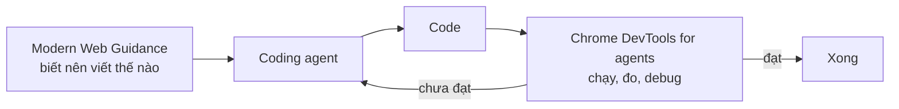

:::tldr
- **Modern Web Guidance (MWG)** là bộ skill cho coding agent, chứa best practice, dữ liệu tương thích trình duyệt (Baseline) và lời khuyên đã được chuyên gia duyệt. Bản **1.0** ra ngày **10/11/2026**.
- Điểm mới: **quy trình modernize** quét codebase có sẵn, **kho guide lớn hơn** nhắm vào hàng trăm lỗ hổng kiến thức của AI, **review kỹ hơn** (có review riêng về accessibility) và **dashboard eval công khai**.
- **Firefox và Edge** tham gia cùng Chrome, nên đây không còn là dự án riêng của Google.
- Cài bằng `npx modern-web-guidance@latest install`, hoặc qua marketplace plugin của Claude Code, Codex, Cursor, Copilot, WebStorm và nhiều agent khác.
- Nên dùng chung với **Chrome DevTools for agents**: MWG giúp agent viết đúng, DevTools giúp agent chạy thử và đo để kiểm chứng.
:::

Coding agent bây giờ viết web khá ổn: bảo làm gì thì thường chạy được. Nhưng đưa code đó cho một người giỏi frontend review, gần như lúc nào họ cũng chỉ ra được chỗ có thể nhanh hơn, dễ tiếp cận hơn (accessible) hoặc an toàn hơn. Modern Web Guidance sinh ra để lấp khoảng trống đó. Bài này tóm tắt từ [bài công bố của Chrome](https://developer.chrome.com/blog/modern-web-guidance-v1) do Philip Walton viết.

## Modern Web Guidance là gì

MWG là một bộ **skill** (tập hướng dẫn mà agent tự nạp khi gặp việc liên quan) gói sẵn ba thứ:

- **Kiến thức về web platform**: dùng HTML, CSS, API nào cho từng việc.
- **Best practice** về accessibility, hiệu năng, bảo mật và trải nghiệm người dùng.
- **Dữ liệu tương thích trình duyệt**, dựa trên [Baseline](https://web.dev/baseline), để agent biết tính năng nào dùng được với mức hỗ trợ trình duyệt mà dự án của bạn yêu cầu.

Bản preview được giới thiệu ở Google I/O tháng 5. Bản 1.0 là bản stable đầu tiên.

## Có gì mới trong 1.0

- **Quy trình modernize mới**: quét codebase có sẵn để tìm chỗ có thể nâng cấp an toàn.
- **Kho guide mở rộng**: nhắm vào hàng trăm lỗ hổng kiến thức của AI đã được xác minh, mỗi guide có giải pháp chạy được trên nhiều trình duyệt.
- **Review kỹ hơn**: mọi guide đều được tech lead của mảng đó duyệt; các guide liên quan đến giao diện người dùng còn được chuyên gia accessibility test bằng công cụ hỗ trợ thật (screen reader, v.v.).
- **Eval đầy đủ**: mọi guide đều có bài đánh giá, kết quả đặt trên [dashboard công khai](https://goo.gle/mwg-evals), so sánh agent có và không có MWG.

Ngoài ra, MWG giờ là dự án **chung của nhiều trình duyệt**: [Firefox và Edge](https://github.com/GoogleChrome/modern-web-guidance-src/blob/main/GOVERNANCE.md#owners) cùng tham gia hỗ trợ, cải thiện độ tương thích và đóng góp guide.

## Cài đặt

Chạy trong thư mục dự án:

```bash
npx modern-web-guidance@latest install
```

Nếu đã cài bản cũ, cập nhật lên 1.0:

```bash
npx modern-web-guidance@latest update
```

Bạn cũng có thể cài qua marketplace plugin của hầu hết các coding agent phổ biến: Claude Code, Codex, Cursor, Antigravity, Copilot, WebStorm, Kimi Code và Grok Build. Chi tiết xem ở [tài liệu chính thức](https://developer.chrome.com/docs/modern-web-guidance).

## Vì sao nên dùng

Khi ai cũng có coding agent, viết code nhanh không còn là lợi thế. Thứ tạo khác biệt là chất lượng: trang có dễ dùng không, có nhanh không, có an toàn không.

### Những best practice mà model hay bỏ sót

Theo [eval của Chrome](https://goo.gle/mwg-evals), model mạnh nhất hiện nay vẫn hụt ở vài mảng:

| Mảng | Ví dụ model hay làm chưa tốt |
| --- | --- |
| Accessibility | Quản lý focus bàn phím và `inert`, tôn trọng reduced-motion, báo lỗi form cho đúng cách |
| Trải nghiệm | Cử chỉ vuốt và chạm, hiệu ứng mở/đóng dialog và popover, giao diện sáng/tối |
| Hiệu năng | Chia nhỏ task trên main thread, tách phần render ngoài màn hình, chống layout shift |
| Bảo mật | Sanitize HTML an toàn, Content Security Policy chặt, quản lý passkey |

Accessibility là mảng đáng lo nhất, vì ARIA dùng sai có thể khiến trang **khó dùng hơn cả không có ARIA**.

### Chọn đúng tính năng cho đúng việc

AI rất giỏi làm cho mọi thứ chạy bằng JavaScript. Nhưng nhiều việc đã có sẵn tính năng HTML hoặc CSS làm được với ít code hơn, chạy nhanh hơn vì trình duyệt tự xử lý, và có sẵn hỗ trợ accessibility. Ví dụ:

- Animate popover và dialog bằng CSS thay vì JS.
- Tương tác theo cuộn và vuốt bằng tính năng có sẵn của trình duyệt.
- Chuyển trang mượt bằng View Transitions.
- **Passkey và WebAuthn** cho đăng nhập nhanh và an toàn hơn.
- **Autofill** cho form thanh toán, thứ hay hỏng khi dùng ô nhập tự làm bằng JS (nhất là trên điện thoại).

Vì guide có sẵn dữ liệu Baseline, agent sẽ đề xuất tính năng phù hợp với mức hỗ trợ trình duyệt bạn cần, không phải lúc nào cũng là thứ mới nhất.

### Modernize codebase cũ

Phần lớn công việc không nằm ở dự án mới mà ở codebase đã tích tụ nhiều năm: workaround lỗi thời, dependency thừa, polyfill không còn cần. Bản 1.0 thêm [quy trình modernize](https://developer.chrome.com/docs/modern-web-guidance/modernization-workflow), phân tích HTML, CSS, JavaScript và `package.json` để tìm chỗ nâng cấp được, rồi hướng dẫn agent sửa:

```text
/modern-web-guidance Modernize the code in this directory
```

Bản đầu tiên dùng **phân tích tĩnh** với một tập mẫu (pattern) giới hạn. Chrome cố ý bắt đầu hẹp để kết quả dễ đoán, sau đó sẽ mở rộng, kể cả kiểu audit mà agent tự đọc và suy luận trên code thay vì chỉ khớp mẫu.

### Cập nhật theo web platform

Mỗi bản trình duyệt mới lại có tính năng mới, và những tính năng trước đây chưa dùng được dần [trở thành Baseline](https://web.dev/baseline#the-baseline-monthly-digest). Vì MWG dựa trên dữ liệu Baseline và được kỹ sư trình duyệt, chuyên gia chuẩn web và chuyên gia accessibility duy trì, lời khuyên sẽ thay đổi theo platform.

### Dùng để tự học

MWG làm cho agent, nhưng nhiều người thấy đọc guide trực tiếp cũng rất có ích. Bạn có thể đọc guide hoặc dùng CLI để tìm theo use case và khám phá kỹ thuật mới cho dự án.

## Kết hợp với Chrome DevTools for agents

Viết code chỉ là một nửa. Agent còn cần chạy code để biết nó có đúng không. Vì vậy Chrome khuyên dùng MWG cùng [Chrome DevTools for agents](https://developer.chrome.com/docs/devtools/agents):



Ba ví dụ trong bài:

- **Tối ưu tới khi đạt mục tiêu hiệu năng.** MWG dạy agent cách chia nhỏ task JavaScript dài, nhưng không đo được task thật sự chặn main thread bao lâu. DevTools chạy performance trace trên CPU giả lập máy yếu, agent lặp lại cho tới khi không task nào chặn main thread quá **50ms** (để không làm xấu INP).
- **Test và tinh chỉnh animation.** MWG chỉ cách animate dialog, tooltip, popover đúng và mượt. DevTools chạy trang, tương tác, quay màn hình rồi xem lại để chắc animation chạy và hợp phong cách trang. Nó cũng kiểm tra được component có tôn trọng `prefers-reduced-motion` không.
- **Cache view mà không rò bộ nhớ.** MWG dạy cách giữ view trong bộ nhớ để chuyển trang SPA tức thì mà vẫn ẩn đúng khỏi accessibility tree. DevTools có công cụ debug bộ nhớ để agent chắc rằng bộ nhớ không tăng mãi khi người dùng ở lâu trên trang.

## Kết quả thực tế

Vài con số từ các công ty đã dùng:

| Công ty | Cách dùng | Kết quả |
| --- | --- | --- |
| Pensionbazaar (Ấn Độ) | MWG + DevTools để xây và kiểm tra trang mới | Thời gian làm giảm **hơn 90%** (từ khoảng 4 ngày xuống vài giờ), lỗi UI giảm **hơn 90%** |
| Policybazaar | DevTools tự động audit hiệu năng khoảng 30 landing page | Giảm **92%** công audit thủ công |
| WeTV (Tencent) | Agent trong CI/CD: DevTools chẩn đoán, MWG sửa | Tự xử lý **90%** lần fail kiểm tra hiệu năng, thời gian sửa giảm **87%** (4 giờ còn 30 phút) |
| note inc. (Nhật) | MWG cùng design system nội bộ trên frontend Next.js | Tỉ lệ pass check web hiện đại từ **61% lên 94%**; ưu tiên ảnh LCP đúng tăng **28%** trên 431 PR |
| MetaMask | MWG làm bot review mỗi pull request, prompt chỉ 3 dòng | 5 tuần review khoảng 480 PR, **43 lỗi** được sửa (chủ yếu accessibility, HTML, form), trung vị **15 phút** từ comment tới fix |

Ví dụ của MetaMask mình thấy đáng thử nhất: không cần đổi cách code của cả team, chỉ thêm một bot review, và nó bắt được loại lỗi mà linter không bắt được.

## Kết

Điều mình thích ở MWG là nó giải đúng chỗ yếu của coding agent: không phải "viết cho chạy" mà là "viết cho đúng cách của web". Model biết nhiều nhưng kiến thức thường cũ hơn trình duyệt, và hay chọn JavaScript khi HTML/CSS đã đủ. Một bộ skill được kỹ sư trình duyệt duy trì, có dữ liệu Baseline và eval công khai là cách hợp lý để kéo agent về gần với cách một người giỏi frontend làm.

Nếu bạn đang dùng coding agent cho dự án web, cài thử một lệnh `npx modern-web-guidance@latest install`, rồi chạy quy trình modernize trên một thư mục nhỏ để xem nó đề xuất gì. Nếu thấy agent còn thiếu kiến thức ở đâu, bạn có thể [đóng góp guide](https://github.com/GoogleChrome/modern-web-guidance-src/blob/main/CONTRIBUTING.md) trên GitHub.
