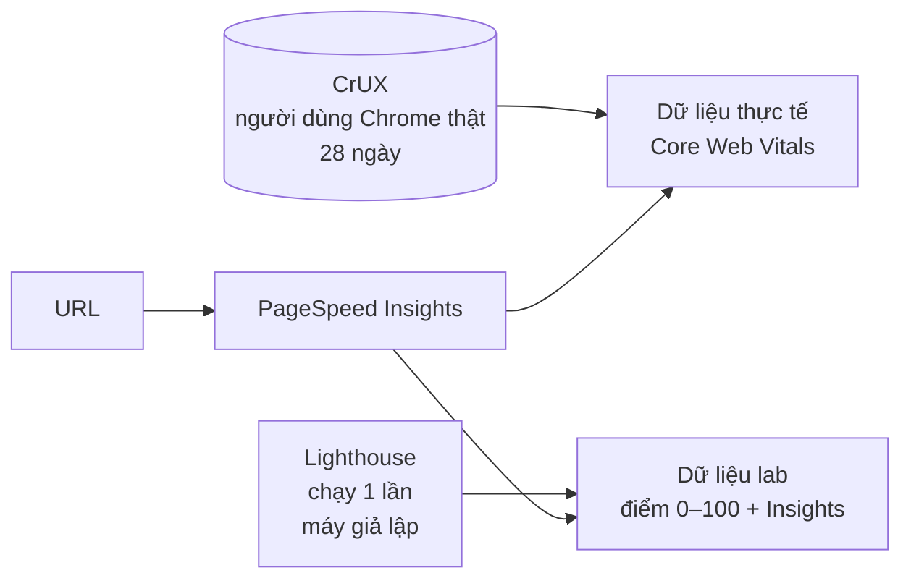

:::tldr
- **[PageSpeed Insights](https://pagespeed.web.dev/) (PSI)** là công cụ miễn phí của Google: dán một URL, nhận báo cáo hiệu năng cho cả mobile và desktop.
- Báo cáo có **hai phần khác bản chất**: dữ liệu **thực tế** từ người dùng Chrome (CrUX, 28 ngày gần nhất) và dữ liệu **lab** từ một lần chạy Lighthouse giả lập.
- **Core Web Vitals** (LCP, INP, CLS) nằm ở phần dữ liệu thực tế, tính ở **phân vị 75**. Đây là phần phản ánh trải nghiệm thật của người đọc.
- **Điểm Performance 0–100** chỉ đến từ lab: trung bình có trọng số của TBT, LCP, CLS, FCP và Speed Index.
- Điểm lab **dao động giữa các lần chạy** và có thể đổi khi Google nâng phiên bản Lighthouse, kể cả khi trang không đổi gì.
- Dùng lab để **tìm lỗi**, dùng dữ liệu thực tế để **biết người dùng có thật sự thấy nhanh** hay không.
:::

Khi nói "trang này được 100 điểm PageSpeed", phần lớn mọi người đang nói về một con số trong lab. Con số đó hữu ích, nhưng nó chỉ là một nửa báo cáo.
Bài này giải thích PageSpeed Insights đo cái gì, lấy dữ liệu từ đâu và nên đọc từng phần ra sao.

## PageSpeed Insights là gì

PageSpeed Insights là trang web tại [pagespeed.web.dev](https://pagespeed.web.dev/). Bạn dán một URL công khai, chọn tab **Mobile** hoặc **Desktop**, và sau khoảng nửa phút sẽ có báo cáo.

PSI không tự đo gì mới. Nó ghép hai nguồn dữ liệu có sẵn của Google vào một trang:



- **Dữ liệu thực tế (field data)** lấy từ Chrome User Experience Report (CrUX): số đo ẩn danh của những người dùng Chrome đã đồng ý chia sẻ, trên đủ loại máy và mạng.
- **Dữ liệu lab** đến từ một lần chạy [Lighthouse](https://developer.chrome.com/docs/lighthouse/) trên máy chủ của Google, trong điều kiện giả lập cố định.

Hai phần này trả lời hai câu hỏi khác nhau, nên đừng trộn chúng với nhau.

## Phần 1: dữ liệu thực tế, "người dùng thật thấy gì"

Phần trên cùng của báo cáo là **"Discover what your real users are experiencing"**. Đây là số đo từ người thật trong **28 ngày gần nhất**, PSI cập nhật hằng ngày.

### Core Web Vitals

Ba chỉ số Core Web Vitals, mỗi cái đo một khía cạnh của trải nghiệm:

| Chỉ số | Đo cái gì | Tốt | Cần cải thiện | Kém |
|---|---|---|---|---|
| **LCP** (Largest Contentful Paint) | Bao lâu thì nội dung chính hiện ra | ≤ 2,5 s | ≤ 4 s | > 4 s |
| **INP** (Interaction to Next Paint) | Trang phản hồi nhanh thế nào khi bấm, gõ | ≤ 200 ms | ≤ 500 ms | > 500 ms |
| **CLS** (Cumulative Layout Shift) | Bố cục có bị xô lệch khi đang đọc không | ≤ 0,1 | ≤ 0,25 | > 0,25 |

PSI còn hiển thị thêm **FCP** (First Contentful Paint, tốt khi ≤ 1,8 s) và **TTFB** (Time to First Byte, tốt khi ≤ 800 ms) để chẩn đoán, nhưng hai chỉ số này không nằm trong Core Web Vitals.

### Vì sao là phân vị 75

Mỗi chỉ số có một thanh ba màu xanh/cam/đỏ cho biết bao nhiêu phần trăm lượt truy cập rơi vào từng mức. Con số lớn hiển thị phía trên là **phân vị 75**: 75% lượt truy cập tốt bằng hoặc hơn giá trị đó.

Google chọn p75 thay vì trung bình để trang phải ổn với **phần lớn** người dùng, kể cả người đang dùng máy yếu hay mạng chập chờn. Trung bình đẹp có thể che đi một phần tư người đọc đang chờ rất lâu.

Trang **đạt Core Web Vitals** khi p75 của cả LCP, INP và CLS đều ở mức Tốt. Nếu chưa đủ dữ liệu INP, chỉ cần LCP và CLS đạt.

### Khi không có dữ liệu thực tế

Trang mới hoặc ít truy cập thường thấy dòng "không đủ dữ liệu". CrUX chỉ có dữ liệu cho URL công khai, được index, và có đủ số mẫu.
Khi URL thiếu dữ liệu, PSI lùi về mức **origin** (gộp mọi trang của domain). Nếu cả origin cũng thiếu, phần này để trống và bạn chỉ còn dữ liệu lab.

:::advanced
### Tab "This URL" và "Origin"

Khi có đủ dữ liệu, PSI cho chuyển giữa **This URL** và **Origin**. Số liệu origin hữu ích khi bạn muốn biết sức khoẻ chung của cả site, còn số liệu URL giúp tìm trang cụ thể đang kéo tụt.
Search Console dùng cùng nguồn CrUX nhưng nhóm các URL giống nhau lại, nên con số ở hai nơi có thể lệch nhau một chút.
:::

## Phần 2: dữ liệu lab, "chẩn đoán vấn đề"

Phần dưới là **"Diagnose performance issues"**: kết quả một lần chạy Lighthouse với bốn vòng tròn **Performance, Accessibility, Best Practices, SEO**. Mỗi vòng có thang: **90–100** tốt (xanh), **50–89** cần cải thiện (cam), **0–49** kém (đỏ).

### Điều kiện giả lập

Ở tab **Mobile**, Lighthouse giả lập một điện thoại tầm trung (báo cáo hiện ghi Moto G Power) trên mạng **Slow 4G** và **làm chậm CPU 4 lần**. Tab Desktop dùng mạng có dây và không làm chậm CPU nhiều như vậy.
Vì thế điểm mobile gần như luôn thấp hơn desktop. Rê chuột vào phần thông tin môi trường ở cuối báo cáo sẽ thấy rõ thiết bị, mạng, vị trí máy chủ và **phiên bản Lighthouse**.

### Điểm Performance được tính thế nào

Điểm Performance là **trung bình có trọng số** của năm chỉ số lab:

| Chỉ số | Trọng số |
|---|---|
| Total Blocking Time (TBT) | 30% |
| Largest Contentful Paint (LCP) | 25% |
| Cumulative Layout Shift (CLS) | 25% |
| First Contentful Paint (FCP) | 10% |
| Speed Index (SI) | 10% |

Vài điều đáng để ý:

- **INP không có trong lab**, vì lab không có ai bấm vào trang. Lighthouse dùng **TBT** (tổng thời gian main thread bị chặn bởi các task dài) làm chỉ số thay thế, và TBT có trọng số lớn nhất. JavaScript nặng là thứ kéo điểm xuống nhanh nhất.
- Mỗi chỉ số được quy ra điểm theo một **đường cong log-normal**, không phải tuyến tính. Đi từ 50 lên 90 dễ hơn nhiều so với từ 95 lên 100.
- Bạn có thể dùng [Lighthouse Scoring Calculator](https://googlechrome.github.io/lighthouse/scorecalc/) để xem cải thiện một chỉ số sẽ đổi điểm bao nhiêu.

### Insights: phần thật sự đáng đọc

Dưới các chỉ số là danh sách **Insights**, ví dụ "LCP breakdown", "Render-blocking requests", "Layout shift culprits", "Improve image delivery".
Từ Lighthouse 13, các mục "Opportunities" và "Diagnostics" cũ đã được gộp vào Insights, dùng chung với panel Performance trong Chrome DevTools.

Insights **không trực tiếp cộng trừ điểm**. Điểm chỉ đến từ năm chỉ số trên. Insights giải thích **vì sao** chỉ số chậm, và PSI sắp xếp chúng theo mức ảnh hưởng ước tính.
Cách đọc hiệu quả: nhìn chỉ số nào đỏ hoặc cam, lọc Insights theo chỉ số đó (nút "Show audits relevant to"), rồi sửa từ mục có ảnh hưởng lớn nhất.

## Vì sao điểm thay đổi dù mình không sửa gì

Đây là câu hỏi phổ biến nhất về PSI. Có vài nguyên nhân:

- **Biến động tự nhiên**: mỗi lần chạy là một lần tải trang thật từ máy chủ của Google, chịu ảnh hưởng của mạng, tải máy, quảng cáo hay script bên thứ ba trả về khác nhau. Lệch vài điểm giữa các lần là bình thường.
- **Máy chủ đo ở khu vực khác nhau**: PSI có thể chạy ở Bắc Mỹ, châu Âu hoặc châu Á. Nếu server của bạn ở xa vùng đó, TTFB sẽ khác.
- **Google nâng phiên bản Lighthouse**: ví dụ Lighthouse 13.6 (cuối tháng 10/2026) chỉnh lại mô hình giả lập Lantern; nhiều trang nặng JavaScript thấy điểm lab nhảy lên mà không sửa dòng code nào.

Vì vậy, khi so sánh trước/sau, hãy chạy vài lần, lấy **trung vị**, và chỉ so các lần chạy **cùng phiên bản Lighthouse**.

## Vì sao lab và thực tế có thể "cãi nhau"

Lab đo **một lần tải**, trên **một máy giả lập**, với **bộ nhớ đệm trống**. Thực tế là hàng nghìn người, với đủ loại thiết bị, mạng, cache đã có sẵn, và họ còn cuộn, bấm, mở menu.

Vài tình huống hay gặp:

- **Lab đỏ, thực tế xanh**: người dùng của bạn phần lớn dùng máy tốt và mạng nhanh hơn điều kiện giả lập, hoặc truy cập lặp lại nên đã có cache.
- **Lab xanh, thực tế đỏ**: vấn đề nằm ở thứ lab không thấy, như INP kém khi người dùng tương tác, layout shift xảy ra khi cuộn, hay quảng cáo chỉ tải với người thật.

Khi hai phần mâu thuẫn, **ưu tiên dữ liệu thực tế**. Đó mới là trải nghiệm của người đọc, và cũng là tín hiệu Google dùng cho Core Web Vitals trong tìm kiếm. Điểm Lighthouse 0–100 thì không phải tín hiệu xếp hạng.

## Dùng PSI hiệu quả

1. **Đọc phần thực tế trước**: trang có đạt Core Web Vitals không, chỉ số nào đang kém.
2. **Dùng lab để tái hiện và tìm nguyên nhân**: lọc Insights theo chỉ số kém, sửa từ mục ảnh hưởng lớn nhất.
3. **Kiểm tra cả mobile**: phần lớn lượt truy cập đến từ điện thoại, và mobile là nơi lộ vấn đề rõ nhất.
4. **Đo lại đúng cách**: chạy nhiều lần, ghi lại phiên bản Lighthouse, và chờ dữ liệu thực tế cập nhật sau 28 ngày.
5. **Tự động hoá khi cần**: PSI có [API miễn phí](https://developers.google.com/speed/docs/insights/v5/get-started), trả về cùng dữ liệu dưới dạng JSON.

:::advanced
### Gọi PSI API từ terminal

```bash
curl -s "https://www.googleapis.com/pagespeedonline/v5/runPagespeed?url=https://buikhuongduy.com/&strategy=mobile" \
  | jq '{
      score: .lighthouseResult.categories.performance.score,
      lighthouse: .lighthouseResult.lighthouseVersion,
      fieldLCP: .loadingExperience.metrics.LARGEST_CONTENTFUL_PAINT_MS.percentile
    }'
```

Không cần API key cho vài lần gọi thử; muốn chạy thường xuyên thì nên tạo key để có hạn mức cao hơn.
Nếu muốn kiểm tra điểm tự động sau mỗi lần push, chạy Lighthouse CI ngay trong pipeline sẽ ổn định hơn gọi PSI, vì bạn kiểm soát được phiên bản Lighthouse và có thể chạy mỗi trang nhiều lần. Mình đã kể cách làm trong [bài về CI dưới 30 giây](/blog/fast-ci-under-30-seconds/).
:::

## Kết

PageSpeed Insights không chỉ là một con số. Phần trên cho biết người dùng thật đang thấy gì, phần dưới giúp bạn tìm ra vì sao.
Điểm 100 trong lab là mục tiêu thú vị (mình đã kể cách đạt nó trong [bài về điểm Lighthouse tuyệt đối](/blog/perfect-lighthouse-score/)), nhưng thứ đáng giữ lâu dài là Core Web Vitals xanh cho người đọc thật.
