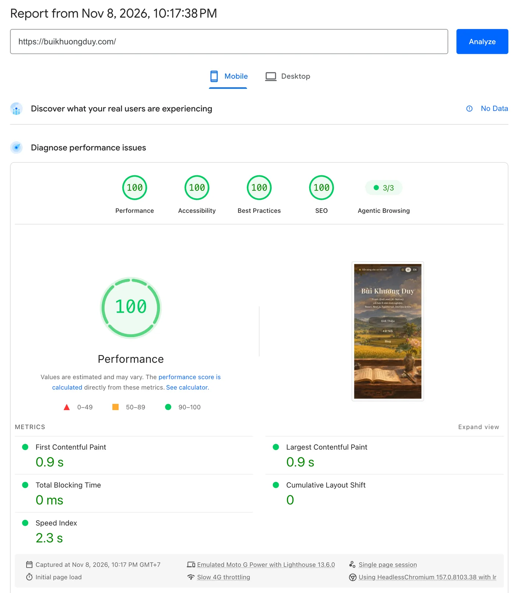
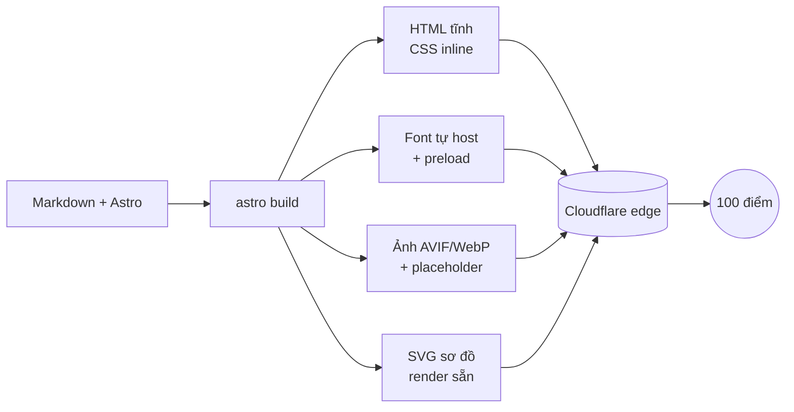

:::tldr
- **100 ở cả bốn nhóm trên mobile**, nơi Lighthouse giả lập mạng Slow 4G và CPU chậm 4 lần: khó hơn desktop rất nhiều.
- **0 KB JavaScript mặc định**: trang là HTML tĩnh, script chỉ xuất hiện ở đúng chỗ cần tương tác.
- **Không còn request chặn render**: CSS được inline, font tự host và preload đúng subset.
- **LCP và Speed Index**: ảnh nền ưu tiên tải sớm, kèm placeholder mờ 24px inline ngay trong HTML.
- **CLS = 0**: font fallback được khớp số đo với font thật, đổi font không làm xô chữ.
- **Mermaid render lúc build**: người đọc nhận SVG sẵn, không tải thư viện vẽ sơ đồ.
- **Accessibility, Best Practices, SEO** đạt 100 nhờ chăm chút từng chi tiết: độ tương phản, `prefers-reduced-motion`, metadata, `hreflang`, JSON-LD.
:::

Điểm 100 Lighthouse không đến từ một mẹo duy nhất. Nó là tổng của nhiều quyết định nhỏ, mỗi cái gỡ đi một thứ trình duyệt phải chờ.
Bài này tóm tắt những gì mình đã làm cho trang này, theo đúng bốn nhóm điểm của Lighthouse.

Đo bằng PageSpeed Insights ở chế độ **mobile**, mô phỏng Moto G Power với mạng Slow 4G (Lighthouse 13.6.0): FCP **0,9 s**, LCP **0,9 s**, Total Blocking Time **0 ms**, CLS **0**, Speed Index **2,3 s**. [Xem báo cáo gốc trên PageSpeed Insights](https://pagespeed.web.dev/analysis/https-buikhuongduy-com/x7i018oiwk?form_factor=mobile).

## Vì sao 100 trên mobile là một thử thách

Đạt 100 trên desktop không quá hiếm. Mobile thì khác hẳn: Lighthouse giả lập một chiếc điện thoại tầm trung trên mạng **Slow 4G** (độ trễ khoảng 150 ms, băng thông khoảng 1,6 Mbps) và **làm chậm CPU 4 lần**.
Trong điều kiện đó, mỗi KB tải về, mỗi request chặn render và mỗi mili giây chạy JavaScript đều bị phóng đại. Nhiều trang đạt 95+ trên desktop tụt xuống vùng cam khi chuyển sang mobile.

Thang điểm cũng không tuyến tính. Từ 90 lên 99 đã khó, nhưng 100 tròn đòi hỏi **mọi chỉ số** cùng lúc nằm sát mức tốt nhất. Chỉ cần một chỗ hụt, như font đổi muộn làm CLS nhích lên hay một script nhỏ chiếm main thread, là điểm rơi xuống 98, 99.

Trang chủ của mình còn có sẵn đủ thứ thường làm mất điểm: **ảnh nền toàn màn hình** làm phần tử LCP, **hai họ font có dấu tiếng Việt**, animation mở đầu, và view transition giữa các trang.
Mình không bỏ cái nào. Thay vào đó, mình tối ưu từng thứ cho tới khi cả bốn vòng tròn cùng xanh 100 trên mobile, với **Total Blocking Time 0 ms** và **CLS 0** dù CPU bị làm chậm 4 lần.

## 1. Performance: bớt mọi thứ trình duyệt phải chờ

### HTML tĩnh, JavaScript chỉ khi cần

Trang được dựng bằng Astro, render toàn bộ ra HTML lúc build. Không có framework nào phải hydrate.
Những chỗ tương tác như chuyển chế độ đọc hay trình xem sơ đồ là script nhỏ, và chỉ được nhúng vào trang thật sự dùng tới.

### Gỡ request chặn render

CSS của site nhỏ, nên mình bật `build.inlineStylesheets: 'always'`. Trình duyệt có đủ style ngay trong HTML đầu tiên, không phải mở thêm kết nối để tải file `.css` trước khi vẽ.

### Font: tự host, preload đúng chỗ, không layout shift

Font tiếng Việt là cái bẫy kinh điển: tải từ CDN bên ngoài tốn thêm DNS + TLS, tải cả bộ thì nặng, còn đổi font muộn thì chữ nhảy.
Mình dùng Astro Fonts API để:

- tự host font, phục vụ cùng domain với trang;
- chỉ lấy đúng các weight và subset cần (`latin`, `latin-ext`, `vietnamese`);
- preload riêng subset `latin` và `vietnamese` cho chữ hiển thị đầu tiên;
- sinh font fallback **khớp số đo** với font thật, nên lúc font thật tải xong, dòng chữ không đổi kích thước.

:::advanced
### Bài học: build xanh chưa chắc preload đã chạy

Lần đầu, mình khai báo preload với bộ lọc không khớp file font thực tế. Build vẫn thành công, không cảnh báo gì, nhưng thẻ `<link rel="preload">` cho Be Vietnam Pro không hề xuất hiện.
Chỉ khi mở HTML trong `dist/` ra soi mới thấy. Từ đó, mỗi thay đổi về font mình đều kiểm tra HTML sau build, không tin vào cấu hình.
:::

### Ảnh LCP: ưu tiên tải và có thứ để nhìn ngay

Ảnh nền trang chủ là phần tử LCP, nên nó được:

- xuất ra **AVIF/WebP** với nhiều kích thước, trình duyệt tự chọn bản vừa màn hình;
- đánh dấu `loading="eager"` và `fetchpriority="high"`;
- đi kèm một **placeholder 24px** đã làm mờ, nhúng thẳng vào HTML dưới dạng base64 (vài trăm byte).

Placeholder giúp khung hình đầu tiên đã có bố cục và màu sắc của ảnh thật thay vì một mảng màu phẳng, kéo Speed Index xuống rõ rệt.

### Animation không được làm chậm điểm số

Lighthouse đo cả thời điểm trang "đứng yên" về mặt hình ảnh. Mình rút ngắn animation mở đầu và độ trễ giữa các phần tử.
Huy hiệu "open to work" trước đây chờ sự kiện `load` của cả trang rồi mới hiện bằng JavaScript. Mình thay bằng một `animation-delay` thuần CSS: vẫn hiện sau cùng để gây chú ý, nhưng không còn phụ thuộc vào ảnh nặng nhất tải xong, và bớt được một đoạn script.

### Sơ đồ Mermaid render lúc build

Mermaid là thư viện lớn. Tải nó về trình duyệt chỉ để vẽ vài sơ đồ là lãng phí.
Mình viết một remark plugin dùng `mermaid-isomorphic` để render sơ đồ ra SVG ngay lúc build, với đúng bảng màu của site. Người đọc nhận SVG sẵn trong HTML, không tải runtime nào.

:::advanced
### Giữ sơ đồ build-time trông giống hệt runtime

Mermaid đo kích thước chữ để vẽ khung. Nếu lúc build đo bằng font khác với font hiển thị, chữ sẽ tràn hoặc hụt khung.
Plugin nạp đúng font Be Vietnam Pro vào trình duyệt headless trước khi render, và dùng Chrome có sẵn trên máy (kể cả runner GitHub Actions) nên không phải tải thêm trình duyệt khi build.
Trình xem sơ đồ phóng to chỉ được nhúng vào bài có sơ đồ, nhờ một cờ do plugin gắn vào frontmatter.
:::

### Phục vụ từ edge

Site được build và deploy lên Cloudflare Pages qua GitHub Actions. HTML tĩnh nằm sẵn ở edge, gần người đọc, TTFB thấp mà không cần tối ưu server.

## 2. Accessibility: thứ dễ mất điểm nhất

- **Độ tương phản**: vài dòng chữ phụ dùng màu quá nhạt. Lighthouse bắt được, mình tăng độ đậm cho đạt ngưỡng WCAG.
- **Tôn trọng `prefers-reduced-motion`**: hiệu ứng click, view transition và animation đều tắt khi người dùng bật giảm chuyển động.
- **Phần tử trang trí** được gắn `aria-hidden`, ảnh nền dùng `alt=""` để trình đọc màn hình bỏ qua.
- **Thao tác bằng bàn phím**: sơ đồ có nút phóng to riêng, không chỉ dựa vào click chuột.
- **Ngôn ngữ trang** được khai báo đúng trong `<html lang>` cho từng bản vi/en.

## 3. Best Practices: không có gì thừa

Không script bên thứ ba, không tracker, không iframe quảng cáo. Mọi thứ phục vụ qua HTTPS, cùng domain, và console sạch lỗi.
Form góp ý cuối bài dùng `mailto:`, nên không cần backend hay dịch vụ ngoài.

## 4. SEO: để máy hiểu trang

- `description`, `canonical` và Open Graph cho từng trang; mỗi bài có **ảnh OG riêng** sinh lúc build bằng Satori + resvg.
- **Song ngữ chuẩn**: cặp `hreflang` cho vi/en kể cả khi slug khác nhau (`/gioi-thieu/` ↔ `/en/about/`), có `x-default`.
- `sitemap`, `robots.txt` và dữ liệu có cấu trúc **JSON-LD** (`ProfilePage`, `BlogPosting`).
- Thêm `llms.txt` để các mô hình ngôn ngữ cũng đọc được tóm tắt về site.

## Kết

Không có bước nào ở trên phức tạp. Cái khó là làm đủ, và kiểm tra lại bằng kết quả build thật thay vì tin vào cấu hình.

Đây mới là bản tóm tắt. Bản đầy đủ gồm cấu hình chi tiết, số đo trước/sau từng bước và checklist mình dùng cho mỗi lần deploy.
Nếu bạn muốn xem bản đó, hoặc cần một người mang tư duy hiệu năng và chất lượng này vào sản phẩm của bạn: **mình đang sẵn sàng cho cơ hội mới**.

[Liên hệ với mình](/lien-he/), mình rất vui được trao đổi.
