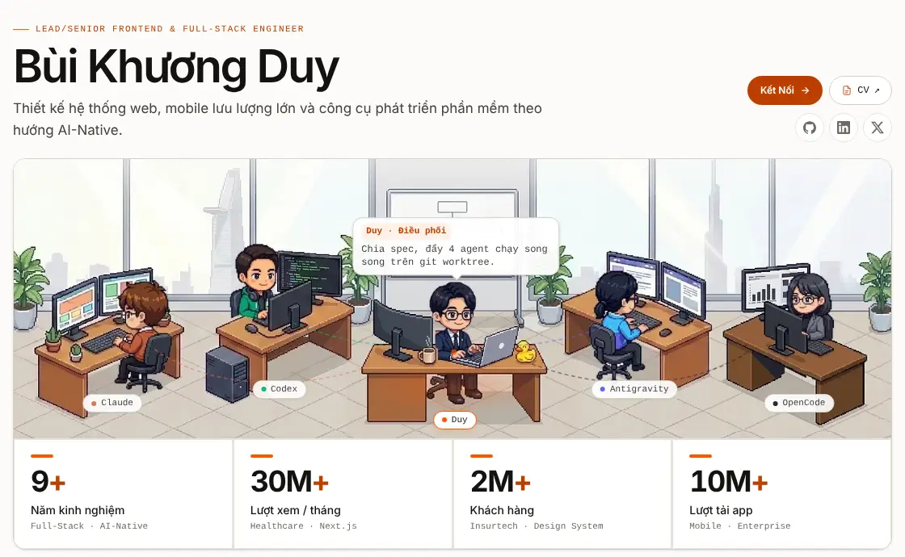

:::tldr
- Từ 26 đến 28/11/2026, mình làm lại gần như toàn bộ trang này: **danh xưng mới**, **giao diện mới**, **SEO** và một loạt sửa lỗi hiệu năng, accessibility. Tổng cộng **10 PR** cùng vài commit UI lớn.
- Cách làm: mỗi việc là một thread riêng với **Claude Code**, agent viết code và mở PR, mình đọc diff rồi merge. **Lighthouse CI** chặn mọi PR làm tụt điểm dưới 100.
- Bài học lớn nhất: CI xanh 100 chưa chắc PageSpeed thật cũng 100. Ở production mình bị kẹt ở **99** nhiều lần, và mỗi lần nguyên nhân lại khác.
- Mình bỏ hẳn web font để chuyển sang **font hệ thống**. LCP mobile giảm từ khoảng **1,9 s** xuống **1,3 s** trong lab.
- Hiện tại PageSpeed mobile thật vẫn **99**. Thủ phạm còn lại là beacon Cloudflare Web Analytics được chèn tự động ở edge.
:::

Tháng 11 này mình đang tìm việc mới, nên trang cá nhân là thứ nhà tuyển dụng thấy đầu tiên. Đọc lại nó, mình thấy ba vấn đề.

Danh xưng không thống nhất. Trang ghi "Front-End Lead (AI-Native)", CV ghi khác, GitHub lại ghi "Front-end developer". Trang chủ chưa có phần dự án, cũng không có link LinkedIn hay GitHub nào dễ thấy. Và mình muốn ứng tuyển cả vị trí Frontend lẫn Full-Stack, nên câu giới thiệu cũ không còn đúng.

Thế là mình làm lại. Bài này kể lại theo đúng thứ tự đã xảy ra, kèm số đo trong từng PR.



## Mình làm việc với agent thế nào

Mình viết về [AI-Native](/blog/what-is-ai-native/) khá nhiều, nên lần này muốn làm đúng như mình nói.

Mỗi việc là một thread riêng với Claude Code chạy trên cloud. Mình mô tả vấn đề, agent đọc code, sửa, tự đo Lighthouse trên máy của nó rồi mở PR. PR nào cũng có phần "Cause", "Fix" và số đo trước/sau. Mình đọc diff, hỏi lại nếu thấy lạ, rồi merge.

Phần giao diện lớn thì mình làm trên máy, chạy nhiều agent song song trên các git worktree khác nhau. Đây cũng là lý do mình làm [KD Code](/blog/why-i-built-kd-code/).

Cái giữ cho mọi thứ không vỡ là CI. Workflow trên GitHub Actions có một job Lighthouse chạy trên 7 trang, và mọi category phải đạt đúng 1:

```js
// lighthouserc.cjs
'categories:performance': ['error', { minScore: 1, aggregationMethod: 'optimistic' }],
'categories:accessibility': ['error', { minScore: 1 }],
'categories:best-practices': ['error', { minScore: 1 }],
'categories:seo': ['error', { minScore: 1 }],
'categories:agentic-browsing': ['error', { minScore: 1 }],
```

Agent có thể viết code nhanh hơn mình. Nhưng nó cũng có thể làm tụt điểm mà không ai để ý. Ngưỡng 100 cứng trong CI là cách mình giao việc mà không phải ngồi canh.

## Ngày 1: đổi danh xưng và SEO

PR đầu tiên (#1) chỉ đổi chữ. Câu giới thiệu thành **"Lead/Senior Frontend Engineer & Full-Stack Developer (AI-Native)"**, áp dụng cho hero, `<title>`, `og:title`, mô tả trang, JSON-LD, phần About và cả câu hỏi trong mini game tuyển dụng. Song song hai bản vi và en.

PR thứ hai (#2) dọn phần mà người dùng không thấy nhưng Google và mạng xã hội thấy:

- Ảnh OG vẫn ghi danh xưng cũ. Agent vẽ lại phần chữ bên trái với cùng bố cục và màu.
- Mô tả trang chủ dài 204 ký tự, trang About 183. Google cắt ở khoảng 155–160. Giờ cả hai ngôn ngữ nằm trong khoảng 141–147 ký tự.
- JSON-LD `Person` có thêm nơi sống, các công ty đã làm và link tới file CV.

Hai PR này không có gì khó. Mình ghi lại vì đây là chỗ nhiều người bỏ qua: đổi tiêu đề trên giao diện mà quên ảnh OG và structured data.

## Ngày 2–3: giao diện mới

Đây là phần mình thích nhất. Trang có bảng màu cam mới, thanh điều hướng cho mobile, và một hero hoàn toàn khác: **văn phòng pixel art**.

Ở giữa là mình ngồi bàn "điều phối". Xung quanh là 4 bàn của 4 agent mình dùng hằng ngày: Claude, Codex, Antigravity và OpenCode. Mỗi bàn có một đường tín hiệu nối về bàn mình, và một bong bóng thoại kể agent đó đang làm gì. Ví dụ "Chia spec, đẩy 4 agent chạy song song trên git worktree". Bấm vào bàn nào thì bong bóng nhảy sang bàn đó. Trên mobile có thêm hàng nút để chọn trạm.

Mình muốn người xem hiểu cách mình làm việc trong 3 giây đầu, trước khi đọc chữ nào.

Ngoài hero còn có:

- Timeline kinh nghiệm dạng tab.
- Lưới công nghệ `duy.stack.ts` với 28 công nghệ, chia theo vòng Adopt, Trial, Assess. Bấm "Radar" để xem dạng Tech Radar.
- Phần dự án với ảnh GIF pixel và nhiều link cho mỗi dự án (store, mã nguồn, marketplace).
- Một mini game nhỏ cho nhà tuyển dụng tự kiểm tra mình có hợp team họ không.
- Nút đổi theme có hiệu ứng lan ra hình tròn từ chỗ bấm.

Toàn bộ là Astro, render ra HTML tĩnh. JavaScript chỉ có ở những chỗ thật sự tương tác.

## Cuộc đuổi theo điểm 100

Mọi PR đều qua CI với 100 điểm. Rồi mình mở [PageSpeed Insights](/blog/pagespeed-insights-explained/) cho production và thấy **99** trên mobile. Vài lần chạy còn ra 98.

Một điểm thôi, nhưng trang này từng có [100/100/100/100](/blog/perfect-lighthouse-score/), và mình đang dùng chính nó để chứng minh mình làm hiệu năng được. Nên mình đuổi theo nó.

### Lần 1: font

Phần tử LCP là ảnh nền văn phòng pixel. Lighthouse cho thấy nó phải chờ **6 file woff2** của Be Vietnam Pro và JetBrains Mono. LCP mô phỏng là 2,0 s.

Agent thử bốn cách trước khi đụng tới font:

- Preload ảnh hero kèm `fetchpriority="high"`: không đổi được bao nhiêu.
- Ảnh hero nhỏ hơn cho mobile: vẫn chờ font.
- Bỏ riêng font mono: chưa đủ.
- Hoãn tải font tới sau `load`: LCP xuống 1,2 s, nhưng lúc font đổi, trình duyệt dựng lại layout và TBT nhảy lên **178 ms**.

Trước đó mình cũng đã thấy font là điểm nghẽn: chỉ cần thêm một weight hay một subset là trang chủ rơi xuống 0,98.

Cuối cùng mình chọn bỏ web font, dùng font hệ thống (#3). Trang không còn request font nào. LCP trong lab còn **1,28–1,36 s**, và cả 6 lần chạy đều ra 100.

Quyết định này là của mình, agent chỉ đưa ra số đo. Be Vietnam Pro đẹp, mình tiếc. Nhưng với một trang portfolio của người làm frontend, điểm hiệu năng nói nhiều hơn một font chữ.

### Lần 2: ảnh poster

Vẫn 99, LCP 1,9 s. Ảnh LCP trên mobile là poster 960px của văn phòng. Agent nén lại từ bản gốc 1376px ở WebP quality 65 (#6):

| | Trước | Sau |
| --- | --- | --- |
| Poster sáng | 43,6 KB | 31,4 KB |
| Poster tối | 30,6 KB | 20,2 KB |

Với pixel art, mắt mình không thấy khác biệt khi phóng to so sánh. LCP mô phỏng giảm từ khoảng 1,66 s xuống 1,51 s.

### Lần 3: Google Analytics

Vẫn 99 trên production, trong khi local và CI đều 100. Khác nhau ở đâu?

Hoá ra CI dùng một GA ID giả, không tải gì thật. Production thì tải `gtag.js` thật. Partytown chèn snippet vào `<head>`, khởi động ở `DOMContentLoaded`, rồi tải ngay service worker, iframe sandbox và `gtag.js`. Tất cả tranh băng thông với ảnh poster. Mà Lighthouse tính mọi request bắt đầu trước LCP vào LCP mô phỏng.

Sửa ở #7: chỉ khởi động Partytown sau sự kiện `load` cộng `requestIdleCallback`. GA vẫn chạy trong worker như cũ, chỉ là đến muộn hơn một chút.

:::advanced
### Thay integration chính thức bằng một integration nhỏ

`@astrojs/partytown` luôn chèn snippet vào `<head>`, không có tuỳ chọn để hoãn. Nên agent thay nó bằng một integration tự viết chỉ làm một việc: copy các file lib của Partytown vào `/~partytown/`, dùng đúng hàm `copyLibFiles` mà bản chính thức gọi.

Snippet được dựng lại bằng `partytownSnippet()` trong `Analytics.astro`, kèm script giữ iframe sống qua các lần chuyển trang của `ClientRouter`. Nó được append sau `load` + `requestIdleCallback` (timeout 3 s), có cờ để chỉ khởi động một lần.

Kiểm tra: request tới sandbox của Partytown giờ bắt đầu sau `loadEventEnd`, và cả hai script GA đều có `type="text/partytown-x"`. Chuyện vì sao thêm GA mà điểm không đổi thì mình đã viết riêng trong [bài về gtag](/blog/why-gtag-did-not-lower-lighthouse-score/).
:::

### Lần 4: làm nhẹ trang chủ

Vẫn LCP khoảng 1,8 s. Lần này agent tìm mọi thứ tải cùng lúc với ảnh hero và cắt bớt (#9):

1. **Tech Radar dựng khi cần.** Radar bị ẩn tới khi ai đó bấm "Radar", vậy mà 28 nút blip của nó vẫn nằm sẵn trong HTML. Giờ chúng được clone từ lưới công nghệ ở lần mở đầu tiên.
2. **Tách CSS của bài viết.** Phần CSS cho prose, code block, Mermaid, chế độ đọc chuyển sang `content.css`, chỉ trang bài viết mới nhúng. Trang chủ không còn phải inline nó.
3. **Inline các chunk JS nhỏ.** `assetsInlineLimit` cho file `.js` tới 8 KB, áp cho script của mascot và command palette. Bớt 2 request tranh băng thông với ảnh hero.

HTML trang chủ còn 66,0 KB gzip (từ 68,7 KB), LCP mô phỏng 1,35–1,5 s.

## Accessibility: những lỗi nhỏ mà Lighthouse bắt được

Song song với hiệu năng là một loạt lỗi accessibility. Lỗi nào cũng nhỏ, nhưng lỗi nào cũng làm mất điểm.

**Bong bóng thoại che đầu mình (#4).** Trên mobile, lần tải đầu tiên bong bóng nằm đè lên mặt mình thay vì phía trên. Nguyên nhân là vị trí server render bị cố định bằng `translate3d(-50%, 3.5rem, 0)`, còn JavaScript lại bỏ qua việc cập nhật khi trạm của mình đang được chọn. Giờ vị trí đầu tiên được tính bằng CSS từ điểm neo trên đầu mình, khớp với công thức của JS. Không cần JS, không có layout shift.

**`role="tabpanel"` đặt trên `<article>` (#5).** ARIA không cho phép điều đó, và Lighthouse mới có thêm nhóm **Agentic Browsing** bắt đúng lỗi này. Đổi thành `<div>` là xong. Mình thêm luôn `categories:agentic-browsing` vào CI để lần sau không lọt.

**Tên công nghệ bị cắt (#8).** Trên tablet và mobile, lưới công nghệ hiện "TypeScri…", "Kubernet…", "Anti…". Agent ẩn chữ của vòng (chỉ giữ chấm màu, chữ vẫn còn cho screen reader), cho tên xuống tối đa 2 dòng, và dùng 1 cột cho màn hình dưới 400px.

**Hai link cùng tên "GitHub" (#10).** Link mã nguồn Simple OTP và link GitHub cá nhân cùng hiện "GitHub" nhưng trỏ hai nơi khác nhau. Thêm `aria-label` "Mã nguồn Simple OTP trên GitHub", chữ hiển thị giữ nguyên.

Thêm một cái bẫy mình gặp khi làm hiệu ứng hiện dần: thẻ nào đang chờ animation phải giữ `opacity: 0` hẳn. Nếu để mờ một nửa, axe sẽ đo độ tương phản đúng lúc đó và báo lỗi.

## Chỗ mình vẫn đang kẹt

Sau 10 PR, Lighthouse local không có beacon ra 100. PageSpeed mobile thật vẫn **99**, LCP 1,8 s.

Thứ còn lại tải trước LCP là `ClientRouter` của Astro và beacon của **Cloudflare Web Analytics**. Beacon này không nằm trong code của mình. Cloudflare tự chèn nó vào HTML ở edge, nên CI không bao giờ thấy.

Hướng sửa là tắt chèn tự động, rồi tự tải beacon sau `load` giống cách đã làm với GA. Mình chưa làm vì nó đụng tới cấu hình Cloudflare, và mình muốn chắc là số liệu analytics không bị hụt. Khi nào xong mình sẽ cập nhật bài này.

## Mình rút ra được gì

**CI 100 chỉ là điều kiện cần.** Lab của CI không có GA thật, không có beacon của Cloudflare, không có header của edge. Nó bắt được lỗi do code của mình, nhưng không bắt được thứ được thêm vào sau khi build. Giờ mình luôn kiểm tra lại bằng PageSpeed trên production sau mỗi lần deploy.

**Đo trước, sửa sau.** Không PR nào ở trên đoán mò. Mỗi PR đều có nguyên nhân cụ thể, số trước và sau, và cả những cách đã thử mà không ăn thua. Agent làm việc này rất tốt nếu mình yêu cầu ngay từ đầu.

**Agent gõ code, mình chịu trách nhiệm.** Agent tìm ra 6 file font đang chặn LCP. Còn bỏ font nào, chấp nhận đánh đổi gì, và khi nào dừng lại ở 99 thì vẫn là mình quyết. Với mình, làm việc kiểu AI-Native nghĩa là vậy: ít thời gian gõ hơn, nhiều thời gian đọc diff và ra quyết định hơn.

Ba ngày, 10 PR, một trang mới mà mình thấy đúng là mình hơn. Nếu team bạn cần một người làm frontend hoặc full-stack, quan tâm tới hiệu năng và quen làm việc cùng AI agent: **mình đang tìm cơ hội mới**. [Kết nối với mình](/contact/) nhé.
