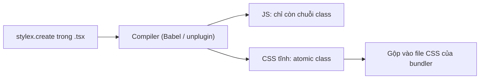

:::tldr
- **StyleX** ([stylexjs.com](https://stylexjs.com/), repo [meta/stylex](https://github.com/meta/stylex)) là thư viện styling mã nguồn mở của Meta, giấy phép MIT, hơn 10.000 sao GitHub. Bản mới nhất là **0.19.2** (12/11/2026).
- Bạn viết style bằng object trong JavaScript (`stylex.create`), **compiler chuyển chúng thành atomic CSS tĩnh lúc build**. Lúc chạy không chèn `<style>` nào, chỉ còn một hàm gộp class rất nhỏ.
- Quy tắc đơn giản: **style áp sau cùng thắng** cho cùng một thuộc tính, không phải nghĩ về specificity. Style truyền qua props được, nên component có style mặc định mà vẫn cho người dùng override.
- Theme bằng `defineVars` + `createTheme` (CSS custom property có type). Selector theo trạng thái cha hoặc anh em bằng `stylex.when.*`.
- Mình thử: app Vite + React có theme, override và style động, cả CSS chỉ **1,47 KB (0,59 KB gzip)**, StyleX cộng thêm khoảng **1,3 KB gzip** JS so với app React trống. Đổi lại phải cài plugin cho bundler, và prop `sx` mới chưa có type sẵn cho TypeScript.
:::

Ai viết React đủ lâu cũng từng đi qua vài vòng: CSS thường rồi đụng độ tên class, CSS Modules rồi khó truyền style từ ngoài vào, styled-components rồi trả giá runtime, Tailwind rồi chuỗi class dài cả dòng. **StyleX** là câu trả lời của Meta cho cùng bài toán đó ở quy mô Facebook.com.

Trước đây mình chỉ biết StyleX qua tên, cho tới khi viết bài về [Astryx](/blog/astryx-design-system/), design system của Meta dựng trên StyleX. Lần này mình đọc kỹ [docs](https://stylexjs.com/docs/learn), bài [StyleX: A Styling Library for CSS at Scale](https://engineering.fb.com/2025/11/11/web/stylex-a-styling-library-for-css-at-scale/) trên blog kỹ thuật của Meta, [release notes](https://github.com/meta/stylex/releases) và tự dựng một app nhỏ để xem nó thật sự sinh ra gì.

## StyleX ra đời từ đâu

Theo bài viết của Meta, CSS ở quy mô của họ gặp đủ thứ vấn đề: class đụng nhau giữa các bundle, khó quản lý phụ thuộc giữa các stylesheet, "chiến tranh specificity" dẫn tới selector phức tạp và `!important` khắp nơi, còn bundle CSS khổng lồ khiến trình duyệt tải hàng trăm KB rule không dùng tới.

Khi viết lại Facebook.com, Meta muốn giữ những thứ hay của CSS-in-JS (style nằm cạnh component, style theo state, có type, đi theo import graph) nhưng bỏ cái giá runtime của thế hệ đầu, vốn sinh thẻ `<style>` và sửa DOM ngay lúc render. Kết quả là một hệ thống **"CSS-in-JS chỉ về hình thức"**: viết trong JS, nhưng compile ra CSS tĩnh. Meta cho biết atomic CSS giúp giảm khoảng **80% kích thước CSS**.

StyleX mở mã nguồn cuối năm 2023, đến nay là hệ thống styling mặc định trên Facebook, Instagram, WhatsApp, Messenger, Threads và được dùng ở cả Figma, Snowflake.

## Ý tưởng cốt lõi: atomic CSS sinh lúc build

Mỗi cặp `thuộc tính: giá trị` trở thành **một class chỉ chứa đúng một khai báo**. Hai component cùng viết `padding: 16px` sẽ dùng chung một class, nên dự án càng lớn thì CSS càng ít tăng thêm, rồi gần như đi ngang.

```tsx
import * as stylex from "@stylexjs/stylex";

const styles = stylex.create({
  root: { padding: 16, borderRadius: 12 },
  active: { backgroundColor: "#0866ff" },
});

function Item({ isActive }: { isActive: boolean }) {
  return <div {...stylex.props(styles.root, isActive && styles.active)} />;
}
```

Sau khi build, `stylex.create` biến mất. Với style dùng trong cùng file, compiler tính sẵn luôn chuỗi class:

```tsx
// Kết quả thật trong bundle mình build
className: "xrvj5dj xou54vl xggk2y7"
```

```css
.xrvj5dj { display: grid; }
.xou54vl { gap: 16px; }
.xggk2y7 { padding: 24px; }
```

Chỉ khi style đi qua ranh giới component (ví dụ prop `style` từ ngoài truyền vào) thì `stylex.props` mới chạy lúc runtime để gộp class. Hàm này rất nhỏ.



## Những API cần biết

| API | Dùng để |
| --- | --- |
| `stylex.create` | Định nghĩa style, có pseudo-class, media query, style động dạng hàm |
| `stylex.props` | Gộp style thành `{ className, style }` để spread vào element |
| `sx={...}` | Viết tắt của `stylex.props` trên thẻ HTML (mới, compiler xử lý) |
| `stylex.defineVars` / `createTheme` | Token thành CSS custom property, theme ghi đè cho một nhánh cây |
| `stylex.defineConsts` | Hằng số, được inline lúc build, không sinh biến CSS |
| `stylex.when.*` | Style theo trạng thái của cha, con hoặc anh em (`:hover`, `[data-state]`...) |
| `stylex.keyframes`, `viewTransitionClass`, `positionTry` | Animation, View Transitions, anchor positioning |
| `@stylexjs/atoms` | Style inline kiểu utility: `x.display.flex`, `x.padding._16px` |

### Giá trị theo điều kiện nằm ngay trong thuộc tính

Thay vì viết một khối `:hover` hay `@media` riêng, StyleX đặt điều kiện **bên trong từng thuộc tính**:

```tsx
const styles = stylex.create({
  card: {
    borderColor: { default: "#ddd", ":hover": colors.accent },
    maxWidth: { default: 320, "@media (min-width: 768px)": 480 },
  },
});
```

Nhìn một thuộc tính là biết hết các trường hợp của nó. Ban đầu mình thấy hơi dài, nhưng khi đọc lại code thì rõ ràng hơn hẳn so với việc lục từng khối media query.

### Style truyền qua props, cái sau thắng

Đây là điểm mình thích nhất. Component nhận style từ ngoài, đặt nó **sau cùng** trong `stylex.props`, vậy là người dùng override được mà không cần tăng specificity hay `!important`:

```tsx
import * as stylex from "@stylexjs/stylex";
import type { StyleXStyles } from "@stylexjs/stylex";

export function Card({ style }: { style?: StyleXStyles }) {
  return <article {...stylex.props(styles.card, style)} />;
}

// Nơi dùng
<Card style={overrides.wide} />;
```

Dùng `StyleXStyles<{ ... }>` hoặc `StyleXStylesWithout<{ ... }>` để giới hạn thuộc tính nào được phép override, ví dụ chỉ cho đổi màu chứ không cho đổi layout.

### Theme bằng biến CSS có type

Token khai báo trong file `.stylex.ts` (bắt buộc đuôi này, dạng named export):

```ts
// tokens.stylex.ts
import * as stylex from "@stylexjs/stylex";

export const colors = stylex.defineVars({
  bg: "white",
  text: "#111",
  accent: "#0866ff",
});
```

Rồi tạo theme và áp cho một nhánh cây:

```tsx
const dark = stylex.createTheme(colors, { bg: "#111", text: "#eee", accent: "#7cb4ff" });

<div {...stylex.props(dark)}>
  <Card />
</div>;
```

Compiler sinh ra biến CSS có tên băm, xác định từ đường dẫn file và tên biến, nên không bao giờ trùng giữa các package.

:::advanced
### `stylex.when` và marker

StyleX cấm "style từ xa": không có selector kiểu `.parent .child`. Muốn đổi style con khi cha được hover, bạn đánh dấu cha bằng marker và khai báo điều kiện ngay trên con:

```tsx
const styles = stylex.create({
  title: {
    color: { default: colors.text, [stylex.when.ancestor(":hover")]: colors.accent },
  },
});

<article {...stylex.props(styles.card, stylex.defaultMarker())}>
  <h2 {...stylex.props(styles.title)}>...</h2>
</article>;
```

Compiler sinh ra `.x4dk5e8:where(.x-default-marker:hover *)`. Ngoài `ancestor` còn có `descendant`, `siblingBefore`, `siblingAfter`, `anySibling`, và quan sát được cả selector thuộc tính như `[data-state="open"]`. Cần nhiều nhóm độc lập (ví dụ hover hàng và hover ô trong bảng) thì dùng `stylex.defineMarker()`. Lưu ý: `descendant`, `siblingAfter`, `anySibling` dựa vào `:has()`.

### Cascade layer hay specificity hack

Mặc định, StyleX đảm bảo thứ tự ưu tiên (ví dụ `marginTop` thắng `margin`) bằng cách lặp `:not(#\#)` để tăng specificity. Bật `useCSSLayers: true` thì nó dùng `@layer priority1, priority2...` thay thế, CSS gọn hơn (trong app thử của mình giảm từ 1,77 KB xuống 1,47 KB) và **CSS ngoài layer luôn thắng StyleX**. Nếu dự án có reset, Tailwind hay design system dùng layer riêng, truyền `{ before, after, prefix }` để xếp thứ tự layer cho rõ ràng.
:::

## Cài vào dự án

Cách nhanh nhất là tạo dự án mới từ template chính thức:

```bash
npm create @stylexjs my-app -- --framework vite-react
```

Có 13 template: Next.js, Vite + React, Vite + RSC, React Router, Waku, RedwoodSDK, Webpack, Rspack, Rollup, esbuild, Storybook... Với dự án có sẵn, từ bản 0.17 StyleX có `@stylexjs/unplugin` dùng chung cho Vite, Rollup, Webpack, Rspack, esbuild và Bun:

```bash
npm install @stylexjs/stylex
npm install -D @stylexjs/unplugin @stylexjs/eslint-plugin
```

```ts
// vite.config.ts
import { defineConfig } from "vite";
import react from "@vitejs/plugin-react";
import stylex from "@stylexjs/unplugin";

export default defineConfig({
  // Đặt StyleX trước plugin React để giữ Fast Refresh
  plugins: [stylex.vite({ useCSSLayers: true }), react()],
});
```

Nhớ import ít nhất một file CSS ở root của app: plugin sẽ nối CSS của StyleX vào file đó. Next.js thì dùng Babel plugin cộng `@stylexjs/postcss-plugin` và khai báo `@stylex;` trong global CSS.

Đừng bỏ qua ESLint plugin. Compiler khá "dễ dãi", có thể compile cả style sai. `@stylexjs/valid-styles` bắt lỗi đó, còn `sort-keys`, `valid-shorthands`, `no-unused` giữ code đồng nhất.

## Mình thử thì thấy

Mình tạo app bằng `npm create @stylexjs app -- --framework vite-react` (thử ngày 15/11/2026, StyleX 0.19.2, Vite 7.3, React 19.2), rồi viết một `Card` có đủ: token bằng `defineVars` và `defineConsts`, theme tối bằng `createTheme`, hover, media query, `stylex.when.ancestor`, style động cho thanh tiến độ, prop `sx` và override qua prop `style`.

**Phần làm tốt:**

- Template chạy một lệnh là xong: tải template, cài 244 package trong khoảng 35 giây, có sẵn ESLint, TypeScript, React Compiler và một package `shared-ui` mẫu để minh họa việc dùng StyleX từ thư viện khác.
- Kích thước rất nhỏ. Toàn bộ CSS của app là **1,47 KB (0,59 KB gzip)** khi bật `useCSSLayers`. So với cùng template nhưng trang chỉ có một `<main>`, JS tăng từ 69,31 KB lên 70,57 KB gzip, tức khoảng **1,3 KB** cho cả runtime StyleX lẫn code component của mình.
- Build nhanh: `vite build` dưới 1 giây cho app nhỏ này.
- Override đúng như docs nói. Mình mở bản build trên Chrome: thẻ `Card` nhận style `maxWidth: "none"` và `borderRadius: 4` từ ngoài, `stylex.props` **gỡ luôn cả hai class `maxWidth`** của component (bản mặc định lẫn bản trong media query) rồi thêm class mới. Không còn cảnh hai class cùng thuộc tính đánh nhau trên một element.
- Style động `bar(progress)` không sinh class mới cho mỗi giá trị, mà dùng một class `width: var(--x-width)` cố định cộng `style="--x-width: 75%"` inline.

**Phần cần cân nhắc:**

- **Prop `sx` chưa có type.** Compile thì chạy, nhưng `tsc` báo lỗi `Property 'sx' does not exist` trên mọi thẻ HTML. Mình phải tự thêm khai báo:

  ```ts
  // src/sx.d.ts
  import type { StyleXStyles } from "@stylexjs/stylex";

  declare module "react" {
    interface HTMLAttributes<T> {
      sx?: StyleXStyles;
    }
  }
  ```

  Kể cả vậy, truyền theme từ `createTheme` vào `sx` vẫn lỗi type, nên với theme mình quay về `{...stylex.props(dark)}`.
- **ESLint khó tính.** Template bật `sort-keys` ở mức `error`, nên vừa viết xong `Card` đã có 5 lỗi thứ tự thuộc tính. `eslint --fix` sửa được hết, nhưng hãy chuẩn bị tinh thần nếu chuyển một codebase cũ sang.
- **Phụ thuộc vào build.** StyleX không chạy nếu không có compiler (có chế độ `runtimeInjection` cho dev, nhưng không nên dùng cho production). Mọi công cụ đụng tới code, từ test runner tới Storybook, đều cần cấu hình plugin.
- **Giá trị phải tĩnh.** `stylex.create` chỉ nhận giá trị compiler tính được trong chính file đó. Muốn dùng chung giữa các file thì phải qua `defineVars`/`defineConsts` trong file `.stylex.ts`, không import một object hằng số thường được.
- **Class băm khó đọc khi debug.** `x1va8c73` không nói gì cả. Bật chế độ `dev` của compiler để có thêm thông tin debug, và StyleX có [DevTools extension](https://github.com/meta/stylex/releases/tag/0.19.1) cho mọi trình duyệt từ bản 0.19.1.
- Vẫn ở **0.x**. API khá ổn định ở các phần lõi, nhưng mỗi bản minor vẫn có thay đổi; repo cũng vừa chuyển từ `facebook/stylex` sang `meta/stylex`.

## Khi nào nên chọn StyleX

So với các lựa chọn phổ biến khác, theo trải nghiệm của mình:

| | StyleX | Tailwind | CSS Modules | styled-components / Emotion |
| --- | --- | --- | --- | --- |
| Viết ở đâu | Object trong JS/TS | Class trong JSX | File `.css` riêng | Template string trong JS |
| Runtime | Gần như không | Không | Không | Có, chèn style khi render |
| CSS khi dự án lớn | Đi ngang (atomic) | Đi ngang (atomic) | Tăng theo code | Tăng theo code |
| Override từ ngoài | Rõ ràng, cái sau thắng | Cần `tailwind-merge` | Đấu specificity | Đấu specificity |
| Type-safe | Có, tới từng thuộc tính | Qua plugin editor | Không | Một phần |
| Cần build plugin | Có | Có | Có sẵn trong bundler | Không bắt buộc |

StyleX hợp nhất khi bạn **xây thư viện component hoặc design system dùng lại nhiều nơi**, cần component có style mặc định nhưng vẫn cho tùy biến an toàn, và dự án đủ lớn để chuyện CSS phình to hay đụng độ là có thật. Đó cũng là lý do Astryx chọn nó.

Với một trang landing nhỏ, hoặc team đã quen Tailwind và không cần truyền style qua props nhiều, chi phí cấu hình build và học quy tắc của StyleX có lẽ không đáng.

## Kết

StyleX không mới về ý tưởng: atomic CSS hay CSS-in-JS compile tĩnh đã có từ lâu. Thứ nó làm tốt là **ràng buộc có chủ đích**: không selector từ xa, giá trị phải tĩnh, style áp sau thắng. Chính những ràng buộc đó giúp hàng nghìn kỹ sư ở Meta viết style mà không giẫm chân nhau, và với mình, chúng làm code dễ đọc hơn sau vài ngày quay lại.

Muốn thử nhanh mà chưa cần cài gì, hãy mở [Playground](https://stylexjs.com/playground) để xem style biến thành CSS thế nào. Còn nếu bạn dùng AI agent để viết code, StyleX có trang [LLM Resources](https://stylexjs.com/docs/llm-resources) và file [llms-full.txt](https://stylexjs.com/llms-full.txt) để đưa vào context.

Muốn xem StyleX được dùng trong một design system thật, đọc tiếp bài [Astryx](/blog/astryx-design-system/).
