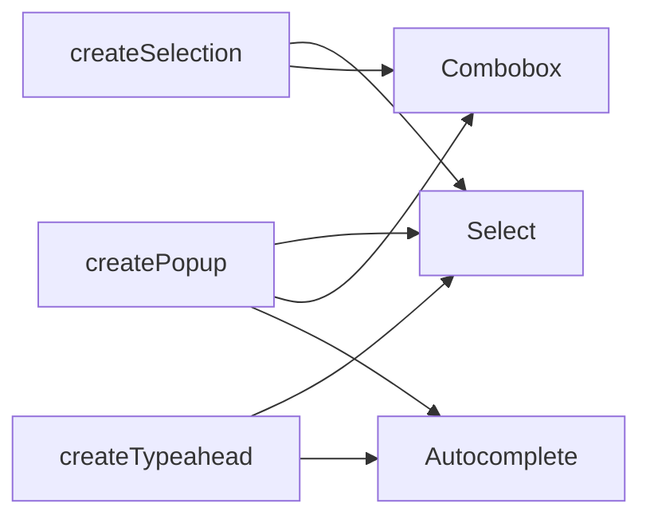

:::tldr
- **UI SDK** ([ui-sdk.dev](https://ui-sdk.dev/)) của Vercel Labs là thư viện **behavior**: các mảnh tương tác như focus, bàn phím, selection, popup, kéo thả cùng ARIA đi kèm, nằm trong `@ui-sdk/core`.
- Thay vì đưa agent một component `Select` làm sẵn, bạn đưa nó các mảnh tạo nên Select (`createPopup`, `createSelection`, `createTypeahead`). Agent ghép chúng thành Select, Combobox, Autocomplete hoặc thứ chưa ai nghĩ ra.
- Có adapter cho **React, Vue, Svelte, Solid và Web Components**, kèm hơn 50 component không style dựng từ chính các behavior đó.
- Agent còn **dùng được** giao diện qua agent bridge (`createAgent`) hoặc **WebMCP**: đọc state, gọi action trực tiếp. Benchmark của Vercel: ít hơn **69% tool call**, nhanh hơn **61%**, rẻ hơn **56%** so với điều khiển qua browser.
- Đang **beta**, giấy phép Apache 2.0.
:::

Đưa cho agent một component `Select`, nó dựng được Select. Hợp lý. Nhưng nếu bạn cần một combobox có tìm kiếm, hay một ô nhập có gợi ý khi gõ `@`, agent lại phải vật lộn với component có sẵn hoặc tự viết lại từ đầu: focus, phím mũi tên, đóng khi bấm ra ngoài, ARIA… Những thứ mà model hay làm sai nhất.

UI SDK đi theo hướng ngược lại. Dưới đây là những gì mình thấy đáng chú ý, lấy từ [trang chủ](https://ui-sdk.dev/), [tài liệu](https://ui-sdk.dev/docs) và [repo GitHub](https://github.com/vercel-labs/ui).

## Behavior là gì

Behavior là **những mảnh làm cho một component hoạt động**, tách khỏi giao diện. Vài ví dụ:

| Behavior | Làm gì |
| --- | --- |
| `createRovingFocus` | Phím mũi tên di chuyển trong danh sách, chỉ một điểm dừng Tab |
| `createTypeahead` | Gõ vài chữ cái để nhảy tới mục tương ứng |
| `createPopup` | Mở cạnh nút bấm, tự định vị để không tràn màn hình, đóng khi cần |
| `createSelection` | Chọn một hoặc nhiều, có Shift và Ctrl như trình quản lý file |
| `createReorder` | Sắp xếp danh sách bằng chuột hoặc bàn phím |
| `createResize` | Đổi kích thước bằng tay cầm |
| `createViewport` | Kéo và zoom canvas |
| `createVirtualizer` | Chỉ render các dòng đang thấy |

Có hơn 50 behavior như vậy. Một `Select` thực chất chỉ là `createPopup` + `createSelection` + `createTypeahead`. Đổi cách ghép một chút là ra combobox, autocomplete hay một component mới hẳn.



## Primitive: nơi behavior gặp state

Behavior được gom lại trong một **primitive** bằng `definePrimitive`: state, API (action) và các **slot** (phần tử DOM) cùng thuộc tính, sự kiện của chúng. Ví dụ một nút tắt tiếng trong docs:

```ts
import { definePrimitive } from "@ui-sdk/core";

const muteButton = definePrimitive({
  name: "mute-button",
  state: () => ({ muted: false }),
  api: (context) => ({
    toggle: () => context.store.set({ muted: !context.store.get().muted }),
  }),
  slots: (slot) => ({
    root: slot({
      attrs: (state) => ({ type: "button", "aria-pressed": String(state.muted) }),
      press: ({ api }) => api.toggle(),
    }),
  }),
});

export { muteButton };
```

Bấm nút thì `muted` đổi, `aria-pressed` đổi theo. Cùng primitive này render được ở cả năm framework qua `createParts`:

```tsx
import { createParts } from "@ui-sdk/react/primitive";
import { muteButton } from "./mute-button";

const parts = createParts(muteButton, { root: "button" });
const MuteButton = parts.Root;
```

Câu Vercel nhấn mạnh: **bạn không cần học cách viết đoạn trên, agent sẽ viết**. Bạn mô tả component cần gì, agent chọn behavior và ghép lại theo framework của bạn.

:::advanced
### Ghép nhiều behavior trong một primitive

Ví dụ ô tìm kiếm trong README: nút Clear chỉ hiện khi có chữ, bấm xong thì focus quay về ô nhập nhờ behavior `createFocusRecovery`.

```ts
import { createFocusRecovery, definePrimitive } from "@ui-sdk/core";

const searchField = definePrimitive({
  name: "search-field",
  state: () => ({ value: "" }),
  api: (context) => ({
    set: (value: string) => context.store.set({ value }),
    recovery: createFocusRecovery({ fallback: () => context.element("input") }),
  }),
  slots: (slot) => ({
    input: slot({
      attrs: (state) => ({ value: state.value }),
      on: { input: (event, { api }) => api.set((event.target as HTMLInputElement).value) },
    }),
    clear: slot({
      present: (state) => state.value !== "",
      attrs: () => ({ type: "button" }),
      press: ({ api }) => api.set(""),
      bind: (el, part) => part.api.recovery.bind(el, part),
    }),
  }),
});
```

- `present` quyết định slot có được render hay không.
- `press` gom cả click lẫn Enter/Space, nên không phải tự xử lý bàn phím.
- `bind` gắn behavior vào phần tử thật sau khi mount.

Mỗi package có kèm tài liệu Markdown đúng phiên bản đã cài (`node_modules/@ui-sdk/react/docs/llms.txt`, `core.md`, `rendering.md`) và một **testing kit** để agent tự kiểm tra bàn phím, focus và ARIA của component vừa làm.
:::

## Bộ component làm sẵn

Nếu không muốn bắt đầu từ con số 0, UI SDK có sẵn hơn 50 component **không style** (headless), tất cả dựng từ cùng bộ behavior: Select, Combobox, Command, Date Picker, Calendar, Color Picker, Token Input, OTP Input, Resizable, Tree, Toolbar, Toast, Drawer, Image Cropper, Waterfall… Bạn tự style bằng CSS của mình.

Mình thích việc các component này không phải hộp đen: khi cần một biến thể khác, agent có thể mở ra, thấy nó ghép từ behavior nào, rồi ghép lại theo kiểu khác.

## Agent không chỉ dựng, mà còn dùng giao diện

Đây là phần mình thấy thú vị nhất. Hiện nay agent dùng web chủ yếu bằng cách đọc DOM, chụp màn hình và bấm vào tọa độ. Chậm, tốn token, dễ sai.

Với UI SDK, bạn tạo một **agent bridge** trước khi trang render:

```ts
import { createAgent } from "@ui-sdk/react/agent";

const agent = createAgent();
```

`agent.snapshot()` trả về danh sách component, state và action của chúng:

```json
{ "ref": "c1", "component": "input", "label": "Project name", "value": "Apollo", "actions": ["setValue", "clear"] }
```

Agent đổi giá trị bằng cách gọi action, không cần bấm hay gõ:

```ts
await agent.act({
  steps: [{ ref: "Project name", action: "setValue", args: ["Atlas"] }],
});
```

Thay đổi đi qua đúng API và change callback của component. App có thể truyền callback `allow` để duyệt hoặc từ chối action; change callback nhận `source: "agent"` nên bạn biết thay đổi đến từ đâu và có thể hủy. Ngoài việc đưa các tool này cho agent riêng, bạn có thể đăng ký chúng với trình duyệt qua **[WebMCP](https://ui-sdk.dev/docs/agents)** để agent tích hợp sẵn trong trình duyệt dùng được component của bạn.

### Benchmark

Vercel cho agent làm một tác vụ trong trang cài đặt dự án: đổi tên, cập nhật thành viên và thông báo, rồi lưu. Một bên dùng browser tool trên trang dựng bằng thư viện khác, một bên dùng agent bridge trên cùng màn hình dựng bằng UI SDK. Cả hai đều dùng Sonnet qua Claude Code, trung vị của ba lần chạy:

| | Browser tools | UI SDK + agent bridge | Chênh lệch |
| --- | --- | --- | --- |
| Tool call | 16 | 5 | **-69%** |
| Lượng chữ phải đọc | 39,8k | 6,8k | **-83%** |
| Thời gian | 41 giây | 16 giây | **-61%** |
| Chi phí | $0,073 | $0,032 | **-56%** |

Mẫu nhỏ và do chính Vercel đo, nên coi là tham khảo. Nhưng hướng đi thì hợp lý: khi component tự mô tả state và action, agent không phải đoán từ pixel.

## Bắt đầu thế nào

Cài core và adapter cho framework của bạn (đổi `react` thành `vue`, `svelte`, `solid` hoặc `web`):

```bash
npm install @ui-sdk/react @ui-sdk/core
npx skills add vercel-labs/ui --skill ui-sdk
```

Bản React cần React 19 trở lên. Docs khuyên thêm một ghi chú vào `AGENTS.md`: trước khi dùng UI SDK thì theo skill `ui-sdk` và đọc `node_modules/@ui-sdk/react/docs/llms.txt`. Sau đó chỉ cần nhờ agent, ví dụ:

```text
Build a search field with ui-sdk: a text input and a Clear button that only shows
when there's text. Clear empties the input and puts focus back in it. Use our existing styles.
```

Muốn hiểu sâu hơn thì đọc [Introduction](https://ui-sdk.dev/docs), guide [Build a Component](https://ui-sdk.dev/docs/guides) và phần [Built for Agents](https://ui-sdk.dev/docs/agents).

## Kết

Mình thấy UI SDK chọn đúng chỗ để đặt ranh giới giữa người và agent. Phần khó và dễ sai nhất của component, tức là focus, bàn phím, ARIA, popup, được gói thành behavior đã kiểm thử. Phần linh hoạt nhất, tức là ghép chúng thành thứ sản phẩm cần, được giao cho agent. Và vì component tự mô tả được mình, agent dùng lại chúng hiệu quả hơn nhiều so với nhìn ảnh chụp màn hình.

Hai điểm cần lưu ý: thư viện đang **beta** nên API còn có thể đổi, và benchmark mới chỉ là một kịch bản. Nhưng nếu bạn đang để agent viết UI, đây là cách đáng thử để nó viết ít code hơn mà đúng hơn.

Bài này đi cùng hướng với [A2UI 1.0](/blog/a2ui-1-0/) (agent trả lời bằng giao diện) và [Modern Web Guidance](/blog/modern-web-guidance/) (dạy agent viết web đúng chuẩn): ba cách khác nhau để agent và giao diện hiểu nhau tốt hơn.
