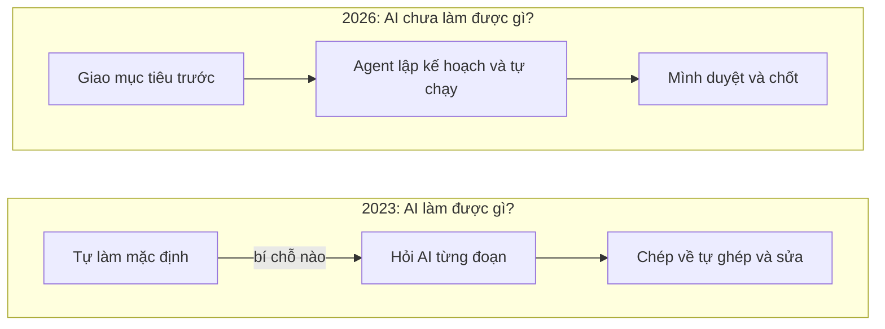
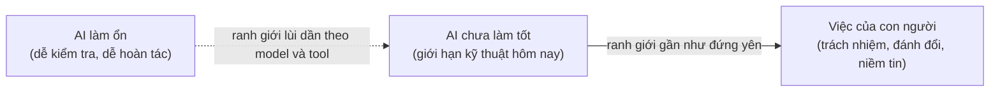

:::tldr
- Năm 2023 mình hỏi "việc này AI làm được không?" và mặc định là tự làm. Cuối 2026, mình hỏi "việc này AI *chưa* làm được gì?" và mặc định là để agent thử trước.
- Mình dùng chữ "chưa" vì nhiều thứ từng bị coi là bất khả thi (đọc cả repo, tự chạy test, gửi pull request hoàn chỉnh) giờ đã thành chuyện hằng ngày.
- Câu trả lời có hai phần. Một phần là giới hạn kỹ thuật, đang hẹp dần qua từng bản model. Phần còn lại là việc phải có người đứng ra: chịu trách nhiệm, chọn đánh đổi, hỏi lại đề bài.
- Cách mình áp dụng: việc nào dễ kiểm tra và hoàn tác được thì giao agent trước, mình giữ phần đọc diff và chốt quyết định.
:::

Năm 2023, mỗi lần mở ô chat AI, mình hay tự hỏi: đoạn này nó viết nổi không, hay mình tự gõ còn nhanh hơn ngồi sửa lại? Hồi đó tự làm là mặc định. AI chỉ là chỗ hỏi ké khi bí một hàm.

Hơn ba năm sau, thói quen đó đổi hẳn. Mình dùng AI gần như mỗi ngày, từ ô chat hồi đầu, tới lúc đưa Claude Code vào quy trình của cả đội, rồi tự viết extension để điều phối agent. Giờ nhận một việc mới, câu đầu tiên mình nghĩ tới là: "Việc này AI *chưa* làm được gì?"

Mặc định đã lật ngược. Mình để agent chạy trước, còn mình lo phần định hướng và kiểm tra lại kết quả.

## Từ 2023 tới 2026, mọi thứ đổi nhanh cỡ nào

Nhìn lại công việc làm web hằng ngày của mình theo từng năm:

- **2023, ô chat bên cạnh.** Chép từng đoạn nhỏ sang trình duyệt để hỏi regex, hỏi lỗi TypeScript, hoặc nhờ viết một hàm tiện ích. Model hay bịa ra hàm không có thật. Phần lớn thời gian mình vẫn tự gõ.
- **2024, AI vào trong editor.** Nó đọc được vài file đang mở và sửa nhiều chỗ một lúc cho một tính năng nhỏ. Nhưng cứ phải chạy lệnh, đọc log build rồi sửa qua nhiều vòng test là nó đứng.
- **2025, agent tự chạy vòng lặp.** Đây là bước nhảy thật. Model được nối với shell và tool, nên tự tìm trong repo, sửa code, chạy typecheck với test, mở trình duyệt xem trang, lỗi thì sửa tiếp. Khi đội mình ghi quy ước vào `AGENTS.md` và dùng Claude Code thành nếp, mình chuyển sang chủ yếu viết mô tả và đọc diff.
- **2026, nhiều agent chạy song song.** Một phiên có thể mở vài git worktree để so các phương án như mình làm trong [KD Code](/blog/why-i-built-kd-code/), hoặc chạy những đợt migration kéo dài hàng giờ như lúc mình thử [Claude Fable 5.2](/blog/claude-fable-5-2/).

| | 2023 ("AI làm được gì?") | 2026 ("AI chưa làm được gì?") |
| --- | --- | --- |
| Mặc định | Tự làm, thỉnh thoảng hỏi gợi ý | Để agent thử trước, trừ việc rủi ro cao |
| Giao việc cỡ nào | Một hàm, một đoạn code | Một tính năng, một bug, một đợt migration |
| Thử có tốn không | Tốn (tự cắt ngữ cảnh, chép qua chép lại) | Rẻ (chạy trong worktree riêng, hỏng thì bỏ) |
| Nghẽn ở đâu | Model yếu, ngữ cảnh hẹp | Yêu cầu chưa rõ, thiếu test, người duyệt không kịp |
| Việc chính của mình | Gõ code | Đặt đề bài và duyệt kết quả |

## Vì sao là "chưa"

Mình ngại nói "AI sẽ *không bao giờ* làm được việc này". Hồi 2023 có nhiều dự đoán rất chắc, kiểu LLM không suy luận được nhiều bước hay không đọc nổi một repo thật. Vài năm sau, mấy dự đoán đó đều trật.

Giờ agent tự chạy lệnh trên repo, mở trình duyệt kiểm tra, nạp thêm kiến thức qua các bộ skill như [Modern Web Guidance](/blog/modern-web-guidance/), rồi trả kết quả thành giao diện tương tác qua [A2UI 1.0](/blog/a2ui-1-0/). Chỗ yếu hôm nay rất có thể được vá ở bản model sau, hoặc nhờ tool tốt hơn.

Nghĩ ngược lại, rằng "AI làm được hết rồi", thì lại gây lỗi thật trên production. Người ta bắt đầu lướt diff cho nhanh, rồi giật mình khi hệ thống gãy ở chỗ tưởng đơn giản.

Nên mình chia câu trả lời làm hai phần. Phần đầu là những chỗ kỹ thuật còn yếu, thay đổi theo từng quý. Phần sau là việc của con người, model mạnh tới đâu cũng vậy.

## Những chỗ AI vẫn hay vấp

### Codebase chạy lâu năm

Dự án mới hay việc khoanh gọn thì agent làm rất nhanh. Đưa nó vào một codebase đã chạy 3–5 năm thì khác. Ở đó có đủ quy ước không ai ghi lại, có cả những đường vòng cố ý làm cho kịp ngày ra mắt. Agent có thể viết một module mới chạy xanh hết test, nhưng thật ra viết lại thứ đã có ở chỗ khác, hoặc thêm một kiểu quản lý state thứ hai bên cạnh cách đội đang dùng.

Kể cả khi có lớp Memory như mình viết trong bài [hạ tầng 5 lớp cho AI agent](/blog/agent-infrastructure-stack/), agent vẫn hay lẫn giữa quy ước còn giữ và đoạn nợ kỹ thuật sắp bỏ.

### Những thứ không nằm trong file

Agent chỉ thấy những gì có trong code, tài liệu hoặc output của tool. Mà nhiều ràng buộc quan trọng lại nằm ngoài repo. Ví dụ một lời hứa giữ tương thích với khách lớn trong cuộc họp tuần trước. Hoặc lý do một API trông kỳ cục nhưng phải để nguyên vì đối tác chưa nâng cấp.

Chừng nào chuyện đó còn nằm trong đầu ai đó, agent không biết là mình đang thiếu. Nó sẽ tự điền vào bằng cách nghe có vẻ hợp lý nhất.

### Việc không có bài test rõ ràng

Chỗ nào có compiler, bộ test hay một con số tự động chấm điểm thì AI tiến rất nhanh. Còn việc cần cảm nhận thì chậm hơn nhiều. Một luồng UX dùng có sướng không, một bài viết có đúng thứ người đọc cần không, máy không chấm được. Agent dễ làm ra thứ nhìn rất chỉn chu, đến khi người thật dùng mới thấy gượng.

### Biết lúc nào nên dừng lại hỏi

Model được huấn luyện để cố trả lời cho xong. Khi yêu cầu có hai điều kiện ngầm đá nhau, hay giả định ban đầu sai so với code thật, agent thường tự chọn một hướng rồi chạy tiếp, ít khi dừng lại hỏi.

Để nó chạy quá lâu mà không đặt giới hạn thì dễ tốn tiền mà không ra gì. Lúc thử [Claude Fable 5.2](/blog/claude-fable-5-2/), mình gặp đúng chuyện này với Opus 5.5 ở effort `max`: ở bài khó, nó nghĩ hết 128.000 token output trong khoảng 19 phút rồi trả về 0 dòng code.

### Thao tác không hoàn tác được

Giả sử agent đúng 95–99% số lần. Với code nằm trên một nhánh git, xem diff rồi bỏ mất hai giây, tỉ lệ đó quá ổn. Nhưng 1–5% còn lại thì không chấp nhận được nếu agent đang chạy lệnh trên database production, sửa quyền IAM hay gửi thông báo cho hàng nghìn người dùng thật.

Agent mà đọc dữ liệu từ bên ngoài (email, trang web, issue của người lạ) thì còn dính thêm prompt injection, tức là có người gài sẵn lệnh trong nội dung để lái model. Nên sandbox và phân quyền chặt vẫn là bắt buộc.

:::advanced
### Vì sao có việc AI tiến nhanh, có việc mãi chưa nhúc nhích

Nhìn lại mấy điểm trên, mình thấy gần như tất cả xoay quanh một chuyện: kiểm tra kết quả nhanh hay chậm, rõ ràng hay cảm tính.

Khi phản hồi nhanh và rõ (typecheck báo lỗi ngay, test chạy vài giây, hoặc trình kiểm tra chứng minh như Lean), cả lúc huấn luyện model lẫn lúc agent tự sửa lỗi đều thuận. Sai là máy báo liền, bước sau sửa tiếp.

Khi phải đợi hàng tháng mới biết đúng sai, chẳng hạn kiến trúc này hai năm nữa còn dễ bảo trì không, thì agent gần như không có tín hiệu gì để tự chỉnh.

Lúc giao việc hằng ngày, mình hay chia theo bảng 2×2 này:

| | Máy kiểm tra được | Khó kiểm tra, cần cảm nhận |
| --- | --- | --- |
| **Dễ hoàn tác (nhánh git)** | Giao hẳn cho agent trong worktree riêng, CI lọc trước rồi mình đọc diff (bug có test, viết test, refactor nhỏ) | Cho agent làm vài bản nháp để có thêm ý, mình chọn rồi tự sửa lại (UX, câu chữ, thử hướng kiến trúc) |
| **Khó hoàn tác (production, tiền, quyền)** | Agent soạn script và chạy thử trên staging hoặc dry-run, người kiểm tra rồi mới chạy thật (migration, hạ tầng, bảo mật) | Người làm từ đầu tới cuối, AI chỉ giúp tra cứu và phản biện (hướng sản phẩm, cam kết với khách) |
:::

## Model mạnh hơn cũng không làm thay được phần này

Giả sử vài thế hệ model tới xử lý gọn hầu hết các lỗi kỹ thuật ở trên. Vẫn có những việc phải do người làm, vì phải có ai đó đứng ra chịu.

### Chịu trách nhiệm khi có sự cố

Cho dù agent viết 90% pull request, khi hệ thống sập lúc 2 giờ sáng thì cũng chẳng ai gọi cho nhà cung cấp model để bắt đền. Người bấm merge và đội làm sản phẩm vẫn là người gánh hậu quả và ngồi sửa.

### Chọn chịu thiệt ở đâu

Làm kỹ thuật hiếm khi chỉ tối ưu một con số. Phần lớn là chọn xem mình chịu thiệt chỗ nào: ra mắt kịp tuần này, hay dọn code cho đỡ nợ kỹ thuật quý sau? Giữ sản phẩm gọn cho số đông, hay chiều một khách lớn?

AI liệt kê phương án và phân tích được mất rất nhanh. Còn chọn cái nào thì người trong cuộc phải tự chốt, vì chính họ sống với hậu quả.

### Hỏi lại đề bài

Agent tối ưu rất tốt bên trong khung bạn đưa cho nó. Nhưng nhiều khi giá trị lớn nhất của một kỹ sư có kinh nghiệm nằm ở trước lúc mở editor, khi họ hỏi: có cần làm việc này không? Đôi khi người ta muốn dựng hẳn một lớp cache phức tạp, trong khi chỉ cần xóa một truy vấn thừa là xong. AI rất hiếm khi tự nói "tính năng này đừng làm".

### Niềm tin giữa người với người

Muốn cả đội đồng ý đổi kiến trúc, hay muốn thương lượng lại phạm vi với một khách hàng đang sốt ruột, bạn cần uy tín của chính mình. Bản tóm tắt AI viết có trơn tru tới đâu cũng không thay được chuyện đó.

## Mình làm việc khác đi thế nào

Từ lúc câu hỏi trong đầu đổi thành "AI chưa làm được gì?", cách làm của mình gọn lại quanh vài thói quen.

Việc nào khoanh được trong một nhánh hay worktree riêng thì mình cứ để agent chạy thử, khỏi ngồi đoán. Xem nó vấp ở đâu trên chính codebase của mình thì đáng tin hơn đọc mười bài tranh luận.

Mình cũng chăm chuẩn bị môi trường cho agent: spec rõ, file `AGENTS.md` ngắn và đúng thực tế, CI chạy nhanh (trang này build và deploy [dưới 30 giây](/blog/fast-ci-under-30-seconds/)), thêm một chỗ đọc diff thoải mái như [KD Code](/blog/why-i-built-kd-code/).

Và mình không bỏ thói quen đọc diff. Test xanh, code gọn gàng rất dễ khiến người ta bấm merge cho nhanh. Đến lúc không còn hiểu thứ mình đẩy lên production, tốc độ của AI sẽ biến thành nợ kỹ thuật cũng nhanh y như vậy.

Còn về nghề: nếu lợi thế của bạn chỉ là nhớ cú pháp hay gõ boilerplate nhanh hơn model một chút, lợi thế đó sẽ hết sớm. Biết đặt đúng đề bài và dám chịu trách nhiệm thì dùng được lâu hơn nhiều.

## Mình đang ở đâu

Giờ mình coi năng lực của model là điểm xuất phát. Việc gì kiểm tra được và hoàn tác được thì giao agent, phần quyết định và trách nhiệm thì mình giữ.

Nếu bạn muốn đọc thêm về cách tổ chức sản phẩm và quy trình quanh tốc độ của agent, xem bài [AI-Native là gì](/blog/what-is-ai-native/). Danh sách "chưa" trong bài này chắc vài tháng nữa sẽ ngắn đi, lúc đó mình sẽ cập nhật.
