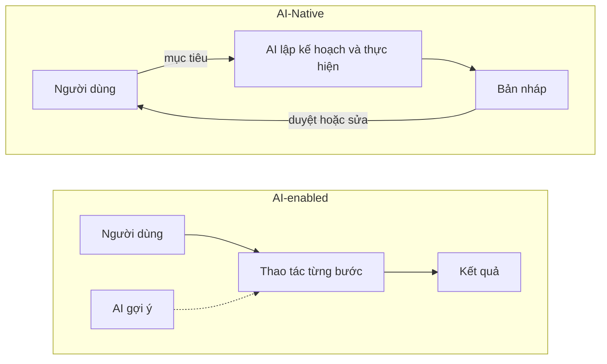
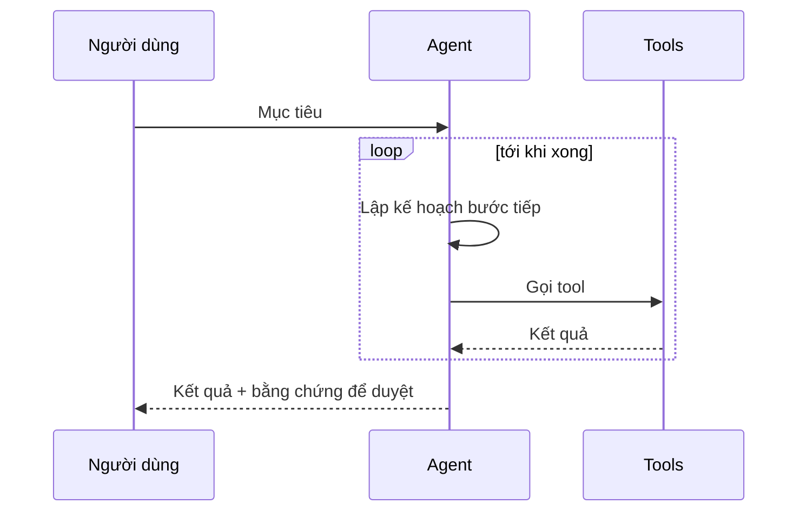

:::tldr
- **AI-Native** là thiết kế quanh AI ngay từ đầu: bỏ AI đi thì con người **vẫn làm được**, nhưng **chậm hơn rất nhiều** vì cả quy trình được xây quanh tốc độ của AI.
- **AI-enabled** là hệ thống cũ được gắn thêm AI: bỏ AI đi thì mọi thứ gần như không đổi, chỉ mất một tính năng tiện lợi.
- Dấu hiệu nhận biết: AI nằm ở **luồng chính** chứ không ở góc màn hình, người dùng **giao mục tiêu** thay vì bấm từng bước, và hệ thống **tốt dần lên** nhờ dữ liệu sử dụng.
- Với lập trình viên, AI-Native là chuyển từ “tự viết từng dòng” sang **mô tả, giao việc và kiểm tra** kết quả của agent.
:::

Dạo này chữ “AI-Native” xuất hiện ở khắp nơi: trong mô tả sản phẩm, tin tuyển dụng, slide gọi vốn. Nhiều chỗ dùng nó như một từ khoá marketing, nên nghĩa thật của nó dễ bị mờ đi.

Cách hiểu đơn giản nhất: **AI-Native là thứ được sinh ra cùng với AI**, giống như “cloud-native” là phần mềm được thiết kế để chạy trên cloud ngay từ đầu, không phải phần mềm cũ được bê lên máy chủ thuê.

## AI-Native và AI-enabled

Cách phân biệt nhanh nhất là tự hỏi: **nếu tắt AI đi thì chuyện gì xảy ra?**

AI-Native không có nghĩa là thiếu AI thì không làm được. Việc nào AI làm thì con người cũng làm được, chỉ là **mất nhiều thời gian và công sức hơn**. Khác biệt nằm ở chỗ: với AI-Native, cả quy trình được thiết kế dựa trên tốc độ của AI, nên tắt AI đi thì thứ mất 5 phút có thể kéo thành nửa ngày. Với AI-enabled, tắt AI đi thì tốc độ gần như không đổi.

| | AI-enabled (gắn thêm AI) | AI-Native |
| --- | --- | --- |
| Vai trò của AI | Một tính năng phụ | Lõi của sản phẩm |
| Tắt AI đi | Gần như không đổi, chỉ mất một tính năng | Người vẫn làm được, nhưng chậm hơn rất nhiều |
| Cách người dùng làm việc | Bấm từng bước, AI gợi ý bên cạnh | Nêu mục tiêu, AI thực hiện, người duyệt |
| Giao diện | Thiết kế cho thao tác tay, thêm ô chat | Thiết kế cho việc giao việc và kiểm tra |
| Dữ liệu | Lưu để báo cáo | Là vòng phản hồi giúp hệ thống tốt lên |

Ví dụ: một trình soạn thảo văn bản có thêm nút “Viết lại bằng AI” là **AI-enabled**. Một công cụ mà bạn chỉ cần nói “soạn hợp đồng thuê nhà theo mẫu của công ty, điền thông tin từ email này”, rồi đọc lại bản nháp, là **AI-Native**.

## Dấu hiệu một sản phẩm thật sự AI-Native

### AI nằm ở luồng chính

Nếu AI chỉ là một biểu tượng lấp lánh ở góc màn hình, đó là tính năng phụ. Ở sản phẩm AI-Native, việc chính mà người dùng đến để làm đi qua AI.

### Người dùng giao mục tiêu, không giao thao tác

Phần mềm truyền thống bắt người dùng biết **cách** làm: menu nào, bấm nút gì, theo thứ tự nào. Sản phẩm AI-Native để người dùng nói **muốn gì**, còn cách làm do hệ thống lo.

### Có chỗ cho con người kiểm tra

AI có thể sai. Một sản phẩm AI-Native tốt không giấu điều đó mà thiết kế sẵn bước duyệt: cho xem diff, nguồn trích dẫn, mức độ chắc chắn, và cho phép hoàn tác dễ dàng.

### Tốt dần lên theo thời gian

Mỗi lần người dùng sửa kết quả là một tín hiệu. Hệ thống AI-Native thu những tín hiệu đó để lần sau làm đúng hơn, thay vì chỉ lưu log cho có.

:::advanced
### Kiến trúc thường thấy bên dưới

Một ứng dụng AI-Native thường có vài lớp lặp đi lặp lại:

- **Model**: LLM hoặc model chuyên biệt, gọi qua API hoặc tự host.
- **Context**: dữ liệu đưa vào prompt đúng lúc, thường qua RAG (tìm tài liệu liên quan rồi đưa vào ngữ cảnh) hoặc qua các kết nối như MCP.
- **Tools**: các hàm mà model được phép gọi để hành động thật: đọc file, gọi API, chạy lệnh.
- **Agent loop**: vòng lặp *lập kế hoạch → gọi tool → đọc kết quả → quyết định bước tiếp*, cho tới khi xong mục tiêu.
- **Evals và guardrails**: bộ kiểm thử đo chất lượng đầu ra, cộng giới hạn về quyền và chi phí.

Điểm khác với phần mềm truyền thống: đầu ra **không xác định** (cùng đầu vào có thể ra kết quả khác nhau). Vì vậy evals đóng vai trò giống unit test, nhưng đo theo tỉ lệ đạt chứ không phải đúng/sai tuyệt đối.
:::

## AI-Native với người làm phần mềm

Chữ này không chỉ dùng cho sản phẩm. Một **lập trình viên** hay một **đội** cũng có thể làm việc theo kiểu AI-Native.

Trước đây, phần lớn thời gian là gõ code. Làm việc kiểu AI-Native thì thời gian dồn vào những việc khác:

- **Mô tả rõ yêu cầu**: viết spec, ràng buộc, ví dụ, vì agent làm tốt tới đâu phụ thuộc vào việc bạn nói rõ tới đâu.
- **Chuẩn bị ngữ cảnh**: tài liệu dự án, quy ước code, file hướng dẫn cho agent (như `AGENTS.md` trong repo này).
- **Giao việc song song**: nhiều agent chạy cùng lúc trên nhiều nhánh, mình chuyển sang vai người điều phối.
- **Review và kiểm chứng**: đọc diff, chạy test, kiểm tra trên trình duyệt. Trách nhiệm cuối cùng vẫn là của người.

Nói cách khác, kỹ năng chuyển từ “viết code nhanh” sang “**ra quyết định đúng và kiểm tra kỹ**”.

## Ví dụ thật: chính trang web này

Trang bạn đang đọc được phát triển và duy trì theo đúng kiểu AI-Native. Mình làm phần định hướng và kiểm tra, còn agent lập trình làm phần lớn việc tay chân:

- **Hướng dẫn cho agent nằm ngay trong repo.** File `AGENTS.md` ghi quy tắc của dự án: code và comment viết bằng tiếng Anh, slug viết tiếng Anh dạng kebab-case, đổi slug thì phải thêm redirect 301. Agent đọc file này trước khi làm, nên mình không phải nhắc lại mỗi lần.
- **Giao việc bằng một câu.** Bài này bắt đầu từ yêu cầu “thêm 1 bài blog giải thích AI-Native là gì”. Agent xem cấu trúc content collection, đọc các bài cũ để theo đúng giọng văn và format, viết bản nháp, dịch sang tiếng Anh rồi chạy build để kiểm tra. Mình đọc lại và góp ý, ví dụ ý “không có AI thì người vẫn làm được, chỉ chậm hơn” trong bài là do mình sửa lại.
- **Song ngữ nhờ agent dịch.** Mỗi bài viết tiếng Việt trước, sau đó một agent dịch sang tiếng Anh, giữ nguyên frontmatter, sơ đồ và các khối nội dung.
- **Chất lượng có máy kiểm tra.** Mỗi lần push, CI build và deploy trong [khoảng 25 giây](/blog/fast-ci-under-30-seconds/), Lighthouse chạy song song để giữ [điểm 100](/blog/perfect-lighthouse-score/). Agent làm nhanh, còn test và CI giữ cho trang không bị hỏng.

Đúng với phép thử ở trên: không có agent, mình vẫn tự làm được tất cả những việc này. Chỉ là một bài viết song ngữ kèm sơ đồ sẽ mất cả buổi thay vì vài chục phút, và mình sẽ khó duy trì trang đều đặn như bây giờ.

## Những hiểu lầm hay gặp

- **“Có chatbot là AI-Native.”** Không. Ô chat gắn vào sản phẩm cũ vẫn là AI-enabled.
- **“AI-Native là không có AI thì không làm được.”** Con người vẫn làm được hết, chỉ là chậm hơn. AI-Native là thiết kế để tận dụng tốc độ đó, không phải thay thế hoàn toàn năng lực của người.
- **“AI-Native là bỏ con người ra.”** Ngược lại, thiết kế tốt luôn chừa chỗ cho người duyệt những quyết định quan trọng.
- **“Cứ dùng model mạnh nhất là đủ.”** Model chỉ là một lớp. Ngữ cảnh, tools, evals và trải nghiệm duyệt mới là phần tạo khác biệt.
- **“Chỉ startup mới AI-Native được.”** Công ty lâu năm vẫn làm được, nhưng phải thiết kế lại quy trình, không chỉ mua thêm công cụ.

## Kết

AI-Native không phải là có bao nhiêu AI trong sản phẩm, mà là **AI quan trọng tới mức nào trong cách sản phẩm hoạt động**. Câu hỏi “tắt AI đi thì chậm đi bao nhiêu?” là phép thử đơn giản và khá chính xác: chậm đi không đáng kể là AI-enabled, chậm đi nhiều lần là AI-Native.

Với mình, khi viết và vận hành trang này, AI-Native nghĩa là: mình quyết định làm gì và kiểm tra kết quả, còn phần lớn việc tay chân để agent làm. Không có agent, mình vẫn tự làm được, chỉ là mất nhiều thời gian hơn.
