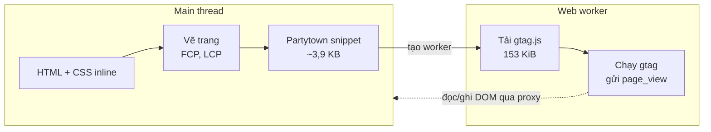

:::tldr
- Mình vừa thêm **Google Analytics 4 (gtag.js)** qua **Partytown**. Trang chủ nặng thêm **154 KiB** (188 → 342 KiB), nhưng điểm Lighthouse mobile **vẫn 100**.
- Điểm Performance **chỉ tính từ 5 chỉ số**: FCP, LCP, TBT, CLS, Speed Index. Tổng dung lượng trang **không nằm trong công thức**.
- gtag.js tải **bất đồng bộ, sau khi nội dung đã hiện**, nên không đụng tới FCP và LCP. Nó không thêm phần tử nào lên trang, nên CLS vẫn 0.
- Bất ngờ: trong thí nghiệm, **gtag chạy trực tiếp không qua Partytown cũng vẫn 100**. Script chỉ chạy khoảng 90 ms trên main thread, chưa đủ tạo long task lớn để kéo TBT.
- Partytown vẫn đáng dùng: **main thread không phải chạy dòng gtag nào**, Lighthouse không còn cảnh báo 71 KiB JavaScript thừa, và người dùng máy yếu bấm vào trang không phải chờ script analytics.
- Điểm 100 trong lab **không chứng minh** analytics vô hại. INP của người dùng thật, CSP và độ chính xác dữ liệu mới là chỗ cần để ý.
:::

Commit gần nhất của trang này thêm GA4. Mình đã chuẩn bị tinh thần nhìn điểm Lighthouse tụt xuống 9x, vì "thêm Google Analytics làm chậm web" gần như là câu ai cũng từng nghe.
Job Lighthouse CI chạy xong: **100/100/100/100**, y như trước. Không đổi một điểm.

Kết quả tốt thì cũng nên hiểu vì sao nó tốt, nếu không lần sau sẽ không biết vì sao nó xấu. Nên mình đo lại cho kỹ.

## Cách mình thêm GA4

Component `Analytics.astro` gắn hai thẻ script với `type="text/partytown"`:

```astro
<script type="text/partytown" src={`https://www.googletagmanager.com/gtag/js?id=${id}`} />
<script type="text/partytown" define:vars={{ id }}>
  window.dataLayer = window.dataLayer || [];
  window.gtag = function () {
    dataLayer.push(arguments);
  };
  gtag("js", new Date());
  gtag("config", id);
</script>
```

Trình duyệt không hiểu kiểu `text/partytown`, nên nó **bỏ qua** hai thẻ này: không tải, không chạy.
[Partytown](https://partytown.qwik.dev/) (qua integration `@astrojs/partytown`) chèn một đoạn script nhỏ khoảng 3,9 KB vào HTML. Đoạn này tạo một **web worker**, rồi worker tự tải `gtag.js` và chạy nó ngoài main thread.



## Thí nghiệm: không GA, GA qua Partytown, GA chạy trực tiếp

Để biết Partytown đóng góp bao nhiêu, mình build ba phiên bản của site và chạy Lighthouse 13.6.0 (mobile, giả lập Slow 4G và CPU chậm 4 lần), mỗi trang 3 lần:

- **Không GA**: build không có `PUBLIC_GA4_ID`.
- **Partytown**: đúng như đang chạy trên production.
- **Trực tiếp**: cùng bản build đó, nhưng đổi `type="text/partytown"` thành `<script async>` thông thường, tức cách nhúng gtag mà Google hướng dẫn.

Kết quả trên trang chủ:

| | Không GA | Partytown | Trực tiếp |
|---|---|---|---|
| Điểm Performance | 100 | 100 | 100 |
| FCP / LCP | 0,75–0,83 s | 0,75 s | 0,75 s |
| Total Blocking Time | 0–14 ms | 0–14 ms | 0–33 ms |
| CLS | 0 | 0 | 0 |
| Tổng dung lượng | 188 KiB | 342 KiB | 342 KiB |
| gtag.js chạy ở | – | worker | main thread |
| Thời gian gtag chiếm main thread | – | 0 ms | 84–91 ms |
| Cảnh báo "Reduce unused JavaScript" | không | không | 71 KiB |

Cả ba đều 100. Partytown không phải lý do duy nhất khiến điểm giữ nguyên. Muốn hiểu vì sao, phải nhìn lại cách Lighthouse tính điểm.

## Lý do 1: điểm chỉ tính từ 5 chỉ số

Như mình đã viết trong [bài về PageSpeed Insights](/blog/pagespeed-insights-explained/), điểm Performance là trung bình có trọng số của **TBT (30%), LCP (25%), CLS (25%), FCP (10%) và Speed Index (10%)**.

Những thứ **không** có trong công thức:

- **Tổng dung lượng trang.** Mục "Avoid enormous network payloads" chỉ là chẩn đoán. Thêm 154 KiB không trừ điểm nào, miễn là nó không làm chậm năm chỉ số trên.
- **Các Insights** như "Reduce unused JavaScript". Bản chạy trực tiếp bị đánh dấu 71 KiB JavaScript không dùng, nhưng điểm vẫn 100.
- **Số request bên thứ ba.** Lighthouse liệt kê chúng, nhưng không phạt theo số lượng.

Vậy câu hỏi đúng không phải "gtag nặng bao nhiêu", mà là "gtag có chen vào **lúc vẽ trang** hoặc **chặn main thread** không".

## Lý do 2: gtag đến sau khi trang đã vẽ xong

Trang này là HTML tĩnh, CSS inline, font preload. Trình duyệt có đủ mọi thứ để vẽ ngay từ response đầu tiên, nên FCP và LCP xảy ra ở khoảng 0,75 s.

gtag.js không nằm trên đường đó:

- Với `async`, trình duyệt tải script song song và **không chặn parse HTML**. Script lại có độ ưu tiên thấp hơn CSS, font và ảnh LCP.
- Với Partytown, script còn đến muộn hơn: request gtag bắt đầu ở khoảng **130–180 ms** trong lần đo, so với **15–40 ms** khi nhúng trực tiếp, vì phải chờ worker khởi động trước.

LCP là phần tử lớn nhất được vẽ. gtag không vẽ gì, nên dù nó tải lúc nào thì LCP cũng không đổi. CLS cũng vậy: GA4 không chèn banner hay iframe nhìn thấy được, nên không có gì xô bố cục.

## Lý do 3: 90 ms chưa đủ thành "blocking time"

TBT không cộng toàn bộ thời gian JavaScript chạy. Nó chỉ cộng **phần vượt quá 50 ms** của mỗi long task nằm giữa FCP và lúc trang ổn định:

```text
task 40 ms  → chặn 0 ms
task 83 ms  → chặn 33 ms
task 200 ms → chặn 150 ms
```

Trong bản chạy trực tiếp, gtag tốn 84–91 ms CPU, nhưng TBT cả trang chỉ 0–33 ms. Phần lớn công việc nằm trong các task ngắn hơn 50 ms, hoặc chỉ vượt ngưỡng một chút. Theo đường cong điểm của Lighthouse trên mobile, TBT dưới vài chục mili giây vẫn được gần như điểm tối đa, và điểm tổng được làm tròn thành 100.

Nói cách khác: **trên một trang gần như không có JavaScript, một script analytics đơn lẻ vẫn còn dư chỗ**. Trang nào đã có sẵn 300 ms JavaScript của framework thì 90 ms đó có thể là giọt nước tràn ly.

:::advanced
### Lighthouse có thấy script trong worker không?

Có thấy request, nhưng không tính CPU. Trong báo cáo, request `gtag/js` ở bản Partytown có `sessionTargetType: "worker"`, vẫn được cộng vào tổng dung lượng 342 KiB.
Còn các audit về JavaScript như `bootup-time`, `unused-javascript` và `third-parties-insight` chỉ phân tích script trên main thread của trang, nên gtag biến mất khỏi đó.

Điều này đúng về mặt kỹ thuật: TBT đo việc **main thread** bị chặn, và worker không chặn main thread. Nhưng cũng nên biết rằng worker vẫn dùng CPU, pin và băng thông của máy người dùng, chỉ là không làm trang kém phản hồi.

Muốn tự kiểm tra, mở file `lhr-*.json` mà Lighthouse CI lưu ra và tìm trong `audits["network-requests"].details.items`.
:::

## Vậy Partytown để làm gì?

Nếu chạy trực tiếp cũng 100, tại sao phải thêm một thư viện, một web worker và nới CSP? Vì điểm lab chỉ là **một lần tải, không ai chạm vào trang**. Người thật thì khác:

- **INP**: người dùng bấm menu hay link đúng lúc gtag đang chạy thì trình duyệt phải chờ task đó xong mới phản hồi. Trên điện thoại yếu, 90 ms trong lab có thể thành vài trăm mili giây. Đưa gtag vào worker là gỡ hẳn nguồn chặn đó.
- **Chuyển trang bằng view transition**: trang này dùng `ClientRouter`, mỗi lần chuyển trang gtag lại gửi `page_view`. Với Partytown, việc đó diễn ra trong worker, không chen vào animation.
- **Biên an toàn**: nếu sau này mình thêm tính năng có JavaScript, ngân sách main thread vẫn còn nguyên cho code của chính trang.

Partytown cũng có giá:

- **CSP phải nới**: worker là URL `blob:`, và Partytown chạy script bằng `new Function`, nên phải thêm `worker-src blob:` và `'unsafe-eval'` vào `script-src`.
- **Khó debug hơn**: lỗi của gtag nằm trong worker, truy cập DOM đi qua proxy, nên đọc console và network tab rối hơn.
- **Không phải script nào cũng chạy được**: script cần đọc DOM đồng bộ liên tục (chat widget, A/B test chỉnh giao diện) thường chạy chậm hoặc lỗi trong worker. Với analytics chỉ gửi sự kiện như GA4 thì ổn.

## Những cách thêm gtag sẽ làm tụt điểm

Điểm giữ 100 là nhờ cách nhúng, không phải nhờ gtag nhẹ. Vài kiểu nhúng sẽ làm khác đi:

1. **Script đồng bộ trong `<head>`** (thiếu `async`): trình duyệt dừng parse HTML để tải 153 KiB từ một domain khác, FCP và LCP lùi ngay.
2. **Google Tag Manager với nhiều tag**: container chứa thêm pixel quảng cáo, heatmap, chat… mỗi thứ một script, cộng dồn lại là long task thật sự.
3. **Banner đồng ý cookie chèn vào đầu trang**: đẩy nội dung xuống, CLS tăng, và nếu banner là phần tử lớn nhất thì LCP đổi theo.
4. **CSP chặn script**: trình duyệt ghi lỗi vào console, và Lighthouse trừ điểm **Best Practices** ở mục "Browser errors were logged to the console".

:::advanced
### Cái bẫy của mục 4 với Lighthouse CI

Lighthouse CI của trang này chạy trên bản build tĩnh trong `dist/`, phục vụ bằng server local của `lhci`. File `public/_headers` chỉ được áp dụng trên Cloudflare Pages, nên **CI không thấy CSP thật**.
Nếu quên thêm `https://www.googletagmanager.com` vào CSP, CI vẫn xanh, còn production thì GA không chạy và console đầy lỗi.

Vì vậy sau khi deploy, mình vẫn mở production với DevTools để chắc rằng request `collect` tới `google-analytics.com` đi qua và console sạch.
Còn trong CI, build dùng Measurement ID giả `G-LHCI000000`: Google vẫn trả về đúng bản `gtag.js` 153 KiB, nên Lighthouse đo đúng trọng lượng thật mà không gửi lượt xem giả vào property thật.
:::

## Kết

Điểm Lighthouse không đổi sau khi thêm gtag là vì ba lý do cộng lại: điểm không tính dung lượng trang, gtag không nằm trên đường vẽ trang, và trên một trang gần như không có JavaScript thì 90 ms của gtag chưa đủ thành blocking time. Partytown đẩy thêm một bước: main thread không phải chạy gtag nữa.

Bài học mình rút ra: **đừng dùng điểm 100 làm bằng chứng một script vô hại**. Hãy xem nó chạy ở đâu, chạy bao lâu, lúc nào, và theo dõi INP của người dùng thật trong vài tuần tới. Nếu bạn muốn biết trang này đạt 100 từ đầu bằng cách nào, mình đã kể trong [bài về điểm Lighthouse tuyệt đối](/blog/perfect-lighthouse-score/).
