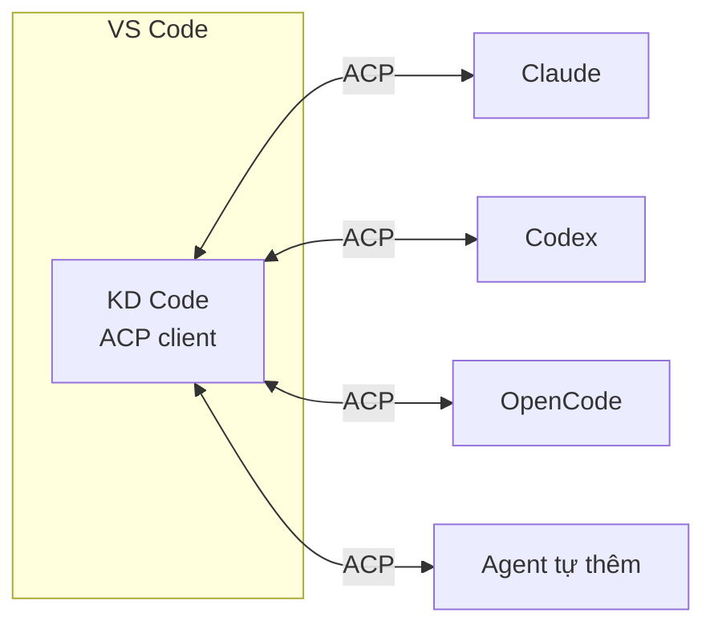
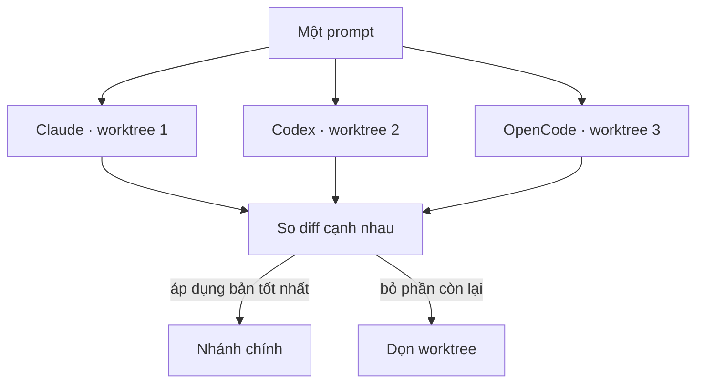
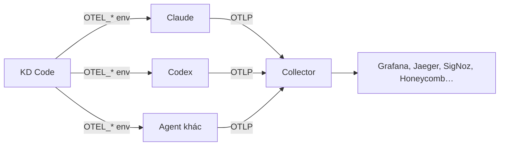

:::tldr
- **ADE** (Agentic Development Environment) là môi trường mà việc chính là **giao việc cho agent và duyệt kết quả**, không phải tự gõ code. Lựa chọn hiện có rất nhiều nhưng gần như cái nào cũng bắt mình **đánh đổi một thứ**: hoặc khoá vào một agent, hoặc phải rời VS Code, hoặc thiếu chỗ chạy song song an toàn.
- [KD Code](https://github.com/kd-labs-io/kd-code-extension) là extension VS Code mã nguồn mở, nói chuyện với agent qua **Agent Client Protocol (ACP)**, nên Claude, Codex, OpenCode… đều dùng chung một giao diện.
- Mỗi cuộc hội thoại có thể chạy trong **git worktree riêng**, và chế độ **Best-of-N** gửi một prompt cho nhiều agent/model cùng lúc rồi so diff để chọn bản tốt nhất.
- Bật cấu hình **OpenTelemetry** là trace, metric và log của mọi agent được gửi về một endpoint OTLP, để theo dõi token, chi phí, độ trễ trên Grafana, Jaeger hay bất kỳ backend nào hỗ trợ OTLP.
- Mình làm nó vì đó là công cụ mình cần mỗi ngày mà chưa thấy ai ghép đủ các mảnh lại với nhau.
:::

Trong bài [AI-Native là gì](/blog/what-is-ai-native/), mình viết rằng làm việc kiểu AI-Native là chuyển từ “tự viết từng dòng” sang **mô tả, giao việc và kiểm tra**. Khi việc chính đổi, công cụ cũng phải đổi theo. Từ đó xuất hiện cả một nhóm sản phẩm gọi là **ADE**: Agentic Development Environment.

Năm 2026, chọn ADE không thiếu lựa chọn. Thừa thì đúng hơn. Vậy mà mình vẫn ngồi viết thêm một cái nữa. Bài này giải thích vì sao.

## Bức tranh các lựa chọn

Mình chia các ADE hiện có thành vài nhóm, mỗi nhóm mạnh ở một chỗ và bắt mình nhường ở một chỗ khác:

| Nhóm | Ví dụ | Mạnh ở | Phải đánh đổi |
| --- | --- | --- | --- |
| Editor fork từ VS Code | Cursor, Kiro | Trải nghiệm AI liền mạch, tối ưu sâu | Rời VS Code gốc, phụ thuộc agent và gói giá của hãng |
| Extension của từng agent | Claude Code, Codex, Copilot | Bám sát tính năng mới nhất của agent đó | Mỗi agent một giao diện, một cách duyệt diff, một lịch sử chat |
| Editor hỗ trợ ACP sẵn | Zed, JetBrains | Chuẩn mở, đổi agent dễ | Phải đổi sang editor khác |
| App điều phối agent riêng | Các app chạy nhiều agent song song trên worktree | Chạy song song tốt | Thêm một cửa sổ nữa ngoài editor, thường chỉ hỗ trợ vài agent |
| Agent trong terminal | CLI của các agent | Linh hoạt, script được | Duyệt diff và quản lý nhiều phiên khá vất vả |

Không nhóm nào sai. Nhưng cách mình làm việc lại cần **cùng lúc** mấy thứ mà mỗi nhóm chỉ có một phần.

## Mình cần gì

### Không bị khoá vào một agent

Agent nào tốt nhất thay đổi theo tháng, có khi theo tuần. Hôm nay Claude viết refactor gọn hơn, tuần sau Codex sửa bug nhanh hơn, rồi một model mới ra lại đáng thử. Nếu mỗi lần đổi agent là đổi luôn giao diện, phím tắt, cách duyệt diff và chỗ lưu lịch sử, thì chi phí chuyển đổi đủ lớn để mình… lười đổi.

Mình muốn **giao diện là của mình**, còn agent là thứ cắm vào được.

### Không rời VS Code

VS Code là nơi mình đã có sẵn mọi thứ: extension, phím tắt, cấu hình, debugger, Source Control. Dùng một editor fork nghĩa là chấp nhận chậm hơn bản gốc ở các bản cập nhật, và chấp nhận rủi ro một số extension không chạy giống hệt. Đổi sang editor khác thì mất cả bộ đồ nghề.

### Chạy song song mà không giẫm chân nhau

Khi đã quen giao việc cho agent, mình muốn giao **nhiều việc cùng lúc**: một agent sửa bug, một agent viết test, một agent thử hướng refactor khác. Nếu tất cả cùng sửa trên một thư mục làm việc, chúng sẽ ghi đè lên nhau và lên cả code mình đang viết dở.

### So sánh, không phải tin ngay

Agent có thể sai, và hai agent khác nhau thường sai theo hai kiểu khác nhau. Với việc quan trọng, mình muốn đưa **cùng một prompt** cho vài agent hoặc vài model, rồi nhìn các diff cạnh nhau và chọn bản tốt nhất. Làm tay việc này (mở nhiều terminal, tạo nhánh, so diff, dọn nhánh) đủ phiền để mình bỏ qua.

## KD Code ghép các mảnh đó lại thế nào

### ACP: một giao diện, nhiều agent

[Agent Client Protocol](https://agentclientprotocol.com) là chuẩn mở để editor nói chuyện với coding agent, giống như LSP đã làm cho language server. Agent nào hỗ trợ ACP thì editor nào hỗ trợ ACP cũng dùng được.

KD Code là một **ACP client chạy trong VS Code**. Mình cài Claude, Codex, OpenCode và các agent khác từ ACP Registry bằng một cú bấm, rồi dùng chung một khung chat, một cách duyệt thay đổi, một lịch sử hội thoại. Đổi agent chỉ là chọn trong danh sách.



### Mỗi cuộc hội thoại một worktree

Một tab chat có thể chạy trong **git worktree riêng**, trên nhánh đặt tên theo prompt đầu tiên. Agent sửa thoải mái mà không đụng vào thư mục mình đang làm. Worktree mới được chép sẵn những file bị ignore như `.env`, `node_modules`, và có thể chạy lệnh setup của dự án (sau khi mình cho phép).

Xong việc, mình bấm một nút để **merge**, **tạo pull request** (agent soạn sẵn mô tả, qua GitHub CLI) hoặc **chép thay đổi thành staged changes**. Worktree không dùng nữa thì dọn một lần.

### Best-of-N: gửi một lần, chọn bản tốt nhất

Bật ô **Compare**, chọn vài agent, model, mức effort, rồi gửi một prompt. Mỗi lựa chọn làm trong worktree riêng, gom dưới một tab nhóm. Mình xem diff của từng bản cạnh nhau, áp dụng bản tốt nhất và bỏ phần còn lại.



Đây là phần mình dùng nhiều nhất. Nó biến câu hỏi “agent nào tốt hơn?” từ cảm tính thành thứ nhìn thấy được trên chính codebase của mình.

### Duyệt thay đổi là luồng chính

Đúng tinh thần AI-Native: nếu agent làm phần lớn việc tay chân, thì **duyệt** phải dễ. KD Code cho Keep/Undo theo từng file hoặc từng thay đổi ngay trong chat lẫn trong editor, khôi phục về checkpoint trước một tin nhắn bất kỳ, và có thể mở theo những file agent đang đọc, đang sửa.

### OpenTelemetry: trace mọi agent ở một chỗ

Giao việc cho agent thì phải biết agent đã làm gì: gọi tool nào, tốn bao nhiêu token, bước nào chậm, vì sao một phiên tự dưng đắt gấp đôi. KD Code có sẵn chế độ **Tracing** để xem token, chi phí, context và thời gian của từng lượt ngay trong chat. Nhưng khi chạy nhiều agent song song mỗi ngày, mình muốn dữ liệu đó nằm ở một hệ thống quan sát thật, lưu lâu dài và truy vấn được.

Vì vậy KD Code có cấu hình **OpenTelemetry**: bật lên là các agent được khởi động với những biến `OTEL_*` chuẩn, trỏ trace, metric và log của chúng tới một endpoint **OTLP** do mình chọn.

```jsonc
// settings.json (User), cấu hình ở phạm vi máy
"kdCode.telemetry": {
  "enabled": true,
  "endpoint": "http://localhost:4318", // 4318 cho HTTP, 4317 cho gRPC
  "protocol": "http/protobuf",          // hoặc "http/json", "grpc"
  "logPrompts": false,                  // gửi kèm prompt và câu trả lời
  "logToolDetails": false               // gửi kèm input của tool: lệnh, đường dẫn file
}
```

Cách nhanh nhất để thử là chạy một collector kèm sẵn Grafana trên máy:

```bash
docker run --rm -p 3000:3000 -p 4317:4317 -p 4318:4318 grafana/otel-lgtm
```

Sau đó vào trang Settings của KD Code, bật OpenTelemetry, bấm **Check connection** để gửi thử một lô rỗng tới endpoint, rồi mở tab chat mới (hoặc khởi động lại agent) để cấu hình có hiệu lực.



Lợi ích của việc dùng OpenTelemetry thay vì một dashboard riêng:

- **Chuẩn mở, không khoá vào nhà cung cấp.** Cùng tinh thần với ACP: OTLP được hầu hết các hệ thống quan sát hỗ trợ, nên mình đổi backend từ Grafana sang Honeycomb hay SigNoz chỉ bằng cách đổi endpoint, không phải sửa gì ở agent.
- **Một chỗ cho mọi agent.** Mỗi agent được gắn resource attribute `kd.agent.id`, nên trên cùng một dashboard mình lọc và so sánh được Claude với Codex: token, chi phí, độ trễ, tỉ lệ lỗi của tool. Rất hợp để kiểm chứng kết quả Best-of-N bằng số liệu thay vì cảm giác.
- **Dữ liệu là của mình.** Collector có thể chạy ngay trên máy hoặc trong hạ tầng của đội, không cần gửi qua dịch vụ bên thứ ba.
- **Ghép được với phần còn lại của hệ thống.** Nếu đội đã có OpenTelemetry cho backend, trace của agent nằm chung chỗ với trace của ứng dụng, dùng chung cảnh báo và cách truy vấn quen thuộc.
- **Debug dễ hơn.** Khi một phiên chạy lâu bất thường hay tốn token bất thường, mình mở trace ra xem từng bước thay vì đoán.
- **Cấu hình một lần.** Không phải đi bật telemetry trong từng agent. KD Code đặt biến môi trường lúc khởi động agent, riêng Claude Code còn được bật thêm `CLAUDE_CODE_ENABLE_TELEMETRY`. Agent nào chưa hỗ trợ OpenTelemetry thì chỉ đơn giản bỏ qua các biến này.

Vài điều cần lưu ý:

- **Header** như API key của backend được nhập trên trang Settings và lưu trong **secret storage của VS Code**, không nằm trong `settings.json`.
- `kdCode.telemetry` chỉ đặt được ở **phạm vi máy**, nên một repo lạ không thể tự trỏ telemetry của bạn tới server của nó.
- Telemetry có thể chứa email và ID tài khoản, đường dẫn file, và nếu bật `logPrompts` hay `logToolDetails` thì có cả prompt và lệnh agent chạy. Hai tuỳ chọn này mặc định tắt; khi tắt, agent nào hỗ trợ sẽ che nội dung đó đi. Chỉ gửi tới endpoint bạn tin tưởng.

:::advanced
### Bảo mật khi để agent chạy lệnh

Một extension cho agent chạy lệnh trên máy là thứ dễ bị lợi dụng nếu mở một repo lạ. Vài quyết định thiết kế của KD Code để giảm rủi ro đó:

- **Cấu hình quyết định thứ gì được chạy** (agent tự thêm, MCP server, biến môi trường, đường dẫn Node và ccusage) chỉ đặt được ở **phạm vi máy**, workspace không ghi đè được. Một repo độc hại không thể tự khai báo agent hay MCP server của nó.
- **Lệnh setup worktree của dự án** phải được hỏi trước, và hỏi lại khi lệnh hoặc file nó nhắc tới thay đổi.
- **Link từ agent** chỉ mở sau khi hỏi, và chỉ qua https hoặc http tới localhost và các host mình liệt kê.
- **Mục trong registry có đường dẫn không an toàn** bị từ chối khi cài.

README cũng nói thẳng: permission rule chỉ để đỡ phải bấm, **không phải ranh giới bảo mật**, và worktree **không phải sandbox**. Agent tự mô tả tool của nó, nên đừng coi rule là lớp bảo vệ.
:::

## Vì sao không chờ ai đó làm

Câu hỏi hợp lý: các hãng lớn sớm muộn cũng sẽ làm, sao không chờ?

- **Động lực của hãng khác động lực của mình.** Một hãng làm agent muốn mình dùng agent của họ. Một hãng làm editor muốn mình ở lại editor của họ. Một công cụ trung lập giữa các agent, chạy trong VS Code gốc, không phải ưu tiên của ai cả.
- **ACP đã đủ chín.** Trước đây muốn hỗ trợ nhiều agent phải viết adapter cho từng cái. Có chuẩn chung và registry rồi, một người cũng làm được client đầy đủ.
- **Chính mình là người dùng.** Mình dùng KD Code hằng ngày để làm các dự án khác, kể cả trang này. Mỗi chỗ vướng là một mục trong backlog, nên công cụ được mài theo nhu cầu thật chứ không theo slide.
- **Mã nguồn mở.** Giấy phép MIT, ai cũng đọc được code, biết extension làm gì trên máy mình, và có thể sửa hoặc fork nếu muốn.

## Những gì KD Code không cố làm

Để rõ ràng hơn:

- **Không làm agent.** KD Code không có model riêng, không thay Claude hay Codex. Nó chỉ là chỗ để dùng chúng tốt hơn.
- **Không fork VS Code.** Nó là một extension bình thường, cài từ Marketplace hoặc Open VSX.
- **Không thay thế việc review.** Best-of-N giúp chọn bản tốt hơn, nhưng đọc diff và chạy test vẫn là việc của người.

## Kết

Giữa rất nhiều ADE, mình không cần thêm một agent mới hay một editor mới. Mình cần một chỗ trong VS Code để **dùng agent nào cũng được, chạy nhiều agent song song mà không giẫm chân nhau, và so kết quả trước khi chọn**. Chưa thấy ai ghép đủ những mảnh đó, nên mình tự làm.

Nếu bạn cũng làm việc theo kiểu đó, hãy thử [KD Code trên VS Code Marketplace](https://marketplace.visualstudio.com/items?itemName=kd-labs.kd-code) hoặc xem [mã nguồn trên GitHub](https://github.com/kd-labs-io/kd-code-extension). Issue và góp ý luôn được chào đón.
