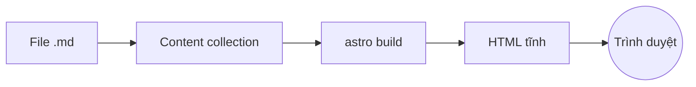
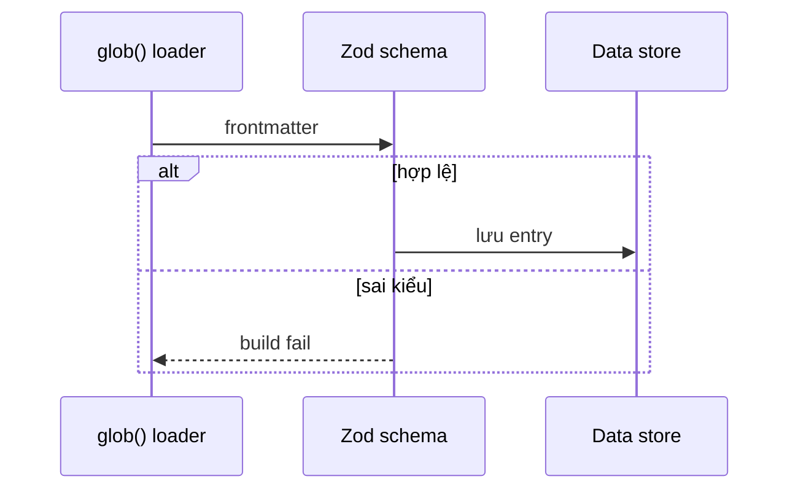

:::tldr
- Trang cá nhân chủ yếu là nội dung tĩnh, nên Astro gửi **0 KB JavaScript** mặc định.
- Markdown + content collections giúp viết bài nhanh, có kiểm tra frontmatter.
- Cần tương tác thì thêm "island" đúng chỗ, không phải kéo cả React vào mọi trang.
:::

Khi làm lại trang cá nhân, mình đặt ra ba tiêu chí: tải nhanh, viết bài dễ, và không phải bảo trì nhiều.
Next.js là lựa chọn quen tay, nhưng với một trang gần như toàn nội dung tĩnh thì nó hơi thừa.

## Nội dung là trung tâm

Astro render mọi thứ ra HTML lúc build. Trình duyệt nhận trang đã hoàn chỉnh, không cần chờ hydrate.
Với blog, mình chỉ cần thả file Markdown vào `src/content/blog/` là có bài mới.



:::advanced
### Content collections hoạt động thế nào

Loader `glob()` quét file lúc build, parse frontmatter và validate bằng schema Zod:

```ts
const blog = defineCollection({
  loader: glob({ pattern: "{vi,en}/**/*.md", base: "./src/content/blog" }),
  schema: z.object({ title: z.string(), pubDate: z.coerce.date() }),
});
```

Sai kiểu dữ liệu (ví dụ `pubDate: hôm qua`) sẽ làm build fail ngay, thay vì lỗi âm thầm trên production.
Kết quả được cache trong `.astro/data-store.json`, nên lần build sau chỉ xử lý file thay đổi.


:::

## Tương tác khi thật sự cần

Nút chuyển chế độ đọc phía trên là một đoạn script nhỏ, chạy riêng cho trang này.
Phần còn lại của trang vẫn là HTML thuần.

:::advanced
### Islands và directive `client:*`

Một component framework chỉ được hydrate khi có directive như `client:visible` hay `client:idle`.
Không có directive, nó được render thành HTML tĩnh và JS của nó không bao giờ tới trình duyệt.
Nhờ vậy chi phí JavaScript tỷ lệ với số chỗ tương tác, không tỷ lệ với kích thước trang.
:::

## Kết

Với trang cá nhân, Astro cho mình đúng thứ cần: nhanh mặc định, viết bằng Markdown, và chỉ thêm độ phức tạp khi có lý do.
