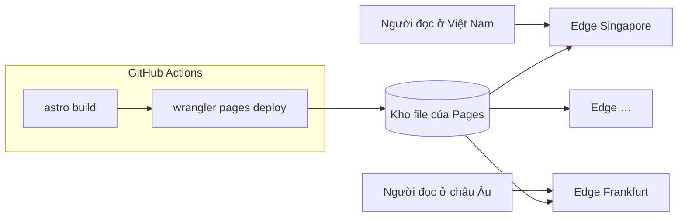

:::tldr
- Hosting, CDN, SSL, DNS, CI/CD và analytics của trang này đều **0đ**. Khoản duy nhất phải trả là **tên miền**, gia hạn theo năm.
- Trang là **HTML tĩnh**: không có server chạy code, không có database. Mỗi request chỉ là việc đọc một file đã build sẵn.
- **Cloudflare Pages** đưa các file đó lên mạng lưới của Cloudflare và phục vụ từ điểm gần người đọc nhất. Theo tài liệu của Cloudflare, **request tới file tĩnh miễn phí và không giới hạn**, băng thông cũng không tính tiền.
- Trang chủ nén Brotli chỉ khoảng **20 KB HTML**. Một triệu lượt xem trang chủ là khoảng 180 GiB băng thông, và mình không trả đồng nào cho số đó.
- Build chạy trên **GitHub Actions** (miễn phí cho repo public), rồi Wrangler tải `dist/` lên Pages.
- Mức 0đ chỉ giữ được khi **không có code chạy theo từng request**. Thêm SSR, Pages Functions hay API là bắt đầu đụng quota của Workers.
:::

"Trang này hosting ở đâu, tháng bao nhiêu tiền?" Câu trả lời ngắn: Cloudflare Pages, 0đ.
Câu hỏi tiếp theo thường là: "Miễn phí thì có chịu nổi lượng truy cập lớn không?" Câu trả lời cũng ngắn: chịu được, và lý do nằm ở chỗ **trang này gần như không bắt máy chủ nào phải làm việc**.

## Hoá đơn hằng tháng

| Thành phần | Dịch vụ | Chi phí |
|---|---|---|
| Hosting + CDN | Cloudflare Pages (gói Free) | 0đ |
| DNS, SSL, chống DDoS | Cloudflare (gói Free) | 0đ |
| Build và deploy | GitHub Actions, repo public | 0đ |
| Analytics | Cloudflare Web Analytics + Google Analytics 4 | 0đ |
| Mã nguồn | GitHub | 0đ |
| Tên miền `buikhuongduy.com` | Nhà đăng ký tên miền | trả theo năm |

Nói "0đ" là nói về phần vận hành. Tên miền thì không ai cho không, nhưng đó là chi phí cố định, không tăng theo lượng truy cập.

## Lý do 1: không có gì chạy khi có người truy cập

Một trang WordPress hay một app Next.js chạy SSR làm khá nhiều việc cho mỗi request: khởi động runtime, chạy code, truy vấn database, render HTML rồi mới trả về. Lượng truy cập tăng gấp 10 thì CPU, RAM và số kết nối database cũng phải tăng theo. Đó là lý do hosting động có giá, và là lý do nó sập khi bị dồn tải.

Trang này được dựng bằng [Astro](/blog/why-i-chose-astro/) ở chế độ tĩnh. Mọi trang được render **một lần, lúc build**, thành file HTML trong `dist/`:

```text
dist/
├── index.html
├── about/index.html
├── blog/why-i-chose-astro/index.html
├── _astro/…            # ảnh, font, JS đã gắn hash
└── …                    # khoảng 130 file, chưa tới 20 MB
```

Khi bạn mở trang, không có code nào chạy để tạo ra nó. Máy chủ chỉ tìm đúng file và gửi đi. Đây là việc rẻ nhất mà một máy chủ web có thể làm, và nó gần như không đổi dù là request thứ một hay thứ một triệu.

## Lý do 2: file nằm ở edge, không nằm ở một máy chủ

Khi `wrangler pages deploy dist` chạy xong, các file không được đặt trên một VPS ở một nơi nào đó. Cloudflare Pages tải chúng lên mạng lưới toàn cầu của Cloudflare và phục vụ từ trung tâm dữ liệu gần người đọc nhất.



Bạn có thể tự kiểm tra bằng `curl`:

```bash
curl -sI https://buikhuongduy.com/ | grep -iE "server|cf-ray|content-encoding"
```

```text
server: cloudflare
cf-ray: a58652d9ff48ce24-SIN
```

Đuôi `SIN` trong `cf-ray` nghĩa là request được trả lời từ Singapore, trung tâm dữ liệu gần mình nhất lúc đo. Người đọc ở nơi khác sẽ thấy mã khác.

Hệ quả là không có "máy chủ gốc" để bị quá tải. Lượng truy cập được chia ra hàng trăm điểm, và mỗi điểm vốn được xây để phục vụ lưu lượng của hàng triệu website khác cùng lúc. Lượng truy cập của một trang cá nhân, kể cả khi lên top Hacker News, chỉ là một phần rất nhỏ trong đó.

:::advanced
### `cf-cache-status: DYNAMIC` có nghĩa là không được cache?

Header của trang HTML trả về `cf-cache-status: DYNAMIC`, dễ làm người ta nghĩ mỗi request đều chạy về một máy chủ nào đó. Không phải vậy.
`cf-cache-status` mô tả **cache của zone** (lớp CDN thông thường của Cloudflare). Pages không đi qua lớp đó: file được phục vụ thẳng từ hạ tầng lưu trữ asset của Pages, vốn đã nằm trên mạng lưới edge. Không có origin nào phía sau để "miss".

Với file trong `_astro/`, header là `cache-control: public, max-age=14400, must-revalidate`, mặc định của Pages. Trình duyệt giữ file 4 giờ, sau đó hỏi lại bằng `ETag` và thường chỉ nhận `304` rỗng. Vì tên file đã có hash, lẽ ra có thể khai báo `immutable` với thời hạn một năm trong `_headers` để bỏ luôn bước hỏi lại. Đây là việc mình còn để dành.
:::

## Lý do 3: request tới file tĩnh không tính tiền

Đây là chỗ mô hình giá quyết định tất cả. Theo [tài liệu của Cloudflare](https://developers.cloudflare.com/workers/static-assets/billing-and-limitations/), **request tới static assets là miễn phí và không giới hạn**, và lưu trữ asset cũng không tốn thêm. Cloudflare Pages ở gói Free không giới hạn băng thông.

Cloudflare chỉ tính tiền khi **code của bạn chạy**: Pages Functions hay Workers. Trang này không có thư mục `functions/`, không có SSR, nên không request nào chạm tới quota đó.

Thử làm phép tính băng thông:

- HTML trang chủ chưa nén khoảng 111 KB vì CSS được inline, **nén Brotli còn khoảng 20 KB**.
- Lần tải đầu tiên của trang chủ, gồm font, ảnh, script, là khoảng **188 KiB** theo Lighthouse (chưa tính gtag.js, vốn tải từ máy chủ của Google).
- Một triệu lượt xem lần đầu: 188 KiB × 1.000.000 ≈ **180 GiB**.

Trên một VPS hay cloud tính tiền theo lưu lượng ra, 180 GiB là một con số phải nhìn vào hoá đơn. Trên Pages, nó không xuất hiện trên hoá đơn nào. Và con số thật còn nhỏ hơn, vì người đọc quay lại đã có font và ảnh trong cache trình duyệt.

Trang nhẹ không chỉ để đạt [điểm Lighthouse 100](/blog/perfect-lighthouse-score/). Nó còn là thứ làm cho bài toán băng thông trở nên vô hại.

## Lý do 4: CI cũng miễn phí, và không dùng quota build của Pages

Pages có hệ thống build riêng, gói Free giới hạn 500 build mỗi tháng và một build tại một thời điểm. Mình không dùng nó.
Toàn bộ build chạy trên GitHub Actions, rồi Wrangler tải thư mục `dist/` lên theo kiểu direct upload. Repo này public, nên phút chạy trên runner chuẩn của GitHub Actions là miễn phí. Chi tiết workflow mình đã viết trong [bài CI dưới 30 giây](/blog/fast-ci-under-30-seconds/).

Một lợi ích nhỏ nhưng đáng kể: mỗi pull request có một **preview deployment** riêng trên `*.pages.dev`, và Pages không giới hạn số preview đang hoạt động.

## Các giới hạn thật sự của gói Free

"Miễn phí" không có nghĩa là không có giới hạn. Đây là những giới hạn của [Cloudflare Pages gói Free](https://developers.cloudflare.com/pages/platform/limits/) và trang này đang ở đâu:

| Giới hạn | Gói Free | Trang này |
|---|---|---|
| Số file mỗi site | 20.000 | khoảng 130 |
| Dung lượng mỗi file | 25 MiB | file lớn nhất là ảnh OG khoảng 500 KB |
| Quy tắc trong `_headers` | 100 | 1 |
| Redirect trong `_redirects` | 2.000 tĩnh + 100 động | 4 |
| Build mỗi tháng (build của Pages) | 500 | 0, build chạy trên GitHub Actions |

Không giới hạn nào trong số đó liên quan đến lượng truy cập. Chúng giới hạn **kích thước site**, không giới hạn **số người đọc**. Với một blog, mình phải viết hàng nghìn bài mới chạm tới mức 20.000 file.

## "Chịu được hàng triệu request" nghĩa là gì, và không nghĩa là gì

Mình không chạy load test lên production. Bắn hàng triệu request vào hạ tầng dùng chung chỉ để lấy một con số khoe thì không đáng, và cũng không công bằng với Cloudflare.
Lập luận ở đây đến từ kiến trúc: không có máy chủ của riêng mình để quá tải, không có database để cạn kết nối, và mô hình giá không tính tiền theo request tĩnh. Những thứ đó không thay đổi giữa một nghìn và một triệu request.

Nhưng cũng có những thứ kiến trúc này không giải quyết:

- **Bot vẫn là bot.** Cloudflare có chống DDoS ở gói Free, nhưng crawler và bot vẫn có thể làm nhiễu số liệu analytics.
- **Dịch vụ bên thứ ba có giới hạn riêng.** gtag.js do Google phục vụ, sự kiện GA4 gửi tới Google. Nếu Google chậm, phần analytics chậm theo, nhưng nội dung trang thì không, vì gtag [chạy trong worker và đến sau khi trang đã vẽ](/blog/why-gtag-did-not-lower-lighthouse-score/).
- **"Miễn phí" là chính sách, không phải định luật.** Cloudflare có thể đổi bảng giá. Rủi ro này thấp vì trang chỉ là một thư mục HTML: nếu cần, mình chuyển sang bất kỳ static host nào trong một buổi chiều.

## Những thứ sẽ làm mất mức 0đ

Mức 0đ không đến từ việc Cloudflare hào phóng. Nó đến từ việc trang **không yêu cầu máy chủ làm gì cho từng request**. Thêm một trong những thứ sau là bắt đầu có code chạy theo request, và có quota phải theo dõi:

1. **SSR hoặc Pages Functions**: mỗi request vào route đó được tính như một request Workers. Gói Free có hạn mức theo ngày, vượt là request bị từ chối thay vì trả trang.
2. **Form liên hệ tự xử lý**: cần một endpoint để nhận dữ liệu, rồi gửi email hoặc lưu vào đâu đó.
3. **Tìm kiếm phía server, bình luận, đếm lượt xem**: đều cần database hoặc API, và database thì hiếm khi miễn phí vô hạn.
4. **Resize ảnh theo yêu cầu**: dịch vụ tối ưu ảnh ở edge thường tính tiền theo số lần biến đổi. Trang này tối ưu ảnh **lúc build**, nên ảnh đã là AVIF/WebP đúng kích thước từ trước khi deploy.
5. **Video tự host**: file lớn hơn 25 MiB không lên được Pages, phải chuyển sang R2 hoặc dịch vụ video.

Không phải là đừng bao giờ thêm những thứ này. Nhưng mỗi lần thêm, câu hỏi nên là: **có làm được lúc build không?** Nếu được, nó vẫn là file tĩnh và vẫn 0đ.

## Kết

Trang này chịu được lượng truy cập lớn mà không tốn tiền không phải nhờ một mẹo nào, mà nhờ ba quyết định cộng lại: render mọi thứ lúc build, đặt file trên một mạng lưới edge, và chọn một nền tảng không tính tiền cho việc phục vụ file tĩnh. Khi mỗi request chỉ là việc đọc một file nhỏ đã nén sẵn, thì một triệu request cũng chỉ là một triệu lần đọc file.

Bài học mình mang theo vào các dự án lớn hơn: **thứ rẻ nhất để vận hành là thứ không cần chạy**. Phần nào tính trước được lúc build thì nên tính trước, và chỉ để máy chủ làm những việc thật sự phụ thuộc vào từng người dùng.

Nếu đội của bạn đang muốn giảm chi phí hạ tầng hoặc đưa một phần sản phẩm về dạng tĩnh: **mình đang sẵn sàng cho cơ hội mới**. [Liên hệ với mình](/contact/), mình rất vui được trao đổi.
